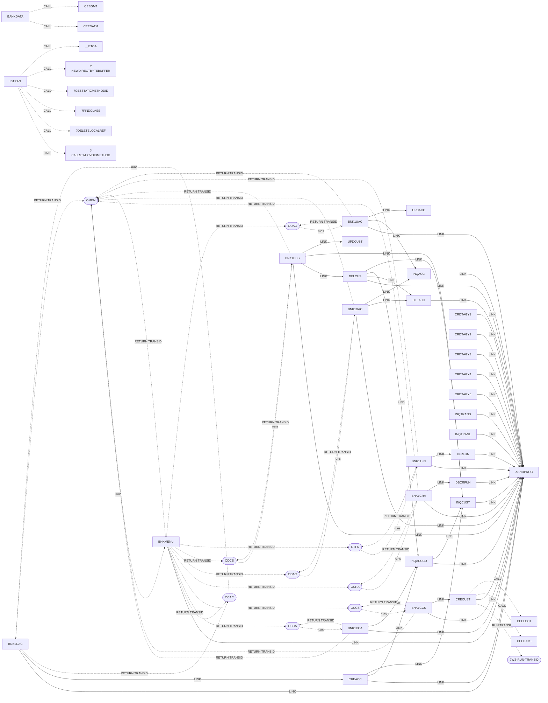

# Program call graph [scan]

> Generated — do not edit. `LINK` / `XCTL` / `CALL` between programs and `RETURN` / `START` / `RUN TRANSID` hand-offs to CICS transactions. Which program a transaction runs is not in the COBOL source: it is taken from the CICS resource definitions in `.setup/zconfig/*.yaml` (dotted `runs` arrows). Targets held in variables are resolved from `VALUE` clauses and `MOVE 'literal'` statements in the same program; anything starting with `?` could not be resolved.

Rounded nodes are CICS transaction IDs, not programs.

## CICS transaction definitions [config]

From the CICS resource definitions checked into this repo — configuration, not COBOL. A transaction ID built at runtime (`?` target) is **not** linked here: which IDs it can take is an inference from the code that builds it and has to be verified.

| Transaction | Program | Referenced by (literal) | Definition |
|---|---|---|---|
| `CDT#` | `EQA10XSC` | — | `.setup/zconfig/debug-definitions.yaml:1330` |
| `CSKL` | `EZACIC02` | — | `.setup/zconfig/debug-definitions.yaml:1388` |
| `DTCD` | `EQADCVSM` | — | `.setup/zconfig/debug-definitions.yaml:1346` |
| `DTCI` | `EQADCVSM` | — | `.setup/zconfig/debug-definitions.yaml:1351` |
| `DTCN` | `EQADCCNM` | — | `.setup/zconfig/debug-definitions.yaml:1341` |
| `DTCP` | `EQA0CDTP` | — | `.setup/zconfig/debug-definitions.yaml:1361` |
| `DTCX` | `EQANCDTX` | — | `.setup/zconfig/debug-definitions.yaml:1356` |
| `DTNP` | `EQANPCNM` | — | `.setup/zconfig/debug-definitions.yaml:1371` |
| `DTSC` | `EQA10XSC` | — | `.setup/zconfig/debug-definitions.yaml:1336` |
| `DTSI` | `EQA0CINF` | — | `.setup/zconfig/debug-definitions.yaml:1366` |
| `DTST` | `EQASTMOD` | — | `.setup/zconfig/debug-definitions.yaml:1376` |
| `EZAC` | `EZACIC23` | — | `.setup/zconfig/debug-definitions.yaml:1402` |
| `EZAO` | `EZACIC00` | — | `.setup/zconfig/debug-definitions.yaml:1381` |
| `EZAP` | `EZACIC22` | — | `.setup/zconfig/debug-definitions.yaml:1395` |
| `LSN0` | `EZACIC02` | — | `.setup/zconfig/debug-definitions.yaml:1451` |
| `OCAC` | `BNK1CAC` | `BNK1CAC`, `BNKMENU` | `.setup/zconfig/bank-of-z-definitions.yaml:842` |
| `OCCA` | `BNK1CCA` | `BNK1CCA`, `BNKMENU` | `.setup/zconfig/bank-of-z-definitions.yaml:873` |
| `OCCS` | `BNK1CCS` | `BNK1CCS`, `BNKMENU` | `.setup/zconfig/bank-of-z-definitions.yaml:904` |
| `OCR1` | `CRDTAGY1` | — | `.setup/zconfig/bank-of-z-definitions.yaml:687` |
| `OCR2` | `CRDTAGY2` | — | `.setup/zconfig/bank-of-z-definitions.yaml:718` |
| `OCR3` | `CRDTAGY3` | — | `.setup/zconfig/bank-of-z-definitions.yaml:749` |
| `OCR4` | `CRDTAGY4` | — | `.setup/zconfig/bank-of-z-definitions.yaml:780` |
| `OCR5` | `CRDTAGY5` | — | `.setup/zconfig/bank-of-z-definitions.yaml:811` |
| `OCRA` | `BNK1CRA` | `BNK1CRA`, `BNKMENU` | `.setup/zconfig/bank-of-z-definitions.yaml:935` |
| `ODAC` | `BNK1DAC` | `BNK1DAC`, `BNKMENU` | `.setup/zconfig/bank-of-z-definitions.yaml:966` |
| `ODCS` | `BNK1DCS` | `BNK1DCS`, `BNKMENU` | `.setup/zconfig/bank-of-z-definitions.yaml:997` |
| `OMEN` | `BNKMENU` | `BNK1CAC`, `BNK1CCA`, `BNK1CCS`, `BNK1CRA`, `BNK1DAC`, `BNK1DCS`, `BNK1TFN`, `BNK1UAC`, `BNKMENU` | `.setup/zconfig/bank-of-z-definitions.yaml:1028` |
| `OTFN` | `BNK1TFN` | `BNK1TFN`, `BNKMENU` | `.setup/zconfig/bank-of-z-definitions.yaml:1059` |
| `OUAC` | `BNK1UAC` | `BNK1UAC`, `BNKMENU` | `.setup/zconfig/bank-of-z-definitions.yaml:1090` |
| `SRV1` | `EZACICSC` | — | `.setup/zconfig/debug-definitions.yaml:1409` |
| `SRV2` | `EZACICSS` | — | `.setup/zconfig/debug-definitions.yaml:1416` |
| `SRV3` | `EZACIC6C` | — | `.setup/zconfig/debug-definitions.yaml:1423` |
| `SRV4` | `EZACIC6S` | — | `.setup/zconfig/debug-definitions.yaml:1430` |
| `SRV5` | `EZACICAC` | — | `.setup/zconfig/debug-definitions.yaml:1437` |
| `SRV6` | `EZACICAS` | — | `.setup/zconfig/debug-definitions.yaml:1444` |

## Edges [scan]

| From | Kind | To | In repo? | Where | Resolved via |
|---|---|---|---|---|---|
| `BANKDATA` | CALL | `CEEDATM` | external (IBM Language Environment) | `src/base/cics/cobol/BANKDATA.cbl:1892` | literal |
| `BANKDATA` | CALL | `CEEGMT` | external (IBM Language Environment) | `src/base/cics/cobol/BANKDATA.cbl:1876` | literal |
| `BNK1CAC` | LINK | `ABNDPROC` | ✅ | `src/base/cics/cobol/BNK1CAC.cbl:1027` | variable `WS-ABEND-PGM` (VALUE clause) |
| `BNK1CAC` | LINK | `ABNDPROC` | ✅ | `src/base/cics/cobol/BNK1CAC.cbl:1104` | variable `WS-ABEND-PGM` (VALUE clause) |
| `BNK1CAC` | LINK | `ABNDPROC` | ✅ | `src/base/cics/cobol/BNK1CAC.cbl:1182` | variable `WS-ABEND-PGM` (VALUE clause) |
| `BNK1CAC` | LINK | `ABNDPROC` | ✅ | `src/base/cics/cobol/BNK1CAC.cbl:1260` | variable `WS-ABEND-PGM` (VALUE clause) |
| `BNK1CAC` | LINK | `ABNDPROC` | ✅ | `src/base/cics/cobol/BNK1CAC.cbl:309` | variable `WS-ABEND-PGM` (VALUE clause) |
| `BNK1CAC` | LINK | `ABNDPROC` | ✅ | `src/base/cics/cobol/BNK1CAC.cbl:416` | variable `WS-ABEND-PGM` (VALUE clause) |
| `BNK1CAC` | LINK | `ABNDPROC` | ✅ | `src/base/cics/cobol/BNK1CAC.cbl:834` | variable `WS-ABEND-PGM` (VALUE clause) |
| `BNK1CAC` | LINK | `CREACC` | ✅ | `src/base/cics/cobol/BNK1CAC.cbl:775` | literal |
| `BNK1CAC` | RETURN TRANSID | `OCAC` | runs `BNK1CAC` [config] | `src/base/cics/cobol/BNK1CAC.cbl:248` | literal |
| `BNK1CAC` | RETURN TRANSID | `OMEN` | runs `BNKMENU` [config] | `src/base/cics/cobol/BNK1CAC.cbl:186` | literal |
| `BNK1CCA` | LINK | `ABNDPROC` | ✅ | `src/base/cics/cobol/BNK1CCA.cbl:304` | variable `WS-ABEND-PGM` (VALUE clause) |
| `BNK1CCA` | LINK | `ABNDPROC` | ✅ | `src/base/cics/cobol/BNK1CCA.cbl:413` | variable `WS-ABEND-PGM` (VALUE clause) |
| `BNK1CCA` | LINK | `ABNDPROC` | ✅ | `src/base/cics/cobol/BNK1CCA.cbl:514` | variable `WS-ABEND-PGM` (VALUE clause) |
| `BNK1CCA` | LINK | `ABNDPROC` | ✅ | `src/base/cics/cobol/BNK1CCA.cbl:702` | variable `WS-ABEND-PGM` (VALUE clause) |
| `BNK1CCA` | LINK | `ABNDPROC` | ✅ | `src/base/cics/cobol/BNK1CCA.cbl:778` | variable `WS-ABEND-PGM` (VALUE clause) |
| `BNK1CCA` | LINK | `ABNDPROC` | ✅ | `src/base/cics/cobol/BNK1CCA.cbl:857` | variable `WS-ABEND-PGM` (VALUE clause) |
| `BNK1CCA` | LINK | `ABNDPROC` | ✅ | `src/base/cics/cobol/BNK1CCA.cbl:936` | variable `WS-ABEND-PGM` (VALUE clause) |
| `BNK1CCA` | LINK | `INQACCCU` | ✅ | `src/base/cics/cobol/BNK1CCA.cbl:459` | variable `INQACCCU-PROGRAM` (VALUE clause) |
| `BNK1CCA` | RETURN TRANSID | `OCCA` | runs `BNK1CCA` [config] | `src/base/cics/cobol/BNK1CCA.cbl:249` | literal |
| `BNK1CCA` | RETURN TRANSID | `OMEN` | runs `BNKMENU` [config] | `src/base/cics/cobol/BNK1CCA.cbl:202` | literal |
| `BNK1CCS` | LINK | `ABNDPROC` | ✅ | `src/base/cics/cobol/BNK1CCS.cbl:1052` | variable `WS-ABEND-PGM` (VALUE clause) |
| `BNK1CCS` | LINK | `ABNDPROC` | ✅ | `src/base/cics/cobol/BNK1CCS.cbl:1203` | variable `WS-ABEND-PGM` (VALUE clause) |
| `BNK1CCS` | LINK | `ABNDPROC` | ✅ | `src/base/cics/cobol/BNK1CCS.cbl:1286` | variable `WS-ABEND-PGM` (VALUE clause) |
| `BNK1CCS` | LINK | `ABNDPROC` | ✅ | `src/base/cics/cobol/BNK1CCS.cbl:1365` | variable `WS-ABEND-PGM` (VALUE clause) |
| `BNK1CCS` | LINK | `ABNDPROC` | ✅ | `src/base/cics/cobol/BNK1CCS.cbl:1444` | variable `WS-ABEND-PGM` (VALUE clause) |
| `BNK1CCS` | LINK | `ABNDPROC` | ✅ | `src/base/cics/cobol/BNK1CCS.cbl:1523` | variable `WS-ABEND-PGM` (VALUE clause) |
| `BNK1CCS` | LINK | `ABNDPROC` | ✅ | `src/base/cics/cobol/BNK1CCS.cbl:1603` | variable `WS-ABEND-PGM` (VALUE clause) |
| `BNK1CCS` | LINK | `ABNDPROC` | ✅ | `src/base/cics/cobol/BNK1CCS.cbl:346` | variable `WS-ABEND-PGM` (VALUE clause) |
| `BNK1CCS` | LINK | `ABNDPROC` | ✅ | `src/base/cics/cobol/BNK1CCS.cbl:477` | variable `WS-ABEND-PGM` (VALUE clause) |
| `BNK1CCS` | LINK | `ABNDPROC` | ✅ | `src/base/cics/cobol/BNK1CCS.cbl:574` | variable `WS-ABEND-PGM` (VALUE clause) |
| `BNK1CCS` | LINK | `CRECUST` | ✅ | `src/base/cics/cobol/BNK1CCS.cbl:997` | literal |
| `BNK1CCS` | RETURN TRANSID | `OCCS` | runs `BNK1CCS` [config] | `src/base/cics/cobol/BNK1CCS.cbl:264` | literal |
| `BNK1CCS` | RETURN TRANSID | `OCCS` | runs `BNK1CCS` [config] | `src/base/cics/cobol/BNK1CCS.cbl:291` | literal |
| `BNK1CCS` | RETURN TRANSID | `OMEN` | runs `BNKMENU` [config] | `src/base/cics/cobol/BNK1CCS.cbl:223` | literal |
| `BNK1CRA` | LINK | `ABNDPROC` | ✅ | `src/base/cics/cobol/BNK1CRA.cbl:318` | variable `WS-ABEND-PGM` (VALUE clause) |
| `BNK1CRA` | LINK | `ABNDPROC` | ✅ | `src/base/cics/cobol/BNK1CRA.cbl:425` | variable `WS-ABEND-PGM` (VALUE clause) |
| `BNK1CRA` | LINK | `ABNDPROC` | ✅ | `src/base/cics/cobol/BNK1CRA.cbl:566` | variable `WS-ABEND-PGM` (VALUE clause) |
| `BNK1CRA` | LINK | `ABNDPROC` | ✅ | `src/base/cics/cobol/BNK1CRA.cbl:705` | variable `WS-ABEND-PGM` (VALUE clause) |
| `BNK1CRA` | LINK | `ABNDPROC` | ✅ | `src/base/cics/cobol/BNK1CRA.cbl:780` | variable `WS-ABEND-PGM` (VALUE clause) |
| `BNK1CRA` | LINK | `ABNDPROC` | ✅ | `src/base/cics/cobol/BNK1CRA.cbl:856` | variable `WS-ABEND-PGM` (VALUE clause) |
| `BNK1CRA` | LINK | `ABNDPROC` | ✅ | `src/base/cics/cobol/BNK1CRA.cbl:934` | variable `WS-ABEND-PGM` (VALUE clause) |
| `BNK1CRA` | LINK | `DBCRFUN` | ✅ | `src/base/cics/cobol/BNK1CRA.cbl:511` | literal |
| `BNK1CRA` | RETURN TRANSID | `OCRA` | runs `BNK1CRA` [config] | `src/base/cics/cobol/BNK1CRA.cbl:263` | literal |
| `BNK1CRA` | RETURN TRANSID | `OMEN` | runs `BNKMENU` [config] | `src/base/cics/cobol/BNK1CRA.cbl:201` | literal |
| `BNK1DAC` | LINK | `ABNDPROC` | ✅ | `src/base/cics/cobol/BNK1DAC.cbl:1040` | variable `WS-ABEND-PGM` (VALUE clause) |
| `BNK1DAC` | LINK | `ABNDPROC` | ✅ | `src/base/cics/cobol/BNK1DAC.cbl:1119` | variable `WS-ABEND-PGM` (VALUE clause) |
| `BNK1DAC` | LINK | `ABNDPROC` | ✅ | `src/base/cics/cobol/BNK1DAC.cbl:351` | variable `WS-ABEND-PGM` (VALUE clause) |
| `BNK1DAC` | LINK | `ABNDPROC` | ✅ | `src/base/cics/cobol/BNK1DAC.cbl:482` | variable `WS-ABEND-PGM` (VALUE clause) |
| `BNK1DAC` | LINK | `ABNDPROC` | ✅ | `src/base/cics/cobol/BNK1DAC.cbl:609` | variable `WS-ABEND-PGM` (VALUE clause) |
| `BNK1DAC` | LINK | `ABNDPROC` | ✅ | `src/base/cics/cobol/BNK1DAC.cbl:884` | variable `WS-ABEND-PGM` (VALUE clause) |
| `BNK1DAC` | LINK | `ABNDPROC` | ✅ | `src/base/cics/cobol/BNK1DAC.cbl:964` | variable `WS-ABEND-PGM` (VALUE clause) |
| `BNK1DAC` | LINK | `DELACC` | ✅ | `src/base/cics/cobol/BNK1DAC.cbl:713` | literal |
| `BNK1DAC` | LINK | `INQACC` | ✅ | `src/base/cics/cobol/BNK1DAC.cbl:554` | literal |
| `BNK1DAC` | RETURN TRANSID | `ODAC` | runs `BNK1DAC` [config] | `src/base/cics/cobol/BNK1DAC.cbl:296` | literal |
| `BNK1DAC` | RETURN TRANSID | `OMEN` | runs `BNKMENU` [config] | `src/base/cics/cobol/BNK1DAC.cbl:214` | literal |
| `BNK1DCS` | LINK | `ABNDPROC` | ✅ | `src/base/cics/cobol/BNK1DCS.cbl:1066` | variable `WS-ABEND-PGM` (VALUE clause) |
| `BNK1DCS` | LINK | `ABNDPROC` | ✅ | `src/base/cics/cobol/BNK1DCS.cbl:1271` | variable `WS-ABEND-PGM` (VALUE clause) |
| `BNK1DCS` | LINK | `ABNDPROC` | ✅ | `src/base/cics/cobol/BNK1DCS.cbl:1566` | variable `WS-ABEND-PGM` (VALUE clause) |
| `BNK1DCS` | LINK | `ABNDPROC` | ✅ | `src/base/cics/cobol/BNK1DCS.cbl:1644` | variable `WS-ABEND-PGM` (VALUE clause) |
| `BNK1DCS` | LINK | `ABNDPROC` | ✅ | `src/base/cics/cobol/BNK1DCS.cbl:1723` | variable `WS-ABEND-PGM` (VALUE clause) |
| `BNK1DCS` | LINK | `ABNDPROC` | ✅ | `src/base/cics/cobol/BNK1DCS.cbl:1825` | variable `WS-ABEND-PGM` (VALUE clause) |
| `BNK1DCS` | LINK | `ABNDPROC` | ✅ | `src/base/cics/cobol/BNK1DCS.cbl:1912` | variable `WS-ABEND-PGM` (VALUE clause) |
| `BNK1DCS` | LINK | `ABNDPROC` | ✅ | `src/base/cics/cobol/BNK1DCS.cbl:1993` | variable `WS-ABEND-PGM` (VALUE clause) |
| `BNK1DCS` | LINK | `ABNDPROC` | ✅ | `src/base/cics/cobol/BNK1DCS.cbl:419` | variable `WS-ABEND-PGM` (VALUE clause) |
| `BNK1DCS` | LINK | `ABNDPROC` | ✅ | `src/base/cics/cobol/BNK1DCS.cbl:616` | variable `WS-ABEND-PGM` (VALUE clause) |
| `BNK1DCS` | LINK | `ABNDPROC` | ✅ | `src/base/cics/cobol/BNK1DCS.cbl:691` | variable `WS-ABEND-PGM` (VALUE clause) |
| `BNK1DCS` | LINK | `ABNDPROC` | ✅ | `src/base/cics/cobol/BNK1DCS.cbl:921` | variable `WS-ABEND-PGM` (VALUE clause) |
| `BNK1DCS` | LINK | `DELCUS` | ✅ | `src/base/cics/cobol/BNK1DCS.cbl:1011` | literal |
| `BNK1DCS` | LINK | `INQCUST` | ✅ | `src/base/cics/cobol/BNK1DCS.cbl:866` | literal |
| `BNK1DCS` | RETURN TRANSID | `ODCS` | runs `BNK1DCS` [config] | `src/base/cics/cobol/BNK1DCS.cbl:364` | literal |
| `BNK1DCS` | RETURN TRANSID | `OMEN` | runs `BNKMENU` [config] | `src/base/cics/cobol/BNK1DCS.cbl:260` | literal |
| `BNK1DCS` | LINK | `UPDCUST` | ✅ | `src/base/cics/cobol/BNK1DCS.cbl:1216` | literal |
| `BNK1TFN` | LINK | `ABNDPROC` | ✅ | `src/base/cics/cobol/BNK1TFN.cbl:302` | variable `WS-ABEND-PGM` (VALUE clause) |
| `BNK1TFN` | LINK | `ABNDPROC` | ✅ | `src/base/cics/cobol/BNK1TFN.cbl:411` | variable `WS-ABEND-PGM` (VALUE clause) |
| `BNK1TFN` | LINK | `ABNDPROC` | ✅ | `src/base/cics/cobol/BNK1TFN.cbl:551` | variable `WS-ABEND-PGM` (VALUE clause) |
| `BNK1TFN` | LINK | `ABNDPROC` | ✅ | `src/base/cics/cobol/BNK1TFN.cbl:728` | variable `WS-ABEND-PGM` (VALUE clause) |
| `BNK1TFN` | LINK | `ABNDPROC` | ✅ | `src/base/cics/cobol/BNK1TFN.cbl:803` | variable `WS-ABEND-PGM` (VALUE clause) |
| `BNK1TFN` | LINK | `ABNDPROC` | ✅ | `src/base/cics/cobol/BNK1TFN.cbl:879` | variable `WS-ABEND-PGM` (VALUE clause) |
| `BNK1TFN` | LINK | `ABNDPROC` | ✅ | `src/base/cics/cobol/BNK1TFN.cbl:957` | variable `WS-ABEND-PGM` (VALUE clause) |
| `BNK1TFN` | RETURN TRANSID | `OMEN` | runs `BNKMENU` [config] | `src/base/cics/cobol/BNK1TFN.cbl:198` | literal |
| `BNK1TFN` | RETURN TRANSID | `OTFN` | runs `BNK1TFN` [config] | `src/base/cics/cobol/BNK1TFN.cbl:247` | literal |
| `BNK1TFN` | LINK | `XFRFUN` | ✅ | `src/base/cics/cobol/BNK1TFN.cbl:496` | literal |
| `BNK1UAC` | LINK | `ABNDPROC` | ✅ | `src/base/cics/cobol/BNK1UAC.cbl:1009` | variable `WS-ABEND-PGM` (VALUE clause) |
| `BNK1UAC` | LINK | `ABNDPROC` | ✅ | `src/base/cics/cobol/BNK1UAC.cbl:1131` | variable `WS-ABEND-PGM` (VALUE clause) |
| `BNK1UAC` | LINK | `ABNDPROC` | ✅ | `src/base/cics/cobol/BNK1UAC.cbl:1208` | variable `WS-ABEND-PGM` (VALUE clause) |
| `BNK1UAC` | LINK | `ABNDPROC` | ✅ | `src/base/cics/cobol/BNK1UAC.cbl:1285` | variable `WS-ABEND-PGM` (VALUE clause) |
| `BNK1UAC` | LINK | `ABNDPROC` | ✅ | `src/base/cics/cobol/BNK1UAC.cbl:1364` | variable `WS-ABEND-PGM` (VALUE clause) |
| `BNK1UAC` | LINK | `ABNDPROC` | ✅ | `src/base/cics/cobol/BNK1UAC.cbl:350` | variable `WS-ABEND-PGM` (VALUE clause) |
| `BNK1UAC` | LINK | `ABNDPROC` | ✅ | `src/base/cics/cobol/BNK1UAC.cbl:474` | variable `WS-ABEND-PGM` (VALUE clause) |
| `BNK1UAC` | LINK | `ABNDPROC` | ✅ | `src/base/cics/cobol/BNK1UAC.cbl:822` | variable `WS-ABEND-PGM` (VALUE clause) |
| `BNK1UAC` | LINK | `INQACC` | ✅ | `src/base/cics/cobol/BNK1UAC.cbl:767` | literal |
| `BNK1UAC` | RETURN TRANSID | `OMEN` | runs `BNKMENU` [config] | `src/base/cics/cobol/BNK1UAC.cbl:222` | literal |
| `BNK1UAC` | RETURN TRANSID | `OUAC` | runs `BNK1UAC` [config] | `src/base/cics/cobol/BNK1UAC.cbl:295` | literal |
| `BNK1UAC` | LINK | `UPDACC` | ✅ | `src/base/cics/cobol/BNK1UAC.cbl:954` | literal |
| `BNKMENU` | LINK | `ABNDPROC` | ✅ | `src/base/cics/cobol/BNKMENU.cbl:1035` | variable `WS-ABEND-PGM` (VALUE clause) |
| `BNKMENU` | LINK | `ABNDPROC` | ✅ | `src/base/cics/cobol/BNKMENU.cbl:1111` | variable `WS-ABEND-PGM` (VALUE clause) |
| `BNKMENU` | LINK | `ABNDPROC` | ✅ | `src/base/cics/cobol/BNKMENU.cbl:1189` | variable `WS-ABEND-PGM` (VALUE clause) |
| `BNKMENU` | LINK | `ABNDPROC` | ✅ | `src/base/cics/cobol/BNKMENU.cbl:1268` | variable `WS-ABEND-PGM` (VALUE clause) |
| `BNKMENU` | LINK | `ABNDPROC` | ✅ | `src/base/cics/cobol/BNKMENU.cbl:225` | variable `WS-ABEND-PGM` (VALUE clause) |
| `BNKMENU` | LINK | `ABNDPROC` | ✅ | `src/base/cics/cobol/BNKMENU.cbl:337` | variable `WS-ABEND-PGM` (VALUE clause) |
| `BNKMENU` | LINK | `ABNDPROC` | ✅ | `src/base/cics/cobol/BNKMENU.cbl:441` | variable `WS-ABEND-PGM` (VALUE clause) |
| `BNKMENU` | LINK | `ABNDPROC` | ✅ | `src/base/cics/cobol/BNKMENU.cbl:513` | variable `WS-ABEND-PGM` (VALUE clause) |
| `BNKMENU` | LINK | `ABNDPROC` | ✅ | `src/base/cics/cobol/BNKMENU.cbl:586` | variable `WS-ABEND-PGM` (VALUE clause) |
| `BNKMENU` | LINK | `ABNDPROC` | ✅ | `src/base/cics/cobol/BNKMENU.cbl:659` | variable `WS-ABEND-PGM` (VALUE clause) |
| `BNKMENU` | LINK | `ABNDPROC` | ✅ | `src/base/cics/cobol/BNKMENU.cbl:732` | variable `WS-ABEND-PGM` (VALUE clause) |
| `BNKMENU` | LINK | `ABNDPROC` | ✅ | `src/base/cics/cobol/BNKMENU.cbl:805` | variable `WS-ABEND-PGM` (VALUE clause) |
| `BNKMENU` | LINK | `ABNDPROC` | ✅ | `src/base/cics/cobol/BNKMENU.cbl:878` | variable `WS-ABEND-PGM` (VALUE clause) |
| `BNKMENU` | LINK | `ABNDPROC` | ✅ | `src/base/cics/cobol/BNKMENU.cbl:952` | variable `WS-ABEND-PGM` (VALUE clause) |
| `BNKMENU` | RETURN TRANSID | `OCAC` | runs `BNK1CAC` [config] | `src/base/cics/cobol/BNKMENU.cbl:605` | literal |
| `BNKMENU` | RETURN TRANSID | `OCCA` | runs `BNK1CCA` [config] | `src/base/cics/cobol/BNKMENU.cbl:898` | literal |
| `BNKMENU` | RETURN TRANSID | `OCCS` | runs `BNK1CCS` [config] | `src/base/cics/cobol/BNKMENU.cbl:532` | literal |
| `BNKMENU` | RETURN TRANSID | `OCRA` | runs `BNK1CRA` [config] | `src/base/cics/cobol/BNKMENU.cbl:751` | literal |
| `BNKMENU` | RETURN TRANSID | `ODAC` | runs `BNK1DAC` [config] | `src/base/cics/cobol/BNKMENU.cbl:459` | literal |
| `BNKMENU` | RETURN TRANSID | `ODCS` | runs `BNK1DCS` [config] | `src/base/cics/cobol/BNKMENU.cbl:387` | literal |
| `BNKMENU` | RETURN TRANSID | `OMEN` | runs `BNKMENU` [config] | `src/base/cics/cobol/BNKMENU.cbl:170` | literal |
| `BNKMENU` | RETURN TRANSID | `OTFN` | runs `BNK1TFN` [config] | `src/base/cics/cobol/BNKMENU.cbl:824` | literal |
| `BNKMENU` | RETURN TRANSID | `OUAC` | runs `BNK1UAC` [config] | `src/base/cics/cobol/BNKMENU.cbl:678` | literal |
| `CRDTAGY1` | LINK | `ABNDPROC` | ✅ | `src/base/cics/cobol/CRDTAGY1.cbl:166` | variable `WS-ABEND-PGM` (VALUE clause) |
| `CRDTAGY2` | LINK | `ABNDPROC` | ✅ | `src/base/cics/cobol/CRDTAGY2.cbl:165` | variable `WS-ABEND-PGM` (VALUE clause) |
| `CRDTAGY3` | LINK | `ABNDPROC` | ✅ | `src/base/cics/cobol/CRDTAGY3.cbl:165` | variable `WS-ABEND-PGM` (VALUE clause) |
| `CRDTAGY4` | LINK | `ABNDPROC` | ✅ | `src/base/cics/cobol/CRDTAGY4.cbl:166` | variable `WS-ABEND-PGM` (VALUE clause) |
| `CRDTAGY5` | LINK | `ABNDPROC` | ✅ | `src/base/cics/cobol/CRDTAGY5.cbl:165` | variable `WS-ABEND-PGM` (VALUE clause) |
| `CREACC` | LINK | `ABNDPROC` | ✅ | `src/base/cics/cobol/CREACC.cbl:1149` | variable `WS-ABEND-PGM` (VALUE clause) |
| `CREACC` | LINK | `ABNDPROC` | ✅ | `src/base/cics/cobol/CREACC.cbl:564` | variable `WS-ABEND-PGM` (VALUE clause) |
| `CREACC` | LINK | `ABNDPROC` | ✅ | `src/base/cics/cobol/CREACC.cbl:655` | variable `WS-ABEND-PGM` (VALUE clause) |
| `CREACC` | LINK | `ABNDPROC` | ✅ | `src/base/cics/cobol/CREACC.cbl:753` | variable `WS-ABEND-PGM` (VALUE clause) |
| `CREACC` | LINK | `ABNDPROC` | ✅ | `src/base/cics/cobol/CREACC.cbl:839` | variable `WS-ABEND-PGM` (VALUE clause) |
| `CREACC` | LINK | `INQACCCU` | ✅ | `src/base/cics/cobol/CREACC.cbl:1182` | literal |
| `CREACC` | LINK | `INQCUST` | ✅ | `src/base/cics/cobol/CREACC.cbl:327` | literal |
| `CRECUST` | RUN TRANSID | `?WS-RUN-TRANSID` | — | `src/base/cics/cobol/CRECUST.cbl:687` | variable `WS-RUN-TRANSID` (unresolved) |
| `CRECUST` | LINK | `ABNDPROC` | ✅ | `src/base/cics/cobol/CRECUST.cbl:1441` | variable `WS-ABEND-PGM` (VALUE clause) |
| `CRECUST` | CALL | `CEEDAYS` | external (IBM Language Environment) | `src/base/cics/cobol/CRECUST.cbl:1570` | literal |
| `CRECUST` | CALL | `CEELOCT` | external (IBM Language Environment) | `src/base/cics/cobol/CRECUST.cbl:1585` | literal |
| `DBCRFUN` | LINK | `ABNDPROC` | ✅ | `src/base/cics/cobol/DBCRFUN.cbl:628` | variable `WS-ABEND-PGM` (VALUE clause) |
| `DBCRFUN` | LINK | `ABNDPROC` | ✅ | `src/base/cics/cobol/DBCRFUN.cbl:815` | variable `WS-ABEND-PGM` (VALUE clause) |
| `DELACC` | LINK | `ABNDPROC` | ✅ | `src/base/cics/cobol/DELACC.cbl:603` | variable `WS-ABEND-PGM` (VALUE clause) |
| `DELCUS` | LINK | `ABNDPROC` | ✅ | `src/base/cics/cobol/DELCUS.cbl:535` | variable `WS-ABEND-PGM` (VALUE clause) |
| `DELCUS` | LINK | `ABNDPROC` | ✅ | `src/base/cics/cobol/DELCUS.cbl:691` | variable `WS-ABEND-PGM` (VALUE clause) |
| `DELCUS` | LINK | `ABNDPROC` | ✅ | `src/base/cics/cobol/DELCUS.cbl:859` | variable `WS-ABEND-PGM` (VALUE clause) |
| `DELCUS` | LINK | `DELACC` | ✅ | `src/base/cics/cobol/DELCUS.cbl:378` | literal |
| `DELCUS` | LINK | `INQACCCU` | ✅ | `src/base/cics/cobol/DELCUS.cbl:409` | literal |
| `DELCUS` | LINK | `INQCUST` | ✅ | `src/base/cics/cobol/DELCUS.cbl:303` | variable `INQCUST-PROGRAM` (VALUE clause) |
| `IBTRAN` | CALL | `?CALLSTATICVOIDMETHOD` | ❓ unresolved | `src/base/ims/cobol/IBTRAN.cbl:490` | variable `CALLSTATICVOIDMETHOD` (unresolved) |
| `IBTRAN` | CALL | `?DELETELOCALREF` | ❓ unresolved | `src/base/ims/cobol/IBTRAN.cbl:281` | variable `DELETELOCALREF` (unresolved) |
| `IBTRAN` | CALL | `?DELETELOCALREF` | ❓ unresolved | `src/base/ims/cobol/IBTRAN.cbl:284` | variable `DELETELOCALREF` (unresolved) |
| `IBTRAN` | CALL | `?FINDCLASS` | ❓ unresolved | `src/base/ims/cobol/IBTRAN.cbl:522` | variable `FINDCLASS` (unresolved) |
| `IBTRAN` | CALL | `?GETSTATICMETHODID` | ❓ unresolved | `src/base/ims/cobol/IBTRAN.cbl:554` | variable `GETSTATICMETHODID` (unresolved) |
| `IBTRAN` | CALL | `?NEWDIRECTBYTEBUFFER` | ❓ unresolved | `src/base/ims/cobol/IBTRAN.cbl:474` | variable `NEWDIRECTBYTEBUFFER` (unresolved) |
| `IBTRAN` | CALL | `__ETOA` | external (IBM Language Environment) | `src/base/ims/cobol/IBTRAN.cbl:519` | literal |
| `IBTRAN` | CALL | `__ETOA` | external (IBM Language Environment) | `src/base/ims/cobol/IBTRAN.cbl:546` | literal |
| `IBTRAN` | CALL | `__ETOA` | external (IBM Language Environment) | `src/base/ims/cobol/IBTRAN.cbl:548` | literal |
| `INQACC` | LINK | `ABNDPROC` | ✅ | `src/base/cics/cobol/INQACC.cbl:321` | variable `WS-ABEND-PGM` (VALUE clause) |
| `INQACC` | LINK | `ABNDPROC` | ✅ | `src/base/cics/cobol/INQACC.cbl:401` | variable `WS-ABEND-PGM` (VALUE clause) |
| `INQACC` | LINK | `ABNDPROC` | ✅ | `src/base/cics/cobol/INQACC.cbl:516` | variable `WS-ABEND-PGM` (VALUE clause) |
| `INQACC` | LINK | `ABNDPROC` | ✅ | `src/base/cics/cobol/INQACC.cbl:738` | variable `WS-ABEND-PGM` (VALUE clause) |
| `INQACC` | LINK | `ABNDPROC` | ✅ | `src/base/cics/cobol/INQACC.cbl:810` | variable `WS-ABEND-PGM` (VALUE clause) |
| `INQACC` | LINK | `ABNDPROC` | ✅ | `src/base/cics/cobol/INQACC.cbl:924` | variable `WS-ABEND-PGM` (VALUE clause) |
| `INQACCCU` | LINK | `ABNDPROC` | ✅ | `src/base/cics/cobol/INQACCCU.cbl:321` | variable `WS-ABEND-PGM` (VALUE clause) |
| `INQACCCU` | LINK | `ABNDPROC` | ✅ | `src/base/cics/cobol/INQACCCU.cbl:424` | variable `WS-ABEND-PGM` (VALUE clause) |
| `INQACCCU` | LINK | `ABNDPROC` | ✅ | `src/base/cics/cobol/INQACCCU.cbl:563` | variable `WS-ABEND-PGM` (VALUE clause) |
| `INQACCCU` | LINK | `ABNDPROC` | ✅ | `src/base/cics/cobol/INQACCCU.cbl:794` | variable `WS-ABEND-PGM` (VALUE clause) |
| `INQACCCU` | LINK | `INQCUST` | ✅ | `src/base/cics/cobol/INQACCCU.cbl:851` | literal |
| `INQCUST` | LINK | `ABNDPROC` | ✅ | `src/base/cics/cobol/INQCUST.cbl:506` | variable `WS-ABEND-PGM` (VALUE clause) |
| `INQCUST` | LINK | `ABNDPROC` | ✅ | `src/base/cics/cobol/INQCUST.cbl:628` | variable `WS-ABEND-PGM` (VALUE clause) |
| `INQTRAND` | LINK | `ABNDPROC` | ✅ | `src/base/cics/cobol/INQTRAND.cbl:334` | variable `WS-ABEND-PGM` (VALUE clause) |
| `INQTRAND` | LINK | `ABNDPROC` | ✅ | `src/base/cics/cobol/INQTRAND.cbl:382` | variable `WS-ABEND-PGM` (VALUE clause) |
| `INQTRANL` | LINK | `ABNDPROC` | ✅ | `src/base/cics/cobol/INQTRANL.cbl:557` | variable `WS-ABEND-PGM` (VALUE clause) |
| `INQTRANL` | LINK | `ABNDPROC` | ✅ | `src/base/cics/cobol/INQTRANL.cbl:605` | variable `WS-ABEND-PGM` (VALUE clause) |
| `XFRFUN` | LINK | `ABNDPROC` | ✅ | `src/base/cics/cobol/XFRFUN.cbl:1165` | variable `WS-ABEND-PGM` (VALUE clause) |
| `XFRFUN` | LINK | `ABNDPROC` | ✅ | `src/base/cics/cobol/XFRFUN.cbl:1262` | variable `WS-ABEND-PGM` (VALUE clause) |
| `XFRFUN` | LINK | `ABNDPROC` | ✅ | `src/base/cics/cobol/XFRFUN.cbl:1341` | variable `WS-ABEND-PGM` (VALUE clause) |
| `XFRFUN` | LINK | `ABNDPROC` | ✅ | `src/base/cics/cobol/XFRFUN.cbl:1459` | variable `WS-ABEND-PGM` (VALUE clause) |
| `XFRFUN` | LINK | `ABNDPROC` | ✅ | `src/base/cics/cobol/XFRFUN.cbl:1541` | variable `WS-ABEND-PGM` (VALUE clause) |
| `XFRFUN` | LINK | `ABNDPROC` | ✅ | `src/base/cics/cobol/XFRFUN.cbl:1709` | variable `WS-ABEND-PGM` (VALUE clause) |
| `XFRFUN` | LINK | `ABNDPROC` | ✅ | `src/base/cics/cobol/XFRFUN.cbl:1846` | variable `WS-ABEND-PGM` (VALUE clause) |
| `XFRFUN` | LINK | `ABNDPROC` | ✅ | `src/base/cics/cobol/XFRFUN.cbl:2018` | variable `WS-ABEND-PGM` (VALUE clause) |
| `XFRFUN` | LINK | `ABNDPROC` | ✅ | `src/base/cics/cobol/XFRFUN.cbl:364` | variable `WS-ABEND-PGM` (VALUE clause) |
| `XFRFUN` | LINK | `ABNDPROC` | ✅ | `src/base/cics/cobol/XFRFUN.cbl:463` | variable `WS-ABEND-PGM` (VALUE clause) |
| `XFRFUN` | LINK | `ABNDPROC` | ✅ | `src/base/cics/cobol/XFRFUN.cbl:573` | variable `WS-ABEND-PGM` (VALUE clause) |
| `XFRFUN` | LINK | `ABNDPROC` | ✅ | `src/base/cics/cobol/XFRFUN.cbl:664` | variable `WS-ABEND-PGM` (VALUE clause) |
| `XFRFUN` | LINK | `ABNDPROC` | ✅ | `src/base/cics/cobol/XFRFUN.cbl:737` | variable `WS-ABEND-PGM` (VALUE clause) |
| `XFRFUN` | LINK | `ABNDPROC` | ✅ | `src/base/cics/cobol/XFRFUN.cbl:813` | variable `WS-ABEND-PGM` (VALUE clause) |
| `XFRFUN` | LINK | `ABNDPROC` | ✅ | `src/base/cics/cobol/XFRFUN.cbl:881` | variable `WS-ABEND-PGM` (VALUE clause) |
