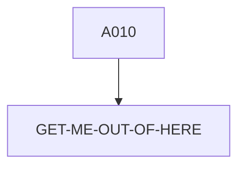

# ABNDPROC — source of truth

> Generated by `.github/skills/cobol-rekt/run-cobol-rekt.sh`. Do not edit by hand — re-run the script.
> **[rekt]** = from the cobol-rekt parse tree · **[scan]** = deterministic scan of the original source.

| | |
|---|---|
| Source | `src/base/cics/cobol/ABNDPROC.cbl` (176 lines) |
| Subsystem | `cics` |
| cobol-rekt | ✅ parsed |
| Sections / paragraphs [scan] | 6 |
| Decisions (IF / EVALUATE) [rekt] | 1 |
| EXEC CICS / EXEC SQL / DL/I calls [scan] | 3 / 0 / 0 |

## 1. Procedure structure

Control transfers inside the program [rekt]. Solid = `PERFORM`, dashed = `GO TO`.

| Section / paragraph | Lines | PERFORMs [rekt] | GO TO [rekt] | Decisions [rekt] | EXEC CICS | EXEC SQL |
|---|---|---|---|---|---|---|
| **PREMIERE** (section) | 131–131 | — | — | 0 | — | — |
| A010 | 132–164 | GET-ME-OUT-OF-HERE | — | 1 | 2 | — |
| A999 | 165–168 | — | — | 0 | — | — |
| **GET-ME-OUT-OF-HERE** (section) | 169–169 | — | — | 0 | — | — |
| GMOOH010 | 170–174 | — | — | 0 | 1 | — |
| GMOOH999 | 175–176 | — | — | 0 | — | — |

## 2. Decision points

Every `IF` / `EVALUATE` found by cobol-rekt, in source order. Condition text is quoted from the original source line. These are where business rules live.

**A010**

- `src/base/cics/cobol/ABNDPROC.cbl:149` `IF WS-CICS-RESP NOT= DFHRESP(NORMAL)`

## 3. External touchpoints [scan]

Every `EXEC CICS`, `EXEC SQL` and IMS DL/I call, as written in the original source.

| Line | Paragraph | Kind | Verb | Statement |
|---|---|---|---|---|
| `src/base/cics/cobol/ABNDPROC.cbl:141` | A010 | EXEC CICS | `WRITE` | `WRITE FILE('ABNDFILE') FROM(WS-ABND-AREA) RIDFLD(ABND-VSAM-KEY) RESP(WS-CICS-RESP) RESP2(WS-CICS-RESP2)` |
| `src/base/cics/cobol/ABNDPROC.cbl:155` | A010 | EXEC CICS | `RETURN` | `RETURN` |
| `src/base/cics/cobol/ABNDPROC.cbl:171` | GMOOH010 | EXEC CICS | `RETURN` | `RETURN` |

## 4. Dependencies [scan]

**Program / transaction transfers**

_None found._

**Copybooks**

- `ABNDINFO` (`src/base/cics/cobol/ABNDPROC.cbl:38`) → `src/base/cics/copy/ABNDINFO.cpy`

## 5. Condition names (88-levels) [scan]

Named conditions encode business codes. Includes copybooks reached from this program.

| Condition | Value(s) | Parent item | Defined at |
|---|---|---|---|
| `DATASTORE-TYPE-DLI` | `'1'` | DATA-STORE-TYPE | `src/base/cics/cobol/ABNDPROC.cbl:53` |
| `DATASTORE-TYPE-DB2` | `'2'` | DATA-STORE-TYPE | `src/base/cics/cobol/ABNDPROC.cbl:54` |
| `DATASTORE-TYPE-VSAM` | `'V'` | DATA-STORE-TYPE | `src/base/cics/cobol/ABNDPROC.cbl:55` |

## 6. Data items [rekt]

**Records (01 / 77 levels)**

| Name | Clause | Fields | Section | Defined at |
|---|---|---|---|---|
| `WS-CICS-WORK-AREA` | `(group)` | 2 | WORKING_STORAGE | `src/base/cics/cobol/ABNDPROC.cbl:32` |
| `WS-ABND-AREA` | `(group)` | 13 | WORKING_STORAGE | `src/base/cics/cobol/ABNDPROC.cbl:37` |
| `WS-ABND-KEY-LEN` | `PIC S9(8) COMP VALUE +12` | — | WORKING_STORAGE | `src/base/cics/cobol/ABNDPROC.cbl:40` |
| `DFHCOMMAREA` | `(group)` | 13 | LINKAGE | `src/base/cics/cobol/ABNDPROC.cbl:110` |

**LINKAGE SECTION — the program's interface contract (COMMAREA / parameters)**

| Level | Name | Clause | Type | Defined at |
|---|---|---|---|---|
| 01 | DFHCOMMAREA | `(group)` | OBJECT | `src/base/cics/cobol/ABNDPROC.cbl:110` |
| 03 | &nbsp;&nbsp;COMM-VSAM-KEY | `(group)` | OBJECT | `src/base/cics/cobol/ABNDPROC.cbl:111` |
| 05 | &nbsp;&nbsp;&nbsp;&nbsp;COMM-UTIME-KEY | `PIC S9(15) COMP-3` | NUMBER | `src/base/cics/cobol/ABNDPROC.cbl:112` |
| 05 | &nbsp;&nbsp;&nbsp;&nbsp;COMM-TASKNO-KEY | `PIC 9(4)` | NUMBER | `src/base/cics/cobol/ABNDPROC.cbl:113` |
| 03 | &nbsp;&nbsp;COMM-APPLID | `PIC X(8)` | STRING | `src/base/cics/cobol/ABNDPROC.cbl:114` |
| 03 | &nbsp;&nbsp;COMM-TRANID | `PIC X(4)` | STRING | `src/base/cics/cobol/ABNDPROC.cbl:115` |
| 03 | &nbsp;&nbsp;COMM-DATE | `PIC X(10)` | STRING | `src/base/cics/cobol/ABNDPROC.cbl:116` |
| 03 | &nbsp;&nbsp;COMM-TIME | `PIC X(8)` | STRING | `src/base/cics/cobol/ABNDPROC.cbl:117` |
| 03 | &nbsp;&nbsp;COMM-CODE | `PIC X(4)` | STRING | `src/base/cics/cobol/ABNDPROC.cbl:118` |
| 03 | &nbsp;&nbsp;COMM-PROGRAM | `PIC X(8)` | STRING | `src/base/cics/cobol/ABNDPROC.cbl:119` |
| 03 | &nbsp;&nbsp;COMM-RESPCODE | `PIC S9(8) DISPLAY SIGN LEADING SEPARATE` | NUMBER | `src/base/cics/cobol/ABNDPROC.cbl:120` |
| 03 | &nbsp;&nbsp;COMM-RESP2CODE | `PIC S9(8) DISPLAY SIGN LEADING SEPARATE` | NUMBER | `src/base/cics/cobol/ABNDPROC.cbl:122` |
| 03 | &nbsp;&nbsp;COMM-SQLCODE | `PIC S9(8) DISPLAY SIGN LEADING SEPARATE` | NUMBER | `src/base/cics/cobol/ABNDPROC.cbl:124` |
| 03 | &nbsp;&nbsp;COMM-FREEFORM | `PIC X(600)` | STRING | `src/base/cics/cobol/ABNDPROC.cbl:126` |

_Working-storage fields below the 01 level are not listed — open the definition to drill in._

**Not reported by cobol-rekt** — present in the source, so read them there [scan]:

- `DB2-DATE-REFORMAT` (LOCAL-STORAGE) `src/base/cics/cobol/ABNDPROC.cbl:45`
- `DATA-STORE-TYPE` (LOCAL-STORAGE) `src/base/cics/cobol/ABNDPROC.cbl:52`
- `WS-EIBTASKN12` (LOCAL-STORAGE) `src/base/cics/cobol/ABNDPROC.cbl:57`
- `WS-SQLCODE-DISP` (LOCAL-STORAGE) `src/base/cics/cobol/ABNDPROC.cbl:58`
- `WS-U-TIME` (LOCAL-STORAGE) `src/base/cics/cobol/ABNDPROC.cbl:65`
- `WS-ORIG-DATE` (LOCAL-STORAGE) `src/base/cics/cobol/ABNDPROC.cbl:66`
- `WS-ORIG-DATE-GRP` (LOCAL-STORAGE) `src/base/cics/cobol/ABNDPROC.cbl:67`
- `WS-ORIG-DATE-GRP-X` (LOCAL-STORAGE) `src/base/cics/cobol/ABNDPROC.cbl:74`
- `WS-PASSED-DATA` (LOCAL-STORAGE) `src/base/cics/cobol/ABNDPROC.cbl:82`
- `WS-SORT-DIV` (LOCAL-STORAGE) `src/base/cics/cobol/ABNDPROC.cbl:90`
- `CUSTOMER-KY` (LOCAL-STORAGE) `src/base/cics/cobol/ABNDPROC.cbl:95`
- `PROCTRAN-RIDFLD` (LOCAL-STORAGE) `src/base/cics/cobol/ABNDPROC.cbl:99`
- `SQLCODE-DISPLAY` (LOCAL-STORAGE) `src/base/cics/cobol/ABNDPROC.cbl:101`
- `MY-ABEND-CODE` (LOCAL-STORAGE) `src/base/cics/cobol/ABNDPROC.cbl:104`
