# BANKDATA — source of truth

> Generated by `.github/skills/cobol-rekt/run-cobol-rekt.sh`. Do not edit by hand — re-run the script.
> **[rekt]** = from the cobol-rekt parse tree · **[scan]** = deterministic scan of the original source.

| | |
|---|---|
| Source | `src/base/cics/cobol/BANKDATA.cbl` (1897 lines) |
| Subsystem | `cics` |
| cobol-rekt | ✅ parsed |
| Sections / paragraphs [scan] | 32 |
| Decisions (IF / EVALUATE) [rekt] | 32 |
| EXEC CICS / EXEC SQL / DL/I calls [scan] | 0 / 21 / 0 |

## 1. Procedure structure

Control transfers inside the program [rekt]. Solid = `PERFORM`, dashed = `GO TO`.

```mermaid
flowchart TD
  n_A010["A010"]
  n_DA010["DA010"]
  n_DBR010["DBR010"]
  n_DEFINE_ACC["DEFINE-ACC"]
  n_DELETE_DB2_ROWS["DELETE-DB2-ROWS"]
  n_GENERATE_OPENED_DATE["GENERATE-OPENED-DATE"]
  n_GET_TODAYS_DATE["GET-TODAYS-DATE"]
  n_GOD010["GOD010"]
  n_GOD999["GOD999"]
  n_INITIALISE_ARRAYS["INITIALISE-ARRAYS"]
  n_INSERT_INITIAL_CONTROL_RECORDS["INSERT-INITIAL-CONTROL-RECORDS"]
  n_PA010["PA010"]
  n_POPULATE_ACC["POPULATE-ACC"]
  n_PROGRAM_DONE["PROGRAM-DONE"]
  n_TIMESTAMP["TIMESTAMP"]
  n_A010 --> n_DEFINE_ACC
  n_A010 --> n_DELETE_DB2_ROWS
  n_A010 --> n_GET_TODAYS_DATE
  n_A010 --> n_INITIALISE_ARRAYS
  n_A010 --> n_PROGRAM_DONE
  n_A010 --> n_TIMESTAMP
  n_DA010 --> n_POPULATE_ACC
  n_DBR010 --> n_INSERT_INITIAL_CONTROL_RECORDS
  n_DBR010 --> n_PROGRAM_DONE
  n_DBR010 --> n_TIMESTAMP
  n_GOD010 -.->|GO TO| n_GOD999
  n_PA010 --> n_GENERATE_OPENED_DATE
  n_PA010 --> n_PROGRAM_DONE
```

| Section / paragraph | Lines | PERFORMs [rekt] | GO TO [rekt] | Decisions [rekt] | EXEC CICS | EXEC SQL |
|---|---|---|---|---|---|---|
| **PREMIERE** (section) | 418–418 | — | — | 0 | — | — |
| A010 | 419–870 | DEFINE-ACC, DELETE-DB2-ROWS, GET-TODAYS-DATE, INITIALISE-ARRAYS, PROGRAM-DONE, TIMESTAMP | — | 9 | — | 7 |
| A999 | 871–876 | — | — | 0 | — | — |
| **PROGRAM-DONE** (section) | 877–877 | — | — | 0 | — | — |
| PD010 | 878–880 | — | — | 0 | — | — |
| PD999 | 881–886 | — | — | 0 | — | — |
| **DEFINE-ACC** (section) | 887–887 | — | — | 0 | — | — |
| DA010 | 888–905 | POPULATE-ACC (loop) | — | 0 | — | 1 |
| DA999 | 906–911 | — | — | 0 | — | — |
| **POPULATE-ACC** (section) | 912–912 | — | — | 0 | — | — |
| PA010 | 913–1080 | GENERATE-OPENED-DATE, PROGRAM-DONE | — | 3 | — | 1 |
| PA999 | 1081–1086 | — | — | 0 | — | — |
| **GENERATE-OPENED-DATE** (section) | 1087–1087 | — | — | 0 | — | — |
| GOD010 | 1088–1132 | — | GOD999 | 2 | — | — |
| GOD999 | 1133–1139 | — | — | 0 | — | — |
| **INITIALISE-ARRAYS** (section) | 1140–1140 | — | — | 0 | — | — |
| IA010 | 1141–1386 | — | — | 0 | — | — |
| IA999 | 1387–1392 | — | — | 0 | — | — |
| **DELETE-DB2-ROWS** (section) | 1393–1393 | — | — | 0 | — | — |
| DBR010 | 1394–1606 | INSERT-INITIAL-CONTROL-RECORDS, PROGRAM-DONE, TIMESTAMP | — | 9 | — | 4 |
| DBR999 | 1607–1614 | — | — | 0 | — | — |
| **INSERT-INITIAL-CONTROL-RECORDS** (section) | 1615–1615 | — | — | 0 | — | — |
| IICR010 | 1616–1809 | — | — | 8 | — | 8 |
| IICR999 | 1810–1813 | — | — | 0 | — | — |
| DBR999 | 1607–1614 | — | — | 0 | — | — |
| **GET-TODAYS-DATE** (section) | 1826–1826 | — | — | 0 | — | — |
| GTD010 | 1827–1836 | — | — | 0 | — | — |
| GTD999 | 1837–1839 | — | — | 0 | — | — |
| **CALC-DAY-OF-WEEK** (section) | 1840–1840 | — | — | 0 | — | — |
| CDW010 | 1841–1871 | — | — | 1 | — | — |
| CDW999 | 1872–1874 | — | — | 0 | — | — |
| **TIMESTAMP** (section) | 1875–1897 | — | — | 0 | — | — |

## 2. Decision points

Every `IF` / `EVALUATE` found by cobol-rekt, in source order. Condition text is quoted from the original source line. These are where business rules live.

**A010**

- `src/base/cics/cobol/BANKDATA.cbl:446` `IF END-KEY < START-KEY`
- `src/base/cics/cobol/BANKDATA.cbl:452` `IF STEP-KEY = ZERO`
- `src/base/cics/cobol/BANKDATA.cbl:714` `IF SQLCODE NOT = 0`
- `src/base/cics/cobol/BANKDATA.cbl:737` `IF COMMIT-COUNT > 1000`
- `src/base/cics/cobol/BANKDATA.cbl:769` `IF SQLCODE = 100`
- `src/base/cics/cobol/BANKDATA.cbl:783` `IF SQLCODE NOT = 0 AND SQLCODE NOT = 100`
- `src/base/cics/cobol/BANKDATA.cbl:814` `IF SQLCODE NOT = 0 AND SQLCODE NOT = 100`
- `src/base/cics/cobol/BANKDATA.cbl:841` `IF SQLCODE NOT = 0 AND SQLCODE NOT = 100`
- `src/base/cics/cobol/BANKDATA.cbl:860` `IF SQLCODE NOT = 0`

**PA010**

- `src/base/cics/cobol/BANKDATA.cbl:993` `IF HV-ACCOUNT-TYPE OF HOST-ACCOUNT-ROW = 'LOAN    ' OR`
- `src/base/cics/cobol/BANKDATA.cbl:1037` `IF SQLCODE NOT = 0`
  - `src/base/cics/cobol/BANKDATA.cbl:1039` `EVALUATE TRUE → WHEN SQLERRD(3) EQUAL 13172878 · WHEN SQLERRD(3) EQUAL 13172872 · WHEN OTHER`

**GOD010**

- `src/base/cics/cobol/BANKDATA.cbl:1119` `IF HV-ACCOUNT-OPENED-YEAR > CUSTOMER-DOB-YEAR OF CUSTOMER-DOB`
- `src/base/cics/cobol/BANKDATA.cbl:1124` `IF OPENED-DATE-ATTEMPTS > 100`

**DBR010**

- `src/base/cics/cobol/BANKDATA.cbl:1412` `IF SQLCODE NOT = +100 AND`
  - `src/base/cics/cobol/BANKDATA.cbl:1416` `IF SQLCODE < 0`
  - `src/base/cics/cobol/BANKDATA.cbl:1421` `EVALUATE TRUE → WHEN SQLERRD(3) EQUAL 13172878 · WHEN SQLERRD(3) EQUAL 13172872 · WHEN OTHER`
- `src/base/cics/cobol/BANKDATA.cbl:1478` `IF SQLCODE NOT = +100 AND`
  - `src/base/cics/cobol/BANKDATA.cbl:1482` `IF SQLCODE < 0`
  - `src/base/cics/cobol/BANKDATA.cbl:1487` `EVALUATE TRUE → WHEN SQLERRD(3) EQUAL 13172878 · WHEN SQLERRD(3) EQUAL 13172872 · WHEN OTHER`
- `src/base/cics/cobol/BANKDATA.cbl:1548` `IF SQLCODE NOT = +100 AND`
  - `src/base/cics/cobol/BANKDATA.cbl:1552` `IF SQLCODE < 0`
  - `src/base/cics/cobol/BANKDATA.cbl:1557` `EVALUATE TRUE → WHEN SQLERRD(3) EQUAL 13172878 · WHEN SQLERRD(3) EQUAL 13172872 · WHEN OTHER`

**IICR010**

- `src/base/cics/cobol/BANKDATA.cbl:1640` `IF SQLCODE NOT = 0`
- `src/base/cics/cobol/BANKDATA.cbl:1667` `IF SQLCODE NOT = 0`
- `src/base/cics/cobol/BANKDATA.cbl:1687` `IF SQLCODE NOT = 0`
- `src/base/cics/cobol/BANKDATA.cbl:1707` `IF SQLCODE NOT = 0`
- `src/base/cics/cobol/BANKDATA.cbl:1727` `IF SQLCODE NOT = 0`
- `src/base/cics/cobol/BANKDATA.cbl:1747` `IF SQLCODE NOT = 0`
- `src/base/cics/cobol/BANKDATA.cbl:1777` `IF SQLCODE NOT = 0`
- `src/base/cics/cobol/BANKDATA.cbl:1803` `IF SQLCODE NOT = 0`

**CDW010**

- `src/base/cics/cobol/BANKDATA.cbl:1863` `IF WS-DT-REM = 0`

## 3. External touchpoints [scan]

Every `EXEC CICS`, `EXEC SQL` and IMS DL/I call, as written in the original source.

| Line | Paragraph | Kind | Verb | Statement |
|---|---|---|---|---|
| `src/base/cics/cobol/BANKDATA.cbl:676` | A010 | EXEC SQL | `INSERT` | `INSERT INTO CUSTOMER (CUSTOMER_EYECATCHER, CUSTOMER_SORTCODE, CUSTOMER_NUMBER, CUSTOMER_TITLE, CUSTOMER_FIRST…` |
| `src/base/cics/cobol/BANKDATA.cbl:739` | A010 | EXEC SQL | `COMMIT` | `COMMIT WORK` |
| `src/base/cics/cobol/BANKDATA.cbl:760` | A010 | EXEC SQL | `UPDATE` | `UPDATE CONTROL SET CONTROL_VALUE_NUM = :HV-CONTROL-VALUE-NUM WHERE CONTROL_NAME = :HV-CONTROL-NAME` |
| `src/base/cics/cobol/BANKDATA.cbl:772` | A010 | EXEC SQL | `INSERT` | `INSERT INTO CONTROL (CONTROL_NAME, CONTROL_VALUE_NUM, CONTROL_VALUE_STR) VALUES(:HV-CONTROL-NAME, :HV-CONTROL…` |
| `src/base/cics/cobol/BANKDATA.cbl:808` | A010 | EXEC SQL | `UPDATE` | `UPDATE CONTROL SET CONTROL_VALUE_NUM = :HV-CONTROL-VALUE-NUM WHERE CONTROL_NAME = :HV-CONTROL-NAME` |
| `src/base/cics/cobol/BANKDATA.cbl:835` | A010 | EXEC SQL | `UPDATE` | `UPDATE CONTROL SET CONTROL_VALUE_NUM = :HV-CONTROL-VALUE-NUM WHERE CONTROL_NAME = :HV-CONTROL-NAME` |
| `src/base/cics/cobol/BANKDATA.cbl:856` | A010 | EXEC SQL | `COMMIT` | `COMMIT WORK` |
| `src/base/cics/cobol/BANKDATA.cbl:902` | DA010 | EXEC SQL | `COMMIT` | `COMMIT WORK` |
| `src/base/cics/cobol/BANKDATA.cbl:1004` | PA010 | EXEC SQL | `INSERT` | `INSERT INTO ACCOUNT (ACCOUNT_EYECATCHER, ACCOUNT_CUSTOMER_NUMBER, ACCOUNT_SORTCODE, ACCOUNT_NUMBER, ACCOUNT_T…` |
| `src/base/cics/cobol/BANKDATA.cbl:1401` | DBR010 | EXEC SQL | `DELETE` | `DELETE FROM CUSTOMER` |
| `src/base/cics/cobol/BANKDATA.cbl:1466` | DBR010 | EXEC SQL | `DELETE` | `DELETE FROM ACCOUNT` |
| `src/base/cics/cobol/BANKDATA.cbl:1534` | DBR010 | EXEC SQL | `DELETE` | `DELETE FROM CONTROL` |
| `src/base/cics/cobol/BANKDATA.cbl:1602` | DBR010 | EXEC SQL | `COMMIT` | `COMMIT WORK` |
| `src/base/cics/cobol/BANKDATA.cbl:1630` | IICR010 | EXEC SQL | `INSERT` | `INSERT INTO CONTROL (CONTROL_NAME, CONTROL_VALUE_NUM, CONTROL_VALUE_STR) VALUES(:HV-CONTROL-NAME, :HV-CONTROL…` |
| `src/base/cics/cobol/BANKDATA.cbl:1657` | IICR010 | EXEC SQL | `INSERT` | `INSERT INTO CONTROL (CONTROL_NAME, CONTROL_VALUE_NUM, CONTROL_VALUE_STR) VALUES(:HV-CONTROL-NAME, :HV-CONTROL…` |
| `src/base/cics/cobol/BANKDATA.cbl:1677` | IICR010 | EXEC SQL | `INSERT` | `INSERT INTO CONTROL (CONTROL_NAME, CONTROL_VALUE_NUM, CONTROL_VALUE_STR) VALUES(:HV-CONTROL-NAME, :HV-CONTROL…` |
| `src/base/cics/cobol/BANKDATA.cbl:1697` | IICR010 | EXEC SQL | `INSERT` | `INSERT INTO CONTROL (CONTROL_NAME, CONTROL_VALUE_NUM, CONTROL_VALUE_STR) VALUES(:HV-CONTROL-NAME, :HV-CONTROL…` |
| `src/base/cics/cobol/BANKDATA.cbl:1717` | IICR010 | EXEC SQL | `INSERT` | `INSERT INTO CONTROL (CONTROL_NAME, CONTROL_VALUE_NUM, CONTROL_VALUE_STR) VALUES(:HV-CONTROL-NAME, :HV-CONTROL…` |
| `src/base/cics/cobol/BANKDATA.cbl:1737` | IICR010 | EXEC SQL | `INSERT` | `INSERT INTO CONTROL (CONTROL_NAME, CONTROL_VALUE_NUM, CONTROL_VALUE_STR) VALUES(:HV-CONTROL-NAME, :HV-CONTROL…` |
| `src/base/cics/cobol/BANKDATA.cbl:1767` | IICR010 | EXEC SQL | `INSERT` | `INSERT INTO CONTROL (CONTROL_NAME, CONTROL_VALUE_NUM, CONTROL_VALUE_STR) VALUES(:HV-CONTROL-NAME, :HV-CONTROL…` |
| `src/base/cics/cobol/BANKDATA.cbl:1793` | IICR010 | EXEC SQL | `INSERT` | `INSERT INTO CONTROL (CONTROL_NAME, CONTROL_VALUE_NUM, CONTROL_VALUE_STR) VALUES(:HV-CONTROL-NAME, :HV-CONTROL…` |

## 4. Dependencies [scan]

**Program / transaction transfers**

Lines refer to `src/base/cics/cobol/BANKDATA.cbl`.

| Kind | Target(s) | Resolved via | Lines · paragraph |
|---|---|---|---|
| CALL | `CEEGMT` | literal | `:1876` TIMESTAMP |
| CALL | `CEEDATM` | literal | `:1892` TIMESTAMP |

**Copybooks**

- `CUSTDB2` (`src/base/cics/cobol/BANKDATA.cbl:52`) → `src/base/cics/copy/CUSTDB2.cpy`
- `CUSTOMER` (`src/base/cics/cobol/BANKDATA.cbl:78`) → `src/base/cics/copy/CUSTOMER.cpy`
- `ACCDB2` (`src/base/cics/cobol/BANKDATA.cbl:81`) → `src/base/cics/copy/ACCDB2.cpy`
- `SQLCA` (`src/base/cics/cobol/BANKDATA.cbl:148`) → DB2 precompiler member (not in repo)
- `SORTCODE` (`src/base/cics/cobol/BANKDATA.cbl:279`) → `src/base/cics/copy/SORTCODE.cpy`
- `CUSTCTRL` (`src/base/cics/cobol/BANKDATA.cbl:374`) → `src/base/cics/copy/CUSTCTRL.cpy`
- `ACCTCTRL` (`src/base/cics/cobol/BANKDATA.cbl:377`) → `src/base/cics/copy/ACCTCTRL.cpy`
- `CONTDB2` (`src/base/cics/cobol/BANKDATA.cbl:380`) → `src/base/cics/copy/CONTDB2.cpy`

## 5. Condition names (88-levels) [scan]

Named conditions encode business codes. Includes copybooks reached from this program.

| Condition | Value(s) | Parent item | Defined at |
|---|---|---|---|
| `CUSTOMER-EYECATCHER-VALUE` | `'CUST'` | CUSTOMER-EYECATCHER | `src/base/cics/copy/CUSTOMER.cpy:9` |
| `CUSTOMER-STATUS-ACTIVE` | `'ACTIVE'` | CUSTOMER-STATUS | `src/base/cics/copy/CUSTOMER.cpy:29` |
| `CUSTOMER-STATUS-INACTIVE` | `'INACTIVE'` | CUSTOMER-STATUS | `src/base/cics/copy/CUSTOMER.cpy:30` |
| `CUSTOMER-STATUS-SUSPENDED` | `'SUSPENDED'` | CUSTOMER-STATUS | `src/base/cics/copy/CUSTOMER.cpy:31` |
| `CUSTOMER-CONTROL-EYECATCHER-V` | `'CTRL'` | CUSTOMER-CONTROL-EYECATCHER | `src/base/cics/copy/CUSTCTRL.cpy:9` |
| `CUSTOMER-CONTROL-SUCCESS` | `'Y'` | CUSTOMER-CONTROL-SUCCESS-FLAG | `src/base/cics/copy/CUSTCTRL.cpy:16` |
| `ACCOUNT-CONTROL-EYECATCHER-V` | `'CTRL'` | ACCOUNT-CONTROL-EYE-CATCHER | `src/base/cics/copy/ACCTCTRL.cpy:9` |
| `ACCOUNT-CONTROL-SUCCESS` | `'Y'` | ACCOUNT-CONTROL-SUCCESS-FLAG | `src/base/cics/copy/ACCTCTRL.cpy:17` |

## 6. Data items [rekt]

**Records (01 / 77 levels)**

| Name | Clause | Fields | Section | Defined at |
|---|---|---|---|---|
| `HOST-CUSTOMER-ROW` | `(group)` | 17 | WORKING_STORAGE | `src/base/cics/cobol/BANKDATA.cbl:57` |
| `WS-CUSTOMER-RECORD` | `(group)` | 30 | WORKING_STORAGE | `src/base/cics/cobol/BANKDATA.cbl:77` |
| `HOST-ACCOUNT-ROW` | `(group)` | 32 | WORKING_STORAGE | `src/base/cics/cobol/BANKDATA.cbl:90` |
| `DISP-LOT` | `(group)` | 2 | WORKING_STORAGE | `src/base/cics/cobol/BANKDATA.cbl:153` |
| `DISP-REASON-CODE` | `PIC X(18)` | — | WORKING_STORAGE | `src/base/cics/cobol/BANKDATA.cbl:157` |
| `START-KEY` | `PIC 9(10) DISPLAY` | — | WORKING_STORAGE | `src/base/cics/cobol/BANKDATA.cbl:159` |
| `END-KEY` | `PIC 9(10) DISPLAY` | — | WORKING_STORAGE | `src/base/cics/cobol/BANKDATA.cbl:160` |
| `STEP-KEY` | `PIC 9(10) DISPLAY` | — | WORKING_STORAGE | `src/base/cics/cobol/BANKDATA.cbl:161` |
| `TESTNM` | `PIC 9(4) DISPLAY` | — | WORKING_STORAGE | `src/base/cics/cobol/BANKDATA.cbl:162` |
| `NEXT-KEY` | `PIC 9(10) DISPLAY` | — | WORKING_STORAGE | `src/base/cics/cobol/BANKDATA.cbl:164` |
| `FORENAMES` | `(group)` | 1 | WORKING_STORAGE | `src/base/cics/cobol/BANKDATA.cbl:166` |
| `FORENAMES-CNT` | `PIC 9(8) BINARY VALUE 0` | — | WORKING_STORAGE | `src/base/cics/cobol/BANKDATA.cbl:170` |
| `FORENAMES-PTR` | `PIC 9(8) BINARY VALUE 0` | — | WORKING_STORAGE | `src/base/cics/cobol/BANKDATA.cbl:172` |
| `STREET-NAME-TREES` | `(group)` | 1 | WORKING_STORAGE | `src/base/cics/cobol/BANKDATA.cbl:175` |
| `STREET-NAME-T-CNT` | `PIC 9(8) BINARY VALUE 0` | — | WORKING_STORAGE | `src/base/cics/cobol/BANKDATA.cbl:179` |
| `STREET-NAME-T-PTR` | `PIC 9(8) BINARY VALUE 0` | — | WORKING_STORAGE | `src/base/cics/cobol/BANKDATA.cbl:181` |
| `STREET-NAME-ROADS` | `(group)` | 1 | WORKING_STORAGE | `src/base/cics/cobol/BANKDATA.cbl:184` |
| `STREET-NAME-R-CNT` | `PIC 9(8) BINARY VALUE 0` | — | WORKING_STORAGE | `src/base/cics/cobol/BANKDATA.cbl:188` |
| `STREET-NAME-R-PTR` | `PIC 9(8) BINARY VALUE 0` | — | WORKING_STORAGE | `src/base/cics/cobol/BANKDATA.cbl:190` |
| `TOWNS` | `(group)` | 1 | WORKING_STORAGE | `src/base/cics/cobol/BANKDATA.cbl:193` |
| `TOWN-COUNT` | `PIC 9(8) BINARY VALUE 0` | — | WORKING_STORAGE | `src/base/cics/cobol/BANKDATA.cbl:197` |
| `TOWN-PTR` | `PIC 9(8) BINARY VALUE 0` | — | WORKING_STORAGE | `src/base/cics/cobol/BANKDATA.cbl:199` |
| `INITIALS` | `(group)` | 1 | WORKING_STORAGE | `src/base/cics/cobol/BANKDATA.cbl:202` |
| `INITIALS-CNT` | `PIC 9(8) BINARY VALUE 0` | — | WORKING_STORAGE | `src/base/cics/cobol/BANKDATA.cbl:205` |
| `INITIALS-PTR` | `PIC 9(8) BINARY VALUE 0` | — | WORKING_STORAGE | `src/base/cics/cobol/BANKDATA.cbl:207` |
| `TITLE-WORDS` | `(group)` | 1 | WORKING_STORAGE | `src/base/cics/cobol/BANKDATA.cbl:210` |
| `TITLE-ALPHABET` | `(group)` | 36 | WORKING_STORAGE | `src/base/cics/cobol/BANKDATA.cbl:212` |
| `TITLE-NUMBER` | `PIC S9(9) BINARY` | — | WORKING_STORAGE | `src/base/cics/cobol/BANKDATA.cbl:252` |
| `HOUSE-NUMBER` | `PIC 99` | — | WORKING_STORAGE | `src/base/cics/cobol/BANKDATA.cbl:254` |
| `SURNAMES` | `(group)` | 1 | WORKING_STORAGE | `src/base/cics/cobol/BANKDATA.cbl:256` |
| `SURNAMES-CNT` | `PIC 9(8) BINARY VALUE 0` | — | WORKING_STORAGE | `src/base/cics/cobol/BANKDATA.cbl:260` |
| `SURNAMES-PTR` | `PIC 9(8) BINARY VALUE 0` | — | WORKING_STORAGE | `src/base/cics/cobol/BANKDATA.cbl:262` |
| `RDATE` | `PIC X(21)` | — | WORKING_STORAGE | `src/base/cics/cobol/BANKDATA.cbl:265` |
| `RDATE-NUMERIC` | `REDEFINES RDATE PIC 9(16) USAGE DISPLAY` REDEFINES RDATE | — | WORKING_STORAGE | `src/base/cics/cobol/BANKDATA.cbl:268` |
| `RANDOM-SEED` | `PIC X(16)` | — | WORKING_STORAGE | `src/base/cics/cobol/BANKDATA.cbl:272` |
| `RANDOM-SEED-NUMERIC` | `REDEFINES RANDOM-SEED PIC 9(16) USAGE DISPLAY` REDEFINES RANDOM-SEED | — | WORKING_STORAGE | `src/base/cics/cobol/BANKDATA.cbl:273` |
| `WS-CNT` | `PIC 9 VALUE 0` | — | WORKING_STORAGE | `src/base/cics/cobol/BANKDATA.cbl:278` |
| `WS-ACCOUNT-NUMBER` | `PIC 9(8) VALUE 1` | — | WORKING_STORAGE | `src/base/cics/cobol/BANKDATA.cbl:281` |
| `WS-ACCOUNT-TYPES` | `(group)` | 1 | WORKING_STORAGE | `src/base/cics/cobol/BANKDATA.cbl:284` |
| `ACCOUNT-TYPES-COUNT` | `PIC 9(8) BINARY VALUE 0` | — | WORKING_STORAGE | `src/base/cics/cobol/BANKDATA.cbl:289` |
| `ACCOUNT-TYPES-PTR` | `PIC 9(8) BINARY VALUE 0` | — | WORKING_STORAGE | `src/base/cics/cobol/BANKDATA.cbl:291` |
| `WS-ACCOUNT-INT-RATES` | `(group)` | 1 | WORKING_STORAGE | `src/base/cics/cobol/BANKDATA.cbl:294` |
| `ACCOUNT-INT-RATES-COUNT` | `PIC 9(8) BINARY VALUE 0` | — | WORKING_STORAGE | `src/base/cics/cobol/BANKDATA.cbl:299` |
| `ACCOUNT-INT-RATES-PTR` | `PIC 9(8) BINARY VALUE 0` | — | WORKING_STORAGE | `src/base/cics/cobol/BANKDATA.cbl:301` |
| `WS-ACCOUNT-OVERDRAFT-LIMS` | `(group)` | 1 | WORKING_STORAGE | `src/base/cics/cobol/BANKDATA.cbl:305` |
| `ACCOUNT-OVERDRAFT-COUNT` | `PIC 9(8) BINARY VALUE 0` | — | WORKING_STORAGE | `src/base/cics/cobol/BANKDATA.cbl:310` |
| `ACCOUNT-OVERDRAFT-PTR` | `PIC 9(8) BINARY VALUE 0` | — | WORKING_STORAGE | `src/base/cics/cobol/BANKDATA.cbl:312` |
| `NO-OF-ACCOUNTS` | `PIC 9(8) BINARY VALUE 0` | — | WORKING_STORAGE | `src/base/cics/cobol/BANKDATA.cbl:315` |
| `WS-OVERDRAFT-CONVERSION` | `PIC S9(9) COMP VALUE 0` | — | WORKING_STORAGE | `src/base/cics/cobol/BANKDATA.cbl:318` |
| `WS-PGM-NAME` | `PIC X(8) VALUE ' '` | — | WORKING_STORAGE | `src/base/cics/cobol/BANKDATA.cbl:322` |
| `WS-SQLCODE-DISPLAY` | `PIC S9(8) DISPLAY SIGN LEADING SEPARATE` | — | WORKING_STORAGE | `src/base/cics/cobol/BANKDATA.cbl:325` |
| `OPENED-DATE-ATTEMPTS` | `PIC S9(8) DISPLAY SIGN LEADING SEPARATE` | — | WORKING_STORAGE | `src/base/cics/cobol/BANKDATA.cbl:328` |
| `OPENED-DATE-VALID` | `PIC X VALUE 'N'` | — | WORKING_STORAGE | `src/base/cics/cobol/BANKDATA.cbl:331` |
| `COMMIT-COUNT` | `PIC S9(8) BINARY` | — | WORKING_STORAGE | `src/base/cics/cobol/BANKDATA.cbl:335` |
| `TIME-DATA` | `(group)` | 12 | WORKING_STORAGE | `src/base/cics/cobol/BANKDATA.cbl:337` |
| `TIMESTAMP-FUNCTION` | `PIC X(40)` | — | WORKING_STORAGE | `src/base/cics/cobol/BANKDATA.cbl:352` |
| `WS-CURRENT-DATE-DATA` | `(group)` | 10 | WORKING_STORAGE | `src/base/cics/cobol/BANKDATA.cbl:355` |
| `WS-CURRENT-DATE-9` | `PIC 9(8) VALUE 0` | — | WORKING_STORAGE | `src/base/cics/cobol/BANKDATA.cbl:367` |
| `WS-TODAY-INT` | `PIC 9(8) VALUE 0` | — | WORKING_STORAGE | `src/base/cics/cobol/BANKDATA.cbl:368` |
| `WS-REVIEW-DATE-ADD` | `PIC 99 VALUE 0` | — | WORKING_STORAGE | `src/base/cics/cobol/BANKDATA.cbl:369` |
| `WS-NEW-REVIEW-DATE-INT` | `PIC 9(8) VALUE 0` | — | WORKING_STORAGE | `src/base/cics/cobol/BANKDATA.cbl:370` |
| `WS-NEW-REVIEW-YYYYMMDD` | `PIC 9(8) VALUE 0` | — | WORKING_STORAGE | `src/base/cics/cobol/BANKDATA.cbl:371` |
| `CUSTOMER-CONTROL` | `(group)` | 14 | WORKING_STORAGE | `src/base/cics/cobol/BANKDATA.cbl:373` |
| `ACCOUNT-CONTROL` | `(group)` | 17 | WORKING_STORAGE | `src/base/cics/cobol/BANKDATA.cbl:376` |
| `HOST-CONTROL-ROW` | `(group)` | 3 | WORKING_STORAGE | `src/base/cics/cobol/BANKDATA.cbl:385` |
| `WS-WEEKDAYS` | `PIC X(63) VALUE ' '` | — | WORKING_STORAGE | `src/base/cics/cobol/BANKDATA.cbl:391` |
| `WS-WEEKDAY-GROUP` | `REDEFINES WS-WEEKDAYS` REDEFINES WS-WEEKDAYS | 1 | WORKING_STORAGE | `src/base/cics/cobol/BANKDATA.cbl:392` |
| `WS-DT` | `PIC 9(8) VALUE 0` | — | WORKING_STORAGE | `src/base/cics/cobol/BANKDATA.cbl:395` |
| `WS-DT-REM` | `PIC S9(9) COMP VALUE 0` | — | WORKING_STORAGE | `src/base/cics/cobol/BANKDATA.cbl:396` |
| `WS-DAY-OF-WEEK-VAL` | `PIC 9 VALUE 0` | — | WORKING_STORAGE | `src/base/cics/cobol/BANKDATA.cbl:398` |
| `WS-DAY-TODAY` | `PIC X(9) VALUE ' '` | — | WORKING_STORAGE | `src/base/cics/cobol/BANKDATA.cbl:399` |
| `SQLCODE-DISPLAY` | `PIC S9(8) DISPLAY SIGN LEADING SEPARATE` | — | WORKING_STORAGE | `src/base/cics/cobol/BANKDATA.cbl:401` |
| `PARM-BUFFER` | `(group)` | 2 | LINKAGE | `src/base/cics/cobol/BANKDATA.cbl:409` |

**LINKAGE SECTION — the program's interface contract (COMMAREA / parameters)**

| Level | Name | Clause | Type | Defined at |
|---|---|---|---|---|
| 01 | PARM-BUFFER | `(group)` | OBJECT | `src/base/cics/cobol/BANKDATA.cbl:409` |
| 05 | &nbsp;&nbsp;PARM-LENGTH | `PIC 9(4) BINARY` | NUMBER | `src/base/cics/cobol/BANKDATA.cbl:410` |
| 05 | &nbsp;&nbsp;PARM | `PIC X(256)` | STRING | `src/base/cics/cobol/BANKDATA.cbl:411` |

_Working-storage fields below the 01 level are not listed — open the definition to drill in._

**Not reported by cobol-rekt** — present in the source, so read them there [scan]:

- `WS-ACCOUNT-OPENED-DAY` (WORKING-STORAGE) `src/base/cics/cobol/BANKDATA.cbl:85`
- `WS-ACCOUNT-OPENED-MONTH` (WORKING-STORAGE) `src/base/cics/cobol/BANKDATA.cbl:86`
- `WS-ACCOUNT-OPENED-YEAR` (WORKING-STORAGE) `src/base/cics/cobol/BANKDATA.cbl:87`
- `WS-POSTCODE-NUM` (WORKING-STORAGE) `src/base/cics/cobol/BANKDATA.cbl:249`
