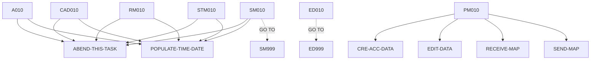

# BNK1CAC — source of truth

> Generated by `.github/skills/cobol-rekt/run-cobol-rekt.sh`. Do not edit by hand — re-run the script.
> **[rekt]** = from the cobol-rekt parse tree · **[scan]** = deterministic scan of the original source.

| | |
|---|---|
| Source | `src/base/cics/cobol/BNK1CAC.cbl` (1301 lines) |
| Subsystem | `cics` |
| cobol-rekt | ✅ parsed |
| Sections / paragraphs [scan] | 27 |
| Decisions (IF / EVALUATE) [rekt] | 33 |
| EXEC CICS / EXEC SQL / DL/I calls [scan] | 37 / 0 / 0 |

## 1. Procedure structure

Control transfers inside the program [rekt]. Solid = `PERFORM`, dashed = `GO TO`.

| Section / paragraph | Lines | PERFORMs [rekt] | GO TO [rekt] | Decisions [rekt] | EXEC CICS | EXEC SQL |
|---|---|---|---|---|---|---|
| **PREMIERE** (section) | 160–160 | — | — | 0 | — | — |
| A010 | 161–315 | ABEND-THIS-TASK, POPULATE-TIME-DATE | — | 3 | 8 | — |
| A999 | 316–319 | — | — | 0 | — | — |
| **PROCESS-MAP** (section) | 320–320 | — | — | 0 | — | — |
| PM010 | 321–346 | CRE-ACC-DATA, EDIT-DATA, RECEIVE-MAP, SEND-MAP | — | 1 | — | — |
| PM999 | 347–350 | — | — | 0 | — | — |
| **RECEIVE-MAP** (section) | 351–351 | — | — | 0 | — | — |
| RM010 | 352–423 | ABEND-THIS-TASK, POPULATE-TIME-DATE | — | 1 | 4 | — |
| RM999 | 424–427 | — | — | 0 | — | — |
| **EDIT-DATA** (section) | 428–428 | — | — | 0 | — | — |
| ED010 | 429–743 | — | ED999 | 18 | 2 | — |
| ED999 | 744–747 | — | — | 0 | — | — |
| **CRE-ACC-DATA** (section) | 748–748 | — | — | 0 | — | — |
| CAD010 | 749–955 | ABEND-THIS-TASK, POPULATE-TIME-DATE | — | 3 | 4 | — |
| CAD999 | 956–959 | — | — | 0 | — | — |
| **SEND-MAP** (section) | 960–960 | — | — | 0 | — | — |
| SM010 | 961–1190 | ABEND-THIS-TASK, POPULATE-TIME-DATE | SM999 | 6 | 12 | — |
| SM999 | 1191–1194 | — | — | 0 | — | — |
| **SEND-TERMINATION-MSG** (section) | 1195–1195 | — | — | 0 | — | — |
| STM010 | 1196–1267 | ABEND-THIS-TASK, POPULATE-TIME-DATE | — | 1 | 4 | — |
| STM999 | 1268–1271 | — | — | 0 | — | — |
| **ABEND-THIS-TASK** (section) | 1272–1272 | — | — | 0 | — | — |
| ATT010 | 1273–1281 | — | — | 0 | 1 | — |
| ATT999 | 1282–1285 | — | — | 0 | — | — |
| **POPULATE-TIME-DATE** (section) | 1286–1286 | — | — | 0 | — | — |
| PTD010 | 1287–1299 | — | — | 0 | 2 | — |
| PTD999 | 1300–1301 | — | — | 0 | — | — |

## 2. Decision points

Every `IF` / `EVALUATE` found by cobol-rekt, in source order. Condition text is quoted from the original source line. These are where business rules live.

**A010**

- `src/base/cics/cobol/BNK1CAC.cbl:163` `EVALUATE TRUE → WHEN EIBCALEN = ZERO · WHEN EIBAID = DFHPA1 OR DFHPA2 OR DFHPA3 · WHEN EIBAID = DFHPF3 · WHEN EIBAID = DFHAID OR DFHPF12 · WHEN EIBAID = DFHCLEAR · WHEN EIBAID = DFHENTER · WHEN OTHER`
- `src/base/cics/cobol/BNK1CAC.cbl:239` `IF EIBCALEN NOT = 0`
- `src/base/cics/cobol/BNK1CAC.cbl:256` `IF WS-CICS-RESP NOT = DFHRESP(NORMAL)`

**PM010**

- `src/base/cics/cobol/BNK1CAC.cbl:336` `IF VALID-DATA`

**RM010**

- `src/base/cics/cobol/BNK1CAC.cbl:364` `IF WS-CICS-RESP NOT = DFHRESP(NORMAL)`

**ED010**

- `src/base/cics/cobol/BNK1CAC.cbl:437` `IF CUSTNOL < 1 OR CUSTNOI = '__________'`
- `src/base/cics/cobol/BNK1CAC.cbl:448` `IF CUSTNOI NOT NUMERIC`
- `src/base/cics/cobol/BNK1CAC.cbl:459` `IF ACCTYPI = '________' OR ACCTYPL < 1`
- `src/base/cics/cobol/BNK1CAC.cbl:472` `IF ACCTYPL > 0`
  - `src/base/cics/cobol/BNK1CAC.cbl:474` `EVALUATE ACCTYPI → WHEN 'ISA_____' · WHEN 'isa_____' · WHEN 'ISA     ' · WHEN 'isa     ' · WHEN 'CURRENT_' · WHEN 'current_' · WHEN 'CURRENT ' · WHEN 'current ' · WHEN 'LOAN____' · WHEN 'loan____' · WHEN 'loan    ' · WHE`
- `src/base/cics/cobol/BNK1CAC.cbl:538` `IF INTRTL = ZERO`
- `src/base/cics/cobol/BNK1CAC.cbl:548` `IF INTRTI(1:INTRTL) IS NOT NUMERIC`
  - `src/base/cics/cobol/BNK1CAC.cbl:575` `IF WS-NUM-COUNT-TOTAL < INTRTL`
  - `src/base/cics/cobol/BNK1CAC.cbl:594` `IF WS-NUM-COUNT-POINT > 1`
  - `src/base/cics/cobol/BNK1CAC.cbl:606` `IF WS-NUM-COUNT-POINT = 1`
    - `src/base/cics/cobol/BNK1CAC.cbl:611` `IF WS-NUM-COUNT-TOTAL > 2`
      - `src/base/cics/cobol/BNK1CAC.cbl:637` `IF WS-NUM-COUNT-TOTAL > 2`
- `src/base/cics/cobol/BNK1CAC.cbl:663` `IF INTRTI-COMP-1 < 0`
- `src/base/cics/cobol/BNK1CAC.cbl:673` `IF INTRTI-COMP-1 > 9999.99`
- `src/base/cics/cobol/BNK1CAC.cbl:701` `IF WS-NUM-COUNT-TOTAL < OVERDRL`
- `src/base/cics/cobol/BNK1CAC.cbl:717` `IF OVERDRL < 1 OR OVERDRI = '________' or overdri = spaces`
- `src/base/cics/cobol/BNK1CAC.cbl:724` `IF OVERDRI NOT NUMERIC`
- `src/base/cics/cobol/BNK1CAC.cbl:736` `IF CUSTNOL < 1 OR ACCTYPL < 1`

**CAD010**

- `src/base/cics/cobol/BNK1CAC.cbl:783` `IF WS-CICS-RESP NOT = DFHRESP(NORMAL)`
- `src/base/cics/cobol/BNK1CAC.cbl:845` `IF SUBPGM-SUCCESS = 'N'`
  - `src/base/cics/cobol/BNK1CAC.cbl:849` `EVALUATE SUBPGM-FAIL-CODE → WHEN '1' · WHEN '2' · WHEN '3' · WHEN '4' · WHEN '5' · WHEN '6' · WHEN '7' · WHEN '8' · WHEN '9' · WHEN 'A' · WHEN OTHER`

**SM010**

- `src/base/cics/cobol/BNK1CAC.cbl:965` `IF SEND-ERASE`
  - `src/base/cics/cobol/BNK1CAC.cbl:976` `IF WS-CICS-RESP NOT = DFHRESP(NORMAL)`
- `src/base/cics/cobol/BNK1CAC.cbl:1040` `IF SEND-DATAONLY`
  - `src/base/cics/cobol/BNK1CAC.cbl:1051` `IF WS-CICS-RESP NOT = DFHRESP(NORMAL)`
- `src/base/cics/cobol/BNK1CAC.cbl:1118` `IF SEND-DATAONLY-ALARM`
  - `src/base/cics/cobol/BNK1CAC.cbl:1130` `IF WS-CICS-RESP NOT = DFHRESP(NORMAL)`

**STM010**

- `src/base/cics/cobol/BNK1CAC.cbl:1208` `IF WS-CICS-RESP NOT = DFHRESP(NORMAL)`

## 3. External touchpoints [scan]

Every `EXEC CICS`, `EXEC SQL` and IMS DL/I call, as written in the original source.

| Line | Paragraph | Kind | Verb | Statement |
|---|---|---|---|---|
| `src/base/cics/cobol/BNK1CAC.cbl:186` | A010 | EXEC CICS | `RETURN` | `RETURN TRANSID('OMEN') IMMEDIATE RESP(WS-CICS-RESP) RESP2(WS-CICS-RESP2)` |
| `src/base/cics/cobol/BNK1CAC.cbl:199` | A010 | EXEC CICS | `RETURN` | `RETURN` |
| `src/base/cics/cobol/BNK1CAC.cbl:207` | A010 | EXEC CICS | `SEND CONTROL` | `SEND CONTROL ERASE FREEKB` |
| `src/base/cics/cobol/BNK1CAC.cbl:212` | A010 | EXEC CICS | `RETURN` | `RETURN` |
| `src/base/cics/cobol/BNK1CAC.cbl:248` | A010 | EXEC CICS | `RETURN` | `RETURN TRANSID('OCAC') COMMAREA(WS-COMM-AREA) LENGTH(32) RESP(WS-CICS-RESP) RESP2(WS-CICS-RESP2)` |
| `src/base/cics/cobol/BNK1CAC.cbl:275` | A010 | EXEC CICS | `ASSIGN` | `ASSIGN APPLID(ABND-APPLID)` |
| `src/base/cics/cobol/BNK1CAC.cbl:296` | A010 | EXEC CICS | `ASSIGN` | `ASSIGN PROGRAM(ABND-PROGRAM)` |
| `src/base/cics/cobol/BNK1CAC.cbl:309` | A010 | EXEC CICS | `LINK` | `LINK PROGRAM(WS-ABEND-PGM) COMMAREA(ABNDINFO-REC)` |
| `src/base/cics/cobol/BNK1CAC.cbl:356` | RM010 | EXEC CICS | `RECEIVE` | `RECEIVE MAP('BNK1CA') MAPSET('BNK1CAM') INTO(BNK1CAI) RESP(WS-CICS-RESP) RESP2(WS-CICS-RESP2)` |
| `src/base/cics/cobol/BNK1CAC.cbl:383` | RM010 | EXEC CICS | `ASSIGN` | `ASSIGN APPLID(ABND-APPLID)` |
| `src/base/cics/cobol/BNK1CAC.cbl:403` | RM010 | EXEC CICS | `ASSIGN` | `ASSIGN PROGRAM(ABND-PROGRAM)` |
| `src/base/cics/cobol/BNK1CAC.cbl:416` | RM010 | EXEC CICS | `LINK` | `LINK PROGRAM(WS-ABEND-PGM) COMMAREA(ABNDINFO-REC)` |
| `src/base/cics/cobol/BNK1CAC.cbl:433` | ED010 | EXEC CICS | `BIF` | `BIF DEEDIT FIELD(CUSTNOI)` |
| `src/base/cics/cobol/BNK1CAC.cbl:710` | ED010 | EXEC CICS | `BIF` | `BIF DEEDIT FIELD(OVERDRI)` |
| `src/base/cics/cobol/BNK1CAC.cbl:775` | CAD010 | EXEC CICS | `LINK` | `LINK PROGRAM('CREACC') COMMAREA(SUBPGM-PARMS) RESP(WS-CICS-RESP) RESP2(WS-CICS-RESP2) SYNCONRETURN` |
| `src/base/cics/cobol/BNK1CAC.cbl:801` | CAD010 | EXEC CICS | `ASSIGN` | `ASSIGN APPLID(ABND-APPLID)` |
| `src/base/cics/cobol/BNK1CAC.cbl:821` | CAD010 | EXEC CICS | `ASSIGN` | `ASSIGN PROGRAM(ABND-PROGRAM)` |
| `src/base/cics/cobol/BNK1CAC.cbl:834` | CAD010 | EXEC CICS | `LINK` | `LINK PROGRAM(WS-ABEND-PGM) COMMAREA(ABNDINFO-REC)` |
| `src/base/cics/cobol/BNK1CAC.cbl:966` | SM010 | EXEC CICS | `SEND` | `SEND MAP('BNK1CA') MAPSET('BNK1CAM') FROM(BNK1CAO) ERASE CURSOR FREEKB RESP(WS-CICS-RESP) RESP2(WS-CICS-RESP2)` |
| `src/base/cics/cobol/BNK1CAC.cbl:994` | SM010 | EXEC CICS | `ASSIGN` | `ASSIGN APPLID(ABND-APPLID)` |
| `src/base/cics/cobol/BNK1CAC.cbl:1014` | SM010 | EXEC CICS | `ASSIGN` | `ASSIGN PROGRAM(ABND-PROGRAM)` |
| `src/base/cics/cobol/BNK1CAC.cbl:1027` | SM010 | EXEC CICS | `LINK` | `LINK PROGRAM(WS-ABEND-PGM) COMMAREA(ABNDINFO-REC)` |
| `src/base/cics/cobol/BNK1CAC.cbl:1041` | SM010 | EXEC CICS | `SEND` | `SEND MAP('BNK1CA') MAPSET('BNK1CAM') FROM(BNK1CAO) DATAONLY CURSOR FREEKB RESP(WS-CICS-RESP) RESP2(WS-CICS-RE…` |
| `src/base/cics/cobol/BNK1CAC.cbl:1070` | SM010 | EXEC CICS | `ASSIGN` | `ASSIGN APPLID(ABND-APPLID)` |
| `src/base/cics/cobol/BNK1CAC.cbl:1090` | SM010 | EXEC CICS | `ASSIGN` | `ASSIGN PROGRAM(ABND-PROGRAM)` |
| `src/base/cics/cobol/BNK1CAC.cbl:1104` | SM010 | EXEC CICS | `LINK` | `LINK PROGRAM(WS-ABEND-PGM) COMMAREA(ABNDINFO-REC)` |
| `src/base/cics/cobol/BNK1CAC.cbl:1119` | SM010 | EXEC CICS | `SEND` | `SEND MAP('BNK1CA') MAPSET('BNK1CAM') FROM(BNK1CAO) DATAONLY ALARM CURSOR FREEKB RESP(WS-CICS-RESP) RESP2(WS-C…` |
| `src/base/cics/cobol/BNK1CAC.cbl:1148` | SM010 | EXEC CICS | `ASSIGN` | `ASSIGN APPLID(ABND-APPLID)` |
| `src/base/cics/cobol/BNK1CAC.cbl:1168` | SM010 | EXEC CICS | `ASSIGN` | `ASSIGN PROGRAM(ABND-PROGRAM)` |
| `src/base/cics/cobol/BNK1CAC.cbl:1182` | SM010 | EXEC CICS | `LINK` | `LINK PROGRAM(WS-ABEND-PGM) COMMAREA(ABNDINFO-REC)` |
| `src/base/cics/cobol/BNK1CAC.cbl:1200` | STM010 | EXEC CICS | `SEND TEXT` | `SEND TEXT FROM(END-OF-SESSION-MESSAGE) ERASE FREEKB RESP(WS-CICS-RESP) RESP2(WS-CICS-RESP2)` |
| `src/base/cics/cobol/BNK1CAC.cbl:1226` | STM010 | EXEC CICS | `ASSIGN` | `ASSIGN APPLID(ABND-APPLID)` |
| `src/base/cics/cobol/BNK1CAC.cbl:1246` | STM010 | EXEC CICS | `ASSIGN` | `ASSIGN PROGRAM(ABND-PROGRAM)` |
| `src/base/cics/cobol/BNK1CAC.cbl:1260` | STM010 | EXEC CICS | `LINK` | `LINK PROGRAM(WS-ABEND-PGM) COMMAREA(ABNDINFO-REC)` |
| `src/base/cics/cobol/BNK1CAC.cbl:1277` | ATT010 | EXEC CICS | `ABEND` | `ABEND ABCODE('HBNK') NODUMP` |
| `src/base/cics/cobol/BNK1CAC.cbl:1289` | PTD010 | EXEC CICS | `ASKTIME` | `ASKTIME ABSTIME(WS-U-TIME)` |
| `src/base/cics/cobol/BNK1CAC.cbl:1293` | PTD010 | EXEC CICS | `FORMATTIME` | `FORMATTIME ABSTIME(WS-U-TIME) DDMMYYYY(WS-ORIG-DATE) TIME(WS-TIME-NOW) DATESEP` |

## 4. Dependencies [scan]

**Program / transaction transfers**

Lines refer to `src/base/cics/cobol/BNK1CAC.cbl`.

| Kind | Target(s) | Resolved via | Lines · paragraph |
|---|---|---|---|
| RETURN TRANSID | `OMEN` | literal | `:186` A010 |
| RETURN TRANSID | `OCAC` | literal | `:248` A010 |
| LINK | `ABNDPROC` | variable `WS-ABEND-PGM` (VALUE clause) | `:309` A010, `:416` RM010, `:834` CAD010, `:1027` SM010, `:1104` SM010, `:1182` SM010, `:1260` STM010 |
| LINK | `CREACC` | literal | `:775` CAD010 |

**Copybooks**

- `BNK1CAM` (`src/base/cics/cobol/BNK1CAC.cbl:65`) → BMS symbolic map — generated at build time from `src/base/cics/bms/BNK1CAM.bms`
- `DFHAID` (`src/base/cics/cobol/BNK1CAC.cbl:67`) → IBM-supplied CICS copybook (not in repo)
- `ABNDINFO` (`src/base/cics/cobol/BNK1CAC.cbl:150`) → `src/base/cics/copy/ABNDINFO.cpy`

## 5. Condition names (88-levels) [scan]

Named conditions encode business codes. Includes copybooks reached from this program.

| Condition | Value(s) | Parent item | Defined at |
|---|---|---|---|
| `VALID-DATA` | `'Y'` | VALID-DATA-SW | `src/base/cics/cobol/BNK1CAC.cbl:45` |
| `SEND-ERASE` | `'1'` | SEND-FLAG | `src/base/cics/cobol/BNK1CAC.cbl:49` |
| `SEND-DATAONLY` | `'2'` | SEND-FLAG | `src/base/cics/cobol/BNK1CAC.cbl:50` |
| `SEND-DATAONLY-ALARM` | `'3'` | SEND-FLAG | `src/base/cics/cobol/BNK1CAC.cbl:51` |

## 6. Data items [rekt]

**Records (01 / 77 levels)**

| Name | Clause | Fields | Section | Defined at |
|---|---|---|---|---|
| `WS-CICS-WORK-AREA` | `(group)` | 2 | WORKING_STORAGE | `src/base/cics/cobol/BNK1CAC.cbl:29` |
| `WS-FAIL-INFO` | `(group)` | 7 | WORKING_STORAGE | `src/base/cics/cobol/BNK1CAC.cbl:33` |
| `SWITCHES` | `(group)` | 1 | WORKING_STORAGE | `src/base/cics/cobol/BNK1CAC.cbl:43` |
| `FLAGS` | `(group)` | 1 | WORKING_STORAGE | `src/base/cics/cobol/BNK1CAC.cbl:47` |
| `ACTION-ALPHA` | `(group)` | 1 | WORKING_STORAGE | `src/base/cics/cobol/BNK1CAC.cbl:53` |
| `END-OF-SESSION-MESSAGE` | `PIC X(13) VALUE 'Session Ended'` | — | WORKING_STORAGE | `src/base/cics/cobol/BNK1CAC.cbl:59` |
| `RESPONSE-CODE` | `PIC S9(8) COMP` | — | WORKING_STORAGE | `src/base/cics/cobol/BNK1CAC.cbl:61` |
| `COMMUNICATION-AREA` | `PIC X` | — | WORKING_STORAGE | `src/base/cics/cobol/BNK1CAC.cbl:63` |
| `COMM-DOB-SPLIT` | `(group)` | 3 | WORKING_STORAGE | `src/base/cics/cobol/BNK1CAC.cbl:69` |
| `WS-COMM-AREA` | `(group)` | 4 | WORKING_STORAGE | `src/base/cics/cobol/BNK1CAC.cbl:74` |
| `DATE-REFORMED` | `(group)` | 9 | WORKING_STORAGE | `src/base/cics/cobol/BNK1CAC.cbl:80` |
| `MORE-STRING-CONVS` | `(group)` | 3 | WORKING_STORAGE | `src/base/cics/cobol/BNK1CAC.cbl:91` |
| `INTRTI-COMP-1` | `USAGE COMP-1` | — | WORKING_STORAGE | `src/base/cics/cobol/BNK1CAC.cbl:96` |
| `INTRT-PIC9` | `PIC 9999.99` | — | WORKING_STORAGE | `src/base/cics/cobol/BNK1CAC.cbl:97` |
| `WS-NUM-COUNT-POINT` | `PIC S9(8) BINARY` | — | WORKING_STORAGE | `src/base/cics/cobol/BNK1CAC.cbl:98` |
| `WS-NUM-COUNT-TOTAL` | `PIC S9(8) BINARY` | — | WORKING_STORAGE | `src/base/cics/cobol/BNK1CAC.cbl:99` |
| `WS-REVERSE` | `PIC X(8)` | — | WORKING_STORAGE | `src/base/cics/cobol/BNK1CAC.cbl:100` |
| `SUBPGM-PARMS` | `(group)` | 15 | WORKING_STORAGE | `src/base/cics/cobol/BNK1CAC.cbl:102` |
| `COMPANY-NAME-FULL` | `PIC X(32)` | — | WORKING_STORAGE | `src/base/cics/cobol/BNK1CAC.cbl:119` |
| `AVAILABLE-BALANCE-DISPLAY` | `PIC +9(10).99` | — | WORKING_STORAGE | `src/base/cics/cobol/BNK1CAC.cbl:121` |
| `ACTUAL-BALANCE-DISPLAY` | `PIC +9(10).99` | — | WORKING_STORAGE | `src/base/cics/cobol/BNK1CAC.cbl:122` |
| `WS-U-TIME` | `PIC S9(15) COMP-3` | — | WORKING_STORAGE | `src/base/cics/cobol/BNK1CAC.cbl:124` |
| `WS-ORIG-DATE` | `PIC X(10)` | — | WORKING_STORAGE | `src/base/cics/cobol/BNK1CAC.cbl:125` |
| `WS-ORIG-DATE-GRP` | `REDEFINES WS-ORIG-DATE` REDEFINES WS-ORIG-DATE | 5 | WORKING_STORAGE | `src/base/cics/cobol/BNK1CAC.cbl:126` |
| `WS-ORIG-DATE-GRP-X` | `(group)` | 5 | WORKING_STORAGE | `src/base/cics/cobol/BNK1CAC.cbl:133` |
| `WS-TIME-DATA` | `(group)` | 5 | WORKING_STORAGE | `src/base/cics/cobol/BNK1CAC.cbl:140` |
| `WS-ABEND-PGM` | `PIC X(8) VALUE 'ABNDPROC'` | — | WORKING_STORAGE | `src/base/cics/cobol/BNK1CAC.cbl:147` |
| `ABNDINFO-REC` | `(group)` | 13 | WORKING_STORAGE | `src/base/cics/cobol/BNK1CAC.cbl:149` |
| `DFHCOMMAREA` | `(group)` | 4 | LINKAGE | `src/base/cics/cobol/BNK1CAC.cbl:153` |

**LINKAGE SECTION — the program's interface contract (COMMAREA / parameters)**

| Level | Name | Clause | Type | Defined at |
|---|---|---|---|---|
| 01 | DFHCOMMAREA | `(group)` | OBJECT | `src/base/cics/cobol/BNK1CAC.cbl:153` |
| 03 | &nbsp;&nbsp;COMM-CUSTNO | `PIC 9(10)` | NUMBER | `src/base/cics/cobol/BNK1CAC.cbl:154` |
| 03 | &nbsp;&nbsp;COMM-ACCTYPE | `PIC X(8)` | STRING | `src/base/cics/cobol/BNK1CAC.cbl:155` |
| 03 | &nbsp;&nbsp;COMM-INTRT | `PIC 9(4)V99` | NUMBER | `src/base/cics/cobol/BNK1CAC.cbl:156` |
| 03 | &nbsp;&nbsp;COMM-OVERDR | `PIC 9(8)` | NUMBER | `src/base/cics/cobol/BNK1CAC.cbl:157` |

_Working-storage fields below the 01 level are not listed — open the definition to drill in._
