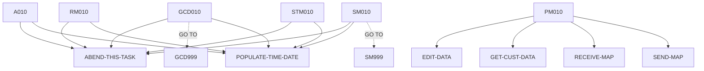

# BNK1CCA — source of truth

> Generated by `.github/skills/cobol-rekt/run-cobol-rekt.sh`. Do not edit by hand — re-run the script.
> **[rekt]** = from the cobol-rekt parse tree · **[scan]** = deterministic scan of the original source.

| | |
|---|---|
| Source | `src/base/cics/cobol/BNK1CCA.cbl` (979 lines) |
| Subsystem | `cics` |
| cobol-rekt | ✅ parsed |
| Sections / paragraphs [scan] | 27 |
| Decisions (IF / EVALUATE) [rekt] | 18 |
| EXEC CICS / EXEC SQL / DL/I calls [scan] | 35 / 0 / 0 |

## 1. Procedure structure

Control transfers inside the program [rekt]. Solid = `PERFORM`, dashed = `GO TO`.

| Section / paragraph | Lines | PERFORMs [rekt] | GO TO [rekt] | Decisions [rekt] | EXEC CICS | EXEC SQL |
|---|---|---|---|---|---|---|
| **PREMIERE** (section) | 177–177 | — | — | 0 | — | — |
| A010 | 178–315 | ABEND-THIS-TASK, POPULATE-TIME-DATE | — | 2 | 8 | — |
| A999 | 316–319 | — | — | 0 | — | — |
| **PROCESS-MAP** (section) | 320–320 | — | — | 0 | — | — |
| PM010 | 321–346 | EDIT-DATA, GET-CUST-DATA, RECEIVE-MAP, SEND-MAP | — | 1 | — | — |
| PM999 | 347–350 | — | — | 0 | — | — |
| **RECEIVE-MAP** (section) | 351–351 | — | — | 0 | — | — |
| RM010 | 352–425 | ABEND-THIS-TASK, POPULATE-TIME-DATE | — | 1 | 4 | — |
| RM999 | 426–429 | — | — | 0 | — | — |
| **EDIT-DATA** (section) | 430–430 | — | — | 0 | — | — |
| ED010 | 431–440 | — | — | 1 | — | — |
| ED999 | 441–444 | — | — | 0 | — | — |
| **GET-CUST-DATA** (section) | 445–445 | — | — | 0 | — | — |
| GCD010 | 446–634 | ABEND-THIS-TASK, POPULATE-TIME-DATE | GCD999 | 6 | 4 | — |
| GCD999 | 635–638 | — | — | 0 | — | — |
| **SEND-MAP** (section) | 639–639 | — | — | 0 | — | — |
| SM010 | 640–871 | ABEND-THIS-TASK, POPULATE-TIME-DATE | SM999 | 6 | 12 | — |
| SM999 | 872–875 | — | — | 0 | — | — |
| **SEND-TERMINATION-MSG** (section) | 876–876 | — | — | 0 | — | — |
| STM010 | 877–947 | ABEND-THIS-TASK, POPULATE-TIME-DATE | — | 1 | 4 | — |
| STM999 | 948–951 | — | — | 0 | — | — |
| **ABEND-THIS-TASK** (section) | 952–952 | — | — | 0 | — | — |
| ATT010 | 953–959 | — | — | 0 | 1 | — |
| ATT999 | 960–963 | — | — | 0 | — | — |
| **POPULATE-TIME-DATE** (section) | 964–964 | — | — | 0 | — | — |
| PTD010 | 965–977 | — | — | 0 | 2 | — |
| PTD999 | 978–979 | — | — | 0 | — | — |

## 2. Decision points

Every `IF` / `EVALUATE` found by cobol-rekt, in source order. Condition text is quoted from the original source line. These are where business rules live.

**A010**

- `src/base/cics/cobol/BNK1CCA.cbl:180` `EVALUATE TRUE → WHEN EIBCALEN = ZERO · WHEN EIBAID = DFHPA1 OR DFHPA2 OR DFHPA3 · WHEN EIBAID = DFHPF3 · WHEN EIBAID = DFHAID OR DFHPF12 · WHEN EIBAID = DFHCLEAR · WHEN EIBAID = DFHENTER · WHEN OTHER`
- `src/base/cics/cobol/BNK1CCA.cbl:257` `IF WS-CICS-RESP NOT = DFHRESP(NORMAL)`

**PM010**

- `src/base/cics/cobol/BNK1CCA.cbl:336` `IF VALID-DATA`

**RM010**

- `src/base/cics/cobol/BNK1CCA.cbl:365` `IF WS-CICS-RESP NOT = DFHRESP(NORMAL)`

**ED010**

- `src/base/cics/cobol/BNK1CCA.cbl:435` `IF CUSTNOI NOT NUMERIC`

**GCD010**

- `src/base/cics/cobol/BNK1CCA.cbl:467` `IF WS-CICS-RESP NOT = DFHRESP(NORMAL)`
- `src/base/cics/cobol/BNK1CCA.cbl:529` `IF CUSTOMER-FOUND = 'N'`
- `src/base/cics/cobol/BNK1CCA.cbl:555` `IF NUMBER-OF-ACCOUNTS = ZERO`
  - `src/base/cics/cobol/BNK1CCA.cbl:558` `IF COMM-SUCCESS = 'N'`
  - `src/base/cics/cobol/BNK1CCA.cbl:586` `IF COMM-AVAIL-BAL(WS-INDEX) < 0`
  - `src/base/cics/cobol/BNK1CCA.cbl:592` `IF COMM-ACTUAL-BAL(WS-INDEX) < 0`

**SM010**

- `src/base/cics/cobol/BNK1CCA.cbl:645` `IF SEND-ERASE`
  - `src/base/cics/cobol/BNK1CCA.cbl:655` `IF WS-CICS-RESP NOT = DFHRESP(NORMAL)`
- `src/base/cics/cobol/BNK1CCA.cbl:720` `IF SEND-DATAONLY`
  - `src/base/cics/cobol/BNK1CCA.cbl:730` `IF WS-CICS-RESP NOT = DFHRESP(NORMAL)`
- `src/base/cics/cobol/BNK1CCA.cbl:797` `IF SEND-DATAONLY-ALARM`
  - `src/base/cics/cobol/BNK1CCA.cbl:808` `IF WS-CICS-RESP NOT = DFHRESP(NORMAL)`

**STM010**

- `src/base/cics/cobol/BNK1CCA.cbl:889` `IF WS-CICS-RESP NOT = DFHRESP(NORMAL)`

## 3. External touchpoints [scan]

Every `EXEC CICS`, `EXEC SQL` and IMS DL/I call, as written in the original source.

| Line | Paragraph | Kind | Verb | Statement |
|---|---|---|---|---|
| `src/base/cics/cobol/BNK1CCA.cbl:202` | A010 | EXEC CICS | `RETURN` | `RETURN TRANSID('OMEN') IMMEDIATE RESP(WS-CICS-RESP) RESP2(WS-CICS-RESP2)` |
| `src/base/cics/cobol/BNK1CCA.cbl:215` | A010 | EXEC CICS | `RETURN` | `RETURN` |
| `src/base/cics/cobol/BNK1CCA.cbl:223` | A010 | EXEC CICS | `SEND CONTROL` | `SEND CONTROL ERASE FREEKB` |
| `src/base/cics/cobol/BNK1CCA.cbl:228` | A010 | EXEC CICS | `RETURN` | `RETURN` |
| `src/base/cics/cobol/BNK1CCA.cbl:249` | A010 | EXEC CICS | `RETURN` | `RETURN TRANSID('OCCA') COMMAREA(WS-COMM-AREA) LENGTH(248) RESP(WS-CICS-RESP) RESP2(WS-CICS-RESP2)` |
| `src/base/cics/cobol/BNK1CCA.cbl:270` | A010 | EXEC CICS | `ASSIGN` | `ASSIGN APPLID(ABND-APPLID)` |
| `src/base/cics/cobol/BNK1CCA.cbl:290` | A010 | EXEC CICS | `ASSIGN` | `ASSIGN PROGRAM(ABND-PROGRAM)` |
| `src/base/cics/cobol/BNK1CCA.cbl:304` | A010 | EXEC CICS | `LINK` | `LINK PROGRAM(WS-ABEND-PGM) COMMAREA(ABNDINFO-REC)` |
| `src/base/cics/cobol/BNK1CCA.cbl:357` | RM010 | EXEC CICS | `RECEIVE` | `RECEIVE MAP('BNK1ACC') MAPSET('BNK1ACC') INTO(BNK1ACCI) RESP(WS-CICS-RESP) RESP2(WS-CICS-RESP2)` |
| `src/base/cics/cobol/BNK1CCA.cbl:379` | RM010 | EXEC CICS | `ASSIGN` | `ASSIGN APPLID(ABND-APPLID)` |
| `src/base/cics/cobol/BNK1CCA.cbl:399` | RM010 | EXEC CICS | `ASSIGN` | `ASSIGN PROGRAM(ABND-PROGRAM)` |
| `src/base/cics/cobol/BNK1CCA.cbl:413` | RM010 | EXEC CICS | `LINK` | `LINK PROGRAM(WS-ABEND-PGM) COMMAREA(ABNDINFO-REC)` |
| `src/base/cics/cobol/BNK1CCA.cbl:459` | GCD010 | EXEC CICS | `LINK` | `LINK PROGRAM(INQACCCU-PROGRAM) COMMAREA(INQACCCU-COMMAREA) RESP(WS-CICS-RESP) RESP2(WS-CICS-RESP2) SYNCONRETU…` |
| `src/base/cics/cobol/BNK1CCA.cbl:480` | GCD010 | EXEC CICS | `ASSIGN` | `ASSIGN APPLID(ABND-APPLID)` |
| `src/base/cics/cobol/BNK1CCA.cbl:500` | GCD010 | EXEC CICS | `ASSIGN` | `ASSIGN PROGRAM(ABND-PROGRAM)` |
| `src/base/cics/cobol/BNK1CCA.cbl:514` | GCD010 | EXEC CICS | `LINK` | `LINK PROGRAM(WS-ABEND-PGM) COMMAREA(ABNDINFO-REC)` |
| `src/base/cics/cobol/BNK1CCA.cbl:646` | SM010 | EXEC CICS | `SEND` | `SEND MAP('BNK1ACC') MAPSET('BNK1ACC') FROM(BNK1ACCO) ERASE FREEKB RESP(WS-CICS-RESP) RESP2(WS-CICS-RESP2)` |
| `src/base/cics/cobol/BNK1CCA.cbl:668` | SM010 | EXEC CICS | `ASSIGN` | `ASSIGN APPLID(ABND-APPLID)` |
| `src/base/cics/cobol/BNK1CCA.cbl:688` | SM010 | EXEC CICS | `ASSIGN` | `ASSIGN PROGRAM(ABND-PROGRAM)` |
| `src/base/cics/cobol/BNK1CCA.cbl:702` | SM010 | EXEC CICS | `LINK` | `LINK PROGRAM(WS-ABEND-PGM) COMMAREA(ABNDINFO-REC)` |
| `src/base/cics/cobol/BNK1CCA.cbl:721` | SM010 | EXEC CICS | `SEND` | `SEND MAP('BNK1ACC') MAPSET('BNK1ACC') FROM(BNK1ACCO) DATAONLY FREEKB RESP(WS-CICS-RESP) RESP2(WS-CICS-RESP2)` |
| `src/base/cics/cobol/BNK1CCA.cbl:744` | SM010 | EXEC CICS | `ASSIGN` | `ASSIGN APPLID(ABND-APPLID)` |
| `src/base/cics/cobol/BNK1CCA.cbl:764` | SM010 | EXEC CICS | `ASSIGN` | `ASSIGN PROGRAM(ABND-PROGRAM)` |
| `src/base/cics/cobol/BNK1CCA.cbl:778` | SM010 | EXEC CICS | `LINK` | `LINK PROGRAM(WS-ABEND-PGM) COMMAREA(ABNDINFO-REC)` |
| `src/base/cics/cobol/BNK1CCA.cbl:798` | SM010 | EXEC CICS | `SEND` | `SEND MAP('BNK1ACC') MAPSET('BNK1ACC') FROM(BNK1ACCO) DATAONLY ALARM FREEKB RESP(WS-CICS-RESP) RESP2(WS-CICS-R…` |
| `src/base/cics/cobol/BNK1CCA.cbl:823` | SM010 | EXEC CICS | `ASSIGN` | `ASSIGN APPLID(ABND-APPLID)` |
| `src/base/cics/cobol/BNK1CCA.cbl:843` | SM010 | EXEC CICS | `ASSIGN` | `ASSIGN PROGRAM(ABND-PROGRAM)` |
| `src/base/cics/cobol/BNK1CCA.cbl:857` | SM010 | EXEC CICS | `LINK` | `LINK PROGRAM(WS-ABEND-PGM) COMMAREA(ABNDINFO-REC)` |
| `src/base/cics/cobol/BNK1CCA.cbl:881` | STM010 | EXEC CICS | `SEND TEXT` | `SEND TEXT FROM(END-OF-SESSION-MESSAGE) ERASE FREEKB RESP(WS-CICS-RESP) RESP2(WS-CICS-RESP2)` |
| `src/base/cics/cobol/BNK1CCA.cbl:902` | STM010 | EXEC CICS | `ASSIGN` | `ASSIGN APPLID(ABND-APPLID)` |
| `src/base/cics/cobol/BNK1CCA.cbl:922` | STM010 | EXEC CICS | `ASSIGN` | `ASSIGN PROGRAM(ABND-PROGRAM)` |
| `src/base/cics/cobol/BNK1CCA.cbl:936` | STM010 | EXEC CICS | `LINK` | `LINK PROGRAM(WS-ABEND-PGM) COMMAREA(ABNDINFO-REC)` |
| `src/base/cics/cobol/BNK1CCA.cbl:955` | ATT010 | EXEC CICS | `ABEND` | `ABEND ABCODE('HBNK') NODUMP` |
| `src/base/cics/cobol/BNK1CCA.cbl:967` | PTD010 | EXEC CICS | `ASKTIME` | `ASKTIME ABSTIME(WS-U-TIME)` |
| `src/base/cics/cobol/BNK1CCA.cbl:971` | PTD010 | EXEC CICS | `FORMATTIME` | `FORMATTIME ABSTIME(WS-U-TIME) DDMMYYYY(WS-ORIG-DATE) TIME(WS-TIME-NOW) DATESEP` |

## 4. Dependencies [scan]

**Program / transaction transfers**

Lines refer to `src/base/cics/cobol/BNK1CCA.cbl`.

| Kind | Target(s) | Resolved via | Lines · paragraph |
|---|---|---|---|
| RETURN TRANSID | `OMEN` | literal | `:202` A010 |
| RETURN TRANSID | `OCCA` | literal | `:249` A010 |
| LINK | `ABNDPROC` | variable `WS-ABEND-PGM` (VALUE clause) | `:304` A010, `:413` RM010, `:514` GCD010, `:702` SM010, `:778` SM010, `:857` SM010, `:936` STM010 |
| LINK | `INQACCCU` | variable `INQACCCU-PROGRAM` (VALUE clause) | `:459` GCD010 |

**Copybooks**

- `BNK1ACC` (`src/base/cics/cobol/BNK1CCA.cbl:64`) → BMS symbolic map — generated at build time from `src/base/cics/bms/BNK1ACC.bms`
- `DFHAID` (`src/base/cics/cobol/BNK1CCA.cbl:66`) → IBM-supplied CICS copybook (not in repo)
- `INQACCCU` (`src/base/cics/cobol/BNK1CCA.cbl:110`) → `src/base/cics/copy/INQACCCU.cpy`
- `ABNDINFO` (`src/base/cics/cobol/BNK1CCA.cbl:151`) → `src/base/cics/copy/ABNDINFO.cpy`

## 5. Condition names (88-levels) [scan]

Named conditions encode business codes. Includes copybooks reached from this program.

| Condition | Value(s) | Parent item | Defined at |
|---|---|---|---|
| `VALID-DATA` | `'Y'` | VALID-DATA-SW | `src/base/cics/cobol/BNK1CCA.cbl:44` |
| `SEND-ERASE` | `'1'` | SEND-FLAG | `src/base/cics/cobol/BNK1CCA.cbl:48` |
| `SEND-DATAONLY` | `'2'` | SEND-FLAG | `src/base/cics/cobol/BNK1CCA.cbl:49` |
| `SEND-DATAONLY-ALARM` | `'3'` | SEND-FLAG | `src/base/cics/cobol/BNK1CCA.cbl:50` |

## 6. Data items [rekt]

**Records (01 / 77 levels)**

| Name | Clause | Fields | Section | Defined at |
|---|---|---|---|---|
| `WS-CICS-WORK-AREA` | `(group)` | 2 | WORKING_STORAGE | `src/base/cics/cobol/BNK1CCA.cbl:29` |
| `WS-FAIL-INFO` | `(group)` | 7 | WORKING_STORAGE | `src/base/cics/cobol/BNK1CCA.cbl:33` |
| `SWITCHES` | `(group)` | 1 | WORKING_STORAGE | `src/base/cics/cobol/BNK1CCA.cbl:42` |
| `FLAGS` | `(group)` | 1 | WORKING_STORAGE | `src/base/cics/cobol/BNK1CCA.cbl:46` |
| `ACTION-ALPHA` | `(group)` | 1 | WORKING_STORAGE | `src/base/cics/cobol/BNK1CCA.cbl:52` |
| `END-OF-SESSION-MESSAGE` | `PIC X(13) VALUE 'Session Ended'` | — | WORKING_STORAGE | `src/base/cics/cobol/BNK1CCA.cbl:58` |
| `RESPONSE-CODE` | `PIC S9(8) COMP` | — | WORKING_STORAGE | `src/base/cics/cobol/BNK1CCA.cbl:60` |
| `COMMUNICATION-AREA` | `PIC X` | — | WORKING_STORAGE | `src/base/cics/cobol/BNK1CCA.cbl:62` |
| `COMM-DOB-SPLIT` | `(group)` | 3 | WORKING_STORAGE | `src/base/cics/cobol/BNK1CCA.cbl:68` |
| `COMM-ADDR-SPLIT` | `(group)` | 3 | WORKING_STORAGE | `src/base/cics/cobol/BNK1CCA.cbl:73` |
| `WS-COMM-AREA` | `(group)` | 18 | WORKING_STORAGE | `src/base/cics/cobol/BNK1CCA.cbl:78` |
| `WS-CONVERSION` | `(group)` | 8 | WORKING_STORAGE | `src/base/cics/cobol/BNK1CCA.cbl:98` |
| `INQACCCU-PROGRAM` | `PIC X(8) VALUE 'INQACCCU'` | — | WORKING_STORAGE | `src/base/cics/cobol/BNK1CCA.cbl:108` |
| `INQACCCU-COMMAREA` | `(group)` | 31 | WORKING_STORAGE | `src/base/cics/cobol/BNK1CCA.cbl:109` |
| `WS-INDEX` | `PIC S9(8) BINARY` | — | WORKING_STORAGE | `src/base/cics/cobol/BNK1CCA.cbl:112` |
| `SCODE-CHAR` | `PIC X(6)` | — | WORKING_STORAGE | `src/base/cics/cobol/BNK1CCA.cbl:113` |
| `ACCNO-CHAR` | `PIC X(8)` | — | WORKING_STORAGE | `src/base/cics/cobol/BNK1CCA.cbl:114` |
| `NUMBER-OF-ACCOUNTS-DISPLAY` | `PIC Z9 DISPLAY` | — | WORKING_STORAGE | `src/base/cics/cobol/BNK1CCA.cbl:115` |
| `WS-AVAIL-BAL-SIGN` | `PIC X VALUE ' '` | — | WORKING_STORAGE | `src/base/cics/cobol/BNK1CCA.cbl:117` |
| `WS-ACT-BAL-SIGN` | `PIC X VALUE ' '` | — | WORKING_STORAGE | `src/base/cics/cobol/BNK1CCA.cbl:118` |
| `DUMP-TITLE` | `PIC X(16) VALUE 'BNK1CCA DUMP NOW'` | — | WORKING_STORAGE | `src/base/cics/cobol/BNK1CCA.cbl:120` |
| `COMPANY-NAME-FULL` | `PIC X(32)` | — | WORKING_STORAGE | `src/base/cics/cobol/BNK1CCA.cbl:123` |
| `WS-U-TIME` | `PIC S9(15) COMP-3` | — | WORKING_STORAGE | `src/base/cics/cobol/BNK1CCA.cbl:125` |
| `WS-ORIG-DATE` | `PIC X(10)` | — | WORKING_STORAGE | `src/base/cics/cobol/BNK1CCA.cbl:126` |
| `WS-ORIG-DATE-GRP` | `REDEFINES WS-ORIG-DATE` REDEFINES WS-ORIG-DATE | 5 | WORKING_STORAGE | `src/base/cics/cobol/BNK1CCA.cbl:127` |
| `WS-ORIG-DATE-GRP-X` | `(group)` | 5 | WORKING_STORAGE | `src/base/cics/cobol/BNK1CCA.cbl:134` |
| `WS-TIME-DATA` | `(group)` | 5 | WORKING_STORAGE | `src/base/cics/cobol/BNK1CCA.cbl:141` |
| `WS-ABEND-PGM` | `PIC X(8) VALUE 'ABNDPROC'` | — | WORKING_STORAGE | `src/base/cics/cobol/BNK1CCA.cbl:148` |
| `ABNDINFO-REC` | `(group)` | 13 | WORKING_STORAGE | `src/base/cics/cobol/BNK1CCA.cbl:150` |
| `DFHCOMMAREA` | `(group)` | 18 | LINKAGE | `src/base/cics/cobol/BNK1CCA.cbl:154` |

**LINKAGE SECTION — the program's interface contract (COMMAREA / parameters)**

| Level | Name | Clause | Type | Defined at |
|---|---|---|---|---|
| 01 | DFHCOMMAREA | `(group)` | OBJECT | `src/base/cics/cobol/BNK1CCA.cbl:154` |
| 03 | &nbsp;&nbsp;COMM-EYE | `PIC X(4)` | STRING | `src/base/cics/cobol/BNK1CCA.cbl:155` |
| 03 | &nbsp;&nbsp;COMM-SCODE | `PIC X(6)` | STRING | `src/base/cics/cobol/BNK1CCA.cbl:156` |
| 03 | &nbsp;&nbsp;COMM-CUSTNO | `PIC X(10)` | STRING | `src/base/cics/cobol/BNK1CCA.cbl:157` |
| 03 | &nbsp;&nbsp;COMM-NAME | `(group)` | OBJECT | `src/base/cics/cobol/BNK1CCA.cbl:158` |
| 05 | &nbsp;&nbsp;&nbsp;&nbsp;COMM-TITLE | `PIC X(10)` | STRING | `src/base/cics/cobol/BNK1CCA.cbl:159` |
| 05 | &nbsp;&nbsp;&nbsp;&nbsp;COMM-FIRST-NAME | `PIC X(50)` | STRING | `src/base/cics/cobol/BNK1CCA.cbl:160` |
| 05 | &nbsp;&nbsp;&nbsp;&nbsp;COMM-LAST-NAME | `PIC X(50)` | STRING | `src/base/cics/cobol/BNK1CCA.cbl:161` |
| 03 | &nbsp;&nbsp;COMM-DOB | `(group)` | OBJECT | `src/base/cics/cobol/BNK1CCA.cbl:162` |
| 05 | &nbsp;&nbsp;&nbsp;&nbsp;COMM-DOB-DAY | `PIC 99 DISPLAY` | NUMBER | `src/base/cics/cobol/BNK1CCA.cbl:163` |
| 05 | &nbsp;&nbsp;&nbsp;&nbsp;COMM-DOB-MONTH | `PIC 99 DISPLAY` | NUMBER | `src/base/cics/cobol/BNK1CCA.cbl:164` |
| 05 | &nbsp;&nbsp;&nbsp;&nbsp;COMM-DOB-YEAR | `PIC 9999 DISPLAY` | NUMBER | `src/base/cics/cobol/BNK1CCA.cbl:165` |
| 03 | &nbsp;&nbsp;COMM-PHONE | `PIC X(20)` | STRING | `src/base/cics/cobol/BNK1CCA.cbl:166` |
| 03 | &nbsp;&nbsp;COMM-ADDR | `(group)` | OBJECT | `src/base/cics/cobol/BNK1CCA.cbl:167` |
| 05 | &nbsp;&nbsp;&nbsp;&nbsp;COMM-ADDR-LINE1 | `PIC X(50)` | STRING | `src/base/cics/cobol/BNK1CCA.cbl:168` |
| 05 | &nbsp;&nbsp;&nbsp;&nbsp;COMM-ADDR-LINE2 | `PIC X(50)` | STRING | `src/base/cics/cobol/BNK1CCA.cbl:169` |
| 05 | &nbsp;&nbsp;&nbsp;&nbsp;COMM-CITY | `PIC X(50)` | STRING | `src/base/cics/cobol/BNK1CCA.cbl:170` |
| 05 | &nbsp;&nbsp;&nbsp;&nbsp;COMM-POSTCODE | `PIC X(10)` | STRING | `src/base/cics/cobol/BNK1CCA.cbl:171` |
| 05 | &nbsp;&nbsp;&nbsp;&nbsp;COMM-COUNTRY | `PIC X(50)` | STRING | `src/base/cics/cobol/BNK1CCA.cbl:172` |

_Working-storage fields below the 01 level are not listed — open the definition to drill in._
