# BNK1CRA — source of truth

> Generated by `.github/skills/cobol-rekt/run-cobol-rekt.sh`. Do not edit by hand — re-run the script.
> **[rekt]** = from the cobol-rekt parse tree · **[scan]** = deterministic scan of the original source.

| | |
|---|---|
| Source | `src/base/cics/cobol/BNK1CRA.cbl` (1169 lines) |
| Subsystem | `cics` |
| cobol-rekt | ✅ parsed |
| Sections / paragraphs [scan] | 30 |
| Decisions (IF / EVALUATE) [rekt] | 30 |
| EXEC CICS / EXEC SQL / DL/I calls [scan] | 37 / 0 / 0 |

## 1. Procedure structure

Control transfers inside the program [rekt]. Solid = `PERFORM`, dashed = `GO TO`.

```mermaid
flowchart TD
  n_A010["A010"]
  n_ABEND_THIS_TASK["ABEND-THIS-TASK"]
  n_ED010["ED010"]
  n_ED999["ED999"]
  n_EDIT_DATA["EDIT-DATA"]
  n_PM010["PM010"]
  n_POPULATE_TIME_DATE["POPULATE-TIME-DATE"]
  n_RECEIVE_MAP["RECEIVE-MAP"]
  n_RM010["RM010"]
  n_SEND_MAP["SEND-MAP"]
  n_SM010["SM010"]
  n_SM999["SM999"]
  n_STM010["STM010"]
  n_UCD010["UCD010"]
  n_UPD_CRED_DATA["UPD-CRED-DATA"]
  n_VA010["VA010"]
  n_VA999["VA999"]
  n_VALIDATE_AMOUNT["VALIDATE-AMOUNT"]
  n_A010 --> n_ABEND_THIS_TASK
  n_A010 --> n_POPULATE_TIME_DATE
  n_ED010 -.->|GO TO| n_ED999
  n_ED010 --> n_VALIDATE_AMOUNT
  n_PM010 --> n_EDIT_DATA
  n_PM010 --> n_RECEIVE_MAP
  n_PM010 --> n_SEND_MAP
  n_PM010 --> n_UPD_CRED_DATA
  n_RM010 --> n_ABEND_THIS_TASK
  n_RM010 --> n_POPULATE_TIME_DATE
  n_SM010 --> n_ABEND_THIS_TASK
  n_SM010 --> n_POPULATE_TIME_DATE
  n_SM010 -.->|GO TO| n_SM999
  n_STM010 --> n_ABEND_THIS_TASK
  n_STM010 --> n_POPULATE_TIME_DATE
  n_UCD010 --> n_ABEND_THIS_TASK
  n_UCD010 --> n_POPULATE_TIME_DATE
  n_VA010 -.->|GO TO| n_VA999
```

| Section / paragraph | Lines | PERFORMs [rekt] | GO TO [rekt] | Decisions [rekt] | EXEC CICS | EXEC SQL |
|---|---|---|---|---|---|---|
| **PREMIERE** (section) | 177–177 | — | — | 0 | — | — |
| A010 | 178–329 | ABEND-THIS-TASK, POPULATE-TIME-DATE | — | 3 | 8 | — |
| A999 | 330–333 | — | — | 0 | — | — |
| **PROCESS-MAP** (section) | 334–334 | — | — | 0 | — | — |
| PM010 | 335–360 | EDIT-DATA, RECEIVE-MAP, SEND-MAP, UPD-CRED-DATA | — | 1 | — | — |
| PM999 | 361–364 | — | — | 0 | — | — |
| **RECEIVE-MAP** (section) | 365–365 | — | — | 0 | — | — |
| RM010 | 366–436 | ABEND-THIS-TASK, POPULATE-TIME-DATE | — | 1 | 4 | — |
| RM999 | 437–440 | — | — | 0 | — | — |
| **EDIT-DATA** (section) | 441–441 | — | — | 0 | — | — |
| ED010 | 442–475 | VALIDATE-AMOUNT | ED999 | 3 | 1 | — |
| ED999 | 476–479 | — | — | 0 | — | — |
| **UPD-CRED-DATA** (section) | 480–480 | — | — | 0 | — | — |
| UCD010 | 481–638 | ABEND-THIS-TASK, POPULATE-TIME-DATE | — | 4 | 5 | — |
| UCD999 | 639–642 | — | — | 0 | — | — |
| **SEND-MAP** (section) | 643–643 | — | — | 0 | — | — |
| SM010 | 644–869 | ABEND-THIS-TASK, POPULATE-TIME-DATE | SM999 | 6 | 12 | — |
| SM999 | 870–873 | — | — | 0 | — | — |
| **SEND-TERMINATION-MSG** (section) | 874–874 | — | — | 0 | — | — |
| STM010 | 875–945 | ABEND-THIS-TASK, POPULATE-TIME-DATE | — | 1 | 4 | — |
| STM999 | 946–949 | — | — | 0 | — | — |
| **ABEND-THIS-TASK** (section) | 950–950 | — | — | 0 | — | — |
| ATT010 | 951–957 | — | — | 0 | 1 | — |
| ATT999 | 958–961 | — | — | 0 | — | — |
| **VALIDATE-AMOUNT** (section) | 962–962 | — | — | 0 | — | — |
| VA010 | 963–1149 | — | VA999 | 11 | — | — |
| VA999 | 1150–1153 | — | — | 0 | — | — |
| **POPULATE-TIME-DATE** (section) | 1154–1154 | — | — | 0 | — | — |
| PTD010 | 1155–1167 | — | — | 0 | 2 | — |
| PTD999 | 1168–1169 | — | — | 0 | — | — |

## 2. Decision points

Every `IF` / `EVALUATE` found by cobol-rekt, in source order. Condition text is quoted from the original source line. These are where business rules live.

**A010**

- `src/base/cics/cobol/BNK1CRA.cbl:180` `EVALUATE TRUE → WHEN EIBCALEN = ZERO · WHEN EIBAID = DFHPA1 OR DFHPA2 OR DFHPA3 · WHEN EIBAID = DFHPF3 · WHEN EIBAID = DFHAID OR DFHPF12 · WHEN EIBAID = DFHCLEAR · WHEN EIBAID = DFHENTER · WHEN OTHER`
- `src/base/cics/cobol/BNK1CRA.cbl:255` `IF EIBCALEN NOT = ZERO`
- `src/base/cics/cobol/BNK1CRA.cbl:271` `IF WS-CICS-RESP NOT = DFHRESP(NORMAL)`

**PM010**

- `src/base/cics/cobol/BNK1CRA.cbl:350` `IF VALID-DATA`

**RM010**

- `src/base/cics/cobol/BNK1CRA.cbl:378` `IF WS-CICS-RESP NOT = DFHRESP(NORMAL)`

**ED010**

- `src/base/cics/cobol/BNK1CRA.cbl:450` `IF ACCNOI NOT NUMERIC`
- `src/base/cics/cobol/BNK1CRA.cbl:457` `IF ACCNOI = ZERO`
- `src/base/cics/cobol/BNK1CRA.cbl:464` `IF SIGNI NOT = '+' AND SIGNI NOT = '-' AND SIGNL = 1`

**UCD010**

- `src/base/cics/cobol/BNK1CRA.cbl:494` `IF SIGNI = '-'`
- `src/base/cics/cobol/BNK1CRA.cbl:519` `IF WS-CICS-RESP NOT = DFHRESP(NORMAL)`
- `src/base/cics/cobol/BNK1CRA.cbl:581` `IF SUBPGM-SUCCESS = 'N'`
  - `src/base/cics/cobol/BNK1CRA.cbl:585` `EVALUATE SUBPGM-FAIL-CODE → WHEN '1' · WHEN '2' · WHEN '3' · WHEN OTHER`

**SM010**

- `src/base/cics/cobol/BNK1CRA.cbl:648` `IF SEND-ERASE`
  - `src/base/cics/cobol/BNK1CRA.cbl:658` `IF WS-CICS-RESP NOT = DFHRESP(NORMAL)`
- `src/base/cics/cobol/BNK1CRA.cbl:723` `IF SEND-DATAONLY`
  - `src/base/cics/cobol/BNK1CRA.cbl:733` `IF WS-CICS-RESP NOT = DFHRESP(NORMAL)`
- `src/base/cics/cobol/BNK1CRA.cbl:798` `IF SEND-DATAONLY-ALARM`
  - `src/base/cics/cobol/BNK1CRA.cbl:809` `IF WS-CICS-RESP NOT = DFHRESP(NORMAL)`

**STM010**

- `src/base/cics/cobol/BNK1CRA.cbl:887` `IF WS-CICS-RESP NOT = DFHRESP(NORMAL)`

**VA010**

- `src/base/cics/cobol/BNK1CRA.cbl:967` `IF AMTL = ZERO`
- `src/base/cics/cobol/BNK1CRA.cbl:976` `IF AMTI(1:AMTL) IS NUMERIC`
- `src/base/cics/cobol/BNK1CRA.cbl:991` `IF WS-NUM-COUNT-TOTAL = AMTL`
- `src/base/cics/cobol/BNK1CRA.cbl:1001` `IF WS-NUM-COUNT-TOTAL = ZERO`
- `src/base/cics/cobol/BNK1CRA.cbl:1047` `IF WS-NUM-COUNT-SPACE > 0`
- `src/base/cics/cobol/BNK1CRA.cbl:1059` `IF WS-NUM-COUNT-TOTAL < WS-AMOUNT-UNSTR-L`
- `src/base/cics/cobol/BNK1CRA.cbl:1077` `IF WS-NUM-COUNT-POINT > 1`
- `src/base/cics/cobol/BNK1CRA.cbl:1091` `IF WS-NUM-COUNT-POINT = 1`
  - `src/base/cics/cobol/BNK1CRA.cbl:1096` `IF WS-NUM-COUNT-TOTAL > 2`
    - `src/base/cics/cobol/BNK1CRA.cbl:1117` `IF WS-NUM-COUNT-TOTAL > 2`
- `src/base/cics/cobol/BNK1CRA.cbl:1136` `IF WS-AMOUNT-AS-FLOAT = ZERO`

## 3. External touchpoints [scan]

Every `EXEC CICS`, `EXEC SQL` and IMS DL/I call, as written in the original source.

| Line | Paragraph | Kind | Verb | Statement |
|---|---|---|---|---|
| `src/base/cics/cobol/BNK1CRA.cbl:201` | A010 | EXEC CICS | `RETURN` | `RETURN TRANSID('OMEN') IMMEDIATE RESP(WS-CICS-RESP) RESP2(WS-CICS-RESP2)` |
| `src/base/cics/cobol/BNK1CRA.cbl:215` | A010 | EXEC CICS | `RETURN` | `RETURN` |
| `src/base/cics/cobol/BNK1CRA.cbl:223` | A010 | EXEC CICS | `SEND CONTROL` | `SEND CONTROL ERASE FREEKB` |
| `src/base/cics/cobol/BNK1CRA.cbl:228` | A010 | EXEC CICS | `RETURN` | `RETURN` |
| `src/base/cics/cobol/BNK1CRA.cbl:263` | A010 | EXEC CICS | `RETURN` | `RETURN TRANSID('OCRA') COMMAREA(WS-COMM-AREA) LENGTH(21) RESP(WS-CICS-RESP) RESP2(WS-CICS-RESP2)` |
| `src/base/cics/cobol/BNK1CRA.cbl:284` | A010 | EXEC CICS | `ASSIGN` | `ASSIGN APPLID(ABND-APPLID)` |
| `src/base/cics/cobol/BNK1CRA.cbl:304` | A010 | EXEC CICS | `ASSIGN` | `ASSIGN PROGRAM(ABND-PROGRAM)` |
| `src/base/cics/cobol/BNK1CRA.cbl:318` | A010 | EXEC CICS | `LINK` | `LINK PROGRAM(WS-ABEND-PGM) COMMAREA(ABNDINFO-REC)` |
| `src/base/cics/cobol/BNK1CRA.cbl:370` | RM010 | EXEC CICS | `RECEIVE` | `RECEIVE MAP('BNK1CD') MAPSET('BNK1CDM') INTO(BNK1CDI) RESP(WS-CICS-RESP) RESP2(WS-CICS-RESP2)` |
| `src/base/cics/cobol/BNK1CRA.cbl:391` | RM010 | EXEC CICS | `ASSIGN` | `ASSIGN APPLID(ABND-APPLID)` |
| `src/base/cics/cobol/BNK1CRA.cbl:411` | RM010 | EXEC CICS | `ASSIGN` | `ASSIGN PROGRAM(ABND-PROGRAM)` |
| `src/base/cics/cobol/BNK1CRA.cbl:425` | RM010 | EXEC CICS | `LINK` | `LINK PROGRAM(WS-ABEND-PGM) COMMAREA(ABNDINFO-REC)` |
| `src/base/cics/cobol/BNK1CRA.cbl:446` | ED010 | EXEC CICS | `BIF` | `BIF DEEDIT FIELD(ACCNOI)` |
| `src/base/cics/cobol/BNK1CRA.cbl:503` | UCD010 | EXEC CICS | `INQUIRE` | `INQUIRE ASSOCIATION(EIBTASKN) ODAPPLID(SUBPGM-APPLID) ODUSERID(SUBPGM-USERID) ODFACILNAME(SUBPGM-FACILITY-NAM…` |
| `src/base/cics/cobol/BNK1CRA.cbl:511` | UCD010 | EXEC CICS | `LINK` | `LINK PROGRAM('DBCRFUN') COMMAREA(SUBPGM-PARMS) RESP(WS-CICS-RESP) RESP2(WS-CICS-RESP2) SYNCONRETURN` |
| `src/base/cics/cobol/BNK1CRA.cbl:532` | UCD010 | EXEC CICS | `ASSIGN` | `ASSIGN APPLID(ABND-APPLID)` |
| `src/base/cics/cobol/BNK1CRA.cbl:552` | UCD010 | EXEC CICS | `ASSIGN` | `ASSIGN PROGRAM(ABND-PROGRAM)` |
| `src/base/cics/cobol/BNK1CRA.cbl:566` | UCD010 | EXEC CICS | `LINK` | `LINK PROGRAM(WS-ABEND-PGM) COMMAREA(ABNDINFO-REC)` |
| `src/base/cics/cobol/BNK1CRA.cbl:649` | SM010 | EXEC CICS | `SEND` | `SEND MAP('BNK1CD') MAPSET('BNK1CDM') FROM(BNK1CDO) ERASE FREEKB RESP(WS-CICS-RESP) RESP2(WS-CICS-RESP2)` |
| `src/base/cics/cobol/BNK1CRA.cbl:671` | SM010 | EXEC CICS | `ASSIGN` | `ASSIGN APPLID(ABND-APPLID)` |
| `src/base/cics/cobol/BNK1CRA.cbl:691` | SM010 | EXEC CICS | `ASSIGN` | `ASSIGN PROGRAM(ABND-PROGRAM)` |
| `src/base/cics/cobol/BNK1CRA.cbl:705` | SM010 | EXEC CICS | `LINK` | `LINK PROGRAM(WS-ABEND-PGM) COMMAREA(ABNDINFO-REC)` |
| `src/base/cics/cobol/BNK1CRA.cbl:724` | SM010 | EXEC CICS | `SEND` | `SEND MAP('BNK1CD') MAPSET('BNK1CDM') FROM(BNK1CDO) DATAONLY FREEKB RESP(WS-CICS-RESP) RESP2(WS-CICS-RESP2)` |
| `src/base/cics/cobol/BNK1CRA.cbl:746` | SM010 | EXEC CICS | `ASSIGN` | `ASSIGN APPLID(ABND-APPLID)` |
| `src/base/cics/cobol/BNK1CRA.cbl:766` | SM010 | EXEC CICS | `ASSIGN` | `ASSIGN PROGRAM(ABND-PROGRAM)` |
| `src/base/cics/cobol/BNK1CRA.cbl:780` | SM010 | EXEC CICS | `LINK` | `LINK PROGRAM(WS-ABEND-PGM) COMMAREA(ABNDINFO-REC)` |
| `src/base/cics/cobol/BNK1CRA.cbl:799` | SM010 | EXEC CICS | `SEND` | `SEND MAP('BNK1CD') MAPSET('BNK1CDM') FROM(BNK1CDO) DATAONLY ALARM FREEKB RESP(WS-CICS-RESP) RESP2(WS-CICS-RES…` |
| `src/base/cics/cobol/BNK1CRA.cbl:822` | SM010 | EXEC CICS | `ASSIGN` | `ASSIGN APPLID(ABND-APPLID)` |
| `src/base/cics/cobol/BNK1CRA.cbl:842` | SM010 | EXEC CICS | `ASSIGN` | `ASSIGN PROGRAM(ABND-PROGRAM)` |
| `src/base/cics/cobol/BNK1CRA.cbl:856` | SM010 | EXEC CICS | `LINK` | `LINK PROGRAM(WS-ABEND-PGM) COMMAREA(ABNDINFO-REC)` |
| `src/base/cics/cobol/BNK1CRA.cbl:879` | STM010 | EXEC CICS | `SEND TEXT` | `SEND TEXT FROM(END-OF-SESSION-MESSAGE) ERASE FREEKB RESP(WS-CICS-RESP) RESP2(WS-CICS-RESP2)` |
| `src/base/cics/cobol/BNK1CRA.cbl:900` | STM010 | EXEC CICS | `ASSIGN` | `ASSIGN APPLID(ABND-APPLID)` |
| `src/base/cics/cobol/BNK1CRA.cbl:920` | STM010 | EXEC CICS | `ASSIGN` | `ASSIGN PROGRAM(ABND-PROGRAM)` |
| `src/base/cics/cobol/BNK1CRA.cbl:934` | STM010 | EXEC CICS | `LINK` | `LINK PROGRAM(WS-ABEND-PGM) COMMAREA(ABNDINFO-REC)` |
| `src/base/cics/cobol/BNK1CRA.cbl:953` | ATT010 | EXEC CICS | `ABEND` | `ABEND ABCODE('HBNK') NODUMP` |
| `src/base/cics/cobol/BNK1CRA.cbl:1157` | PTD010 | EXEC CICS | `ASKTIME` | `ASKTIME ABSTIME(WS-U-TIME)` |
| `src/base/cics/cobol/BNK1CRA.cbl:1161` | PTD010 | EXEC CICS | `FORMATTIME` | `FORMATTIME ABSTIME(WS-U-TIME) DDMMYYYY(WS-ORIG-DATE) TIME(WS-TIME-NOW) DATESEP` |

## 4. Dependencies [scan]

**Program / transaction transfers**

Lines refer to `src/base/cics/cobol/BNK1CRA.cbl`.

| Kind | Target(s) | Resolved via | Lines · paragraph |
|---|---|---|---|
| RETURN TRANSID | `OMEN` | literal | `:201` A010 |
| RETURN TRANSID | `OCRA` | literal | `:263` A010 |
| LINK | `ABNDPROC` | variable `WS-ABEND-PGM` (VALUE clause) | `:318` A010, `:425` RM010, `:566` UCD010, `:705` SM010, `:780` SM010, `:856` SM010, `:934` STM010 |
| LINK | `DBCRFUN` | literal | `:511` UCD010 |

**Copybooks**

- `BNK1CDM` (`src/base/cics/cobol/BNK1CRA.cbl:66`) → BMS symbolic map — generated at build time from `src/base/cics/bms/BNK1CDM.bms`
- `DFHAID` (`src/base/cics/cobol/BNK1CRA.cbl:68`) → IBM-supplied CICS copybook (not in repo)
- `ABNDINFO` (`src/base/cics/cobol/BNK1CRA.cbl:167`) → `src/base/cics/copy/ABNDINFO.cpy`

## 5. Condition names (88-levels) [scan]

Named conditions encode business codes. Includes copybooks reached from this program.

| Condition | Value(s) | Parent item | Defined at |
|---|---|---|---|
| `VALID-DATA` | `'Y'` | VALID-DATA-SW | `src/base/cics/cobol/BNK1CRA.cbl:46` |
| `SEND-ERASE` | `'1'` | SEND-FLAG | `src/base/cics/cobol/BNK1CRA.cbl:50` |
| `SEND-DATAONLY` | `'2'` | SEND-FLAG | `src/base/cics/cobol/BNK1CRA.cbl:51` |
| `SEND-DATAONLY-ALARM` | `'3'` | SEND-FLAG | `src/base/cics/cobol/BNK1CRA.cbl:52` |

## 6. Data items [rekt]

**Records (01 / 77 levels)**

| Name | Clause | Fields | Section | Defined at |
|---|---|---|---|---|
| `WS-CICS-WORK-AREA` | `(group)` | 2 | WORKING_STORAGE | `src/base/cics/cobol/BNK1CRA.cbl:30` |
| `WS-FAIL-INFO` | `(group)` | 7 | WORKING_STORAGE | `src/base/cics/cobol/BNK1CRA.cbl:35` |
| `SWITCHES` | `(group)` | 1 | WORKING_STORAGE | `src/base/cics/cobol/BNK1CRA.cbl:44` |
| `FLAGS` | `(group)` | 1 | WORKING_STORAGE | `src/base/cics/cobol/BNK1CRA.cbl:48` |
| `ACTION-ALPHA` | `(group)` | 1 | WORKING_STORAGE | `src/base/cics/cobol/BNK1CRA.cbl:54` |
| `END-OF-SESSION-MESSAGE` | `PIC X(13) VALUE 'Session Ended'` | — | WORKING_STORAGE | `src/base/cics/cobol/BNK1CRA.cbl:60` |
| `RESPONSE-CODE` | `PIC S9(8) COMP` | — | WORKING_STORAGE | `src/base/cics/cobol/BNK1CRA.cbl:62` |
| `COMMUNICATION-AREA` | `PIC X` | — | WORKING_STORAGE | `src/base/cics/cobol/BNK1CRA.cbl:64` |
| `AMTI9` | `PIC 9(12)` | — | WORKING_STORAGE | `src/base/cics/cobol/BNK1CRA.cbl:70` |
| `WS-AMOUNT-AS-FLOAT` | `COMP-2` | — | WORKING_STORAGE | `src/base/cics/cobol/BNK1CRA.cbl:72` |
| `WS-NUM-COUNT-TOTAL` | `PIC S9(8) BINARY` | — | WORKING_STORAGE | `src/base/cics/cobol/BNK1CRA.cbl:73` |
| `WS-NUM-COUNT-POINT` | `PIC S9(8) BINARY` | — | WORKING_STORAGE | `src/base/cics/cobol/BNK1CRA.cbl:74` |
| `WS-NUM-COUNT-SPACE` | `PIC S9(8) BINARY` | — | WORKING_STORAGE | `src/base/cics/cobol/BNK1CRA.cbl:75` |
| `WS-AMOUNT-UNSTR` | `PIC X(13)` | — | WORKING_STORAGE | `src/base/cics/cobol/BNK1CRA.cbl:77` |
| `WS-AMOUNT-UNSTR-L` | `PIC S9(8) BINARY` | — | WORKING_STORAGE | `src/base/cics/cobol/BNK1CRA.cbl:78` |
| `WS-AMOUNT-UNSTR-REVERSE` | `PIC X(13)` | — | WORKING_STORAGE | `src/base/cics/cobol/BNK1CRA.cbl:79` |
| `WS-STUFF1` | `(group)` | 1 | WORKING_STORAGE | `src/base/cics/cobol/BNK1CRA.cbl:81` |
| `WS-STUFF2` | `REDEFINES WS-STUFF1` REDEFINES WS-STUFF1 | 1 | WORKING_STORAGE | `src/base/cics/cobol/BNK1CRA.cbl:83` |
| `WS-STUFF3` | `(group)` | 1 | WORKING_STORAGE | `src/base/cics/cobol/BNK1CRA.cbl:86` |
| `WS-STUFF4` | `REDEFINES WS-STUFF3` REDEFINES WS-STUFF3 | 1 | WORKING_STORAGE | `src/base/cics/cobol/BNK1CRA.cbl:88` |
| `WS-STUFF5` | `(group)` | 1 | WORKING_STORAGE | `src/base/cics/cobol/BNK1CRA.cbl:91` |
| `WS-STUFF6` | `REDEFINES WS-STUFF5` REDEFINES WS-STUFF5 | 1 | WORKING_STORAGE | `src/base/cics/cobol/BNK1CRA.cbl:93` |
| `WS-COMM-AREA` | `(group)` | 3 | WORKING_STORAGE | `src/base/cics/cobol/BNK1CRA.cbl:96` |
| `WS-CONVERSIONA` | `(group)` | 5 | WORKING_STORAGE | `src/base/cics/cobol/BNK1CRA.cbl:101` |
| `WS-CONVERSIONB` | `(group)` | 5 | WORKING_STORAGE | `src/base/cics/cobol/BNK1CRA.cbl:108` |
| `WS-CONVERTED-VAL1` | `PIC S9(10)V99 VALUE 0` | — | WORKING_STORAGE | `src/base/cics/cobol/BNK1CRA.cbl:115` |
| `WS-CONVERTED-VAL2` | `PIC S9(10)V99 VALUE 0` | — | WORKING_STORAGE | `src/base/cics/cobol/BNK1CRA.cbl:116` |
| `WS-CONVERTED-VAL3` | `PIC S9(10)V99 VALUE 0` | — | WORKING_STORAGE | `src/base/cics/cobol/BNK1CRA.cbl:117` |
| `WS-CONVERTED-VAL4` | `PIC S9(10)V99 VALUE 0` | — | WORKING_STORAGE | `src/base/cics/cobol/BNK1CRA.cbl:118` |
| `SUBPGM-PARMS` | `(group)` | 14 | WORKING_STORAGE | `src/base/cics/cobol/BNK1CRA.cbl:120` |
| `COMPANY-NAME-FULL` | `PIC X(32)` | — | WORKING_STORAGE | `src/base/cics/cobol/BNK1CRA.cbl:136` |
| `AVAILABLE-BALANCE-DISPLAY` | `PIC +9(10).99` | — | WORKING_STORAGE | `src/base/cics/cobol/BNK1CRA.cbl:138` |
| `ACTUAL-BALANCE-DISPLAY` | `PIC +9(10).99` | — | WORKING_STORAGE | `src/base/cics/cobol/BNK1CRA.cbl:139` |
| `WS-U-TIME` | `PIC S9(15) COMP-3` | — | WORKING_STORAGE | `src/base/cics/cobol/BNK1CRA.cbl:141` |
| `WS-ORIG-DATE` | `PIC X(10)` | — | WORKING_STORAGE | `src/base/cics/cobol/BNK1CRA.cbl:142` |
| `WS-ORIG-DATE-GRP` | `REDEFINES WS-ORIG-DATE` REDEFINES WS-ORIG-DATE | 5 | WORKING_STORAGE | `src/base/cics/cobol/BNK1CRA.cbl:143` |
| `WS-ORIG-DATE-GRP-X` | `(group)` | 5 | WORKING_STORAGE | `src/base/cics/cobol/BNK1CRA.cbl:150` |
| `WS-TIME-DATA` | `(group)` | 5 | WORKING_STORAGE | `src/base/cics/cobol/BNK1CRA.cbl:157` |
| `WS-ABEND-PGM` | `PIC X(8) VALUE 'ABNDPROC'` | — | WORKING_STORAGE | `src/base/cics/cobol/BNK1CRA.cbl:164` |
| `ABNDINFO-REC` | `(group)` | 13 | WORKING_STORAGE | `src/base/cics/cobol/BNK1CRA.cbl:166` |
| `DFHCOMMAREA` | `(group)` | 3 | LINKAGE | `src/base/cics/cobol/BNK1CRA.cbl:170` |

**LINKAGE SECTION — the program's interface contract (COMMAREA / parameters)**

| Level | Name | Clause | Type | Defined at |
|---|---|---|---|---|
| 01 | DFHCOMMAREA | `(group)` | OBJECT | `src/base/cics/cobol/BNK1CRA.cbl:170` |
| 03 | &nbsp;&nbsp;COMM-ACCNO | `PIC X(8)` | STRING | `src/base/cics/cobol/BNK1CRA.cbl:171` |
| 03 | &nbsp;&nbsp;COMM-SIGN | `PIC X` | STRING | `src/base/cics/cobol/BNK1CRA.cbl:172` |
| 03 | &nbsp;&nbsp;COMM-AMT | `PIC 9(12)` | NUMBER | `src/base/cics/cobol/BNK1CRA.cbl:173` |

_Working-storage fields below the 01 level are not listed — open the definition to drill in._
