# BNK1DAC — source of truth

> Generated by `.github/skills/cobol-rekt/run-cobol-rekt.sh`. Do not edit by hand — re-run the script.
> **[rekt]** = from the cobol-rekt parse tree · **[scan]** = deterministic scan of the original source.

| | |
|---|---|
| Source | `src/base/cics/cobol/BNK1DAC.cbl` (1162 lines) |
| Subsystem | `cics` |
| cobol-rekt | ✅ parsed |
| Sections / paragraphs [scan] | 33 |
| Decisions (IF / EVALUATE) [rekt] | 27 |
| EXEC CICS / EXEC SQL / DL/I calls [scan] | 37 / 0 / 0 |

## 1. Procedure structure

Control transfers inside the program [rekt]. Solid = `PERFORM`, dashed = `GO TO`.

```mermaid
flowchart TD
  n_A010["A010"]
  n_ABEND_THIS_TASK["ABEND-THIS-TASK"]
  n_DAD010["DAD010"]
  n_DAD999["DAD999"]
  n_DEL_ACC_DATA["DEL-ACC-DATA"]
  n_ED010["ED010"]
  n_ED999["ED999"]
  n_EDIT_DATA["EDIT-DATA"]
  n_GAD010["GAD010"]
  n_GAD999["GAD999"]
  n_GET_ACC_DATA["GET-ACC-DATA"]
  n_PM010["PM010"]
  n_POPULATE_TIME_DATE["POPULATE-TIME-DATE"]
  n_RECEIVE_MAP["RECEIVE-MAP"]
  n_RM010["RM010"]
  n_SEND_MAP["SEND-MAP"]
  n_SM010["SM010"]
  n_SM999["SM999"]
  n_STM010["STM010"]
  n_VALIDATE_DATA["VALIDATE-DATA"]
  n_A010 --> n_ABEND_THIS_TASK
  n_A010 --> n_POPULATE_TIME_DATE
  n_DAD010 --> n_ABEND_THIS_TASK
  n_DAD010 -.->|GO TO| n_DAD999
  n_ED010 -.->|GO TO| n_ED999
  n_GAD010 --> n_ABEND_THIS_TASK
  n_GAD010 -.->|GO TO| n_GAD999
  n_GAD010 --> n_POPULATE_TIME_DATE
  n_PM010 --> n_DEL_ACC_DATA
  n_PM010 --> n_EDIT_DATA
  n_PM010 --> n_GET_ACC_DATA
  n_PM010 --> n_RECEIVE_MAP
  n_PM010 --> n_SEND_MAP
  n_PM010 --> n_VALIDATE_DATA
  n_RM010 --> n_ABEND_THIS_TASK
  n_RM010 --> n_POPULATE_TIME_DATE
  n_SM010 --> n_ABEND_THIS_TASK
  n_SM010 --> n_POPULATE_TIME_DATE
  n_SM010 -.->|GO TO| n_SM999
  n_STM010 --> n_ABEND_THIS_TASK
  n_STM010 --> n_POPULATE_TIME_DATE
```

| Section / paragraph | Lines | PERFORMs [rekt] | GO TO [rekt] | Decisions [rekt] | EXEC CICS | EXEC SQL |
|---|---|---|---|---|---|---|
| **PREMIERE** (section) | 188–188 | — | — | 0 | — | — |
| A010 | 189–362 | ABEND-THIS-TASK, POPULATE-TIME-DATE | — | 4 | 8 | — |
| A999 | 363–366 | — | — | 0 | — | — |
| **PROCESS-MAP** (section) | 367–367 | — | — | 0 | — | — |
| PM010 | 368–417 | DEL-ACC-DATA, EDIT-DATA, GET-ACC-DATA, RECEIVE-MAP, SEND-MAP, VALIDATE-DATA | — | 4 | — | — |
| PM999 | 418–421 | — | — | 0 | — | — |
| **RECEIVE-MAP** (section) | 422–422 | — | — | 0 | — | — |
| RM010 | 423–494 | ABEND-THIS-TASK, POPULATE-TIME-DATE | — | 1 | 4 | — |
| RM999 | 495–498 | — | — | 0 | — | — |
| **EDIT-DATA** (section) | 499–499 | — | — | 0 | — | — |
| ED010 | 500–521 | — | ED999 | 2 | 1 | — |
| ED999 | 522–525 | — | — | 0 | — | — |
| **VALIDATE-DATA** (section) | 526–526 | — | — | 0 | — | — |
| VD010 | 527–540 | — | — | 1 | — | — |
| VD999 | 541–544 | — | — | 0 | — | — |
| **GET-ACC-DATA** (section) | 545–545 | — | — | 0 | — | — |
| GAD010 | 546–697 | ABEND-THIS-TASK, POPULATE-TIME-DATE | GAD999 | 2 | 4 | — |
| GAD999 | 698–701 | — | — | 0 | — | — |
| **DEL-ACC-DATA** (section) | 702–702 | — | — | 0 | — | — |
| DAD010 | 703–816 | ABEND-THIS-TASK | DAD999 | 5 | 1 | — |
| DAD999 | 817–820 | — | — | 0 | — | — |
| **SEND-MAP** (section) | 821–821 | — | — | 0 | — | — |
| SM010 | 822–1054 | ABEND-THIS-TASK, POPULATE-TIME-DATE | SM999 | 7 | 12 | — |
| SM999 | 1055–1058 | — | — | 0 | — | — |
| **SEND-TERMINATION-MSG** (section) | 1059–1059 | — | — | 0 | — | — |
| STM010 | 1060–1130 | ABEND-THIS-TASK, POPULATE-TIME-DATE | — | 1 | 4 | — |
| STM999 | 1131–1134 | — | — | 0 | — | — |
| **ABEND-THIS-TASK** (section) | 1135–1135 | — | — | 0 | — | — |
| ATT010 | 1136–1141 | — | — | 0 | 1 | — |
| ATT999 | 1142–1145 | — | — | 0 | — | — |
| **POPULATE-TIME-DATE** (section) | 1146–1146 | — | — | 0 | — | — |
| PTD010 | 1147–1160 | — | — | 0 | 2 | — |
| PTD999 | 1161–1162 | — | — | 0 | — | — |

## 2. Decision points

Every `IF` / `EVALUATE` found by cobol-rekt, in source order. Condition text is quoted from the original source line. These are where business rules live.

**A010**

- `src/base/cics/cobol/BNK1DAC.cbl:192` `EVALUATE TRUE → WHEN EIBCALEN = ZERO · WHEN EIBAID = DFHPA1 OR DFHPA2 OR DFHPA3 · WHEN EIBAID = DFHPF3 · WHEN EIBAID = DFHPF5 · WHEN EIBAID = DFHPF12 · WHEN EIBAID = DFHCLEAR · WHEN EIBAID = DFHENTER · WHEN OTHER`
- `src/base/cics/cobol/BNK1DAC.cbl:275` `IF EIBCALEN NOT = ZERO`
  - `src/base/cics/cobol/BNK1DAC.cbl:276` `IF INQACC-EYE = 'ACCT'`
- `src/base/cics/cobol/BNK1DAC.cbl:304` `IF WS-CICS-RESP NOT = DFHRESP(NORMAL)`

**PM010**

- `src/base/cics/cobol/BNK1DAC.cbl:377` `IF EIBAID = DFHENTER`
  - `src/base/cics/cobol/BNK1DAC.cbl:387` `IF VALID-DATA`
- `src/base/cics/cobol/BNK1DAC.cbl:399` `IF EIBAID = DFHPF5`
  - `src/base/cics/cobol/BNK1DAC.cbl:406` `IF VALID-DATA`

**RM010**

- `src/base/cics/cobol/BNK1DAC.cbl:435` `IF WS-CICS-RESP NOT = DFHRESP(NORMAL)`

**ED010**

- `src/base/cics/cobol/BNK1DAC.cbl:504` `IF ACCNOI = LOW-VALUES OR ACCNOL = 0`
- `src/base/cics/cobol/BNK1DAC.cbl:516` `IF ACCNOI NOT NUMERIC`

**VD010**

- `src/base/cics/cobol/BNK1DAC.cbl:531` `IF COMM-SCODE = ZEROES OR LOW-VALUES OR COMM-ACCNO = ZEROES OR LOW-VALUES`

**GAD010**

- `src/base/cics/cobol/BNK1DAC.cbl:562` `IF WS-CICS-RESP NOT = DFHRESP(NORMAL)`
- `src/base/cics/cobol/BNK1DAC.cbl:625` `IF INQACC-ACC-TYPE = SPACES AND`

**DAD010**

- `src/base/cics/cobol/BNK1DAC.cbl:721` `IF WS-CICS-RESP NOT = DFHRESP(NORMAL)`
- `src/base/cics/cobol/BNK1DAC.cbl:734` `IF PARMS-SUBPGM-DEL-SUCCESS = 'N' AND`
- `src/base/cics/cobol/BNK1DAC.cbl:746` `IF PARMS-SUBPGM-DEL-SUCCESS = 'N' AND`
- `src/base/cics/cobol/BNK1DAC.cbl:758` `IF PARMS-SUBPGM-DEL-SUCCESS = 'N' AND`
- `src/base/cics/cobol/BNK1DAC.cbl:770` `IF PARMS-SUBPGM-DEL-SUCCESS = 'N'`

**SM010**

- `src/base/cics/cobol/BNK1DAC.cbl:826` `IF SEND-ERASE`
  - `src/base/cics/cobol/BNK1DAC.cbl:837` `IF WS-CICS-RESP NOT = DFHRESP(NORMAL)`
- `src/base/cics/cobol/BNK1DAC.cbl:902` `IF SEND-DATAONLY`
  - `src/base/cics/cobol/BNK1DAC.cbl:903` `IF MESSAGEO IS NOT EQUAL SPACES AND MESSAGEO IS NOT EQUAL LOW-VALUES`
  - `src/base/cics/cobol/BNK1DAC.cbl:917` `IF WS-CICS-RESP NOT = DFHRESP(NORMAL)`
- `src/base/cics/cobol/BNK1DAC.cbl:982` `IF SEND-DATAONLY-ALARM`
  - `src/base/cics/cobol/BNK1DAC.cbl:993` `IF WS-CICS-RESP NOT = DFHRESP(NORMAL)`

**STM010**

- `src/base/cics/cobol/BNK1DAC.cbl:1072` `IF WS-CICS-RESP NOT = DFHRESP(NORMAL)`

## 3. External touchpoints [scan]

Every `EXEC CICS`, `EXEC SQL` and IMS DL/I call, as written in the original source.

| Line | Paragraph | Kind | Verb | Statement |
|---|---|---|---|---|
| `src/base/cics/cobol/BNK1DAC.cbl:214` | A010 | EXEC CICS | `RETURN` | `RETURN TRANSID('OMEN') IMMEDIATE RESP(WS-CICS-RESP) RESP2(WS-CICS-RESP2)` |
| `src/base/cics/cobol/BNK1DAC.cbl:234` | A010 | EXEC CICS | `RETURN` | `RETURN` |
| `src/base/cics/cobol/BNK1DAC.cbl:242` | A010 | EXEC CICS | `SEND CONTROL` | `SEND CONTROL ERASE FREEKB` |
| `src/base/cics/cobol/BNK1DAC.cbl:247` | A010 | EXEC CICS | `RETURN` | `RETURN` |
| `src/base/cics/cobol/BNK1DAC.cbl:296` | A010 | EXEC CICS | `RETURN` | `RETURN TRANSID('ODAC') COMMAREA(WS-COMM-AREA) LENGTH(102) RESP(WS-CICS-RESP) RESP2(WS-CICS-RESP2)` |
| `src/base/cics/cobol/BNK1DAC.cbl:317` | A010 | EXEC CICS | `ASSIGN` | `ASSIGN APPLID(ABND-APPLID)` |
| `src/base/cics/cobol/BNK1DAC.cbl:337` | A010 | EXEC CICS | `ASSIGN` | `ASSIGN PROGRAM(ABND-PROGRAM)` |
| `src/base/cics/cobol/BNK1DAC.cbl:351` | A010 | EXEC CICS | `LINK` | `LINK PROGRAM(WS-ABEND-PGM) COMMAREA(ABNDINFO-REC)` |
| `src/base/cics/cobol/BNK1DAC.cbl:427` | RM010 | EXEC CICS | `RECEIVE` | `RECEIVE MAP('BNK1DA') MAPSET('BNK1DAM') INTO(BNK1DAI) RESP(WS-CICS-RESP) RESP2(WS-CICS-RESP2)` |
| `src/base/cics/cobol/BNK1DAC.cbl:448` | RM010 | EXEC CICS | `ASSIGN` | `ASSIGN APPLID(ABND-APPLID)` |
| `src/base/cics/cobol/BNK1DAC.cbl:468` | RM010 | EXEC CICS | `ASSIGN` | `ASSIGN PROGRAM(ABND-PROGRAM)` |
| `src/base/cics/cobol/BNK1DAC.cbl:482` | RM010 | EXEC CICS | `LINK` | `LINK PROGRAM(WS-ABEND-PGM) COMMAREA(ABNDINFO-REC)` |
| `src/base/cics/cobol/BNK1DAC.cbl:512` | ED010 | EXEC CICS | `BIF` | `BIF DEEDIT FIELD(ACCNOI)` |
| `src/base/cics/cobol/BNK1DAC.cbl:554` | GAD010 | EXEC CICS | `LINK` | `LINK PROGRAM('INQACC') COMMAREA(INQACC-COMMAREA) RESP(WS-CICS-RESP) RESP2(WS-CICS-RESP2) SYNCONRETURN` |
| `src/base/cics/cobol/BNK1DAC.cbl:575` | GAD010 | EXEC CICS | `ASSIGN` | `ASSIGN APPLID(ABND-APPLID)` |
| `src/base/cics/cobol/BNK1DAC.cbl:595` | GAD010 | EXEC CICS | `ASSIGN` | `ASSIGN PROGRAM(ABND-PROGRAM)` |
| `src/base/cics/cobol/BNK1DAC.cbl:609` | GAD010 | EXEC CICS | `LINK` | `LINK PROGRAM(WS-ABEND-PGM) COMMAREA(ABNDINFO-REC)` |
| `src/base/cics/cobol/BNK1DAC.cbl:713` | DAD010 | EXEC CICS | `LINK` | `LINK PROGRAM('DELACC') COMMAREA(PARMS-SUBPGM) RESP(WS-CICS-RESP) RESP2(WS-CICS-RESP2) SYNCONRETURN` |
| `src/base/cics/cobol/BNK1DAC.cbl:828` | SM010 | EXEC CICS | `SEND` | `SEND MAP('BNK1DA') MAPSET('BNK1DAM') FROM(BNK1DAO) ERASE FREEKB RESP(WS-CICS-RESP) RESP2(WS-CICS-RESP2)` |
| `src/base/cics/cobol/BNK1DAC.cbl:850` | SM010 | EXEC CICS | `ASSIGN` | `ASSIGN APPLID(ABND-APPLID)` |
| `src/base/cics/cobol/BNK1DAC.cbl:870` | SM010 | EXEC CICS | `ASSIGN` | `ASSIGN PROGRAM(ABND-PROGRAM)` |
| `src/base/cics/cobol/BNK1DAC.cbl:884` | SM010 | EXEC CICS | `LINK` | `LINK PROGRAM(WS-ABEND-PGM) COMMAREA(ABNDINFO-REC)` |
| `src/base/cics/cobol/BNK1DAC.cbl:908` | SM010 | EXEC CICS | `SEND` | `SEND MAP('BNK1DA') MAPSET('BNK1DAM') FROM(BNK1DAO) DATAONLY FREEKB RESP(WS-CICS-RESP) RESP2(WS-CICS-RESP2)` |
| `src/base/cics/cobol/BNK1DAC.cbl:930` | SM010 | EXEC CICS | `ASSIGN` | `ASSIGN APPLID(ABND-APPLID)` |
| `src/base/cics/cobol/BNK1DAC.cbl:950` | SM010 | EXEC CICS | `ASSIGN` | `ASSIGN PROGRAM(ABND-PROGRAM)` |
| `src/base/cics/cobol/BNK1DAC.cbl:964` | SM010 | EXEC CICS | `LINK` | `LINK PROGRAM(WS-ABEND-PGM) COMMAREA(ABNDINFO-REC)` |
| `src/base/cics/cobol/BNK1DAC.cbl:983` | SM010 | EXEC CICS | `SEND` | `SEND MAP('BNK1DA') MAPSET('BNK1DAM') FROM(BNK1DAO) DATAONLY ALARM FREEKB RESP(WS-CICS-RESP) RESP2(WS-CICS-RES…` |
| `src/base/cics/cobol/BNK1DAC.cbl:1006` | SM010 | EXEC CICS | `ASSIGN` | `ASSIGN APPLID(ABND-APPLID)` |
| `src/base/cics/cobol/BNK1DAC.cbl:1026` | SM010 | EXEC CICS | `ASSIGN` | `ASSIGN PROGRAM(ABND-PROGRAM)` |
| `src/base/cics/cobol/BNK1DAC.cbl:1040` | SM010 | EXEC CICS | `LINK` | `LINK PROGRAM(WS-ABEND-PGM) COMMAREA(ABNDINFO-REC)` |
| `src/base/cics/cobol/BNK1DAC.cbl:1064` | STM010 | EXEC CICS | `SEND TEXT` | `SEND TEXT FROM(END-OF-SESSION-MESSAGE) ERASE FREEKB RESP(WS-CICS-RESP) RESP2(WS-CICS-RESP2)` |
| `src/base/cics/cobol/BNK1DAC.cbl:1085` | STM010 | EXEC CICS | `ASSIGN` | `ASSIGN APPLID(ABND-APPLID)` |
| `src/base/cics/cobol/BNK1DAC.cbl:1105` | STM010 | EXEC CICS | `ASSIGN` | `ASSIGN PROGRAM(ABND-PROGRAM)` |
| `src/base/cics/cobol/BNK1DAC.cbl:1119` | STM010 | EXEC CICS | `LINK` | `LINK PROGRAM(WS-ABEND-PGM) COMMAREA(ABNDINFO-REC)` |
| `src/base/cics/cobol/BNK1DAC.cbl:1137` | ATT010 | EXEC CICS | `ABEND` | `ABEND ABCODE('HBNK') NODUMP` |
| `src/base/cics/cobol/BNK1DAC.cbl:1150` | PTD010 | EXEC CICS | `ASKTIME` | `ASKTIME ABSTIME(WS-U-TIME)` |
| `src/base/cics/cobol/BNK1DAC.cbl:1154` | PTD010 | EXEC CICS | `FORMATTIME` | `FORMATTIME ABSTIME(WS-U-TIME) DDMMYYYY(WS-ORIG-DATE) TIME(WS-TIME-NOW) DATESEP` |

## 4. Dependencies [scan]

**Program / transaction transfers**

Lines refer to `src/base/cics/cobol/BNK1DAC.cbl`.

| Kind | Target(s) | Resolved via | Lines · paragraph |
|---|---|---|---|
| RETURN TRANSID | `OMEN` | literal | `:214` A010 |
| RETURN TRANSID | `ODAC` | literal | `:296` A010 |
| LINK | `ABNDPROC` | variable `WS-ABEND-PGM` (VALUE clause) | `:351` A010, `:482` RM010, `:609` GAD010, `:884` SM010, `:964` SM010, `:1040` SM010, `:1119` STM010 |
| LINK | `INQACC` | literal | `:554` GAD010 |
| LINK | `DELACC` | literal | `:713` DAD010 |

**Copybooks**

- `BNK1DAM` (`src/base/cics/cobol/BNK1DAC.cbl:64`) → BMS symbolic map — generated at build time from `src/base/cics/bms/BNK1DAM.bms`
- `DFHAID` (`src/base/cics/cobol/BNK1DAC.cbl:66`) → IBM-supplied CICS copybook (not in repo)
- `INQACC` (`src/base/cics/cobol/BNK1DAC.cbl:106`) → `src/base/cics/copy/INQACC.cpy`
- `ABNDINFO` (`src/base/cics/cobol/BNK1DAC.cbl:164`) → `src/base/cics/copy/ABNDINFO.cpy`

## 5. Condition names (88-levels) [scan]

Named conditions encode business codes. Includes copybooks reached from this program.

| Condition | Value(s) | Parent item | Defined at |
|---|---|---|---|
| `VALID-DATA` | `'Y'` | VALID-DATA-SW | `src/base/cics/cobol/BNK1DAC.cbl:44` |
| `SEND-ERASE` | `'1'` | SEND-FLAG | `src/base/cics/cobol/BNK1DAC.cbl:48` |
| `SEND-DATAONLY` | `'2'` | SEND-FLAG | `src/base/cics/cobol/BNK1DAC.cbl:49` |
| `SEND-DATAONLY-ALARM` | `'3'` | SEND-FLAG | `src/base/cics/cobol/BNK1DAC.cbl:50` |
| `PARMS-SUBPGM-EYE-VALID` | `'ACCT'` | PARMS-SUBPGM-EYE | `src/base/cics/cobol/BNK1DAC.cbl:85` |

## 6. Data items [rekt]

**Records (01 / 77 levels)**

| Name | Clause | Fields | Section | Defined at |
|---|---|---|---|---|
| `WS-CICS-WORK-AREA` | `(group)` | 2 | WORKING_STORAGE | `src/base/cics/cobol/BNK1DAC.cbl:29` |
| `WS-FAIL-INFO` | `(group)` | 7 | WORKING_STORAGE | `src/base/cics/cobol/BNK1DAC.cbl:33` |
| `SWITCHES` | `(group)` | 1 | WORKING_STORAGE | `src/base/cics/cobol/BNK1DAC.cbl:42` |
| `FLAGS` | `(group)` | 1 | WORKING_STORAGE | `src/base/cics/cobol/BNK1DAC.cbl:46` |
| `ACTION-ALPHA` | `(group)` | 1 | WORKING_STORAGE | `src/base/cics/cobol/BNK1DAC.cbl:52` |
| `END-OF-SESSION-MESSAGE` | `PIC X(13) VALUE 'Session Ended'` | — | WORKING_STORAGE | `src/base/cics/cobol/BNK1DAC.cbl:58` |
| `RESPONSE-CODE` | `PIC S9(8) COMP` | — | WORKING_STORAGE | `src/base/cics/cobol/BNK1DAC.cbl:60` |
| `COMMUNICATION-AREA` | `PIC X` | — | WORKING_STORAGE | `src/base/cics/cobol/BNK1DAC.cbl:62` |
| `COMM-OPENED-SPLIT` | `(group)` | 3 | WORKING_STORAGE | `src/base/cics/cobol/BNK1DAC.cbl:68` |
| `COMM-LAST-ST-SPLIT` | `(group)` | 3 | WORKING_STORAGE | `src/base/cics/cobol/BNK1DAC.cbl:73` |
| `COMM-NEXT-ST-SPLIT` | `(group)` | 3 | WORKING_STORAGE | `src/base/cics/cobol/BNK1DAC.cbl:78` |
| `PARMS-SUBPGM` | `(group)` | 20 | WORKING_STORAGE | `src/base/cics/cobol/BNK1DAC.cbl:83` |
| `INQACC-COMMAREA` | `(group)` | 26 | WORKING_STORAGE | `src/base/cics/copy/INQACC.cpy:7` |
| `WS-COMM-AREA` | `(group)` | 16 | WORKING_STORAGE | `src/base/cics/cobol/BNK1DAC.cbl:108` |
| `COMM-AVAIL-BAL-DISP` | `PIC 9(12)` | — | WORKING_STORAGE | `src/base/cics/cobol/BNK1DAC.cbl:126` |
| `COMM-ACT-BAL-DISP` | `PIC 9(12)` | — | WORKING_STORAGE | `src/base/cics/cobol/BNK1DAC.cbl:127` |
| `WS-STUFF` | `(group)` | 2 | WORKING_STORAGE | `src/base/cics/cobol/BNK1DAC.cbl:129` |
| `COMPANY-NAME-FULL` | `PIC X(32)` | — | WORKING_STORAGE | `src/base/cics/cobol/BNK1DAC.cbl:133` |
| `AVAILABLE-BALANCE-DISPLAY` | `PIC +9(10).99` | — | WORKING_STORAGE | `src/base/cics/cobol/BNK1DAC.cbl:135` |
| `ACTUAL-BALANCE-DISPLAY` | `PIC +9(10).99` | — | WORKING_STORAGE | `src/base/cics/cobol/BNK1DAC.cbl:136` |
| `WS-U-TIME` | `PIC S9(15) COMP-3` | — | WORKING_STORAGE | `src/base/cics/cobol/BNK1DAC.cbl:138` |
| `WS-ORIG-DATE` | `PIC X(10)` | — | WORKING_STORAGE | `src/base/cics/cobol/BNK1DAC.cbl:139` |
| `WS-ORIG-DATE-GRP` | `REDEFINES WS-ORIG-DATE` REDEFINES WS-ORIG-DATE | 5 | WORKING_STORAGE | `src/base/cics/cobol/BNK1DAC.cbl:140` |
| `WS-ORIG-DATE-GRP-X` | `(group)` | 5 | WORKING_STORAGE | `src/base/cics/cobol/BNK1DAC.cbl:147` |
| `WS-TIME-DATA` | `(group)` | 5 | WORKING_STORAGE | `src/base/cics/cobol/BNK1DAC.cbl:154` |
| `WS-ABEND-PGM` | `PIC X(8) VALUE 'ABNDPROC'` | — | WORKING_STORAGE | `src/base/cics/cobol/BNK1DAC.cbl:161` |
| `ABNDINFO-REC` | `(group)` | 13 | WORKING_STORAGE | `src/base/cics/cobol/BNK1DAC.cbl:163` |
| `DFHCOMMAREA` | `(group)` | 16 | LINKAGE | `src/base/cics/cobol/BNK1DAC.cbl:168` |

**LINKAGE SECTION — the program's interface contract (COMMAREA / parameters)**

| Level | Name | Clause | Type | Defined at |
|---|---|---|---|---|
| 01 | DFHCOMMAREA | `(group)` | OBJECT | `src/base/cics/cobol/BNK1DAC.cbl:168` |
| 03 | &nbsp;&nbsp;COMM-EYE | `PIC X(4)` | STRING | `src/base/cics/cobol/BNK1DAC.cbl:169` |
| 03 | &nbsp;&nbsp;COMM-CUSTNO | `PIC X(10)` | STRING | `src/base/cics/cobol/BNK1DAC.cbl:170` |
| 03 | &nbsp;&nbsp;COMM-SCODE | `PIC X(6)` | STRING | `src/base/cics/cobol/BNK1DAC.cbl:171` |
| 03 | &nbsp;&nbsp;COMM-ACCNO | `PIC 9(8)` | NUMBER | `src/base/cics/cobol/BNK1DAC.cbl:172` |
| 03 | &nbsp;&nbsp;COMM-ACC-TYPE | `PIC X(8)` | STRING | `src/base/cics/cobol/BNK1DAC.cbl:173` |
| 03 | &nbsp;&nbsp;COMM-INT-RATE | `PIC 9(6)` | NUMBER | `src/base/cics/cobol/BNK1DAC.cbl:174` |
| 03 | &nbsp;&nbsp;COMM-OPENED | `PIC 9(8)` | NUMBER | `src/base/cics/cobol/BNK1DAC.cbl:175` |
| 03 | &nbsp;&nbsp;COMM-OVERDRAFT | `PIC 9(8)` | NUMBER | `src/base/cics/cobol/BNK1DAC.cbl:176` |
| 03 | &nbsp;&nbsp;COMM-LAST-STMT-DT | `PIC 9(8)` | NUMBER | `src/base/cics/cobol/BNK1DAC.cbl:177` |
| 03 | &nbsp;&nbsp;COMM-NEXT-STMT-DT | `PIC 9(8)` | NUMBER | `src/base/cics/cobol/BNK1DAC.cbl:178` |
| 03 | &nbsp;&nbsp;COMM-AVAIL-BAL | `PIC S9(10)V99` | NUMBER | `src/base/cics/cobol/BNK1DAC.cbl:179` |
| 03 | &nbsp;&nbsp;COMM-ACTUAL-BAL | `PIC S9(10)V99` | NUMBER | `src/base/cics/cobol/BNK1DAC.cbl:180` |
| 03 | &nbsp;&nbsp;COMM-SUCCESS | `PIC X` | STRING | `src/base/cics/cobol/BNK1DAC.cbl:181` |
| 03 | &nbsp;&nbsp;COMM-FAIL-CD | `PIC X` | STRING | `src/base/cics/cobol/BNK1DAC.cbl:182` |
| 03 | &nbsp;&nbsp;COMM-DEL-SUCCESS | `PIC X` | STRING | `src/base/cics/cobol/BNK1DAC.cbl:183` |
| 03 | &nbsp;&nbsp;COMM-DEL-FAIL-CD | `PIC X` | STRING | `src/base/cics/cobol/BNK1DAC.cbl:184` |

_Working-storage fields below the 01 level are not listed — open the definition to drill in._
