# BNK1TFN — source of truth

> Generated by `.github/skills/cobol-rekt/run-cobol-rekt.sh`. Do not edit by hand — re-run the script.
> **[rekt]** = from the cobol-rekt parse tree · **[scan]** = deterministic scan of the original source.

| | |
|---|---|
| Source | `src/base/cics/cobol/BNK1TFN.cbl` (1227 lines) |
| Subsystem | `cics` |
| cobol-rekt | ✅ parsed |
| Sections / paragraphs [scan] | 30 |
| Decisions (IF / EVALUATE) [rekt] | 32 |
| EXEC CICS / EXEC SQL / DL/I calls [scan] | 37 / 0 / 0 |

## 1. Procedure structure

Control transfers inside the program [rekt]. Solid = `PERFORM`, dashed = `GO TO`.

```mermaid
flowchart TD
  n_A010["A010"]
  n_ABEND_THIS_TASK["ABEND-THIS-TASK"]
  n_ED010["ED010"]
  n_ED999["ED999"]
  n_EDIT_DATA["EDIT-DATA"]
  n_GCD010["GCD010"]
  n_GCD999["GCD999"]
  n_GET_ACC_DATA["GET-ACC-DATA"]
  n_PM010["PM010"]
  n_POPULATE_TIME_DATE["POPULATE-TIME-DATE"]
  n_RECEIVE_MAP["RECEIVE-MAP"]
  n_RM010["RM010"]
  n_SEND_MAP["SEND-MAP"]
  n_SM010["SM010"]
  n_SM999["SM999"]
  n_STM010["STM010"]
  n_VA010["VA010"]
  n_VA999["VA999"]
  n_VALIDATE_AMOUNT["VALIDATE-AMOUNT"]
  n_A010 --> n_ABEND_THIS_TASK
  n_A010 --> n_POPULATE_TIME_DATE
  n_ED010 -.->|GO TO| n_ED999
  n_ED010 --> n_VALIDATE_AMOUNT
  n_GCD010 --> n_ABEND_THIS_TASK
  n_GCD010 -.->|GO TO| n_GCD999
  n_GCD010 --> n_POPULATE_TIME_DATE
  n_PM010 --> n_EDIT_DATA
  n_PM010 --> n_GET_ACC_DATA
  n_PM010 --> n_RECEIVE_MAP
  n_PM010 --> n_SEND_MAP
  n_RM010 --> n_ABEND_THIS_TASK
  n_RM010 --> n_POPULATE_TIME_DATE
  n_SM010 --> n_ABEND_THIS_TASK
  n_SM010 --> n_POPULATE_TIME_DATE
  n_SM010 -.->|GO TO| n_SM999
  n_STM010 --> n_ABEND_THIS_TASK
  n_STM010 --> n_POPULATE_TIME_DATE
  n_VA010 -.->|GO TO| n_VA999
```

| Section / paragraph | Lines | PERFORMs [rekt] | GO TO [rekt] | Decisions [rekt] | EXEC CICS | EXEC SQL |
|---|---|---|---|---|---|---|
| **PREMIERE** (section) | 174–174 | — | — | 0 | — | — |
| A010 | 175–314 | ABEND-THIS-TASK, POPULATE-TIME-DATE | — | 2 | 8 | — |
| A999 | 315–318 | — | — | 0 | — | — |
| **PROCESS-MAP** (section) | 319–319 | — | — | 0 | — | — |
| PM010 | 320–346 | EDIT-DATA, GET-ACC-DATA, RECEIVE-MAP, SEND-MAP | — | 1 | — | — |
| PM999 | 347–350 | — | — | 0 | — | — |
| **RECEIVE-MAP** (section) | 351–351 | — | — | 0 | — | — |
| RM010 | 352–423 | ABEND-THIS-TASK, POPULATE-TIME-DATE | — | 1 | 4 | — |
| RM999 | 424–427 | — | — | 0 | — | — |
| **EDIT-DATA** (section) | 428–428 | — | — | 0 | — | — |
| ED010 | 429–473 | VALIDATE-AMOUNT | ED999 | 4 | 2 | — |
| ED999 | 474–477 | — | — | 0 | — | — |
| **GET-ACC-DATA** (section) | 478–478 | — | — | 0 | — | — |
| GCD010 | 479–657 | ABEND-THIS-TASK, POPULATE-TIME-DATE | GCD999 | 4 | 4 | — |
| GCD999 | 658–661 | — | — | 0 | — | — |
| **SEND-MAP** (section) | 662–662 | — | — | 0 | — | — |
| SM010 | 663–892 | ABEND-THIS-TASK, POPULATE-TIME-DATE | SM999 | 6 | 12 | — |
| SM999 | 893–896 | — | — | 0 | — | — |
| **SEND-TERMINATION-MSG** (section) | 897–897 | — | — | 0 | — | — |
| STM010 | 898–968 | ABEND-THIS-TASK, POPULATE-TIME-DATE | — | 1 | 4 | — |
| STM999 | 969–972 | — | — | 0 | — | — |
| **ABEND-THIS-TASK** (section) | 973–973 | — | — | 0 | — | — |
| ATT010 | 974–983 | — | — | 0 | 1 | — |
| ATT999 | 984–987 | — | — | 0 | — | — |
| **VALIDATE-AMOUNT** (section) | 988–988 | — | — | 0 | — | — |
| VA010 | 989–1205 | — | VA999 | 13 | — | — |
| VA999 | 1206–1209 | — | — | 0 | — | — |
| **POPULATE-TIME-DATE** (section) | 1210–1210 | — | — | 0 | — | — |
| PTD010 | 1211–1225 | — | — | 0 | 2 | — |
| PTD999 | 1226–1227 | — | — | 0 | — | — |

## 2. Decision points

Every `IF` / `EVALUATE` found by cobol-rekt, in source order. Condition text is quoted from the original source line. These are where business rules live.

**A010**

- `src/base/cics/cobol/BNK1TFN.cbl:177` `EVALUATE TRUE → WHEN EIBCALEN = ZERO · WHEN EIBAID = DFHPA1 OR DFHPA2 OR DFHPA3 · WHEN EIBAID = DFHPF3 · WHEN EIBAID = DFHAID OR DFHPF12 · WHEN EIBAID = DFHCLEAR · WHEN EIBAID = DFHENTER · WHEN OTHER`
- `src/base/cics/cobol/BNK1TFN.cbl:255` `IF WS-CICS-RESP NOT = DFHRESP(NORMAL)`

**PM010**

- `src/base/cics/cobol/BNK1TFN.cbl:336` `IF VALID-DATA`

**RM010**

- `src/base/cics/cobol/BNK1TFN.cbl:364` `IF WS-CICS-RESP NOT = DFHRESP(NORMAL)`

**ED010**

- `src/base/cics/cobol/BNK1TFN.cbl:437` `IF FACCNOI NOT NUMERIC`
- `src/base/cics/cobol/BNK1TFN.cbl:448` `IF TACCNOI NOT NUMERIC`
- `src/base/cics/cobol/BNK1TFN.cbl:455` `IF FACCNOI = TACCNOI`
- `src/base/cics/cobol/BNK1TFN.cbl:462` `IF FACCNOI = '00000000' OR TACCNOI = '00000000'`

**GCD010**

- `src/base/cics/cobol/BNK1TFN.cbl:504` `IF WS-CICS-RESP NOT = DFHRESP(NORMAL)`
- `src/base/cics/cobol/BNK1TFN.cbl:582` `IF SUBPGM-SUCCESS = 'N'`
  - `src/base/cics/cobol/BNK1TFN.cbl:586` `EVALUATE SUBPGM-FAIL-CODE → WHEN '1' · WHEN '2' · WHEN '3' · WHEN '4' · WHEN OTHER`
- `src/base/cics/cobol/BNK1TFN.cbl:629` `IF SUBPGM-SUCCESS NOT = 'Y'`

**SM010**

- `src/base/cics/cobol/BNK1TFN.cbl:671` `IF SEND-ERASE`
  - `src/base/cics/cobol/BNK1TFN.cbl:681` `IF WS-CICS-RESP NOT = DFHRESP(NORMAL)`
- `src/base/cics/cobol/BNK1TFN.cbl:746` `IF SEND-DATAONLY`
  - `src/base/cics/cobol/BNK1TFN.cbl:756` `IF WS-CICS-RESP NOT = DFHRESP(NORMAL)`
- `src/base/cics/cobol/BNK1TFN.cbl:821` `IF SEND-DATAONLY-ALARM`
  - `src/base/cics/cobol/BNK1TFN.cbl:832` `IF WS-CICS-RESP NOT = DFHRESP(NORMAL)`

**STM010**

- `src/base/cics/cobol/BNK1TFN.cbl:910` `IF WS-CICS-RESP NOT = DFHRESP(NORMAL)`

**VA010**

- `src/base/cics/cobol/BNK1TFN.cbl:994` `IF AMTL = ZERO`
- `src/base/cics/cobol/BNK1TFN.cbl:1002` `IF AMTI(1:AMTL) IS NUMERIC`
  - `src/base/cics/cobol/BNK1TFN.cbl:1009` `IF WS-AMOUNT-AS-FLOAT <= 0`
- `src/base/cics/cobol/BNK1TFN.cbl:1029` `IF WS-NUM-COUNT-TOTAL = AMTL`
- `src/base/cics/cobol/BNK1TFN.cbl:1040` `IF WS-NUM-COUNT-TOTAL = ZERO`
- `src/base/cics/cobol/BNK1TFN.cbl:1086` `IF WS-NUM-COUNT-MINUS > 0`
- `src/base/cics/cobol/BNK1TFN.cbl:1103` `IF WS-NUM-COUNT-SPACE > 0`
- `src/base/cics/cobol/BNK1TFN.cbl:1115` `IF WS-NUM-COUNT-TOTAL < WS-AMOUNT-UNSTR-L`
- `src/base/cics/cobol/BNK1TFN.cbl:1133` `IF WS-NUM-COUNT-POINT > 1`
- `src/base/cics/cobol/BNK1TFN.cbl:1145` `IF WS-NUM-COUNT-POINT = 1`
  - `src/base/cics/cobol/BNK1TFN.cbl:1151` `IF WS-NUM-COUNT-TOTAL > 2`
    - `src/base/cics/cobol/BNK1TFN.cbl:1174` `IF WS-NUM-COUNT-TOTAL > 2`
- `src/base/cics/cobol/BNK1TFN.cbl:1193` `IF WS-AMOUNT-AS-FLOAT = ZERO`

## 3. External touchpoints [scan]

Every `EXEC CICS`, `EXEC SQL` and IMS DL/I call, as written in the original source.

| Line | Paragraph | Kind | Verb | Statement |
|---|---|---|---|---|
| `src/base/cics/cobol/BNK1TFN.cbl:198` | A010 | EXEC CICS | `RETURN` | `RETURN TRANSID('OMEN') IMMEDIATE RESP(WS-CICS-RESP) RESP2(WS-CICS-RESP2)` |
| `src/base/cics/cobol/BNK1TFN.cbl:211` | A010 | EXEC CICS | `RETURN` | `RETURN` |
| `src/base/cics/cobol/BNK1TFN.cbl:219` | A010 | EXEC CICS | `SEND CONTROL` | `SEND CONTROL ERASE FREEKB` |
| `src/base/cics/cobol/BNK1TFN.cbl:223` | A010 | EXEC CICS | `RETURN` | `RETURN` |
| `src/base/cics/cobol/BNK1TFN.cbl:247` | A010 | EXEC CICS | `RETURN` | `RETURN TRANSID('OTFN') COMMAREA(WS-COMMAREA) LENGTH(29) RESP(WS-CICS-RESP) RESP2(WS-CICS-RESP2)` |
| `src/base/cics/cobol/BNK1TFN.cbl:268` | A010 | EXEC CICS | `ASSIGN` | `ASSIGN APPLID(ABND-APPLID)` |
| `src/base/cics/cobol/BNK1TFN.cbl:288` | A010 | EXEC CICS | `ASSIGN` | `ASSIGN PROGRAM(ABND-PROGRAM)` |
| `src/base/cics/cobol/BNK1TFN.cbl:302` | A010 | EXEC CICS | `LINK` | `LINK PROGRAM(WS-ABEND-PGM) COMMAREA(ABNDINFO-REC)` |
| `src/base/cics/cobol/BNK1TFN.cbl:356` | RM010 | EXEC CICS | `RECEIVE` | `RECEIVE MAP('BNK1TF') MAPSET('BNK1TFM') INTO(BNK1TFI) RESP(WS-CICS-RESP) RESP2(WS-CICS-RESP2)` |
| `src/base/cics/cobol/BNK1TFN.cbl:377` | RM010 | EXEC CICS | `ASSIGN` | `ASSIGN APPLID(ABND-APPLID)` |
| `src/base/cics/cobol/BNK1TFN.cbl:397` | RM010 | EXEC CICS | `ASSIGN` | `ASSIGN PROGRAM(ABND-PROGRAM)` |
| `src/base/cics/cobol/BNK1TFN.cbl:411` | RM010 | EXEC CICS | `LINK` | `LINK PROGRAM(WS-ABEND-PGM) COMMAREA(ABNDINFO-REC)` |
| `src/base/cics/cobol/BNK1TFN.cbl:433` | ED010 | EXEC CICS | `BIF` | `BIF DEEDIT FIELD(FACCNOI)` |
| `src/base/cics/cobol/BNK1TFN.cbl:444` | ED010 | EXEC CICS | `BIF` | `BIF DEEDIT FIELD(TACCNOI)` |
| `src/base/cics/cobol/BNK1TFN.cbl:496` | GCD010 | EXEC CICS | `LINK` | `LINK PROGRAM('XFRFUN') COMMAREA(SUBPGM-PARMS) RESP(WS-CICS-RESP) RESP2(WS-CICS-RESP2) SYNCONRETURN` |
| `src/base/cics/cobol/BNK1TFN.cbl:517` | GCD010 | EXEC CICS | `ASSIGN` | `ASSIGN APPLID(ABND-APPLID)` |
| `src/base/cics/cobol/BNK1TFN.cbl:537` | GCD010 | EXEC CICS | `ASSIGN` | `ASSIGN PROGRAM(ABND-PROGRAM)` |
| `src/base/cics/cobol/BNK1TFN.cbl:551` | GCD010 | EXEC CICS | `LINK` | `LINK PROGRAM(WS-ABEND-PGM) COMMAREA(ABNDINFO-REC)` |
| `src/base/cics/cobol/BNK1TFN.cbl:672` | SM010 | EXEC CICS | `SEND` | `SEND MAP('BNK1TF') MAPSET('BNK1TFM') FROM(BNK1TFO) ERASE FREEKB RESP(WS-CICS-RESP) RESP2(WS-CICS-RESP2)` |
| `src/base/cics/cobol/BNK1TFN.cbl:694` | SM010 | EXEC CICS | `ASSIGN` | `ASSIGN APPLID(ABND-APPLID)` |
| `src/base/cics/cobol/BNK1TFN.cbl:714` | SM010 | EXEC CICS | `ASSIGN` | `ASSIGN PROGRAM(ABND-PROGRAM)` |
| `src/base/cics/cobol/BNK1TFN.cbl:728` | SM010 | EXEC CICS | `LINK` | `LINK PROGRAM(WS-ABEND-PGM) COMMAREA(ABNDINFO-REC)` |
| `src/base/cics/cobol/BNK1TFN.cbl:747` | SM010 | EXEC CICS | `SEND` | `SEND MAP('BNK1TF') MAPSET('BNK1TFM') FROM(BNK1TFO) DATAONLY FREEKB RESP(WS-CICS-RESP) RESP2(WS-CICS-RESP2)` |
| `src/base/cics/cobol/BNK1TFN.cbl:769` | SM010 | EXEC CICS | `ASSIGN` | `ASSIGN APPLID(ABND-APPLID)` |
| `src/base/cics/cobol/BNK1TFN.cbl:789` | SM010 | EXEC CICS | `ASSIGN` | `ASSIGN PROGRAM(ABND-PROGRAM)` |
| `src/base/cics/cobol/BNK1TFN.cbl:803` | SM010 | EXEC CICS | `LINK` | `LINK PROGRAM(WS-ABEND-PGM) COMMAREA(ABNDINFO-REC)` |
| `src/base/cics/cobol/BNK1TFN.cbl:822` | SM010 | EXEC CICS | `SEND` | `SEND MAP('BNK1TF') MAPSET('BNK1TFM') FROM(BNK1TFO) DATAONLY ALARM FREEKB RESP(WS-CICS-RESP) RESP2(WS-CICS-RES…` |
| `src/base/cics/cobol/BNK1TFN.cbl:845` | SM010 | EXEC CICS | `ASSIGN` | `ASSIGN APPLID(ABND-APPLID)` |
| `src/base/cics/cobol/BNK1TFN.cbl:865` | SM010 | EXEC CICS | `ASSIGN` | `ASSIGN PROGRAM(ABND-PROGRAM)` |
| `src/base/cics/cobol/BNK1TFN.cbl:879` | SM010 | EXEC CICS | `LINK` | `LINK PROGRAM(WS-ABEND-PGM) COMMAREA(ABNDINFO-REC)` |
| `src/base/cics/cobol/BNK1TFN.cbl:902` | STM010 | EXEC CICS | `SEND TEXT` | `SEND TEXT FROM(END-OF-SESSION-MESSAGE) ERASE FREEKB RESP(WS-CICS-RESP) RESP2(WS-CICS-RESP2)` |
| `src/base/cics/cobol/BNK1TFN.cbl:923` | STM010 | EXEC CICS | `ASSIGN` | `ASSIGN APPLID(ABND-APPLID)` |
| `src/base/cics/cobol/BNK1TFN.cbl:943` | STM010 | EXEC CICS | `ASSIGN` | `ASSIGN PROGRAM(ABND-PROGRAM)` |
| `src/base/cics/cobol/BNK1TFN.cbl:957` | STM010 | EXEC CICS | `LINK` | `LINK PROGRAM(WS-ABEND-PGM) COMMAREA(ABNDINFO-REC)` |
| `src/base/cics/cobol/BNK1TFN.cbl:979` | ATT010 | EXEC CICS | `ABEND` | `ABEND ABCODE('HBNK') NODUMP` |
| `src/base/cics/cobol/BNK1TFN.cbl:1215` | PTD010 | EXEC CICS | `ASKTIME` | `ASKTIME ABSTIME(WS-U-TIME)` |
| `src/base/cics/cobol/BNK1TFN.cbl:1219` | PTD010 | EXEC CICS | `FORMATTIME` | `FORMATTIME ABSTIME(WS-U-TIME) DDMMYYYY(WS-ORIG-DATE) TIME(WS-TIME-NOW) DATESEP` |

## 4. Dependencies [scan]

**Program / transaction transfers**

Lines refer to `src/base/cics/cobol/BNK1TFN.cbl`.

| Kind | Target(s) | Resolved via | Lines · paragraph |
|---|---|---|---|
| RETURN TRANSID | `OMEN` | literal | `:198` A010 |
| RETURN TRANSID | `OTFN` | literal | `:247` A010 |
| LINK | `ABNDPROC` | variable `WS-ABEND-PGM` (VALUE clause) | `:302` A010, `:411` RM010, `:551` GCD010, `:728` SM010, `:803` SM010, `:879` SM010, `:957` STM010 |
| LINK | `XFRFUN` | literal | `:496` GCD010 |

**Copybooks**

- `BNK1TFM` (`src/base/cics/cobol/BNK1TFN.cbl:68`) → BMS symbolic map — generated at build time from `src/base/cics/bms/BNK1TFM.bms`
- `DFHAID` (`src/base/cics/cobol/BNK1TFN.cbl:70`) → IBM-supplied CICS copybook (not in repo)
- `ABNDINFO` (`src/base/cics/cobol/BNK1TFN.cbl:163`) → `src/base/cics/copy/ABNDINFO.cpy`

## 5. Condition names (88-levels) [scan]

Named conditions encode business codes. Includes copybooks reached from this program.

| Condition | Value(s) | Parent item | Defined at |
|---|---|---|---|
| `VALID-DATA` | `'Y'` | VALID-DATA-SW | `src/base/cics/cobol/BNK1TFN.cbl:47` |
| `SEND-ERASE` | `'1'` | SEND-FLAG | `src/base/cics/cobol/BNK1TFN.cbl:51` |
| `SEND-DATAONLY` | `'2'` | SEND-FLAG | `src/base/cics/cobol/BNK1TFN.cbl:52` |
| `SEND-DATAONLY-ALARM` | `'3'` | SEND-FLAG | `src/base/cics/cobol/BNK1TFN.cbl:53` |

## 6. Data items [rekt]

**Records (01 / 77 levels)**

| Name | Clause | Fields | Section | Defined at |
|---|---|---|---|---|
| `WS-CICS-WORK-AREA` | `(group)` | 2 | WORKING_STORAGE | `src/base/cics/cobol/BNK1TFN.cbl:30` |
| `WS-FAIL-INFO` | `(group)` | 7 | WORKING_STORAGE | `src/base/cics/cobol/BNK1TFN.cbl:36` |
| `SWITCHES` | `(group)` | 1 | WORKING_STORAGE | `src/base/cics/cobol/BNK1TFN.cbl:45` |
| `FLAGS` | `(group)` | 1 | WORKING_STORAGE | `src/base/cics/cobol/BNK1TFN.cbl:49` |
| `ACTION-ALPHA` | `(group)` | 1 | WORKING_STORAGE | `src/base/cics/cobol/BNK1TFN.cbl:55` |
| `END-OF-SESSION-MESSAGE` | `PIC X(13) VALUE 'Session Ended'` | — | WORKING_STORAGE | `src/base/cics/cobol/BNK1TFN.cbl:61` |
| `RESPONSE-CODE` | `PIC S9(8) COMP` | — | WORKING_STORAGE | `src/base/cics/cobol/BNK1TFN.cbl:64` |
| `COMMUNICATION-AREA` | `PIC X` | — | WORKING_STORAGE | `src/base/cics/cobol/BNK1TFN.cbl:66` |
| `WS-AMOUNT-AS-FLOAT` | `COMP-2` | — | WORKING_STORAGE | `src/base/cics/cobol/BNK1TFN.cbl:72` |
| `WS-NUM-COUNT-TOTAL` | `PIC S9(8) BINARY` | — | WORKING_STORAGE | `src/base/cics/cobol/BNK1TFN.cbl:74` |
| `WS-NUM-COUNT-POINT` | `PIC S9(8) BINARY` | — | WORKING_STORAGE | `src/base/cics/cobol/BNK1TFN.cbl:75` |
| `WS-NUM-COUNT-SPACE` | `PIC S9(8) BINARY` | — | WORKING_STORAGE | `src/base/cics/cobol/BNK1TFN.cbl:76` |
| `WS-NUM-COUNT-MINUS` | `PIC S9(8) BINARY` | — | WORKING_STORAGE | `src/base/cics/cobol/BNK1TFN.cbl:77` |
| `WS-AMOUNT-UNSTR` | `PIC X(13)` | — | WORKING_STORAGE | `src/base/cics/cobol/BNK1TFN.cbl:79` |
| `WS-AMOUNT-UNSTR-L` | `PIC S9(8) BINARY` | — | WORKING_STORAGE | `src/base/cics/cobol/BNK1TFN.cbl:80` |
| `WS-AMOUNT-UNSTR-REVERSE` | `PIC X(13)` | — | WORKING_STORAGE | `src/base/cics/cobol/BNK1TFN.cbl:81` |
| `COMM-DOB-SPLIT` | `(group)` | 3 | WORKING_STORAGE | `src/base/cics/cobol/BNK1TFN.cbl:83` |
| `COMM-ADDR-SPLIT` | `(group)` | 3 | WORKING_STORAGE | `src/base/cics/cobol/BNK1TFN.cbl:88` |
| `WS-CONVERSIONA` | `(group)` | 5 | WORKING_STORAGE | `src/base/cics/cobol/BNK1TFN.cbl:93` |
| `WS-CONVERSIONB` | `(group)` | 5 | WORKING_STORAGE | `src/base/cics/cobol/BNK1TFN.cbl:100` |
| `WS-CONVERTED-VAL1` | `PIC S9(10)V99 VALUE 0` | — | WORKING_STORAGE | `src/base/cics/cobol/BNK1TFN.cbl:107` |
| `WS-CONVERTED-VAL2` | `PIC S9(10)V99 VALUE 0` | — | WORKING_STORAGE | `src/base/cics/cobol/BNK1TFN.cbl:108` |
| `WS-CONVERTED-VAL3` | `PIC S9(10)V99 VALUE 0` | — | WORKING_STORAGE | `src/base/cics/cobol/BNK1TFN.cbl:109` |
| `WS-CONVERTED-VAL4` | `PIC S9(10)V99 VALUE 0` | — | WORKING_STORAGE | `src/base/cics/cobol/BNK1TFN.cbl:110` |
| `SUBPGM-PARMS` | `(group)` | 11 | WORKING_STORAGE | `src/base/cics/cobol/BNK1TFN.cbl:112` |
| `WS-COMMAREA` | `(group)` | 3 | WORKING_STORAGE | `src/base/cics/cobol/BNK1TFN.cbl:125` |
| `COMPANY-NAME-FULL` | `PIC X(32)` | — | WORKING_STORAGE | `src/base/cics/cobol/BNK1TFN.cbl:130` |
| `FROM-AVAILABLE-BALANCE-DISPLAY` | `PIC +9(10).99` | — | WORKING_STORAGE | `src/base/cics/cobol/BNK1TFN.cbl:131` |
| `FROM-ACTUAL-BALANCE-DISPLAY` | `PIC +9(10).99` | — | WORKING_STORAGE | `src/base/cics/cobol/BNK1TFN.cbl:133` |
| `TO-AVAILABLE-BALANCE-DISPLAY` | `PIC +9(10).99` | — | WORKING_STORAGE | `src/base/cics/cobol/BNK1TFN.cbl:134` |
| `TO-ACTUAL-BALANCE-DISPLAY` | `PIC +9(10).99` | — | WORKING_STORAGE | `src/base/cics/cobol/BNK1TFN.cbl:135` |
| `WS-U-TIME` | `PIC S9(15) COMP-3` | — | WORKING_STORAGE | `src/base/cics/cobol/BNK1TFN.cbl:137` |
| `WS-ORIG-DATE` | `PIC X(10)` | — | WORKING_STORAGE | `src/base/cics/cobol/BNK1TFN.cbl:138` |
| `WS-ORIG-DATE-GRP` | `REDEFINES WS-ORIG-DATE` REDEFINES WS-ORIG-DATE | 5 | WORKING_STORAGE | `src/base/cics/cobol/BNK1TFN.cbl:139` |
| `WS-ORIG-DATE-GRP-X` | `(group)` | 5 | WORKING_STORAGE | `src/base/cics/cobol/BNK1TFN.cbl:146` |
| `WS-TIME-DATA` | `(group)` | 5 | WORKING_STORAGE | `src/base/cics/cobol/BNK1TFN.cbl:153` |
| `WS-ABEND-PGM` | `PIC X(8) VALUE 'ABNDPROC'` | — | WORKING_STORAGE | `src/base/cics/cobol/BNK1TFN.cbl:160` |
| `ABNDINFO-REC` | `(group)` | 13 | WORKING_STORAGE | `src/base/cics/cobol/BNK1TFN.cbl:162` |
| `DFHCOMMAREA` | `(group)` | 3 | LINKAGE | `src/base/cics/cobol/BNK1TFN.cbl:167` |

**LINKAGE SECTION — the program's interface contract (COMMAREA / parameters)**

| Level | Name | Clause | Type | Defined at |
|---|---|---|---|---|
| 01 | DFHCOMMAREA | `(group)` | OBJECT | `src/base/cics/cobol/BNK1TFN.cbl:167` |
| 03 | &nbsp;&nbsp;COMMAREA-FACCNO | `PIC 9(8)` | NUMBER | `src/base/cics/cobol/BNK1TFN.cbl:168` |
| 03 | &nbsp;&nbsp;COMMAREA-TACCNO | `PIC 9(8)` | NUMBER | `src/base/cics/cobol/BNK1TFN.cbl:169` |
| 03 | &nbsp;&nbsp;COMMAREA-AMT | `PIC 9(12)` | NUMBER | `src/base/cics/cobol/BNK1TFN.cbl:170` |

_Working-storage fields below the 01 level are not listed — open the definition to drill in._
