# BNK1UAC — source of truth

> Generated by `.github/skills/cobol-rekt/run-cobol-rekt.sh`. Do not edit by hand — re-run the script.
> **[rekt]** = from the cobol-rekt parse tree · **[scan]** = deterministic scan of the original source.

| | |
|---|---|
| Source | `src/base/cics/cobol/BNK1UAC.cbl` (1408 lines) |
| Subsystem | `cics` |
| cobol-rekt | ✅ parsed |
| Sections / paragraphs [scan] | 33 |
| Decisions (IF / EVALUATE) [rekt] | 41 |
| EXEC CICS / EXEC SQL / DL/I calls [scan] | 39 / 0 / 0 |

## 1. Procedure structure

Control transfers inside the program [rekt]. Solid = `PERFORM`, dashed = `GO TO`.

```mermaid
flowchart TD
  n_A010["A010"]
  n_ABEND_THIS_TASK["ABEND-THIS-TASK"]
  n_EDIT_DATA["EDIT-DATA"]
  n_IAD010["IAD010"]
  n_INQ_ACC_DATA["INQ-ACC-DATA"]
  n_PM010["PM010"]
  n_POPULATE_TIME_DATE["POPULATE-TIME-DATE"]
  n_RECEIVE_MAP["RECEIVE-MAP"]
  n_RM010["RM010"]
  n_SEND_MAP["SEND-MAP"]
  n_SM010["SM010"]
  n_SM999["SM999"]
  n_STM010["STM010"]
  n_UAD010["UAD010"]
  n_UPD_ACC_DATA["UPD-ACC-DATA"]
  n_VALIDATE_DATA["VALIDATE-DATA"]
  n_VD010["VD010"]
  n_VD999["VD999"]
  n_A010 --> n_ABEND_THIS_TASK
  n_A010 --> n_POPULATE_TIME_DATE
  n_IAD010 --> n_ABEND_THIS_TASK
  n_IAD010 --> n_POPULATE_TIME_DATE
  n_PM010 --> n_EDIT_DATA
  n_PM010 --> n_INQ_ACC_DATA
  n_PM010 --> n_RECEIVE_MAP
  n_PM010 --> n_SEND_MAP
  n_PM010 --> n_UPD_ACC_DATA
  n_PM010 --> n_VALIDATE_DATA
  n_RM010 --> n_ABEND_THIS_TASK
  n_RM010 --> n_POPULATE_TIME_DATE
  n_SM010 --> n_ABEND_THIS_TASK
  n_SM010 --> n_POPULATE_TIME_DATE
  n_SM010 -.->|GO TO| n_SM999
  n_STM010 --> n_ABEND_THIS_TASK
  n_STM010 --> n_POPULATE_TIME_DATE
  n_UAD010 --> n_ABEND_THIS_TASK
  n_UAD010 --> n_POPULATE_TIME_DATE
  n_VD010 -.->|GO TO| n_VD999
```

| Section / paragraph | Lines | PERFORMs [rekt] | GO TO [rekt] | Decisions [rekt] | EXEC CICS | EXEC SQL |
|---|---|---|---|---|---|---|
| **PREMIERE** (section) | 197–197 | — | — | 0 | — | — |
| A010 | 198–361 | ABEND-THIS-TASK, POPULATE-TIME-DATE | — | 3 | 8 | — |
| A999 | 362–365 | — | — | 0 | — | — |
| **PROCESS-MAP** (section) | 366–366 | — | — | 0 | — | — |
| PM010 | 367–409 | EDIT-DATA, INQ-ACC-DATA, RECEIVE-MAP, SEND-MAP, UPD-ACC-DATA, VALIDATE-DATA | — | 4 | — | — |
| PM999 | 410–413 | — | — | 0 | — | — |
| **RECEIVE-MAP** (section) | 414–414 | — | — | 0 | — | — |
| RM010 | 415–486 | ABEND-THIS-TASK, POPULATE-TIME-DATE | — | 1 | 4 | — |
| RM999 | 487–490 | — | — | 0 | — | — |
| **EDIT-DATA** (section) | 491–491 | — | — | 0 | — | — |
| ED010 | 492–501 | — | — | 1 | — | — |
| ED999 | 502–505 | — | — | 0 | — | — |
| **VALIDATE-DATA** (section) | 506–506 | — | — | 0 | — | — |
| VD010 | 507–752 | — | VD999 | 18 | — | — |
| VD999 | 753–756 | — | — | 0 | — | — |
| **INQ-ACC-DATA** (section) | 757–757 | — | — | 0 | — | — |
| IAD010 | 758–880 | ABEND-THIS-TASK, POPULATE-TIME-DATE | — | 2 | 4 | — |
| IAD999 | 881–884 | — | — | 0 | — | — |
| **UPD-ACC-DATA** (section) | 885–885 | — | — | 0 | — | — |
| UAD010 | 886–1063 | ABEND-THIS-TASK, POPULATE-TIME-DATE | — | 5 | 4 | — |
| UAD999 | 1064–1067 | — | — | 0 | — | — |
| **SEND-MAP** (section) | 1068–1068 | — | — | 0 | — | — |
| SM010 | 1069–1299 | ABEND-THIS-TASK, POPULATE-TIME-DATE | SM999 | 6 | 12 | — |
| SM999 | 1300–1303 | — | — | 0 | — | — |
| **SEND-TERMINATION-MSG** (section) | 1304–1304 | — | — | 0 | — | — |
| STM010 | 1305–1376 | ABEND-THIS-TASK, POPULATE-TIME-DATE | — | 1 | 4 | — |
| STM999 | 1377–1380 | — | — | 0 | — | — |
| **ABEND-THIS-TASK** (section) | 1381–1381 | — | — | 0 | — | — |
| ATT010 | 1382–1388 | — | — | 0 | 1 | — |
| ATT999 | 1389–1392 | — | — | 0 | — | — |
| **POPULATE-TIME-DATE** (section) | 1393–1393 | — | — | 0 | — | — |
| PTD010 | 1394–1406 | — | — | 0 | 2 | — |
| PTD999 | 1407–1408 | — | — | 0 | — | — |

## 2. Decision points

Every `IF` / `EVALUATE` found by cobol-rekt, in source order. Condition text is quoted from the original source line. These are where business rules live.

**A010**

- `src/base/cics/cobol/BNK1UAC.cbl:200` `EVALUATE TRUE → WHEN EIBCALEN = ZERO · WHEN EIBAID = DFHPA1 OR DFHPA2 OR DFHPA3 · WHEN EIBAID = DFHPF3 · WHEN EIBAID = DFHAID OR DFHPF12 · WHEN EIBAID = DFHCLEAR · WHEN EIBAID = DFHENTER · WHEN EIBAID = DFHPF5 · WHEN OTH`
- `src/base/cics/cobol/BNK1UAC.cbl:280` `IF EIBCALEN NOT = ZERO`
- `src/base/cics/cobol/BNK1UAC.cbl:303` `IF WS-CICS-RESP NOT = DFHRESP(NORMAL)`

**PM010**

- `src/base/cics/cobol/BNK1UAC.cbl:376` `IF EIBAID = DFHENTER`
  - `src/base/cics/cobol/BNK1UAC.cbl:382` `IF VALID-DATA-SW = 'Y'`
- `src/base/cics/cobol/BNK1UAC.cbl:391` `IF EIBAID = DFHPF5`
  - `src/base/cics/cobol/BNK1UAC.cbl:398` `IF VALID-DATA-SW = 'Y'`

**RM010**

- `src/base/cics/cobol/BNK1UAC.cbl:427` `IF WS-CICS-RESP NOT = DFHRESP(NORMAL)`

**ED010**

- `src/base/cics/cobol/BNK1UAC.cbl:496` `IF ACCNOI NOT NUMERIC`

**VD010**

- `src/base/cics/cobol/BNK1UAC.cbl:511` `IF ACTYPEI NOT = 'CURRENT ' AND`
- `src/base/cics/cobol/BNK1UAC.cbl:526` `IF INTRTL = ZERO`
- `src/base/cics/cobol/BNK1UAC.cbl:536` `IF INTRTI(1:INTRTL) IS NOT NUMERIC`
  - `src/base/cics/cobol/BNK1UAC.cbl:563` `IF WS-NUM-COUNT-TOTAL < INTRTL`
  - `src/base/cics/cobol/BNK1UAC.cbl:580` `IF WS-NUM-COUNT-POINT > 1`
  - `src/base/cics/cobol/BNK1UAC.cbl:593` `IF WS-NUM-COUNT-POINT = 1`
    - `src/base/cics/cobol/BNK1UAC.cbl:598` `IF WS-NUM-COUNT-TOTAL > 2`
      - `src/base/cics/cobol/BNK1UAC.cbl:625` `IF WS-NUM-COUNT-TOTAL > 2`
- `src/base/cics/cobol/BNK1UAC.cbl:646` `IF INTRTI-COMP-1 < 0`
- `src/base/cics/cobol/BNK1UAC.cbl:656` `IF INTRTI-COMP-1 > 9999.99`
- `src/base/cics/cobol/BNK1UAC.cbl:667` `IF (ACTYPEI = 'LOAN    ' AND INTRTI = '0000.00') OR (ACTYPEI = 'MORTGAGE' AND INTRTI = '0000.00')`
- `src/base/cics/cobol/BNK1UAC.cbl:679` `IF(OVERDRL = ZERO OR OVERDRI(1:OVERDRL) IS NOT NUMERIC)`
- `src/base/cics/cobol/BNK1UAC.cbl:687` `IF LSTMTDDI NOT NUMERIC OR`
- `src/base/cics/cobol/BNK1UAC.cbl:696` `IF NSTMTDDI NOT NUMERIC OR`
- `src/base/cics/cobol/BNK1UAC.cbl:709` `IF WS-LSTMTDDI > 31 OR`
- `src/base/cics/cobol/BNK1UAC.cbl:719` `IF (WS-LSTMTDDI = 31 AND WS-LSTMTMMI = 9) OR (WS-LSTMTDDI = 31 AND WS-LSTMTMMI = 4) OR (WS-LSTMTDDI = 31 AND WS-LSTMTMMI = 6) OR (WS-LSTMTDDI = 31 AND WS-LSTMTMMI = 11) OR (WS-LSTMTDDI > 29 AND WS-LSTMTMMI = 2)`
- `src/base/cics/cobol/BNK1UAC.cbl:733` `IF (WS-NSTMTDDI = 31 AND WS-NSTMTMMI = 9) OR (WS-NSTMTDDI = 31 AND WS-NSTMTMMI = 4) OR (WS-NSTMTDDI = 31 AND WS-NSTMTMMI = 6) OR (WS-NSTMTDDI = 31 AND WS-NSTMTMMI = 11) OR (WS-NSTMTDDI > 29 AND WS-NSTMTMMI = 2)`
- `src/base/cics/cobol/BNK1UAC.cbl:743` `IF (WS-NSTMTDDI = 31 AND WS-NSTMTMMI = 9) OR (WS-NSTMTDDI = 31 AND WS-NSTMTMMI = 4) OR (WS-NSTMTDDI = 31 AND WS-NSTMTMMI = 6) OR (WS-NSTMTDDI = 31 AND WS-NSTMTMMI = 11) OR (WS-NSTMTDDI > 29 AND WS-NSTMTMMI = 2)`

**IAD010**

- `src/base/cics/cobol/BNK1UAC.cbl:775` `IF WS-CICS-RESP NOT = DFHRESP(NORMAL)`
- `src/base/cics/cobol/BNK1UAC.cbl:837` `IF COMM-ACC-TYPE = SPACES AND`

**UAD010**

- `src/base/cics/cobol/BNK1UAC.cbl:893` `IF ACCNOI = 99999999`
- `src/base/cics/cobol/BNK1UAC.cbl:931` `IF WS-CONVERT-SIGN = '-'`
- `src/base/cics/cobol/BNK1UAC.cbl:945` `IF WS-CONVERT-SIGN = '-'`
- `src/base/cics/cobol/BNK1UAC.cbl:962` `IF WS-CICS-RESP NOT = DFHRESP(NORMAL)`
- `src/base/cics/cobol/BNK1UAC.cbl:1024` `IF COMM-SUCCESS = 'N'`

**SM010**

- `src/base/cics/cobol/BNK1UAC.cbl:1073` `IF SEND-ERASE`
  - `src/base/cics/cobol/BNK1UAC.cbl:1084` `IF WS-CICS-RESP NOT = DFHRESP(NORMAL)`
- `src/base/cics/cobol/BNK1UAC.cbl:1150` `IF SEND-DATAONLY`
  - `src/base/cics/cobol/BNK1UAC.cbl:1161` `IF WS-CICS-RESP NOT = DFHRESP(NORMAL)`
- `src/base/cics/cobol/BNK1UAC.cbl:1226` `IF SEND-DATAONLY-ALARM`
  - `src/base/cics/cobol/BNK1UAC.cbl:1238` `IF WS-CICS-RESP NOT = DFHRESP(NORMAL)`

**STM010**

- `src/base/cics/cobol/BNK1UAC.cbl:1317` `IF WS-CICS-RESP NOT = DFHRESP(NORMAL)`

## 3. External touchpoints [scan]

Every `EXEC CICS`, `EXEC SQL` and IMS DL/I call, as written in the original source.

| Line | Paragraph | Kind | Verb | Statement |
|---|---|---|---|---|
| `src/base/cics/cobol/BNK1UAC.cbl:222` | A010 | EXEC CICS | `RETURN` | `RETURN TRANSID('OMEN') IMMEDIATE RESP(WS-CICS-RESP) RESP2(WS-CICS-RESP2)` |
| `src/base/cics/cobol/BNK1UAC.cbl:235` | A010 | EXEC CICS | `RETURN` | `RETURN` |
| `src/base/cics/cobol/BNK1UAC.cbl:243` | A010 | EXEC CICS | `SEND CONTROL` | `SEND CONTROL ERASE FREEKB` |
| `src/base/cics/cobol/BNK1UAC.cbl:248` | A010 | EXEC CICS | `RETURN` | `RETURN` |
| `src/base/cics/cobol/BNK1UAC.cbl:295` | A010 | EXEC CICS | `RETURN` | `RETURN TRANSID('OUAC') COMMAREA(WS-COMM-AREA) LENGTH(99) RESP(WS-CICS-RESP) RESP2(WS-CICS-RESP2)` |
| `src/base/cics/cobol/BNK1UAC.cbl:316` | A010 | EXEC CICS | `ASSIGN` | `ASSIGN APPLID(ABND-APPLID)` |
| `src/base/cics/cobol/BNK1UAC.cbl:336` | A010 | EXEC CICS | `ASSIGN` | `ASSIGN PROGRAM(ABND-PROGRAM)` |
| `src/base/cics/cobol/BNK1UAC.cbl:350` | A010 | EXEC CICS | `LINK` | `LINK PROGRAM(WS-ABEND-PGM) COMMAREA(ABNDINFO-REC)` |
| `src/base/cics/cobol/BNK1UAC.cbl:419` | RM010 | EXEC CICS | `RECEIVE` | `RECEIVE MAP('BNK1UA') MAPSET('BNK1UAM') INTO(BNK1UAI) RESP(WS-CICS-RESP) RESP2(WS-CICS-RESP2)` |
| `src/base/cics/cobol/BNK1UAC.cbl:440` | RM010 | EXEC CICS | `ASSIGN` | `ASSIGN APPLID(ABND-APPLID)` |
| `src/base/cics/cobol/BNK1UAC.cbl:460` | RM010 | EXEC CICS | `ASSIGN` | `ASSIGN PROGRAM(ABND-PROGRAM)` |
| `src/base/cics/cobol/BNK1UAC.cbl:474` | RM010 | EXEC CICS | `LINK` | `LINK PROGRAM(WS-ABEND-PGM) COMMAREA(ABNDINFO-REC)` |
| `src/base/cics/cobol/BNK1UAC.cbl:767` | IAD010 | EXEC CICS | `LINK` | `LINK PROGRAM('INQACC') COMMAREA(DFHCOMMAREA) RESP(WS-CICS-RESP) RESP2(WS-CICS-RESP2) SYNCONRETURN` |
| `src/base/cics/cobol/BNK1UAC.cbl:788` | IAD010 | EXEC CICS | `ASSIGN` | `ASSIGN APPLID(ABND-APPLID)` |
| `src/base/cics/cobol/BNK1UAC.cbl:808` | IAD010 | EXEC CICS | `ASSIGN` | `ASSIGN PROGRAM(ABND-PROGRAM)` |
| `src/base/cics/cobol/BNK1UAC.cbl:822` | IAD010 | EXEC CICS | `LINK` | `LINK PROGRAM(WS-ABEND-PGM) COMMAREA(ABNDINFO-REC)` |
| `src/base/cics/cobol/BNK1UAC.cbl:954` | UAD010 | EXEC CICS | `LINK` | `LINK PROGRAM('UPDACC') COMMAREA(DFHCOMMAREA) RESP(WS-CICS-RESP) RESP2(WS-CICS-RESP2) SYNCONRETURN` |
| `src/base/cics/cobol/BNK1UAC.cbl:975` | UAD010 | EXEC CICS | `ASSIGN` | `ASSIGN APPLID(ABND-APPLID)` |
| `src/base/cics/cobol/BNK1UAC.cbl:995` | UAD010 | EXEC CICS | `ASSIGN` | `ASSIGN PROGRAM(ABND-PROGRAM)` |
| `src/base/cics/cobol/BNK1UAC.cbl:1009` | UAD010 | EXEC CICS | `LINK` | `LINK PROGRAM(WS-ABEND-PGM) COMMAREA(ABNDINFO-REC)` |
| `src/base/cics/cobol/BNK1UAC.cbl:1074` | SM010 | EXEC CICS | `SEND` | `SEND MAP('BNK1UA') MAPSET('BNK1UAM') FROM(BNK1UAO) ERASE CURSOR FREEKB RESP(WS-CICS-RESP) RESP2(WS-CICS-RESP2)` |
| `src/base/cics/cobol/BNK1UAC.cbl:1097` | SM010 | EXEC CICS | `ASSIGN` | `ASSIGN APPLID(ABND-APPLID)` |
| `src/base/cics/cobol/BNK1UAC.cbl:1117` | SM010 | EXEC CICS | `ASSIGN` | `ASSIGN PROGRAM(ABND-PROGRAM)` |
| `src/base/cics/cobol/BNK1UAC.cbl:1131` | SM010 | EXEC CICS | `LINK` | `LINK PROGRAM(WS-ABEND-PGM) COMMAREA(ABNDINFO-REC)` |
| `src/base/cics/cobol/BNK1UAC.cbl:1151` | SM010 | EXEC CICS | `SEND` | `SEND MAP('BNK1UA') MAPSET('BNK1UAM') FROM(BNK1UAO) DATAONLY CURSOR FREEKB RESP(WS-CICS-RESP) RESP2(WS-CICS-RE…` |
| `src/base/cics/cobol/BNK1UAC.cbl:1174` | SM010 | EXEC CICS | `ASSIGN` | `ASSIGN APPLID(ABND-APPLID)` |
| `src/base/cics/cobol/BNK1UAC.cbl:1194` | SM010 | EXEC CICS | `ASSIGN` | `ASSIGN PROGRAM(ABND-PROGRAM)` |
| `src/base/cics/cobol/BNK1UAC.cbl:1208` | SM010 | EXEC CICS | `LINK` | `LINK PROGRAM(WS-ABEND-PGM) COMMAREA(ABNDINFO-REC)` |
| `src/base/cics/cobol/BNK1UAC.cbl:1227` | SM010 | EXEC CICS | `SEND` | `SEND MAP('BNK1UA') MAPSET('BNK1UAM') FROM(BNK1UAO) DATAONLY ALARM CURSOR FREEKB RESP(WS-CICS-RESP) RESP2(WS-C…` |
| `src/base/cics/cobol/BNK1UAC.cbl:1251` | SM010 | EXEC CICS | `ASSIGN` | `ASSIGN APPLID(ABND-APPLID)` |
| `src/base/cics/cobol/BNK1UAC.cbl:1271` | SM010 | EXEC CICS | `ASSIGN` | `ASSIGN PROGRAM(ABND-PROGRAM)` |
| `src/base/cics/cobol/BNK1UAC.cbl:1285` | SM010 | EXEC CICS | `LINK` | `LINK PROGRAM(WS-ABEND-PGM) COMMAREA(ABNDINFO-REC)` |
| `src/base/cics/cobol/BNK1UAC.cbl:1309` | STM010 | EXEC CICS | `SEND TEXT` | `SEND TEXT FROM(END-OF-SESSION-MESSAGE) ERASE FREEKB RESP(WS-CICS-RESP) RESP2(WS-CICS-RESP2)` |
| `src/base/cics/cobol/BNK1UAC.cbl:1330` | STM010 | EXEC CICS | `ASSIGN` | `ASSIGN APPLID(ABND-APPLID)` |
| `src/base/cics/cobol/BNK1UAC.cbl:1350` | STM010 | EXEC CICS | `ASSIGN` | `ASSIGN PROGRAM(ABND-PROGRAM)` |
| `src/base/cics/cobol/BNK1UAC.cbl:1364` | STM010 | EXEC CICS | `LINK` | `LINK PROGRAM(WS-ABEND-PGM) COMMAREA(ABNDINFO-REC)` |
| `src/base/cics/cobol/BNK1UAC.cbl:1384` | ATT010 | EXEC CICS | `ABEND` | `ABEND ABCODE('HBNK') NODUMP` |
| `src/base/cics/cobol/BNK1UAC.cbl:1396` | PTD010 | EXEC CICS | `ASKTIME` | `ASKTIME ABSTIME(WS-U-TIME)` |
| `src/base/cics/cobol/BNK1UAC.cbl:1400` | PTD010 | EXEC CICS | `FORMATTIME` | `FORMATTIME ABSTIME(WS-U-TIME) DDMMYYYY(WS-ORIG-DATE) TIME(WS-TIME-NOW) DATESEP` |

## 4. Dependencies [scan]

**Program / transaction transfers**

Lines refer to `src/base/cics/cobol/BNK1UAC.cbl`.

| Kind | Target(s) | Resolved via | Lines · paragraph |
|---|---|---|---|
| RETURN TRANSID | `OMEN` | literal | `:222` A010 |
| RETURN TRANSID | `OUAC` | literal | `:295` A010 |
| LINK | `ABNDPROC` | variable `WS-ABEND-PGM` (VALUE clause) | `:350` A010, `:474` RM010, `:822` IAD010, `:1009` UAD010, `:1131` SM010, `:1208` SM010, `:1285` SM010, `:1364` STM010 |
| LINK | `INQACC` | literal | `:767` IAD010 |
| LINK | `UPDACC` | literal | `:954` UAD010 |

**Copybooks**

- `BNK1UAM` (`src/base/cics/cobol/BNK1UAC.cbl:66`) → BMS symbolic map — generated at build time from `src/base/cics/bms/BNK1UAM.bms`
- `DFHAID` (`src/base/cics/cobol/BNK1UAC.cbl:68`) → IBM-supplied CICS copybook (not in repo)
- `ABNDINFO` (`src/base/cics/cobol/BNK1UAC.cbl:175`) → `src/base/cics/copy/ABNDINFO.cpy`

## 5. Condition names (88-levels) [scan]

Named conditions encode business codes. Includes copybooks reached from this program.

| Condition | Value(s) | Parent item | Defined at |
|---|---|---|---|
| `VALID-DATA` | `'Y'` | VALID-DATA-SW | `src/base/cics/cobol/BNK1UAC.cbl:46` |
| `SEND-ERASE` | `'1'` | SEND-FLAG | `src/base/cics/cobol/BNK1UAC.cbl:50` |
| `SEND-DATAONLY` | `'2'` | SEND-FLAG | `src/base/cics/cobol/BNK1UAC.cbl:51` |
| `SEND-DATAONLY-ALARM` | `'3'` | SEND-FLAG | `src/base/cics/cobol/BNK1UAC.cbl:52` |

## 6. Data items [rekt]

**Records (01 / 77 levels)**

| Name | Clause | Fields | Section | Defined at |
|---|---|---|---|---|
| `WS-CICS-WORK-AREA` | `(group)` | 2 | WORKING_STORAGE | `src/base/cics/cobol/BNK1UAC.cbl:30` |
| `WS-FAIL-INFO` | `(group)` | 7 | WORKING_STORAGE | `src/base/cics/cobol/BNK1UAC.cbl:34` |
| `SWITCHES` | `(group)` | 1 | WORKING_STORAGE | `src/base/cics/cobol/BNK1UAC.cbl:44` |
| `FLAGS` | `(group)` | 1 | WORKING_STORAGE | `src/base/cics/cobol/BNK1UAC.cbl:48` |
| `ACTION-ALPHA` | `(group)` | 1 | WORKING_STORAGE | `src/base/cics/cobol/BNK1UAC.cbl:54` |
| `END-OF-SESSION-MESSAGE` | `PIC X(13) VALUE 'Session Ended'` | — | WORKING_STORAGE | `src/base/cics/cobol/BNK1UAC.cbl:60` |
| `RESPONSE-CODE` | `PIC S9(8) COMP` | — | WORKING_STORAGE | `src/base/cics/cobol/BNK1UAC.cbl:62` |
| `COMMUNICATION-AREA` | `PIC X` | — | WORKING_STORAGE | `src/base/cics/cobol/BNK1UAC.cbl:64` |
| `AMTI9` | `PIC 9(12)` | — | WORKING_STORAGE | `src/base/cics/cobol/BNK1UAC.cbl:71` |
| `WS-STUFF1` | `(group)` | 1 | WORKING_STORAGE | `src/base/cics/cobol/BNK1UAC.cbl:73` |
| `WS-STUFF2` | `REDEFINES WS-STUFF1` REDEFINES WS-STUFF1 | 1 | WORKING_STORAGE | `src/base/cics/cobol/BNK1UAC.cbl:76` |
| `WS-STUFF3` | `(group)` | 1 | WORKING_STORAGE | `src/base/cics/cobol/BNK1UAC.cbl:79` |
| `WS-STUFF4` | `REDEFINES WS-STUFF3` REDEFINES WS-STUFF3 | 1 | WORKING_STORAGE | `src/base/cics/cobol/BNK1UAC.cbl:81` |
| `WS-STUFF5` | `(group)` | 1 | WORKING_STORAGE | `src/base/cics/cobol/BNK1UAC.cbl:84` |
| `WS-STUFF6` | `REDEFINES WS-STUFF5` REDEFINES WS-STUFF5 | 1 | WORKING_STORAGE | `src/base/cics/cobol/BNK1UAC.cbl:87` |
| `WS-LSTMTDDI` | `PIC 99` | — | WORKING_STORAGE | `src/base/cics/cobol/BNK1UAC.cbl:90` |
| `WS-LSTMTMMI` | `PIC 99` | — | WORKING_STORAGE | `src/base/cics/cobol/BNK1UAC.cbl:91` |
| `WS-LSTMTYYI` | `PIC 9999` | — | WORKING_STORAGE | `src/base/cics/cobol/BNK1UAC.cbl:92` |
| `WS-NSTMTDDI` | `PIC 99` | — | WORKING_STORAGE | `src/base/cics/cobol/BNK1UAC.cbl:94` |
| `WS-NSTMTMMI` | `PIC 99` | — | WORKING_STORAGE | `src/base/cics/cobol/BNK1UAC.cbl:95` |
| `WS-NSTMTYYI` | `PIC 9999` | — | WORKING_STORAGE | `src/base/cics/cobol/BNK1UAC.cbl:96` |
| `WS-DATE-SPLIT` | `(group)` | 3 | WORKING_STORAGE | `src/base/cics/cobol/BNK1UAC.cbl:98` |
| `WS-CONVERSION` | `(group)` | 6 | WORKING_STORAGE | `src/base/cics/cobol/BNK1UAC.cbl:103` |
| `WS-CONVERTED-VAL1` | `PIC S9(10)V99 VALUE 0` | — | WORKING_STORAGE | `src/base/cics/cobol/BNK1UAC.cbl:111` |
| `WS-CONVERTED-VAL2` | `PIC S9(10)V99 VALUE 0` | — | WORKING_STORAGE | `src/base/cics/cobol/BNK1UAC.cbl:112` |
| `WS-CONVERTED-VAL3` | `PIC S9(10)V99 VALUE 0` | — | WORKING_STORAGE | `src/base/cics/cobol/BNK1UAC.cbl:113` |
| `WS-CONVERTED-VAL4` | `PIC S9(10)V99 VALUE 0` | — | WORKING_STORAGE | `src/base/cics/cobol/BNK1UAC.cbl:114` |
| `INT-RT-CONVERT` | `(group)` | 3 | WORKING_STORAGE | `src/base/cics/cobol/BNK1UAC.cbl:116` |
| `WS-COMM-AREA` | `(group)` | 13 | WORKING_STORAGE | `src/base/cics/cobol/BNK1UAC.cbl:121` |
| `COMPANY-NAME-FULL` | `PIC X(32)` | — | WORKING_STORAGE | `src/base/cics/cobol/BNK1UAC.cbl:136` |
| `INTRTI-COMP-1` | `USAGE COMP-1` | — | WORKING_STORAGE | `src/base/cics/cobol/BNK1UAC.cbl:138` |
| `INTRT-PIC9` | `PIC 9999.99` | — | WORKING_STORAGE | `src/base/cics/cobol/BNK1UAC.cbl:140` |
| `WS-NUM-COUNT-POINT` | `PIC S9(8) BINARY` | — | WORKING_STORAGE | `src/base/cics/cobol/BNK1UAC.cbl:142` |
| `WS-NUM-COUNT-TOTAL` | `PIC S9(8) BINARY` | — | WORKING_STORAGE | `src/base/cics/cobol/BNK1UAC.cbl:143` |
| `AVAILABLE-BALANCE-DISPLAY` | `PIC +9(10).99` | — | WORKING_STORAGE | `src/base/cics/cobol/BNK1UAC.cbl:145` |
| `ACTUAL-BALANCE-DISPLAY` | `PIC +9(10).99` | — | WORKING_STORAGE | `src/base/cics/cobol/BNK1UAC.cbl:146` |
| `WS-U-TIME` | `PIC S9(15) COMP-3` | — | WORKING_STORAGE | `src/base/cics/cobol/BNK1UAC.cbl:148` |
| `WS-ORIG-DATE` | `PIC X(10)` | — | WORKING_STORAGE | `src/base/cics/cobol/BNK1UAC.cbl:149` |
| `WS-ORIG-DATE-GRP` | `REDEFINES WS-ORIG-DATE` REDEFINES WS-ORIG-DATE | 5 | WORKING_STORAGE | `src/base/cics/cobol/BNK1UAC.cbl:150` |
| `WS-ORIG-DATE-GRP-X` | `(group)` | 5 | WORKING_STORAGE | `src/base/cics/cobol/BNK1UAC.cbl:157` |
| `WS-TIME-DATA` | `(group)` | 5 | WORKING_STORAGE | `src/base/cics/cobol/BNK1UAC.cbl:165` |
| `WS-ABEND-PGM` | `PIC X(8) VALUE 'ABNDPROC'` | — | WORKING_STORAGE | `src/base/cics/cobol/BNK1UAC.cbl:172` |
| `ABNDINFO-REC` | `(group)` | 13 | WORKING_STORAGE | `src/base/cics/cobol/BNK1UAC.cbl:174` |
| `DFHCOMMAREA` | `(group)` | 14 | LINKAGE | `src/base/cics/cobol/BNK1UAC.cbl:179` |

**LINKAGE SECTION — the program's interface contract (COMMAREA / parameters)**

| Level | Name | Clause | Type | Defined at |
|---|---|---|---|---|
| 01 | DFHCOMMAREA | `(group)` | OBJECT | `src/base/cics/cobol/BNK1UAC.cbl:179` |
| 03 | &nbsp;&nbsp;COMM-EYE | `PIC X(4)` | STRING | `src/base/cics/cobol/BNK1UAC.cbl:180` |
| 03 | &nbsp;&nbsp;COMM-CUSTNO | `PIC X(10)` | STRING | `src/base/cics/cobol/BNK1UAC.cbl:181` |
| 03 | &nbsp;&nbsp;COMM-SCODE | `PIC X(6)` | STRING | `src/base/cics/cobol/BNK1UAC.cbl:182` |
| 03 | &nbsp;&nbsp;COMM-ACCNO | `PIC 9(8)` | NUMBER | `src/base/cics/cobol/BNK1UAC.cbl:183` |
| 03 | &nbsp;&nbsp;COMM-ACC-TYPE | `PIC X(8)` | STRING | `src/base/cics/cobol/BNK1UAC.cbl:184` |
| 03 | &nbsp;&nbsp;COMM-INT-RATE | `PIC 9(4)V99` | NUMBER | `src/base/cics/cobol/BNK1UAC.cbl:185` |
| 03 | &nbsp;&nbsp;COMM-OPENED | `PIC 9(8)` | NUMBER | `src/base/cics/cobol/BNK1UAC.cbl:186` |
| 03 | &nbsp;&nbsp;COMM-OVERDRAFT | `PIC 9(8)` | NUMBER | `src/base/cics/cobol/BNK1UAC.cbl:187` |
| 03 | &nbsp;&nbsp;COMM-LAST-STMT-DT | `PIC 9(8)` | NUMBER | `src/base/cics/cobol/BNK1UAC.cbl:188` |
| 03 | &nbsp;&nbsp;COMM-NEXT-STMT-DT | `PIC 9(8)` | NUMBER | `src/base/cics/cobol/BNK1UAC.cbl:189` |
| 03 | &nbsp;&nbsp;COMM-AVAIL-BAL | `PIC S9(10)V99` | NUMBER | `src/base/cics/cobol/BNK1UAC.cbl:190` |
| 03 | &nbsp;&nbsp;COMM-ACTUAL-BAL | `PIC S9(10)V99` | NUMBER | `src/base/cics/cobol/BNK1UAC.cbl:191` |
| 03 | &nbsp;&nbsp;COMM-SUCCESS | `PIC X` | STRING | `src/base/cics/cobol/BNK1UAC.cbl:192` |
| 03 | &nbsp;&nbsp;COMM-PCB1-POINTER | `POINTER` | POINTER | `src/base/cics/cobol/BNK1UAC.cbl:193` |

_Working-storage fields below the 01 level are not listed — open the definition to drill in._
