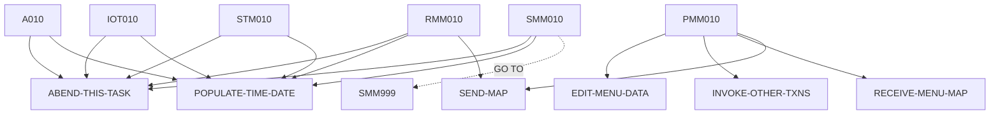

# BNKMENU — source of truth

> Generated by `.github/skills/cobol-rekt/run-cobol-rekt.sh`. Do not edit by hand — re-run the script.
> **[rekt]** = from the cobol-rekt parse tree · **[scan]** = deterministic scan of the original source.

| | |
|---|---|
| Source | `src/base/cics/cobol/BNKMENU.cbl` (1314 lines) |
| Subsystem | `cics` |
| cobol-rekt | ✅ parsed |
| Sections / paragraphs [scan] | 27 |
| Decisions (IF / EVALUATE) [rekt] | 29 |
| EXEC CICS / EXEC SQL / DL/I calls [scan] | 62 / 0 / 0 |

## 1. Procedure structure

Control transfers inside the program [rekt]. Solid = `PERFORM`, dashed = `GO TO`.

| Section / paragraph | Lines | PERFORMs [rekt] | GO TO [rekt] | Decisions [rekt] | EXEC CICS | EXEC SQL |
|---|---|---|---|---|---|---|
| **PREMIERE** (section) | 108–108 | — | — | 0 | — | — |
| A010 | 109–236 | ABEND-THIS-TASK, POPULATE-TIME-DATE | — | 2 | 7 | — |
| A999 | 237–240 | — | — | 0 | — | — |
| **PROCESS-MENU-MAP** (section) | 241–241 | — | — | 0 | — | — |
| PMM010 | 242–264 | EDIT-MENU-DATA, INVOKE-OTHER-TXNS, RECEIVE-MENU-MAP, SEND-MAP | — | 1 | — | — |
| PMM999 | 265–268 | — | — | 0 | — | — |
| **RECEIVE-MENU-MAP** (section) | 269–269 | — | — | 0 | — | — |
| RMM010 | 270–350 | ABEND-THIS-TASK, POPULATE-TIME-DATE, SEND-MAP | — | 2 | 4 | — |
| RMM999 | 351–354 | — | — | 0 | — | — |
| **EDIT-MENU-DATA** (section) | 355–355 | — | — | 0 | — | — |
| EMD010 | 356–372 | — | — | 1 | — | — |
| EMD999 | 373–376 | — | — | 0 | — | — |
| **INVOKE-OTHER-TXNS** (section) | 377–377 | — | — | 0 | — | — |
| IOT010 | 378–967 | ABEND-THIS-TASK, POPULATE-TIME-DATE | — | 16 | 32 | — |
| IOT999 | 968–971 | — | — | 0 | — | — |
| **SEND-MAP** (section) | 972–972 | — | — | 0 | — | — |
| SMM010 | 973–1203 | ABEND-THIS-TASK, POPULATE-TIME-DATE | SMM999 | 6 | 12 | — |
| SMM999 | 1204–1207 | — | — | 0 | — | — |
| **SEND-TERMINATION-MSG** (section) | 1208–1208 | — | — | 0 | — | — |
| STM010 | 1209–1280 | ABEND-THIS-TASK, POPULATE-TIME-DATE | — | 1 | 4 | — |
| STM999 | 1281–1284 | — | — | 0 | — | — |
| **ABEND-THIS-TASK** (section) | 1285–1285 | — | — | 0 | — | — |
| ATT010 | 1286–1293 | — | — | 0 | 1 | — |
| ATT999 | 1294–1297 | — | — | 0 | — | — |
| **POPULATE-TIME-DATE** (section) | 1298–1298 | — | — | 0 | — | — |
| PTD010 | 1299–1312 | — | — | 0 | 2 | — |
| PTD999 | 1313–1314 | — | — | 0 | — | — |

## 2. Decision points

Every `IF` / `EVALUATE` found by cobol-rekt, in source order. Condition text is quoted from the original source line. These are where business rules live.

**A010**

- `src/base/cics/cobol/BNKMENU.cbl:111` `EVALUATE TRUE → WHEN EIBCALEN = ZERO · WHEN EIBAID = DFHPA1 OR DFHPA2 OR DFHPA3 · WHEN EIBAID = DFHPF3 OR DFHPF12 · WHEN EIBAID = DFHCLEAR · WHEN EIBAID = DFHENTER · WHEN OTHER`
- `src/base/cics/cobol/BNKMENU.cbl:178` `IF WS-CICS-RESP NOT = DFHRESP(NORMAL)`

**PMM010**

- `src/base/cics/cobol/BNKMENU.cbl:254` `IF VALID-DATA`

**RMM010**

- `src/base/cics/cobol/BNKMENU.cbl:282` `IF WS-CICS-RESP NOT = DFHRESP(NORMAL)`
  - `src/base/cics/cobol/BNKMENU.cbl:284` `IF WS-CICS-RESP = DFHRESP(MAPFAIL)`

**EMD010**

- `src/base/cics/cobol/BNKMENU.cbl:360` `IF ACTIONI NOT = '1' AND ACTIONI NOT = '2' AND`

**IOT010**

- `src/base/cics/cobol/BNKMENU.cbl:386` `IF ACTIONI = '1'`
  - `src/base/cics/cobol/BNKMENU.cbl:394` `IF WS-CICS-RESP NOT = DFHRESP(NORMAL)`
- `src/base/cics/cobol/BNKMENU.cbl:458` `IF ACTIONI = '2'`
  - `src/base/cics/cobol/BNKMENU.cbl:466` `IF WS-CICS-RESP NOT = DFHRESP(NORMAL)`
- `src/base/cics/cobol/BNKMENU.cbl:531` `IF ACTIONI = '3'`
  - `src/base/cics/cobol/BNKMENU.cbl:539` `IF WS-CICS-RESP NOT = DFHRESP(NORMAL)`
- `src/base/cics/cobol/BNKMENU.cbl:604` `IF ACTIONI = '4'`
  - `src/base/cics/cobol/BNKMENU.cbl:612` `IF WS-CICS-RESP NOT = DFHRESP(NORMAL)`
- `src/base/cics/cobol/BNKMENU.cbl:677` `IF ACTIONI = '5'`
  - `src/base/cics/cobol/BNKMENU.cbl:685` `IF WS-CICS-RESP NOT = DFHRESP(NORMAL)`
- `src/base/cics/cobol/BNKMENU.cbl:750` `IF ACTIONI = '6'`
  - `src/base/cics/cobol/BNKMENU.cbl:758` `IF WS-CICS-RESP NOT = DFHRESP(NORMAL)`
- `src/base/cics/cobol/BNKMENU.cbl:823` `IF ACTIONI = '7'`
  - `src/base/cics/cobol/BNKMENU.cbl:831` `IF WS-CICS-RESP NOT = DFHRESP(NORMAL)`
- `src/base/cics/cobol/BNKMENU.cbl:897` `IF ACTIONI = 'A'`
  - `src/base/cics/cobol/BNKMENU.cbl:905` `IF WS-CICS-RESP NOT = DFHRESP(NORMAL)`

**SMM010**

- `src/base/cics/cobol/BNKMENU.cbl:978` `IF SEND-ERASE`
  - `src/base/cics/cobol/BNKMENU.cbl:988` `IF WS-CICS-RESP NOT = DFHRESP(NORMAL)`
- `src/base/cics/cobol/BNKMENU.cbl:1053` `IF SEND-DATAONLY`
  - `src/base/cics/cobol/BNKMENU.cbl:1063` `IF WS-CICS-RESP NOT = DFHRESP(NORMAL)`
- `src/base/cics/cobol/BNKMENU.cbl:1130` `IF SEND-DATAONLY-ALARM`
  - `src/base/cics/cobol/BNKMENU.cbl:1141` `IF WS-CICS-RESP NOT = DFHRESP(NORMAL)`

**STM010**

- `src/base/cics/cobol/BNKMENU.cbl:1221` `IF WS-CICS-RESP NOT = DFHRESP(NORMAL)`

## 3. External touchpoints [scan]

Every `EXEC CICS`, `EXEC SQL` and IMS DL/I call, as written in the original source.

| Line | Paragraph | Kind | Verb | Statement |
|---|---|---|---|---|
| `src/base/cics/cobol/BNKMENU.cbl:134` | A010 | EXEC CICS | `RETURN` | `RETURN` |
| `src/base/cics/cobol/BNKMENU.cbl:142` | A010 | EXEC CICS | `SEND CONTROL` | `SEND CONTROL ERASE FREEKB` |
| `src/base/cics/cobol/BNKMENU.cbl:146` | A010 | EXEC CICS | `RETURN` | `RETURN` |
| `src/base/cics/cobol/BNKMENU.cbl:170` | A010 | EXEC CICS | `RETURN` | `RETURN TRANSID('OMEN') COMMAREA(COMMUNICATION-AREA) LENGTH(1) RESP(WS-CICS-RESP) RESP2(WS-CICS-RESP2)` |
| `src/base/cics/cobol/BNKMENU.cbl:191` | A010 | EXEC CICS | `ASSIGN` | `ASSIGN APPLID(ABND-APPLID)` |
| `src/base/cics/cobol/BNKMENU.cbl:211` | A010 | EXEC CICS | `ASSIGN` | `ASSIGN PROGRAM(ABND-PROGRAM)` |
| `src/base/cics/cobol/BNKMENU.cbl:225` | A010 | EXEC CICS | `LINK` | `LINK PROGRAM(WS-ABEND-PGM) COMMAREA(ABNDINFO-REC)` |
| `src/base/cics/cobol/BNKMENU.cbl:274` | RMM010 | EXEC CICS | `RECEIVE` | `RECEIVE MAP('BNK1ME') MAPSET('BNK1MAI') INTO(BNK1MEI) RESP(WS-CICS-RESP) RESP2(WS-CICS-RESP2)` |
| `src/base/cics/cobol/BNKMENU.cbl:303` | RMM010 | EXEC CICS | `ASSIGN` | `ASSIGN APPLID(ABND-APPLID)` |
| `src/base/cics/cobol/BNKMENU.cbl:323` | RMM010 | EXEC CICS | `ASSIGN` | `ASSIGN PROGRAM(ABND-PROGRAM)` |
| `src/base/cics/cobol/BNKMENU.cbl:337` | RMM010 | EXEC CICS | `LINK` | `LINK PROGRAM(WS-ABEND-PGM) COMMAREA(ABNDINFO-REC)` |
| `src/base/cics/cobol/BNKMENU.cbl:387` | IOT010 | EXEC CICS | `RETURN` | `RETURN TRANSID('ODCS') IMMEDIATE RESP(WS-CICS-RESP) RESP2(WS-CICS-RESP2)` |
| `src/base/cics/cobol/BNKMENU.cbl:407` | IOT010 | EXEC CICS | `ASSIGN` | `ASSIGN APPLID(ABND-APPLID)` |
| `src/base/cics/cobol/BNKMENU.cbl:427` | IOT010 | EXEC CICS | `ASSIGN` | `ASSIGN PROGRAM(ABND-PROGRAM)` |
| `src/base/cics/cobol/BNKMENU.cbl:441` | IOT010 | EXEC CICS | `LINK` | `LINK PROGRAM(WS-ABEND-PGM) COMMAREA(ABNDINFO-REC)` |
| `src/base/cics/cobol/BNKMENU.cbl:459` | IOT010 | EXEC CICS | `RETURN` | `RETURN TRANSID('ODAC') IMMEDIATE RESP(WS-CICS-RESP) RESP2(WS-CICS-RESP2)` |
| `src/base/cics/cobol/BNKMENU.cbl:479` | IOT010 | EXEC CICS | `ASSIGN` | `ASSIGN APPLID(ABND-APPLID)` |
| `src/base/cics/cobol/BNKMENU.cbl:499` | IOT010 | EXEC CICS | `ASSIGN` | `ASSIGN PROGRAM(ABND-PROGRAM)` |
| `src/base/cics/cobol/BNKMENU.cbl:513` | IOT010 | EXEC CICS | `LINK` | `LINK PROGRAM(WS-ABEND-PGM) COMMAREA(ABNDINFO-REC)` |
| `src/base/cics/cobol/BNKMENU.cbl:532` | IOT010 | EXEC CICS | `RETURN` | `RETURN TRANSID('OCCS') IMMEDIATE RESP(WS-CICS-RESP) RESP2(WS-CICS-RESP2)` |
| `src/base/cics/cobol/BNKMENU.cbl:552` | IOT010 | EXEC CICS | `ASSIGN` | `ASSIGN APPLID(ABND-APPLID)` |
| `src/base/cics/cobol/BNKMENU.cbl:572` | IOT010 | EXEC CICS | `ASSIGN` | `ASSIGN PROGRAM(ABND-PROGRAM)` |
| `src/base/cics/cobol/BNKMENU.cbl:586` | IOT010 | EXEC CICS | `LINK` | `LINK PROGRAM(WS-ABEND-PGM) COMMAREA(ABNDINFO-REC)` |
| `src/base/cics/cobol/BNKMENU.cbl:605` | IOT010 | EXEC CICS | `RETURN` | `RETURN TRANSID('OCAC') IMMEDIATE RESP(WS-CICS-RESP) RESP2(WS-CICS-RESP2)` |
| `src/base/cics/cobol/BNKMENU.cbl:625` | IOT010 | EXEC CICS | `ASSIGN` | `ASSIGN APPLID(ABND-APPLID)` |
| `src/base/cics/cobol/BNKMENU.cbl:645` | IOT010 | EXEC CICS | `ASSIGN` | `ASSIGN PROGRAM(ABND-PROGRAM)` |
| `src/base/cics/cobol/BNKMENU.cbl:659` | IOT010 | EXEC CICS | `LINK` | `LINK PROGRAM(WS-ABEND-PGM) COMMAREA(ABNDINFO-REC)` |
| `src/base/cics/cobol/BNKMENU.cbl:678` | IOT010 | EXEC CICS | `RETURN` | `RETURN TRANSID('OUAC') IMMEDIATE RESP(WS-CICS-RESP) RESP2(WS-CICS-RESP2)` |
| `src/base/cics/cobol/BNKMENU.cbl:698` | IOT010 | EXEC CICS | `ASSIGN` | `ASSIGN APPLID(ABND-APPLID)` |
| `src/base/cics/cobol/BNKMENU.cbl:718` | IOT010 | EXEC CICS | `ASSIGN` | `ASSIGN PROGRAM(ABND-PROGRAM)` |
| `src/base/cics/cobol/BNKMENU.cbl:732` | IOT010 | EXEC CICS | `LINK` | `LINK PROGRAM(WS-ABEND-PGM) COMMAREA(ABNDINFO-REC)` |
| `src/base/cics/cobol/BNKMENU.cbl:751` | IOT010 | EXEC CICS | `RETURN` | `RETURN TRANSID('OCRA') IMMEDIATE RESP(WS-CICS-RESP) RESP2(WS-CICS-RESP2)` |
| `src/base/cics/cobol/BNKMENU.cbl:771` | IOT010 | EXEC CICS | `ASSIGN` | `ASSIGN APPLID(ABND-APPLID)` |
| `src/base/cics/cobol/BNKMENU.cbl:791` | IOT010 | EXEC CICS | `ASSIGN` | `ASSIGN PROGRAM(ABND-PROGRAM)` |
| `src/base/cics/cobol/BNKMENU.cbl:805` | IOT010 | EXEC CICS | `LINK` | `LINK PROGRAM(WS-ABEND-PGM) COMMAREA(ABNDINFO-REC)` |
| `src/base/cics/cobol/BNKMENU.cbl:824` | IOT010 | EXEC CICS | `RETURN` | `RETURN TRANSID('OTFN') IMMEDIATE RESP(WS-CICS-RESP) RESP2(WS-CICS-RESP2)` |
| `src/base/cics/cobol/BNKMENU.cbl:844` | IOT010 | EXEC CICS | `ASSIGN` | `ASSIGN APPLID(ABND-APPLID)` |
| `src/base/cics/cobol/BNKMENU.cbl:864` | IOT010 | EXEC CICS | `ASSIGN` | `ASSIGN PROGRAM(ABND-PROGRAM)` |
| `src/base/cics/cobol/BNKMENU.cbl:878` | IOT010 | EXEC CICS | `LINK` | `LINK PROGRAM(WS-ABEND-PGM) COMMAREA(ABNDINFO-REC)` |
| `src/base/cics/cobol/BNKMENU.cbl:898` | IOT010 | EXEC CICS | `RETURN` | `RETURN TRANSID('OCCA') IMMEDIATE RESP(WS-CICS-RESP) RESP2(WS-CICS-RESP2)` |
| `src/base/cics/cobol/BNKMENU.cbl:918` | IOT010 | EXEC CICS | `ASSIGN` | `ASSIGN APPLID(ABND-APPLID)` |
| `src/base/cics/cobol/BNKMENU.cbl:938` | IOT010 | EXEC CICS | `ASSIGN` | `ASSIGN PROGRAM(ABND-PROGRAM)` |
| `src/base/cics/cobol/BNKMENU.cbl:952` | IOT010 | EXEC CICS | `LINK` | `LINK PROGRAM(WS-ABEND-PGM) COMMAREA(ABNDINFO-REC)` |
| `src/base/cics/cobol/BNKMENU.cbl:979` | SMM010 | EXEC CICS | `SEND` | `SEND MAP('BNK1ME') MAPSET('BNK1MAI') FROM(BNK1MEO) ERASE FREEKB RESP(WS-CICS-RESP) RESP2(WS-CICS-RESP2)` |
| `src/base/cics/cobol/BNKMENU.cbl:1001` | SMM010 | EXEC CICS | `ASSIGN` | `ASSIGN APPLID(ABND-APPLID)` |
| `src/base/cics/cobol/BNKMENU.cbl:1021` | SMM010 | EXEC CICS | `ASSIGN` | `ASSIGN PROGRAM(ABND-PROGRAM)` |
| `src/base/cics/cobol/BNKMENU.cbl:1035` | SMM010 | EXEC CICS | `LINK` | `LINK PROGRAM(WS-ABEND-PGM) COMMAREA(ABNDINFO-REC)` |
| `src/base/cics/cobol/BNKMENU.cbl:1054` | SMM010 | EXEC CICS | `SEND` | `SEND MAP('BNK1ME') MAPSET('BNK1MAI') FROM(BNK1MEO) DATAONLY FREEKB RESP(WS-CICS-RESP) RESP2(WS-CICS-RESP2)` |
| `src/base/cics/cobol/BNKMENU.cbl:1077` | SMM010 | EXEC CICS | `ASSIGN` | `ASSIGN APPLID(ABND-APPLID)` |
| `src/base/cics/cobol/BNKMENU.cbl:1097` | SMM010 | EXEC CICS | `ASSIGN` | `ASSIGN PROGRAM(ABND-PROGRAM)` |
| `src/base/cics/cobol/BNKMENU.cbl:1111` | SMM010 | EXEC CICS | `LINK` | `LINK PROGRAM(WS-ABEND-PGM) COMMAREA(ABNDINFO-REC)` |
| `src/base/cics/cobol/BNKMENU.cbl:1131` | SMM010 | EXEC CICS | `SEND` | `SEND MAP('BNK1ME') MAPSET('BNK1MAI') FROM(BNK1MEO) DATAONLY ALARM FREEKB RESP(WS-CICS-RESP) RESP2(WS-CICS-RES…` |
| `src/base/cics/cobol/BNKMENU.cbl:1155` | SMM010 | EXEC CICS | `ASSIGN` | `ASSIGN APPLID(ABND-APPLID)` |
| `src/base/cics/cobol/BNKMENU.cbl:1175` | SMM010 | EXEC CICS | `ASSIGN` | `ASSIGN PROGRAM(ABND-PROGRAM)` |
| `src/base/cics/cobol/BNKMENU.cbl:1189` | SMM010 | EXEC CICS | `LINK` | `LINK PROGRAM(WS-ABEND-PGM) COMMAREA(ABNDINFO-REC)` |
| `src/base/cics/cobol/BNKMENU.cbl:1213` | STM010 | EXEC CICS | `SEND TEXT` | `SEND TEXT FROM(END-OF-SESSION-MESSAGE) ERASE FREEKB RESP(WS-CICS-RESP) RESP2(WS-CICS-RESP2)` |
| `src/base/cics/cobol/BNKMENU.cbl:1234` | STM010 | EXEC CICS | `ASSIGN` | `ASSIGN APPLID(ABND-APPLID)` |
| `src/base/cics/cobol/BNKMENU.cbl:1254` | STM010 | EXEC CICS | `ASSIGN` | `ASSIGN PROGRAM(ABND-PROGRAM)` |
| `src/base/cics/cobol/BNKMENU.cbl:1268` | STM010 | EXEC CICS | `LINK` | `LINK PROGRAM(WS-ABEND-PGM) COMMAREA(ABNDINFO-REC)` |
| `src/base/cics/cobol/BNKMENU.cbl:1289` | ATT010 | EXEC CICS | `ABEND` | `ABEND ABCODE('HBNK') NODUMP` |
| `src/base/cics/cobol/BNKMENU.cbl:1302` | PTD010 | EXEC CICS | `ASKTIME` | `ASKTIME ABSTIME(WS-U-TIME)` |
| `src/base/cics/cobol/BNKMENU.cbl:1306` | PTD010 | EXEC CICS | `FORMATTIME` | `FORMATTIME ABSTIME(WS-U-TIME) DDMMYYYY(WS-ORIG-DATE) TIME(WS-TIME-NOW) DATESEP` |

## 4. Dependencies [scan]

**Program / transaction transfers**

Lines refer to `src/base/cics/cobol/BNKMENU.cbl`.

| Kind | Target(s) | Resolved via | Lines · paragraph |
|---|---|---|---|
| RETURN TRANSID | `OMEN` | literal | `:170` A010 |
| LINK | `ABNDPROC` | variable `WS-ABEND-PGM` (VALUE clause) | `:225` A010, `:337` RMM010, `:441` IOT010, `:513` IOT010, `:586` IOT010, `:659` IOT010, `:732` IOT010, `:805` IOT010, `:878` IOT010, `:952` IOT010, `:1035` SMM010, `:1111` SMM010 … +2 more |
| RETURN TRANSID | `ODCS` | literal | `:387` IOT010 |
| RETURN TRANSID | `ODAC` | literal | `:459` IOT010 |
| RETURN TRANSID | `OCCS` | literal | `:532` IOT010 |
| RETURN TRANSID | `OCAC` | literal | `:605` IOT010 |
| RETURN TRANSID | `OUAC` | literal | `:678` IOT010 |
| RETURN TRANSID | `OCRA` | literal | `:751` IOT010 |
| RETURN TRANSID | `OTFN` | literal | `:824` IOT010 |
| RETURN TRANSID | `OCCA` | literal | `:898` IOT010 |

**Copybooks**

- `BNK1MAI` (`src/base/cics/cobol/BNKMENU.cbl:68`) → BMS symbolic map — generated at build time from `src/base/cics/bms/BNK1MAI.bms`
- `DFHAID` (`src/base/cics/cobol/BNKMENU.cbl:70`) → IBM-supplied CICS copybook (not in repo)
- `ABNDINFO` (`src/base/cics/cobol/BNKMENU.cbl:99`) → `src/base/cics/copy/ABNDINFO.cpy`

## 5. Condition names (88-levels) [scan]

Named conditions encode business codes. Includes copybooks reached from this program.

| Condition | Value(s) | Parent item | Defined at |
|---|---|---|---|
| `VALID-DATA` | `'Y'` | VALID-DATA-SW | `src/base/cics/cobol/BNKMENU.cbl:48` |
| `SEND-ERASE` | `'1'` | SEND-FLAG | `src/base/cics/cobol/BNKMENU.cbl:52` |
| `SEND-DATAONLY` | `'2'` | SEND-FLAG | `src/base/cics/cobol/BNKMENU.cbl:53` |
| `SEND-DATAONLY-ALARM` | `'3'` | SEND-FLAG | `src/base/cics/cobol/BNKMENU.cbl:54` |

## 6. Data items [rekt]

**Records (01 / 77 levels)**

| Name | Clause | Fields | Section | Defined at |
|---|---|---|---|---|
| `WS-CICS-WORK-AREA` | `(group)` | 2 | WORKING_STORAGE | `src/base/cics/cobol/BNKMENU.cbl:33` |
| `WS-FAIL-INFO` | `(group)` | 7 | WORKING_STORAGE | `src/base/cics/cobol/BNKMENU.cbl:37` |
| `SWITCHES` | `(group)` | 1 | WORKING_STORAGE | `src/base/cics/cobol/BNKMENU.cbl:46` |
| `FLAGS` | `(group)` | 1 | WORKING_STORAGE | `src/base/cics/cobol/BNKMENU.cbl:50` |
| `ACTION-ALPHA` | `(group)` | 1 | WORKING_STORAGE | `src/base/cics/cobol/BNKMENU.cbl:56` |
| `END-OF-SESSION-MESSAGE` | `PIC X(13) VALUE 'Session Ended'` | — | WORKING_STORAGE | `src/base/cics/cobol/BNKMENU.cbl:62` |
| `RESPONSE-CODE` | `PIC S9(8) COMP` | — | WORKING_STORAGE | `src/base/cics/cobol/BNKMENU.cbl:64` |
| `COMMUNICATION-AREA` | `PIC X` | — | WORKING_STORAGE | `src/base/cics/cobol/BNKMENU.cbl:66` |
| `WS-U-TIME` | `PIC S9(15) COMP-3` | — | WORKING_STORAGE | `src/base/cics/cobol/BNKMENU.cbl:72` |
| `WS-ORIG-DATE` | `PIC X(10)` | — | WORKING_STORAGE | `src/base/cics/cobol/BNKMENU.cbl:73` |
| `WS-ORIG-DATE-GRP` | `REDEFINES WS-ORIG-DATE` REDEFINES WS-ORIG-DATE | 5 | WORKING_STORAGE | `src/base/cics/cobol/BNKMENU.cbl:74` |
| `WS-ORIG-DATE-GRP-X` | `(group)` | 5 | WORKING_STORAGE | `src/base/cics/cobol/BNKMENU.cbl:81` |
| `WS-TIME-DATA` | `(group)` | 5 | WORKING_STORAGE | `src/base/cics/cobol/BNKMENU.cbl:89` |
| `WS-ABEND-PGM` | `PIC X(8) VALUE 'ABNDPROC'` | — | WORKING_STORAGE | `src/base/cics/cobol/BNKMENU.cbl:96` |
| `ABNDINFO-REC` | `(group)` | 13 | WORKING_STORAGE | `src/base/cics/cobol/BNKMENU.cbl:98` |
| `DFHCOMMAREA` | `PIC X` | — | LINKAGE | `src/base/cics/cobol/BNKMENU.cbl:104` |

**LINKAGE SECTION — the program's interface contract (COMMAREA / parameters)**

| Level | Name | Clause | Type | Defined at |
|---|---|---|---|---|
| 01 | DFHCOMMAREA | `PIC X` | STRING | `src/base/cics/cobol/BNKMENU.cbl:104` |

_Working-storage fields below the 01 level are not listed — open the definition to drill in._
