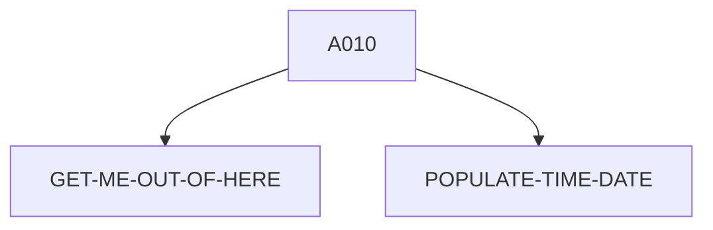

# CRDTAGY5 — source of truth

> Generated by `.github/skills/cobol-rekt/run-cobol-rekt.sh`. Do not edit by hand — re-run the script.
> **[rekt]** = from the cobol-rekt parse tree · **[scan]** = deterministic scan of the original source.

| | |
|---|---|
| Source | `src/base/cics/cobol/CRDTAGY5.cbl` (262 lines) |
| Subsystem | `cics` |
| cobol-rekt | ✅ parsed |
| Sections / paragraphs [scan] | 9 |
| Decisions (IF / EVALUATE) [rekt] | 3 |
| EXEC CICS / EXEC SQL / DL/I calls [scan] | 10 / 0 / 0 |

## 1. Procedure structure

Control transfers inside the program [rekt]. Solid = `PERFORM`, dashed = `GO TO`.

| Section / paragraph | Lines | PERFORMs [rekt] | GO TO [rekt] | Decisions [rekt] | EXEC CICS | EXEC SQL |
|---|---|---|---|---|---|---|
| **PREMIERE** (section) | 97–97 | — | — | 0 | — | — |
| A010 | 98–232 | GET-ME-OUT-OF-HERE, POPULATE-TIME-DATE | — | 3 | 7 | — |
| A999 | 233–236 | — | — | 0 | — | — |
| **GET-ME-OUT-OF-HERE** (section) | 237–237 | — | — | 0 | — | — |
| GMOFH010 | 238–242 | — | — | 0 | 1 | — |
| GMOFH999 | 243–246 | — | — | 0 | — | — |
| **POPULATE-TIME-DATE** (section) | 247–247 | — | — | 0 | — | — |
| PTD010 | 248–260 | — | — | 0 | 2 | — |
| PTD999 | 261–262 | — | — | 0 | — | — |

## 2. Decision points

Every `IF` / `EVALUATE` found by cobol-rekt, in source order. Condition text is quoted from the original source line. These are where business rules live.

**A010**

- `src/base/cics/cobol/CRDTAGY5.cbl:118` `IF WS-CICS-RESP NOT = DFHRESP(NORMAL)`
- `src/base/cics/cobol/CRDTAGY5.cbl:186` `IF WS-CICS-RESP NOT = DFHRESP(NORMAL)`
- `src/base/cics/cobol/CRDTAGY5.cbl:222` `IF WS-CICS-RESP NOT = DFHRESP(NORMAL)`

## 3. External touchpoints [scan]

Every `EXEC CICS`, `EXEC SQL` and IMS DL/I call, as written in the original source.

| Line | Paragraph | Kind | Verb | Statement |
|---|---|---|---|---|
| `src/base/cics/cobol/CRDTAGY5.cbl:112` | A010 | EXEC CICS | `DELAY` | `DELAY FOR SECONDS(WS-DELAY-AMT) RESP(WS-CICS-RESP) RESP2(WS-CICS-RESP2)` |
| `src/base/cics/cobol/CRDTAGY5.cbl:131` | A010 | EXEC CICS | `ASSIGN` | `ASSIGN APPLID(ABND-APPLID)` |
| `src/base/cics/cobol/CRDTAGY5.cbl:151` | A010 | EXEC CICS | `ASSIGN` | `ASSIGN PROGRAM(ABND-PROGRAM)` |
| `src/base/cics/cobol/CRDTAGY5.cbl:165` | A010 | EXEC CICS | `LINK` | `LINK PROGRAM(WS-ABEND-PGM) COMMAREA(ABNDINFO-REC)` |
| `src/base/cics/cobol/CRDTAGY5.cbl:171` | A010 | EXEC CICS | `ABEND` | `ABEND ABCODE('PLOP')` |
| `src/base/cics/cobol/CRDTAGY5.cbl:178` | A010 | EXEC CICS | `GET` | `GET CONTAINER(WS-CONTAINER-NAME) CHANNEL(WS-CHANNEL-NAME) INTO(WS-CONT-IN) FLENGTH(WS-CONTAINER-LEN) RESP(WS-…` |
| `src/base/cics/cobol/CRDTAGY5.cbl:214` | A010 | EXEC CICS | `PUT` | `PUT CONTAINER(WS-CONTAINER-NAME) FROM(WS-CONT-IN) FLENGTH(WS-CONTAINER-LEN) CHANNEL(WS-CHANNEL-NAME) RESP(WS-…` |
| `src/base/cics/cobol/CRDTAGY5.cbl:240` | GMOFH010 | EXEC CICS | `RETURN` | `RETURN` |
| `src/base/cics/cobol/CRDTAGY5.cbl:250` | PTD010 | EXEC CICS | `ASKTIME` | `ASKTIME ABSTIME(WS-U-TIME)` |
| `src/base/cics/cobol/CRDTAGY5.cbl:254` | PTD010 | EXEC CICS | `FORMATTIME` | `FORMATTIME ABSTIME(WS-U-TIME) DDMMYYYY(WS-ORIG-DATE) TIME(WS-TIME-NOW) DATESEP` |

## 4. Dependencies [scan]

**Program / transaction transfers**

Lines refer to `src/base/cics/cobol/CRDTAGY5.cbl`.

| Kind | Target(s) | Resolved via | Lines · paragraph |
|---|---|---|---|
| LINK | `ABNDPROC` | variable `WS-ABEND-PGM` (VALUE clause) | `:165` A010 |

**Copybooks**

- `SORTCODE` (`src/base/cics/cobol/CRDTAGY5.cbl:41`) → `src/base/cics/copy/SORTCODE.cpy`
- `CUSTOMER` (`src/base/cics/cobol/CRDTAGY5.cbl:45`) → `src/base/cics/copy/CUSTOMER.cpy`
- `ABNDINFO` (`src/base/cics/cobol/CRDTAGY5.cbl:91`) → `src/base/cics/copy/ABNDINFO.cpy`

## 5. Condition names (88-levels) [scan]

Named conditions encode business codes. Includes copybooks reached from this program.

| Condition | Value(s) | Parent item | Defined at |
|---|---|---|---|
| `CUSTOMER-EYECATCHER-VALUE` | `'CUST'` | CUSTOMER-EYECATCHER | `src/base/cics/copy/CUSTOMER.cpy:9` |
| `CUSTOMER-STATUS-ACTIVE` | `'ACTIVE'` | CUSTOMER-STATUS | `src/base/cics/copy/CUSTOMER.cpy:29` |
| `CUSTOMER-STATUS-INACTIVE` | `'INACTIVE'` | CUSTOMER-STATUS | `src/base/cics/copy/CUSTOMER.cpy:30` |
| `CUSTOMER-STATUS-SUSPENDED` | `'SUSPENDED'` | CUSTOMER-STATUS | `src/base/cics/copy/CUSTOMER.cpy:31` |

## 6. Data items [rekt]

**Records (01 / 77 levels)**

| Name | Clause | Fields | Section | Defined at |
|---|---|---|---|---|
| `WS-CONT-IN` | `(group)` | 30 | WORKING_STORAGE | `src/base/cics/cobol/CRDTAGY5.cbl:44` |
| `WS-CICS-WORK-AREA` | `(group)` | 2 | WORKING_STORAGE | `src/base/cics/cobol/CRDTAGY5.cbl:47` |
| `WS-DELAY-AMT` | `PIC S9(8) COMP VALUE 0` | — | WORKING_STORAGE | `src/base/cics/cobol/CRDTAGY5.cbl:52` |
| `WS-CONTAINER-NAME` | `PIC X(16) VALUE SPACES` | — | WORKING_STORAGE | `src/base/cics/cobol/CRDTAGY5.cbl:55` |
| `WS-CHANNEL-NAME` | `PIC X(16) VALUE SPACES` | — | WORKING_STORAGE | `src/base/cics/cobol/CRDTAGY5.cbl:56` |
| `WS-CONTAINER-LEN` | `PIC S9(8) COMP VALUE 0` | — | WORKING_STORAGE | `src/base/cics/cobol/CRDTAGY5.cbl:58` |
| `WS-NEW-CREDSCORE` | `PIC 999 VALUE 0` | — | WORKING_STORAGE | `src/base/cics/cobol/CRDTAGY5.cbl:60` |
| `WS-SEED` | `PIC S9(15) COMP` | — | WORKING_STORAGE | `src/base/cics/cobol/CRDTAGY5.cbl:61` |
| `WS-U-TIME` | `PIC S9(15) COMP-3` | — | WORKING_STORAGE | `src/base/cics/cobol/CRDTAGY5.cbl:64` |
| `WS-ORIG-DATE` | `PIC X(10)` | — | WORKING_STORAGE | `src/base/cics/cobol/CRDTAGY5.cbl:65` |
| `WS-ORIG-DATE-GRP` | `REDEFINES WS-ORIG-DATE` REDEFINES WS-ORIG-DATE | 5 | WORKING_STORAGE | `src/base/cics/cobol/CRDTAGY5.cbl:66` |
| `WS-ORIG-DATE-GRP-X` | `(group)` | 5 | WORKING_STORAGE | `src/base/cics/cobol/CRDTAGY5.cbl:73` |
| `WS-TIME-DATA` | `(group)` | 5 | WORKING_STORAGE | `src/base/cics/cobol/CRDTAGY5.cbl:81` |
| `WS-ABEND-PGM` | `PIC X(8) VALUE 'ABNDPROC'` | — | WORKING_STORAGE | `src/base/cics/cobol/CRDTAGY5.cbl:88` |
| `ABNDINFO-REC` | `(group)` | 13 | WORKING_STORAGE | `src/base/cics/cobol/CRDTAGY5.cbl:90` |

_Working-storage fields below the 01 level are not listed — open the definition to drill in._
