# CREACC — source of truth

> Generated by `.github/skills/cobol-rekt/run-cobol-rekt.sh`. Do not edit by hand — re-run the script.
> **[rekt]** = from the cobol-rekt parse tree · **[scan]** = deterministic scan of the original source.

| | |
|---|---|
| Source | `src/base/cics/cobol/CREACC.cbl` (1341 lines) |
| Subsystem | `cics` |
| cobol-rekt | ✅ parsed |
| Sections / paragraphs [scan] | 36 |
| Decisions (IF / EVALUATE) [rekt] | 15 |
| EXEC CICS / EXEC SQL / DL/I calls [scan] | 31 / 6 / 0 |

## 1. Procedure structure

Control transfers inside the program [rekt]. Solid = `PERFORM`, dashed = `GO TO`.

```mermaid
flowchart TD
  n_ACCOUNT_TYPE_CHECK["ACCOUNT-TYPE-CHECK"]
  n_CALCULATE_DATES["CALCULATE-DATES"]
  n_CUSTOMER_ACCOUNT_COUNT["CUSTOMER-ACCOUNT-COUNT"]
  n_DEQ_NAMED_COUNTER["DEQ-NAMED-COUNTER"]
  n_DNC010["DNC010"]
  n_ENC010["ENC010"]
  n_ENQ_NAMED_COUNTER["ENQ-NAMED-COUNTER"]
  n_FIND_NEXT_ACCOUNT["FIND-NEXT-ACCOUNT"]
  n_FNA010["FNA010"]
  n_GET_ME_OUT_OF_HERE["GET-ME-OUT-OF-HERE"]
  n_P010["P010"]
  n_POPULATE_TIME_DATE2["POPULATE-TIME-DATE2"]
  n_WAD010["WAD010"]
  n_WP010["WP010"]
  n_WPD010["WPD010"]
  n_WRITE_ACCOUNT_DB2["WRITE-ACCOUNT-DB2"]
  n_WRITE_PROCTRAN["WRITE-PROCTRAN"]
  n_WRITE_PROCTRAN_DB2["WRITE-PROCTRAN-DB2"]
  n_DNC010 --> n_GET_ME_OUT_OF_HERE
  n_ENC010 --> n_GET_ME_OUT_OF_HERE
  n_FNA010 --> n_POPULATE_TIME_DATE2
  n_P010 --> n_ACCOUNT_TYPE_CHECK
  n_P010 --> n_CUSTOMER_ACCOUNT_COUNT
  n_P010 --> n_ENQ_NAMED_COUNTER
  n_P010 --> n_FIND_NEXT_ACCOUNT
  n_P010 --> n_GET_ME_OUT_OF_HERE
  n_P010 --> n_WRITE_ACCOUNT_DB2
  n_WAD010 --> n_CALCULATE_DATES
  n_WAD010 --> n_DEQ_NAMED_COUNTER
  n_WAD010 --> n_GET_ME_OUT_OF_HERE
  n_WAD010 --> n_WRITE_PROCTRAN
  n_WP010 --> n_WRITE_PROCTRAN_DB2
  n_WPD010 --> n_DEQ_NAMED_COUNTER
  n_WPD010 --> n_POPULATE_TIME_DATE2
```

| Section / paragraph | Lines | PERFORMs [rekt] | GO TO [rekt] | Decisions [rekt] | EXEC CICS | EXEC SQL |
|---|---|---|---|---|---|---|
| **PREMIERE** (section) | 302–302 | — | — | 0 | — | — |
| P010 | 303–427 | ACCOUNT-TYPE-CHECK, CUSTOMER-ACCOUNT-COUNT, ENQ-NAMED-COUNTER, FIND-NEXT-ACCOUNT, GET-ME-OUT-OF-HERE, WRITE-ACCOUNT-DB2 | — | 5 | 1 | — |
| P999 | 428–431 | — | — | 0 | — | — |
| **ENQ-NAMED-COUNTER** (section) | 432–432 | — | — | 0 | — | — |
| ENC010 | 433–449 | GET-ME-OUT-OF-HERE | — | 1 | 1 | — |
| ENC999 | 450–453 | — | — | 0 | — | — |
| **DEQ-NAMED-COUNTER** (section) | 454–454 | — | — | 0 | — | — |
| DNC010 | 455–471 | GET-ME-OUT-OF-HERE | — | 1 | 1 | — |
| DNC999 | 472–475 | — | — | 0 | — | — |
| **FIND-NEXT-ACCOUNT** (section) | 476–476 | — | — | 0 | — | — |
| FNA010 | 477–856 | POPULATE-TIME-DATE2 | — | 4 | 16 | 4 |
| FNA999 | 857–863 | — | — | 0 | — | — |
| **WRITE-ACCOUNT-DB2** (section) | 864–864 | — | — | 0 | — | — |
| WAD010 | 865–1005 | CALCULATE-DATES, DEQ-NAMED-COUNTER, GET-ME-OUT-OF-HERE, WRITE-PROCTRAN | — | 1 | — | 1 |
| WAD999 | 1006–1009 | — | — | 0 | — | — |
| **WRITE-PROCTRAN** (section) | 1010–1010 | — | — | 0 | — | — |
| WP010 | 1011–1013 | WRITE-PROCTRAN-DB2 | — | 0 | — | — |
| WP999 | 1014–1017 | — | — | 0 | — | — |
| **WRITE-PROCTRAN-DB2** (section) | 1018–1018 | — | — | 0 | — | — |
| WPD010 | 1019–1157 | DEQ-NAMED-COUNTER, POPULATE-TIME-DATE2 | — | 1 | 6 | 1 |
| WPD999 | 1158–1161 | — | — | 0 | — | — |
| **GET-ME-OUT-OF-HERE** (section) | 1162–1162 | — | — | 0 | — | — |
| GMOFH010 | 1163–1169 | — | — | 0 | 1 | — |
| GMOFH999 | 1170–1173 | — | — | 0 | — | — |
| **CUSTOMER-ACCOUNT-COUNT** (section) | 1174–1174 | — | — | 0 | — | — |
| CAC010 | 1175–1187 | — | — | 0 | 1 | — |
| CAC999 | 1188–1191 | — | — | 0 | — | — |
| **CALCULATE-DATES** (section) | 1192–1192 | — | — | 0 | — | — |
| CD010 | 1193–1298 | — | — | 1 | 2 | — |
| CD999 | 1299–1302 | — | — | 0 | — | — |
| **ACCOUNT-TYPE-CHECK** (section) | 1303–1303 | — | — | 0 | — | — |
| ATC010 | 1304–1320 | — | — | 1 | — | — |
| ATC999 | 1321–1324 | — | — | 0 | — | — |
| **POPULATE-TIME-DATE2** (section) | 1325–1325 | — | — | 0 | — | — |
| PTD2010 | 1326–1339 | — | — | 0 | 2 | — |
| PTD2999 | 1340–1341 | — | — | 0 | — | — |

## 2. Decision points

Every `IF` / `EVALUATE` found by cobol-rekt, in source order. Condition text is quoted from the original source line. These are where business rules live.

**P010**

- `src/base/cics/cobol/CREACC.cbl:341` `IF EIBRESP IS NOT EQUAL TO DFHRESP(NORMAL) OR INQCUST-INQ-SUCCESS IS NOT EQUAL TO 'Y'`
- `src/base/cics/cobol/CREACC.cbl:362` `IF WS-CICS-RESP IS NOT EQUAL TO DFHRESP(NORMAL)`
- `src/base/cics/cobol/CREACC.cbl:371` `IF COMM-SUCCESS IN INQACCCU-COMMAREA = 'N'`
- `src/base/cics/cobol/CREACC.cbl:380` `IF NUMBER-OF-ACCOUNTS IN INQACCCU-COMMAREA > 9`
- `src/base/cics/cobol/CREACC.cbl:397` `IF COMM-SUCCESS OF DFHCOMMAREA = 'N'`

**ENC010**

- `src/base/cics/cobol/CREACC.cbl:444` `IF WS-CICS-RESP NOT = DFHRESP(NORMAL)`

**DNC010**

- `src/base/cics/cobol/CREACC.cbl:466` `IF WS-CICS-RESP NOT = DFHRESP(NORMAL)`

**FNA010**

- `src/base/cics/cobol/CREACC.cbl:511` `IF SQLCODE IS NOT EQUAL TO ZERO`
  - `src/base/cics/cobol/CREACC.cbl:603` `IF SQLCODE IS NOT EQUAL TO ZERO`
- `src/base/cics/cobol/CREACC.cbl:701` `IF SQLCODE IS NOT EQUAL TO ZERO`
  - `src/base/cics/cobol/CREACC.cbl:787` `IF SQLCODE IS NOT EQUAL TO ZERO`

**WAD010**

- `src/base/cics/cobol/CREACC.cbl:949` `IF SQLCODE NOT = 0`

**WPD010**

- `src/base/cics/cobol/CREACC.cbl:1089` `IF SQLCODE NOT = 0`

**CD010**

- `src/base/cics/cobol/CREACC.cbl:1231` `EVALUATE WS-ORIG-DATE-MM → WHEN 1 · WHEN 3 · WHEN 5 · WHEN 7 · WHEN 8 · WHEN 10 · WHEN 12 · WHEN 9 · WHEN 4 · WHEN 6 · WHEN 11 · WHEN 2`

**ATC010**

- `src/base/cics/cobol/CREACC.cbl:1309` `EVALUATE TRUE → WHEN COMM-ACC-TYPE IN DFHCOMMAREA(1:3) = 'ISA' · WHEN COMM-ACC-TYPE IN DFHCOMMAREA(1:8) = 'MORTGAGE' · WHEN COMM-ACC-TYPE IN DFHCOMMAREA(1:6) = 'SAVING' · WHEN COMM-ACC-TYPE IN DFHCOMMAREA(1:7) = 'CURRENT`

## 3. External touchpoints [scan]

Every `EXEC CICS`, `EXEC SQL` and IMS DL/I call, as written in the original source.

| Line | Paragraph | Kind | Verb | Statement |
|---|---|---|---|---|
| `src/base/cics/cobol/CREACC.cbl:327` | P010 | EXEC CICS | `LINK` | `LINK PROGRAM('INQCUST ') COMMAREA(INQCUST-COMMAREA) RESP(WS-CICS-RESP)` |
| `src/base/cics/cobol/CREACC.cbl:437` | ENC010 | EXEC CICS | `ENQ` | `ENQ RESOURCE(NCS-ACC-NO-NAME) LENGTH(16) RESP(WS-CICS-RESP) RESP2(WS-CICS-RESP2)` |
| `src/base/cics/cobol/CREACC.cbl:459` | DNC010 | EXEC CICS | `DEQ` | `DEQ RESOURCE(NCS-ACC-NO-NAME) LENGTH(16) RESP(WS-CICS-RESP) RESP2(WS-CICS-RESP2)` |
| `src/base/cics/cobol/CREACC.cbl:495` | FNA010 | EXEC SQL | `SELECT` | `SELECT CONTROL_NAME, CONTROL_VALUE_NUM, CONTROL_VALUE_STR INTO :HV-CONTROL-NAME, :HV-CONTROL-VALUE-NUM, :HV-C…` |
| `src/base/cics/cobol/CREACC.cbl:527` | FNA010 | EXEC CICS | `ASSIGN` | `ASSIGN APPLID(ABND-APPLID)` |
| `src/base/cics/cobol/CREACC.cbl:547` | FNA010 | EXEC CICS | `ASSIGN` | `ASSIGN PROGRAM(ABND-PROGRAM)` |
| `src/base/cics/cobol/CREACC.cbl:564` | FNA010 | EXEC CICS | `LINK` | `LINK PROGRAM(WS-ABEND-PGM) COMMAREA(ABNDINFO-REC)` |
| `src/base/cics/cobol/CREACC.cbl:575` | FNA010 | EXEC CICS | `ABEND` | `ABEND ABCODE('HNCS') NODUMP` |
| `src/base/cics/cobol/CREACC.cbl:593` | FNA010 | EXEC SQL | `UPDATE` | `UPDATE CONTROL SET CONTROL_VALUE_NUM = :HV-CONTROL-VALUE-NUM WHERE (CONTROL_NAME = :HV-CONTROL-NAME)` |
| `src/base/cics/cobol/CREACC.cbl:618` | FNA010 | EXEC CICS | `ASSIGN` | `ASSIGN APPLID(ABND-APPLID)` |
| `src/base/cics/cobol/CREACC.cbl:638` | FNA010 | EXEC CICS | `ASSIGN` | `ASSIGN PROGRAM(ABND-PROGRAM)` |
| `src/base/cics/cobol/CREACC.cbl:655` | FNA010 | EXEC CICS | `LINK` | `LINK PROGRAM(WS-ABEND-PGM) COMMAREA(ABNDINFO-REC)` |
| `src/base/cics/cobol/CREACC.cbl:666` | FNA010 | EXEC CICS | `ABEND` | `ABEND ABCODE('HNCS') NODUMP` |
| `src/base/cics/cobol/CREACC.cbl:686` | FNA010 | EXEC SQL | `SELECT` | `SELECT CONTROL_NAME, CONTROL_VALUE_NUM, CONTROL_VALUE_STR INTO :HV-CONTROL-NAME, :HV-CONTROL-VALUE-NUM, :HV-C…` |
| `src/base/cics/cobol/CREACC.cbl:716` | FNA010 | EXEC CICS | `ASSIGN` | `ASSIGN APPLID(ABND-APPLID)` |
| `src/base/cics/cobol/CREACC.cbl:736` | FNA010 | EXEC CICS | `ASSIGN` | `ASSIGN PROGRAM(ABND-PROGRAM)` |
| `src/base/cics/cobol/CREACC.cbl:753` | FNA010 | EXEC CICS | `LINK` | `LINK PROGRAM(WS-ABEND-PGM) COMMAREA(ABNDINFO-REC)` |
| `src/base/cics/cobol/CREACC.cbl:764` | FNA010 | EXEC CICS | `ABEND` | `ABEND ABCODE('HNCS') NODUMP` |
| `src/base/cics/cobol/CREACC.cbl:777` | FNA010 | EXEC SQL | `UPDATE` | `UPDATE CONTROL SET CONTROL_VALUE_NUM = :HV-CONTROL-VALUE-NUM WHERE (CONTROL_NAME = :HV-CONTROL-NAME)` |
| `src/base/cics/cobol/CREACC.cbl:802` | FNA010 | EXEC CICS | `ASSIGN` | `ASSIGN APPLID(ABND-APPLID)` |
| `src/base/cics/cobol/CREACC.cbl:822` | FNA010 | EXEC CICS | `ASSIGN` | `ASSIGN PROGRAM(ABND-PROGRAM)` |
| `src/base/cics/cobol/CREACC.cbl:839` | FNA010 | EXEC CICS | `LINK` | `LINK PROGRAM(WS-ABEND-PGM) COMMAREA(ABNDINFO-REC)` |
| `src/base/cics/cobol/CREACC.cbl:850` | FNA010 | EXEC CICS | `ABEND` | `ABEND ABCODE('HNCS') NODUMP` |
| `src/base/cics/cobol/CREACC.cbl:916` | WAD010 | EXEC SQL | `INSERT` | `INSERT INTO ACCOUNT (ACCOUNT_EYECATCHER, ACCOUNT_CUSTOMER_NUMBER, ACCOUNT_SORTCODE, ACCOUNT_NUMBER, ACCOUNT_T…` |
| `src/base/cics/cobol/CREACC.cbl:1036` | WPD010 | EXEC CICS | `ASKTIME` | `ASKTIME ABSTIME(WS-U-TIME)` |
| `src/base/cics/cobol/CREACC.cbl:1040` | WPD010 | EXEC CICS | `FORMATTIME` | `FORMATTIME ABSTIME(WS-U-TIME) DDMMYYYY(WS-ORIG-DATE) TIME(HV-PROCTRAN-TIME) DATESEP('.')` |
| `src/base/cics/cobol/CREACC.cbl:1059` | WPD010 | EXEC SQL | `INSERT` | `INSERT INTO PROCTRAN ( PROCTRAN_EYECATCHER, PROCTRAN_SORTCODE, PROCTRAN_NUMBER, PROCTRAN_DATE, PROCTRAN_TIME,…` |
| `src/base/cics/cobol/CREACC.cbl:1115` | WPD010 | EXEC CICS | `ASSIGN` | `ASSIGN APPLID(ABND-APPLID)` |
| `src/base/cics/cobol/CREACC.cbl:1135` | WPD010 | EXEC CICS | `ASSIGN` | `ASSIGN PROGRAM(ABND-PROGRAM)` |
| `src/base/cics/cobol/CREACC.cbl:1149` | WPD010 | EXEC CICS | `LINK` | `LINK PROGRAM(WS-ABEND-PGM) COMMAREA(ABNDINFO-REC)` |
| `src/base/cics/cobol/CREACC.cbl:1153` | WPD010 | EXEC CICS | `ABEND` | `ABEND ABCODE('HWPT')` |
| `src/base/cics/cobol/CREACC.cbl:1167` | GMOFH010 | EXEC CICS | `RETURN` | `RETURN` |
| `src/base/cics/cobol/CREACC.cbl:1182` | CAC010 | EXEC CICS | `LINK` | `LINK PROGRAM('INQACCCU') COMMAREA(INQACCCU-COMMAREA) RESP(WS-CICS-RESP) SYNCONRETURN` |
| `src/base/cics/cobol/CREACC.cbl:1203` | CD010 | EXEC CICS | `ASKTIME` | `ASKTIME ABSTIME(WS-U-TIME)` |
| `src/base/cics/cobol/CREACC.cbl:1207` | CD010 | EXEC CICS | `FORMATTIME` | `FORMATTIME ABSTIME(WS-U-TIME) DDMMYYYY(WS-ORIG-DATE) TIME(PROC-TRAN-TIME OF PROCTRAN-AREA) DATESEP` |
| `src/base/cics/cobol/CREACC.cbl:1329` | PTD2010 | EXEC CICS | `ASKTIME` | `ASKTIME ABSTIME(WS-U-TIME)` |
| `src/base/cics/cobol/CREACC.cbl:1333` | PTD2010 | EXEC CICS | `FORMATTIME` | `FORMATTIME ABSTIME(WS-U-TIME) DDMMYYYY(WS-ORIG-DATE) TIME(WS-TIME-NOW) DATESEP` |

## 4. Dependencies [scan]

**Program / transaction transfers**

Lines refer to `src/base/cics/cobol/CREACC.cbl`.

| Kind | Target(s) | Resolved via | Lines · paragraph |
|---|---|---|---|
| LINK | `INQCUST` | literal | `:327` P010 |
| LINK | `ABNDPROC` | variable `WS-ABEND-PGM` (VALUE clause) | `:564` FNA010, `:655` FNA010, `:753` FNA010, `:839` FNA010, `:1149` WPD010 |
| LINK | `INQACCCU` | literal | `:1182` CAC010 |

**Copybooks**

- `SORTCODE` (`src/base/cics/cobol/CREACC.cbl:42`) → `src/base/cics/copy/SORTCODE.cpy`
- `ACCDB2` (`src/base/cics/cobol/CREACC.cbl:49`) → `src/base/cics/copy/ACCDB2.cpy`
- `PROCDB2` (`src/base/cics/cobol/CREACC.cbl:105`) → `src/base/cics/copy/PROCDB2.cpy`
- `SQLCA` (`src/base/cics/cobol/CREACC.cbl:129`) → DB2 precompiler member (not in repo)
- `PROCTRAN` (`src/base/cics/cobol/CREACC.cbl:134`) → `src/base/cics/copy/PROCTRAN.cpy`
- `ACCOUNT` (`src/base/cics/cobol/CREACC.cbl:153`) → `src/base/cics/copy/ACCOUNT.cpy`
- `CUSTOMER` (`src/base/cics/cobol/CREACC.cbl:156`) → `src/base/cics/copy/CUSTOMER.cpy`
- `INQCUSTZ` (`src/base/cics/cobol/CREACC.cbl:272`) → `src/base/cics/copy/INQCUSTZ.cpy`
- `INQACCCU` (`src/base/cics/cobol/CREACC.cbl:275`) → `src/base/cics/copy/INQACCCU.cpy`
- `ACCTCTRL` (`src/base/cics/cobol/CREACC.cbl:281`) → `src/base/cics/copy/ACCTCTRL.cpy`
- `ABNDINFO` (`src/base/cics/cobol/CREACC.cbl:294`) → `src/base/cics/copy/ABNDINFO.cpy`
- `CREACC` (`src/base/cics/cobol/CREACC.cbl:298`) → `src/base/cics/copy/CREACC.cpy`

## 5. Condition names (88-levels) [scan]

Named conditions encode business codes. Includes copybooks reached from this program.

| Condition | Value(s) | Parent item | Defined at |
|---|---|---|---|
| `PROC-TRAN-VALID` | `'PRTR'` | PROC-TRAN-EYE-CATCHER | `src/base/cics/copy/PROCTRAN.cpy:9` |
| `PROC-TRAN-LOGICALLY-DELETED` | `X'FF'` | PROC-TRAN-LOGICAL-DELETE-FLAG | `src/base/cics/copy/PROCTRAN.cpy:13` |
| `PROC-TY-CHEQUE-ACKNOWLEDGED` | `'CHA'` | PROC-TRAN-TYPE | `src/base/cics/copy/PROCTRAN.cpy:30` |
| `PROC-TY-CHEQUE-FAILURE` | `'CHF'` | PROC-TRAN-TYPE | `src/base/cics/copy/PROCTRAN.cpy:31` |
| `PROC-TY-CHEQUE-PAID-IN` | `'CHI'` | PROC-TRAN-TYPE | `src/base/cics/copy/PROCTRAN.cpy:32` |
| `PROC-TY-CHEQUE-PAID-OUT` | `'CHO'` | PROC-TRAN-TYPE | `src/base/cics/copy/PROCTRAN.cpy:33` |
| `PROC-TY-CREDIT` | `'CRE'` | PROC-TRAN-TYPE | `src/base/cics/copy/PROCTRAN.cpy:34` |
| `PROC-TY-DEBIT` | `'DEB'` | PROC-TRAN-TYPE | `src/base/cics/copy/PROCTRAN.cpy:35` |
| `PROC-TY-WEB-CREATE-ACCOUNT` | `'ICA'` | PROC-TRAN-TYPE | `src/base/cics/copy/PROCTRAN.cpy:36` |
| `PROC-TY-WEB-CREATE-CUSTOMER` | `'ICC'` | PROC-TRAN-TYPE | `src/base/cics/copy/PROCTRAN.cpy:37` |
| `PROC-TY-WEB-DELETE-ACCOUNT` | `'IDA'` | PROC-TRAN-TYPE | `src/base/cics/copy/PROCTRAN.cpy:38` |
| `PROC-TY-WEB-DELETE-CUSTOMER` | `'IDC'` | PROC-TRAN-TYPE | `src/base/cics/copy/PROCTRAN.cpy:39` |
| `PROC-TY-BRANCH-CREATE-ACCOUNT` | `'OCA'` | PROC-TRAN-TYPE | `src/base/cics/copy/PROCTRAN.cpy:40` |
| `PROC-TY-BRANCH-CREATE-CUSTOMER` | `'OCC'` | PROC-TRAN-TYPE | `src/base/cics/copy/PROCTRAN.cpy:41` |
| `PROC-TY-BRANCH-DELETE-ACCOUNT` | `'ODA'` | PROC-TRAN-TYPE | `src/base/cics/copy/PROCTRAN.cpy:42` |
| `PROC-TY-BRANCH-DELETE-CUSTOMER` | `'ODC'` | PROC-TRAN-TYPE | `src/base/cics/copy/PROCTRAN.cpy:43` |
| `PROC-TY-CREATE-SODD` | `'OCS'` | PROC-TRAN-TYPE | `src/base/cics/copy/PROCTRAN.cpy:44` |
| `PROC-TY-PAYMENT-CREDIT` | `'PCR'` | PROC-TRAN-TYPE | `src/base/cics/copy/PROCTRAN.cpy:45` |
| `PROC-TY-PAYMENT-DEBIT` | `'PDR'` | PROC-TRAN-TYPE | `src/base/cics/copy/PROCTRAN.cpy:46` |
| `PROC-TY-TRANSFER` | `'TFR'` | PROC-TRAN-TYPE | `src/base/cics/copy/PROCTRAN.cpy:47` |
| `PROC-TRAN-DESC-XFR-FLAG` | `'TRANSFER'` | PROC-TRAN-DESC-XFR-HEADER | `src/base/cics/copy/PROCTRAN.cpy:51` |
| `PROC-DESC-DELACC-FLAG` | `'DELETE'` | PROC-DESC-DELACC-FOOTER | `src/base/cics/copy/PROCTRAN.cpy:67` |
| `PROC-DESC-CREACC-FLAG` | `'CREATE'` | PROC-DESC-CREACC-FOOTER | `src/base/cics/copy/PROCTRAN.cpy:79` |
| `PROC-DESC-DELCUS-FILLER-SET` | `'-'` | PROC-DESC-DELCUS-FILLER | `src/base/cics/copy/PROCTRAN.cpy:87` |
| `PROC-DESC-DELCUS-FILLER2-SET` | `'-'` | PROC-DESC-DELCUS-FILLER2 | `src/base/cics/copy/PROCTRAN.cpy:90` |
| `PROC-DESC-CRECUS-FILLER-SET` | `'-'` | PROC-DESC-CRECUS-FILLER | `src/base/cics/copy/PROCTRAN.cpy:98` |
| `PROC-DESC-CRECUS-FILLER2-SET` | `'-'` | PROC-DESC-CRECUS-FILLER2 | `src/base/cics/copy/PROCTRAN.cpy:101` |
| `ACCOUNT-EYECATCHER-VALUE` | `'ACCT'` | ACCOUNT-EYE-CATCHER | `src/base/cics/copy/ACCOUNT.cpy:9` |
| `CUSTOMER-EYECATCHER-VALUE` | `'CUST'` | CUSTOMER-EYECATCHER | `src/base/cics/copy/CUSTOMER.cpy:9` |
| `CUSTOMER-STATUS-ACTIVE` | `'ACTIVE'` | CUSTOMER-STATUS | `src/base/cics/copy/CUSTOMER.cpy:29` |
| `CUSTOMER-STATUS-INACTIVE` | `'INACTIVE'` | CUSTOMER-STATUS | `src/base/cics/copy/CUSTOMER.cpy:30` |
| `CUSTOMER-STATUS-SUSPENDED` | `'SUSPENDED'` | CUSTOMER-STATUS | `src/base/cics/copy/CUSTOMER.cpy:31` |
| `ACCOUNT-CONTROL-EYECATCHER-V` | `'CTRL'` | ACCOUNT-CONTROL-EYE-CATCHER | `src/base/cics/copy/ACCTCTRL.cpy:9` |
| `ACCOUNT-CONTROL-SUCCESS` | `'Y'` | ACCOUNT-CONTROL-SUCCESS-FLAG | `src/base/cics/copy/ACCTCTRL.cpy:17` |

## 6. Data items [rekt]

**Records (01 / 77 levels)**

| Name | Clause | Fields | Section | Defined at |
|---|---|---|---|---|
| `HOST-ACCOUNT-ROW` | `(group)` | 30 | WORKING_STORAGE | `src/base/cics/cobol/CREACC.cbl:54` |
| `SQLCODE-DISPLAY` | `PIC S9(8) DISPLAY SIGN LEADING SEPARATE` | — | WORKING_STORAGE | `src/base/cics/cobol/CREACC.cbl:101` |
| `HOST-PROCTRAN-ROW` | `(group)` | 9 | WORKING_STORAGE | `src/base/cics/cobol/CREACC.cbl:110` |
| `HOST-CONTROL-ROW` | `(group)` | 3 | WORKING_STORAGE | `src/base/cics/cobol/CREACC.cbl:122` |
| `PROCTRAN-AREA` | `(group)` | 64 | WORKING_STORAGE | `src/base/cics/cobol/CREACC.cbl:133` |
| `PROCTRAN-RIDFLD` | `PIC S9(8) COMP` | — | WORKING_STORAGE | `src/base/cics/cobol/CREACC.cbl:136` |
| `PROCTRAN-RETRY` | `PIC 999` | — | WORKING_STORAGE | `src/base/cics/cobol/CREACC.cbl:138` |
| `WS-EXIT-RETRY-LOOP` | `PIC X VALUE ' '` | — | WORKING_STORAGE | `src/base/cics/cobol/CREACC.cbl:139` |
| `WS-CICS-WORK-AREA` | `(group)` | 3 | WORKING_STORAGE | `src/base/cics/cobol/CREACC.cbl:141` |
| `WS-CUSTOMER-NO-NUM` | `PIC 9(10)` | — | WORKING_STORAGE | `src/base/cics/cobol/CREACC.cbl:147` |
| `DFHCOMMAREA` | `(group)` | 27 | LINKAGE | `src/base/cics/cobol/CREACC.cbl:297` |

**LINKAGE SECTION — the program's interface contract (COMMAREA / parameters)**

| Level | Name | Clause | Type | Defined at |
|---|---|---|---|---|
| 01 | DFHCOMMAREA | `(group)` | OBJECT | `src/base/cics/cobol/CREACC.cbl:297` |
| 03 | &nbsp;&nbsp;COMM-EYECATCHER | `PIC X(4)` | STRING | `src/base/cics/copy/CREACC.cpy:7` |
| 03 | &nbsp;&nbsp;COMM-CUSTNO | `PIC 9(10)` | NUMBER | `src/base/cics/copy/CREACC.cpy:8` |
| 03 | &nbsp;&nbsp;COMM-KEY | `(group)` | OBJECT | `src/base/cics/copy/CREACC.cpy:9` |
| 05 | &nbsp;&nbsp;&nbsp;&nbsp;COMM-SORTCODE | `PIC 9(6) DISPLAY` | NUMBER | `src/base/cics/copy/CREACC.cpy:10` |
| 05 | &nbsp;&nbsp;&nbsp;&nbsp;COMM-NUMBER | `PIC 9(8) DISPLAY` | NUMBER | `src/base/cics/copy/CREACC.cpy:11` |
| 03 | &nbsp;&nbsp;COMM-ACC-TYPE | `PIC X(8)` | STRING | `src/base/cics/copy/CREACC.cpy:12` |
| 03 | &nbsp;&nbsp;COMM-INT-RT | `PIC 9(4)V99` | NUMBER | `src/base/cics/copy/CREACC.cpy:13` |
| 03 | &nbsp;&nbsp;COMM-OPENED | `PIC 9(8)` | NUMBER | `src/base/cics/copy/CREACC.cpy:14` |
| 03 | &nbsp;&nbsp;COMM-OPENED-GROUP | `REDEFINES COMM-OPENED` REDEFINES COMM-OPENED | OBJECT | `src/base/cics/copy/CREACC.cpy:15` |
| 05 | &nbsp;&nbsp;&nbsp;&nbsp;COMM-OPENED-DAY | `PIC 99` | NUMBER | `src/base/cics/copy/CREACC.cpy:16` |
| 05 | &nbsp;&nbsp;&nbsp;&nbsp;COMM-OPENED-MONTH | `PIC 99` | NUMBER | `src/base/cics/copy/CREACC.cpy:17` |
| 05 | &nbsp;&nbsp;&nbsp;&nbsp;COMM-OPENED-YEAR | `PIC 9999` | NUMBER | `src/base/cics/copy/CREACC.cpy:18` |
| 03 | &nbsp;&nbsp;COMM-OVERDR-LIM | `PIC 9(8)` | NUMBER | `src/base/cics/copy/CREACC.cpy:19` |
| 03 | &nbsp;&nbsp;COMM-LAST-STMT-DT | `PIC 9(8)` | NUMBER | `src/base/cics/copy/CREACC.cpy:20` |
| 03 | &nbsp;&nbsp;COMM-LAST-STMNT-GROUP | `REDEFINES COMM-LAST-STMT-DT` REDEFINES COMM-LAST-STMT-DT | OBJECT | `src/base/cics/copy/CREACC.cpy:21` |
| 05 | &nbsp;&nbsp;&nbsp;&nbsp;COMM-LASTST-DAY | `PIC 99` | NUMBER | `src/base/cics/copy/CREACC.cpy:22` |
| 05 | &nbsp;&nbsp;&nbsp;&nbsp;COMM-LASTST-MONTH | `PIC 99` | NUMBER | `src/base/cics/copy/CREACC.cpy:23` |
| 05 | &nbsp;&nbsp;&nbsp;&nbsp;COMM-LASTST-YEAR | `PIC 9999` | NUMBER | `src/base/cics/copy/CREACC.cpy:24` |
| 03 | &nbsp;&nbsp;COMM-NEXT-STMT-DT | `PIC 9(8)` | NUMBER | `src/base/cics/copy/CREACC.cpy:25` |
| 03 | &nbsp;&nbsp;COMM-NEXT-STMNT-GROUP | `REDEFINES COMM-NEXT-STMT-DT` REDEFINES COMM-NEXT-STMT-DT | OBJECT | `src/base/cics/copy/CREACC.cpy:26` |
| 05 | &nbsp;&nbsp;&nbsp;&nbsp;COMM-NEXTST-DAY | `PIC 99` | NUMBER | `src/base/cics/copy/CREACC.cpy:27` |
| 05 | &nbsp;&nbsp;&nbsp;&nbsp;COMM-NEXTST-MONTH | `PIC 99` | NUMBER | `src/base/cics/copy/CREACC.cpy:28` |
| 05 | &nbsp;&nbsp;&nbsp;&nbsp;COMM-NEXTST-YEAR | `PIC 9999` | NUMBER | `src/base/cics/copy/CREACC.cpy:29` |
| 03 | &nbsp;&nbsp;COMM-AVAIL-BAL | `PIC S9(10)V99` | NUMBER | `src/base/cics/copy/CREACC.cpy:30` |
| 03 | &nbsp;&nbsp;COMM-ACT-BAL | `PIC S9(10)V99` | NUMBER | `src/base/cics/copy/CREACC.cpy:31` |
| 03 | &nbsp;&nbsp;COMM-SUCCESS | `PIC X` | STRING | `src/base/cics/copy/INQACCCU.cpy:9` |
| 03 | &nbsp;&nbsp;COMM-FAIL-CODE | `PIC X` | STRING | `src/base/cics/copy/INQACCCU.cpy:10` |

_Working-storage fields below the 01 level are not listed — open the definition to drill in._

**Not reported by cobol-rekt** — present in the source, so read them there [scan]:

- `SYSIDERR-RETRY` (WORKING-STORAGE) `src/base/cics/cobol/CREACC.cbl:46`
- `FILE-RETRY` (LOCAL-STORAGE) `src/base/cics/cobol/CREACC.cbl:150`
- `OUTPUT-DATA` (LOCAL-STORAGE) `src/base/cics/cobol/CREACC.cbl:152`
- `OUTPUTC-DATA` (LOCAL-STORAGE) `src/base/cics/cobol/CREACC.cbl:155`
- `RETURN-DATA` (LOCAL-STORAGE) `src/base/cics/cobol/CREACC.cbl:158`
- `CUSTOMER-KY` (LOCAL-STORAGE) `src/base/cics/cobol/CREACC.cbl:166`
- `ACCOUNT-KY` (LOCAL-STORAGE) `src/base/cics/cobol/CREACC.cbl:170`
- `RANDOM-CUSTOMER` (LOCAL-STORAGE) `src/base/cics/cobol/CREACC.cbl:174`
- `HIGHEST-CUST-NUMBER` (LOCAL-STORAGE) `src/base/cics/cobol/CREACC.cbl:175`
- `EXIT-VSAM-READ` (LOCAL-STORAGE) `src/base/cics/cobol/CREACC.cbl:177`
- `EXIT-DB2-READ` (LOCAL-STORAGE) `src/base/cics/cobol/CREACC.cbl:178`
- `WS-V-RETRIED` (LOCAL-STORAGE) `src/base/cics/cobol/CREACC.cbl:180`
- `WS-D-RETRIED` (LOCAL-STORAGE) `src/base/cics/cobol/CREACC.cbl:181`
- `WS-ERROR` (LOCAL-STORAGE) `src/base/cics/cobol/CREACC.cbl:183`
- `NCS-ACC-NO-STUFF` (LOCAL-STORAGE) `src/base/cics/cobol/CREACC.cbl:188`
- `WS-DISP-CUST-NO-VAL` (LOCAL-STORAGE) `src/base/cics/cobol/CREACC.cbl:206`
- `WS-ACC-REC-LEN` (LOCAL-STORAGE) `src/base/cics/cobol/CREACC.cbl:208`
- `NCS-UPDATED` (LOCAL-STORAGE) `src/base/cics/cobol/CREACC.cbl:211`
- `WS-U-TIME` (LOCAL-STORAGE) `src/base/cics/cobol/CREACC.cbl:213`
- `WS-ORIG-DATE` (LOCAL-STORAGE) `src/base/cics/cobol/CREACC.cbl:214`
- `WS-ORIG-DATE-GRP` (LOCAL-STORAGE) `src/base/cics/cobol/CREACC.cbl:215`
- `DONT-CARE` (LOCAL-STORAGE) `src/base/cics/cobol/CREACC.cbl:222`
- `LEAP-YEAR` (LOCAL-STORAGE) `src/base/cics/cobol/CREACC.cbl:223`
- `WS-ORIG-DATE-GRP-X` (LOCAL-STORAGE) `src/base/cics/cobol/CREACC.cbl:225`
- `WS-STDT-X` (LOCAL-STORAGE) `src/base/cics/cobol/CREACC.cbl:232`
- `WS-STDT-9` (LOCAL-STORAGE) `src/base/cics/cobol/CREACC.cbl:233`
- `WS-STDT-9-NUMERIC` (LOCAL-STORAGE) `src/base/cics/cobol/CREACC.cbl:235`
- `WS-INTEGER` (LOCAL-STORAGE) `src/base/cics/cobol/CREACC.cbl:237`
- `WS-FUTURE-DATE` (LOCAL-STORAGE) `src/base/cics/cobol/CREACC.cbl:240`
- `WS-FUT` (LOCAL-STORAGE) `src/base/cics/cobol/CREACC.cbl:241`
- `WS-FUTURE-CONV` (LOCAL-STORAGE) `src/base/cics/cobol/CREACC.cbl:246`
- `NCS-ACC-NO-DISP` (LOCAL-STORAGE) `src/base/cics/cobol/CREACC.cbl:253`
- `STORED-SORTCODE` (LOCAL-STORAGE) `src/base/cics/cobol/CREACC.cbl:255`
- `STORED-CUSTNO` (LOCAL-STORAGE) `src/base/cics/cobol/CREACC.cbl:256`
- `STORED-ACCTYPE` (LOCAL-STORAGE) `src/base/cics/cobol/CREACC.cbl:257`
- `STORED-LST-STMT` (LOCAL-STORAGE) `src/base/cics/cobol/CREACC.cbl:258`
- `STORED-NXT-STMT` (LOCAL-STORAGE) `src/base/cics/cobol/CREACC.cbl:259`
- `STORED-ACCNO` (LOCAL-STORAGE) `src/base/cics/cobol/CREACC.cbl:260`
- `WS-EIBTASKN12` (LOCAL-STORAGE) `src/base/cics/cobol/CREACC.cbl:262`
- `ACCOUNT-KY3` (LOCAL-STORAGE) `src/base/cics/cobol/CREACC.cbl:264`
- `ACCOUNT-KY3-BYTES` (LOCAL-STORAGE) `src/base/cics/cobol/CREACC.cbl:268`
- `INQCUST-COMMAREA` (LOCAL-STORAGE) `src/base/cics/cobol/CREACC.cbl:271`
- `INQACCCU-COMMAREA` (LOCAL-STORAGE) `src/base/cics/cobol/CREACC.cbl:274`
- `STORM-DRAIN-CONDITION` (LOCAL-STORAGE) `src/base/cics/cobol/CREACC.cbl:278`
- `ACCOUNT-CONTROL` (LOCAL-STORAGE) `src/base/cics/cobol/CREACC.cbl:280`
- `WS-TIME-DATA` (LOCAL-STORAGE) `src/base/cics/cobol/CREACC.cbl:284`
- `WS-ABEND-PGM` (LOCAL-STORAGE) `src/base/cics/cobol/CREACC.cbl:291`
- `ABNDINFO-REC` (LOCAL-STORAGE) `src/base/cics/cobol/CREACC.cbl:293`
