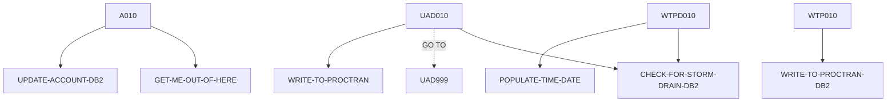

# DBCRFUN — source of truth

> Generated by `.github/skills/cobol-rekt/run-cobol-rekt.sh`. Do not edit by hand — re-run the script.
> **[rekt]** = from the cobol-rekt parse tree · **[scan]** = deterministic scan of the original source.

| | |
|---|---|
| Source | `src/base/cics/cobol/DBCRFUN.cbl` (869 lines) |
| Subsystem | `cics` |
| cobol-rekt | ✅ parsed |
| Sections / paragraphs [scan] | 24 |
| Decisions (IF / EVALUATE) [rekt] | 18 |
| EXEC CICS / EXEC SQL / DL/I calls [scan] | 19 / 3 / 0 |

## 1. Procedure structure

Control transfers inside the program [rekt]. Solid = `PERFORM`, dashed = `GO TO`.

| Section / paragraph | Lines | PERFORMs [rekt] | GO TO [rekt] | Decisions [rekt] | EXEC CICS | EXEC SQL |
|---|---|---|---|---|---|---|
| **PREMIERE** (section) | 199–199 | — | — | 0 | — | — |
| A010 | 200–230 | GET-ME-OUT-OF-HERE, UPDATE-ACCOUNT-DB2 | — | 0 | 1 | — |
| A999 | 231–234 | — | — | 0 | — | — |
| **UPDATE-ACCOUNT-DB2** (section) | 235–235 | — | — | 0 | — | — |
| UAD010 | 236–442 | CHECK-FOR-STORM-DRAIN-DB2, WRITE-TO-PROCTRAN | UAD999 | 7 | — | 2 |
| UAD999 | 443–446 | — | — | 0 | — | — |
| **WRITE-TO-PROCTRAN** (section) | 447–447 | — | — | 0 | — | — |
| WTP010 | 448–455 | WRITE-TO-PROCTRAN-DB2 | — | 0 | — | — |
| WTP999 | 456–459 | — | — | 0 | — | — |
| **WRITE-TO-PROCTRAN-DB2** (section) | 460–460 | — | — | 0 | — | — |
| WTPD010 | 461–661 | CHECK-FOR-STORM-DRAIN-DB2, POPULATE-TIME-DATE | — | 7 | 7 | 1 |
| WTPD999 | 662–665 | — | — | 0 | — | — |
| **GET-ME-OUT-OF-HERE** (section) | 666–666 | — | — | 0 | — | — |
| GMOOH010 | 667–671 | — | — | 0 | 1 | — |
| GMOOH999 | 672–675 | — | — | 0 | — | — |
| **CHECK-FOR-STORM-DRAIN-DB2** (section) | 676–676 | — | — | 0 | — | — |
| CFSDD010 | 677–701 | — | — | 2 | — | — |
| CFSDD999 | 702–708 | — | — | 0 | — | — |
| **ABEND-HANDLING** (section) | 709–709 | — | — | 0 | — | — |
| AH010 | 710–849 | — | — | 2 | 8 | — |
| AH999 | 850–853 | — | — | 0 | — | — |
| **POPULATE-TIME-DATE** (section) | 854–854 | — | — | 0 | — | — |
| PTD10 | 855–867 | — | — | 0 | 2 | — |
| PTD999 | 868–869 | — | — | 0 | — | — |

## 2. Decision points

Every `IF` / `EVALUATE` found by cobol-rekt, in source order. Condition text is quoted from the original source line. These are where business rules live.

**UAD010**

- `src/base/cics/cobol/DBCRFUN.cbl:279` `IF SQLCODE NOT = 0`
  - `src/base/cics/cobol/DBCRFUN.cbl:283` `IF SQLCODE = +100`
- `src/base/cics/cobol/DBCRFUN.cbl:307` `IF COMM-AMT < 0`
  - `src/base/cics/cobol/DBCRFUN.cbl:330` `IF (HV-ACCOUNT-ACC-TYPE = 'MORTGAGE' AND COMM-FACILTYPE = 496) OR (HV-ACCOUNT-ACC-TYPE = 'LOAN    ' AND COMM-FACILTYPE = 496)`
  - `src/base/cics/cobol/DBCRFUN.cbl:344` `IF WS-DIFFERENCE < 0 AND COMM-FACILTYPE = 496`
- `src/base/cics/cobol/DBCRFUN.cbl:368` `IF (HV-ACCOUNT-ACC-TYPE = 'MORTGAGE' AND`
- `src/base/cics/cobol/DBCRFUN.cbl:425` `IF SQLCODE NOT = 0`

**WTPD010**

- `src/base/cics/cobol/DBCRFUN.cbl:491` `IF COMM-AMT < 0`
  - `src/base/cics/cobol/DBCRFUN.cbl:498` `IF COMM-FACILTYPE = 496`
    - `src/base/cics/cobol/DBCRFUN.cbl:500` `IF COMM-DESCRIPTION OF COMM-ORIGIN NOT = SPACES`
  - `src/base/cics/cobol/DBCRFUN.cbl:515` `IF COMM-FACILTYPE = 496`
    - `src/base/cics/cobol/DBCRFUN.cbl:517` `IF COMM-DESCRIPTION OF COMM-ORIGIN NOT = SPACES`
- `src/base/cics/cobol/DBCRFUN.cbl:562` `IF SQLCODE NOT = 0`
  - `src/base/cics/cobol/DBCRFUN.cbl:577` `IF WS-CICS-RESP NOT = DFHRESP(NORMAL)`

**CFSDD010**

- `src/base/cics/cobol/DBCRFUN.cbl:683` `EVALUATE SQLCODE → WHEN 923 · WHEN OTHER`
- `src/base/cics/cobol/DBCRFUN.cbl:693` `IF STORM-DRAIN-CONDITION NOT EQUAL 'Not Storm Drain     '`

**AH010**

- `src/base/cics/cobol/DBCRFUN.cbl:724` `EVALUATE MY-ABEND-CODE → WHEN 'AD2Z' · WHEN 'AFCR' · WHEN 'AFCS' · WHEN 'AFCT'`
- `src/base/cics/cobol/DBCRFUN.cbl:841` `IF WS-STORM-DRAIN = 'N'`

## 3. External touchpoints [scan]

Every `EXEC CICS`, `EXEC SQL` and IMS DL/I call, as written in the original source.

| Line | Paragraph | Kind | Verb | Statement |
|---|---|---|---|---|
| `src/base/cics/cobol/DBCRFUN.cbl:207` | A010 | EXEC CICS | `HANDLE ABEND` | `HANDLE ABEND LABEL(ABEND-HANDLING)` |
| `src/base/cics/cobol/DBCRFUN.cbl:245` | UAD010 | EXEC SQL | `SELECT` | `SELECT ACCOUNT_EYECATCHER, ACCOUNT_CUSTOMER_NUMBER, ACCOUNT_SORTCODE, ACCOUNT_NUMBER, ACCOUNT_TYPE, ACCOUNT_I…` |
| `src/base/cics/cobol/DBCRFUN.cbl:392` | UAD010 | EXEC SQL | `UPDATE` | `UPDATE ACCOUNT SET ACCOUNT_EYECATCHER = :HV-ACCOUNT-EYECATCHER, ACCOUNT_CUSTOMER_NUMBER = :HV-ACCOUNT-CUST-NO…` |
| `src/base/cics/cobol/DBCRFUN.cbl:475` | WTPD010 | EXEC CICS | `ASKTIME` | `ASKTIME ABSTIME(WS-U-TIME)` |
| `src/base/cics/cobol/DBCRFUN.cbl:479` | WTPD010 | EXEC CICS | `FORMATTIME` | `FORMATTIME ABSTIME(WS-U-TIME) DDMMYYYY(WS-ORIG-DATE) TIME(HV-PROCTRAN-TIME) DATESEP('.')` |
| `src/base/cics/cobol/DBCRFUN.cbl:532` | WTPD010 | EXEC SQL | `INSERT` | `INSERT INTO PROCTRAN ( PROCTRAN_EYECATCHER, PROCTRAN_SORTCODE, PROCTRAN_NUMBER, PROCTRAN_DATE, PROCTRAN_TIME,…` |
| `src/base/cics/cobol/DBCRFUN.cbl:572` | WTPD010 | EXEC CICS | `SYNCPOINT` | `SYNCPOINT ROLLBACK RESP(WS-CICS-RESP) RESP2(WS-CICS-RESP2)` |
| `src/base/cics/cobol/DBCRFUN.cbl:590` | WTPD010 | EXEC CICS | `ASSIGN` | `ASSIGN APPLID(ABND-APPLID)` |
| `src/base/cics/cobol/DBCRFUN.cbl:610` | WTPD010 | EXEC CICS | `ASSIGN` | `ASSIGN PROGRAM(ABND-PROGRAM)` |
| `src/base/cics/cobol/DBCRFUN.cbl:628` | WTPD010 | EXEC CICS | `LINK` | `LINK PROGRAM(WS-ABEND-PGM) COMMAREA(ABNDINFO-REC)` |
| `src/base/cics/cobol/DBCRFUN.cbl:638` | WTPD010 | EXEC CICS | `ABEND` | `ABEND ABCODE ('HROL') CANCEL` |
| `src/base/cics/cobol/DBCRFUN.cbl:668` | GMOOH010 | EXEC CICS | `RETURN` | `RETURN` |
| `src/base/cics/cobol/DBCRFUN.cbl:712` | AH010 | EXEC CICS | `ASSIGN` | `ASSIGN ABCODE(MY-ABEND-CODE)` |
| `src/base/cics/cobol/DBCRFUN.cbl:758` | AH010 | EXEC CICS | `SYNCPOINT` | `SYNCPOINT ROLLBACK RESP(WS-CICS-RESP) RESP2(WS-CICS-RESP2)` |
| `src/base/cics/cobol/DBCRFUN.cbl:777` | AH010 | EXEC CICS | `ASSIGN` | `ASSIGN APPLID(ABND-APPLID)` |
| `src/base/cics/cobol/DBCRFUN.cbl:797` | AH010 | EXEC CICS | `ASSIGN` | `ASSIGN PROGRAM(ABND-PROGRAM)` |
| `src/base/cics/cobol/DBCRFUN.cbl:815` | AH010 | EXEC CICS | `LINK` | `LINK PROGRAM(WS-ABEND-PGM) COMMAREA(ABNDINFO-REC)` |
| `src/base/cics/cobol/DBCRFUN.cbl:826` | AH010 | EXEC CICS | `ABEND` | `ABEND ABCODE ('HROL') CANCEL` |
| `src/base/cics/cobol/DBCRFUN.cbl:836` | AH010 | EXEC CICS | `RETURN` | `RETURN` |
| `src/base/cics/cobol/DBCRFUN.cbl:842` | AH010 | EXEC CICS | `ABEND` | `ABEND ABCODE( MY-ABEND-CODE) NODUMP CANCEL` |
| `src/base/cics/cobol/DBCRFUN.cbl:857` | PTD10 | EXEC CICS | `ASKTIME` | `ASKTIME ABSTIME(WS-U-TIME)` |
| `src/base/cics/cobol/DBCRFUN.cbl:861` | PTD10 | EXEC CICS | `FORMATTIME` | `FORMATTIME ABSTIME(WS-U-TIME) DDMMYYYY(WS-ORIG-DATE) TIME(WS-TIME-NOW) DATESEP` |

## 4. Dependencies [scan]

**Program / transaction transfers**

Lines refer to `src/base/cics/cobol/DBCRFUN.cbl`.

| Kind | Target(s) | Resolved via | Lines · paragraph |
|---|---|---|---|
| LINK | `ABNDPROC` | variable `WS-ABEND-PGM` (VALUE clause) | `:628` WTPD010, `:815` AH010 |

**Copybooks**

- `SORTCODE` (`src/base/cics/cobol/DBCRFUN.cbl:48`) → `src/base/cics/copy/SORTCODE.cpy`
- `ACCDB2` (`src/base/cics/cobol/DBCRFUN.cbl:55`) → `src/base/cics/copy/ACCDB2.cpy`
- `PROCDB2` (`src/base/cics/cobol/DBCRFUN.cbl:76`) → `src/base/cics/copy/PROCDB2.cpy`
- `SQLCA` (`src/base/cics/cobol/DBCRFUN.cbl:93`) → DB2 precompiler member (not in repo)
- `ACCOUNT` (`src/base/cics/cobol/DBCRFUN.cbl:119`) → `src/base/cics/copy/ACCOUNT.cpy`
- `PROCTRAN` (`src/base/cics/cobol/DBCRFUN.cbl:150`) → `src/base/cics/copy/PROCTRAN.cpy`
- `ABNDINFO` (`src/base/cics/cobol/DBCRFUN.cbl:188`) → `src/base/cics/copy/ABNDINFO.cpy`
- `PAYDBCR` (`src/base/cics/cobol/DBCRFUN.cbl:195`) → `src/base/cics/copy/PAYDBCR.cpy`

## 5. Condition names (88-levels) [scan]

Named conditions encode business codes. Includes copybooks reached from this program.

| Condition | Value(s) | Parent item | Defined at |
|---|---|---|---|
| `DATASTORE-TYPE-DLI` | `'1'` | DATA-STORE-TYPE | `src/base/cics/cobol/DBCRFUN.cbl:114` |
| `DATASTORE-TYPE-DB2` | `'2'` | DATA-STORE-TYPE | `src/base/cics/cobol/DBCRFUN.cbl:115` |
| `DATASTORE-TYPE-VSAM` | `'V'` | DATA-STORE-TYPE | `src/base/cics/cobol/DBCRFUN.cbl:116` |
| `ACCOUNT-EYECATCHER-VALUE` | `'ACCT'` | ACCOUNT-EYE-CATCHER | `src/base/cics/copy/ACCOUNT.cpy:9` |
| `PROC-TRAN-VALID` | `'PRTR'` | PROC-TRAN-EYE-CATCHER | `src/base/cics/copy/PROCTRAN.cpy:9` |
| `PROC-TRAN-LOGICALLY-DELETED` | `X'FF'` | PROC-TRAN-LOGICAL-DELETE-FLAG | `src/base/cics/copy/PROCTRAN.cpy:13` |
| `PROC-TY-CHEQUE-ACKNOWLEDGED` | `'CHA'` | PROC-TRAN-TYPE | `src/base/cics/copy/PROCTRAN.cpy:30` |
| `PROC-TY-CHEQUE-FAILURE` | `'CHF'` | PROC-TRAN-TYPE | `src/base/cics/copy/PROCTRAN.cpy:31` |
| `PROC-TY-CHEQUE-PAID-IN` | `'CHI'` | PROC-TRAN-TYPE | `src/base/cics/copy/PROCTRAN.cpy:32` |
| `PROC-TY-CHEQUE-PAID-OUT` | `'CHO'` | PROC-TRAN-TYPE | `src/base/cics/copy/PROCTRAN.cpy:33` |
| `PROC-TY-CREDIT` | `'CRE'` | PROC-TRAN-TYPE | `src/base/cics/copy/PROCTRAN.cpy:34` |
| `PROC-TY-DEBIT` | `'DEB'` | PROC-TRAN-TYPE | `src/base/cics/copy/PROCTRAN.cpy:35` |
| `PROC-TY-WEB-CREATE-ACCOUNT` | `'ICA'` | PROC-TRAN-TYPE | `src/base/cics/copy/PROCTRAN.cpy:36` |
| `PROC-TY-WEB-CREATE-CUSTOMER` | `'ICC'` | PROC-TRAN-TYPE | `src/base/cics/copy/PROCTRAN.cpy:37` |
| `PROC-TY-WEB-DELETE-ACCOUNT` | `'IDA'` | PROC-TRAN-TYPE | `src/base/cics/copy/PROCTRAN.cpy:38` |
| `PROC-TY-WEB-DELETE-CUSTOMER` | `'IDC'` | PROC-TRAN-TYPE | `src/base/cics/copy/PROCTRAN.cpy:39` |
| `PROC-TY-BRANCH-CREATE-ACCOUNT` | `'OCA'` | PROC-TRAN-TYPE | `src/base/cics/copy/PROCTRAN.cpy:40` |
| `PROC-TY-BRANCH-CREATE-CUSTOMER` | `'OCC'` | PROC-TRAN-TYPE | `src/base/cics/copy/PROCTRAN.cpy:41` |
| `PROC-TY-BRANCH-DELETE-ACCOUNT` | `'ODA'` | PROC-TRAN-TYPE | `src/base/cics/copy/PROCTRAN.cpy:42` |
| `PROC-TY-BRANCH-DELETE-CUSTOMER` | `'ODC'` | PROC-TRAN-TYPE | `src/base/cics/copy/PROCTRAN.cpy:43` |
| `PROC-TY-CREATE-SODD` | `'OCS'` | PROC-TRAN-TYPE | `src/base/cics/copy/PROCTRAN.cpy:44` |
| `PROC-TY-PAYMENT-CREDIT` | `'PCR'` | PROC-TRAN-TYPE | `src/base/cics/copy/PROCTRAN.cpy:45` |
| `PROC-TY-PAYMENT-DEBIT` | `'PDR'` | PROC-TRAN-TYPE | `src/base/cics/copy/PROCTRAN.cpy:46` |
| `PROC-TY-TRANSFER` | `'TFR'` | PROC-TRAN-TYPE | `src/base/cics/copy/PROCTRAN.cpy:47` |
| `PROC-TRAN-DESC-XFR-FLAG` | `'TRANSFER'` | PROC-TRAN-DESC-XFR-HEADER | `src/base/cics/copy/PROCTRAN.cpy:51` |
| `PROC-DESC-DELACC-FLAG` | `'DELETE'` | PROC-DESC-DELACC-FOOTER | `src/base/cics/copy/PROCTRAN.cpy:67` |
| `PROC-DESC-CREACC-FLAG` | `'CREATE'` | PROC-DESC-CREACC-FOOTER | `src/base/cics/copy/PROCTRAN.cpy:79` |
| `PROC-DESC-DELCUS-FILLER-SET` | `'-'` | PROC-DESC-DELCUS-FILLER | `src/base/cics/copy/PROCTRAN.cpy:87` |
| `PROC-DESC-DELCUS-FILLER2-SET` | `'-'` | PROC-DESC-DELCUS-FILLER2 | `src/base/cics/copy/PROCTRAN.cpy:90` |
| `PROC-DESC-CRECUS-FILLER-SET` | `'-'` | PROC-DESC-CRECUS-FILLER | `src/base/cics/copy/PROCTRAN.cpy:98` |
| `PROC-DESC-CRECUS-FILLER2-SET` | `'-'` | PROC-DESC-CRECUS-FILLER2 | `src/base/cics/copy/PROCTRAN.cpy:101` |

## 6. Data items [rekt]

**Records (01 / 77 levels)**

| Name | Clause | Fields | Section | Defined at |
|---|---|---|---|---|
| `HOST-ACCOUNT-ROW` | `(group)` | 13 | WORKING_STORAGE | `src/base/cics/cobol/DBCRFUN.cbl:60` |
| `HOST-PROCTRAN-ROW` | `(group)` | 9 | WORKING_STORAGE | `src/base/cics/cobol/DBCRFUN.cbl:81` |
| `WS-CICS-WORK-AREA` | `(group)` | 2 | WORKING_STORAGE | `src/base/cics/cobol/DBCRFUN.cbl:97` |
| `DFHCOMMAREA` | `(group)` | 15 | LINKAGE | `src/base/cics/cobol/DBCRFUN.cbl:194` |

**LINKAGE SECTION — the program's interface contract (COMMAREA / parameters)**

| Level | Name | Clause | Type | Defined at |
|---|---|---|---|---|
| 01 | DFHCOMMAREA | `(group)` | OBJECT | `src/base/cics/cobol/DBCRFUN.cbl:194` |
| 03 | &nbsp;&nbsp;COMM-ACCNO | `PIC X(8)` | STRING | `src/base/cics/copy/PAYDBCR.cpy:7` |
| 03 | &nbsp;&nbsp;COMM-AMT | `PIC S9(10)V99` | NUMBER | `src/base/cics/copy/PAYDBCR.cpy:8` |
| 03 | &nbsp;&nbsp;COMM-SORTC | `PIC 9(6)` | NUMBER | `src/base/cics/copy/PAYDBCR.cpy:9` |
| 03 | &nbsp;&nbsp;COMM-AV-BAL | `PIC S9(10)V99` | NUMBER | `src/base/cics/copy/PAYDBCR.cpy:10` |
| 03 | &nbsp;&nbsp;COMM-ACT-BAL | `PIC S9(10)V99` | NUMBER | `src/base/cics/copy/PAYDBCR.cpy:11` |
| 03 | &nbsp;&nbsp;COMM-ORIGIN | `(group)` | OBJECT | `src/base/cics/copy/PAYDBCR.cpy:12` |
| 05 | &nbsp;&nbsp;&nbsp;&nbsp;COMM-APPLID | `PIC X(8)` | STRING | `src/base/cics/copy/PAYDBCR.cpy:13` |
| 05 | &nbsp;&nbsp;&nbsp;&nbsp;COMM-USERID | `PIC X(8)` | STRING | `src/base/cics/copy/PAYDBCR.cpy:14` |
| 05 | &nbsp;&nbsp;&nbsp;&nbsp;COMM-FACILITY-NAME | `PIC X(8)` | STRING | `src/base/cics/copy/PAYDBCR.cpy:15` |
| 05 | &nbsp;&nbsp;&nbsp;&nbsp;COMM-NETWRK-ID | `PIC X(8)` | STRING | `src/base/cics/copy/PAYDBCR.cpy:16` |
| 05 | &nbsp;&nbsp;&nbsp;&nbsp;COMM-FACILTYPE | `PIC S9(8) COMP` | NUMBER | `src/base/cics/copy/PAYDBCR.cpy:17` |
| 05 | &nbsp;&nbsp;&nbsp;&nbsp;FILLER | `PIC X(4)` | STRING | `src/base/cics/copy/PAYDBCR.cpy:18` |
| 05 | &nbsp;&nbsp;&nbsp;&nbsp;COMM-DESCRIPTION | `PIC X(40)` | STRING | `src/base/cics/copy/PAYDBCR.cpy:19` |
| 03 | &nbsp;&nbsp;COMM-SUCCESS | `PIC X` | STRING | `src/base/cics/copy/PAYDBCR.cpy:20` |
| 03 | &nbsp;&nbsp;COMM-FAIL-CODE | `PIC X` | STRING | `src/base/cics/copy/PAYDBCR.cpy:21` |

_Working-storage fields below the 01 level are not listed — open the definition to drill in._

**Not reported by cobol-rekt** — present in the source, so read them there [scan]:

- `SYSIDERR-RETRY` (WORKING-STORAGE) `src/base/cics/cobol/DBCRFUN.cbl:52`
- `FILE-RETRY` (LOCAL-STORAGE) `src/base/cics/cobol/DBCRFUN.cbl:103`
- `WS-EXIT-RETRY-LOOP` (LOCAL-STORAGE) `src/base/cics/cobol/DBCRFUN.cbl:104`
- `DB2-DATE-REFORMAT` (LOCAL-STORAGE) `src/base/cics/cobol/DBCRFUN.cbl:106`
- `DATA-STORE-TYPE` (LOCAL-STORAGE) `src/base/cics/cobol/DBCRFUN.cbl:113`
- `WS-ACC-DATA` (LOCAL-STORAGE) `src/base/cics/cobol/DBCRFUN.cbl:118`
- `WS-EIBTASKN12` (LOCAL-STORAGE) `src/base/cics/cobol/DBCRFUN.cbl:121`
- `WS-SQLCODE-DISP` (LOCAL-STORAGE) `src/base/cics/cobol/DBCRFUN.cbl:122`
- `DESIRED-ACC-KEY` (LOCAL-STORAGE) `src/base/cics/cobol/DBCRFUN.cbl:124`
- `NEW-ACCOUNT-AVAILABLE-BALANCE` (LOCAL-STORAGE) `src/base/cics/cobol/DBCRFUN.cbl:128`
- `NEW-ACCOUNT-ACTUAL-BALANCE` (LOCAL-STORAGE) `src/base/cics/cobol/DBCRFUN.cbl:129`
- `WS-ACC-REC-LEN` (LOCAL-STORAGE) `src/base/cics/cobol/DBCRFUN.cbl:130`
- `WS-U-TIME` (LOCAL-STORAGE) `src/base/cics/cobol/DBCRFUN.cbl:133`
- `WS-ORIG-DATE` (LOCAL-STORAGE) `src/base/cics/cobol/DBCRFUN.cbl:134`
- `WS-ORIG-DATE-GRP` (LOCAL-STORAGE) `src/base/cics/cobol/DBCRFUN.cbl:135`
- `WS-ORIG-DATE-GRP-X` (LOCAL-STORAGE) `src/base/cics/cobol/DBCRFUN.cbl:142`
- `PROCTRAN-AREA` (LOCAL-STORAGE) `src/base/cics/cobol/DBCRFUN.cbl:149`
- `WS-PASSED-DATA` (LOCAL-STORAGE) `src/base/cics/cobol/DBCRFUN.cbl:152`
- `PROCTRAN-RIDFLD` (LOCAL-STORAGE) `src/base/cics/cobol/DBCRFUN.cbl:166`
- `SQLCODE-DISPLAY` (LOCAL-STORAGE) `src/base/cics/cobol/DBCRFUN.cbl:168`
- `MY-ABEND-CODE` (LOCAL-STORAGE) `src/base/cics/cobol/DBCRFUN.cbl:171`
- `WS-STORM-DRAIN` (LOCAL-STORAGE) `src/base/cics/cobol/DBCRFUN.cbl:173`
- `STORM-DRAIN-CONDITION` (LOCAL-STORAGE) `src/base/cics/cobol/DBCRFUN.cbl:174`
- `NUMERIC-AMOUNT-DISPLAY` (LOCAL-STORAGE) `src/base/cics/cobol/DBCRFUN.cbl:176`
- `WS-TIME-DATA` (LOCAL-STORAGE) `src/base/cics/cobol/DBCRFUN.cbl:178`
- `WS-ABEND-PGM` (LOCAL-STORAGE) `src/base/cics/cobol/DBCRFUN.cbl:185`
- `ABNDINFO-REC` (LOCAL-STORAGE) `src/base/cics/cobol/DBCRFUN.cbl:187`
- `WS-SUFFICIENT-FUNDS` (LOCAL-STORAGE) `src/base/cics/cobol/DBCRFUN.cbl:190`
- `WS-DIFFERENCE` (LOCAL-STORAGE) `src/base/cics/cobol/DBCRFUN.cbl:191`
