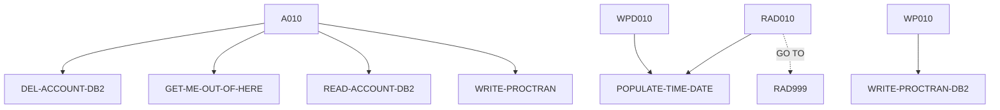

# DELACC — source of truth

> Generated by `.github/skills/cobol-rekt/run-cobol-rekt.sh`. Do not edit by hand — re-run the script.
> **[rekt]** = from the cobol-rekt parse tree · **[scan]** = deterministic scan of the original source.

| | |
|---|---|
| Source | `src/base/cics/cobol/DELACC.cbl` (649 lines) |
| Subsystem | `cics` |
| cobol-rekt | ✅ parsed |
| Sections / paragraphs [scan] | 21 |
| Decisions (IF / EVALUATE) [rekt] | 7 |
| EXEC CICS / EXEC SQL / DL/I calls [scan] | 11 / 3 / 0 |

## 1. Procedure structure

Control transfers inside the program [rekt]. Solid = `PERFORM`, dashed = `GO TO`.

| Section / paragraph | Lines | PERFORMs [rekt] | GO TO [rekt] | Decisions [rekt] | EXEC CICS | EXEC SQL |
|---|---|---|---|---|---|---|
| **PREMIERE** (section) | 204–204 | — | — | 0 | — | — |
| A010 | 205–228 | DEL-ACCOUNT-DB2, GET-ME-OUT-OF-HERE, READ-ACCOUNT-DB2, WRITE-PROCTRAN | — | 2 | — | — |
| A999 | 229–235 | — | — | 0 | — | — |
| **READ-ACCOUNT-DB2** (section) | 236–236 | — | — | 0 | — | — |
| RAD010 | 237–426 | POPULATE-TIME-DATE | RAD999 | 3 | 3 | 1 |
| RAD999 | 427–430 | — | — | 0 | — | — |
| **DEL-ACCOUNT-DB2** (section) | 431–431 | — | — | 0 | — | — |
| DADB010 | 432–449 | — | — | 1 | — | 1 |
| DADB999 | 450–453 | — | — | 0 | — | — |
| **WRITE-PROCTRAN** (section) | 454–454 | — | — | 0 | — | — |
| WP010 | 455–457 | WRITE-PROCTRAN-DB2 | — | 0 | — | — |
| WP999 | 458–461 | — | — | 0 | — | — |
| **WRITE-PROCTRAN-DB2** (section) | 462–462 | — | — | 0 | — | — |
| WPD010 | 463–617 | POPULATE-TIME-DATE | — | 1 | 6 | 1 |
| WPD999 | 618–624 | — | — | 0 | — | — |
| **GET-ME-OUT-OF-HERE** (section) | 625–625 | — | — | 0 | — | — |
| GMOFH010 | 626–629 | — | — | 0 | — | — |
| GMOFH999 | 630–633 | — | — | 0 | — | — |
| **POPULATE-TIME-DATE** (section) | 634–634 | — | — | 0 | — | — |
| PTD010 | 635–647 | — | — | 0 | 2 | — |
| PTD999 | 648–649 | — | — | 0 | — | — |

## 2. Decision points

Every `IF` / `EVALUATE` found by cobol-rekt, in source order. Condition text is quoted from the original source line. These are where business rules live.

**A010**

- `src/base/cics/cobol/DELACC.cbl:218` `IF DELACC-DEL-SUCCESS = 'Y'`
  - `src/base/cics/cobol/DELACC.cbl:221` `IF DELACC-DEL-SUCCESS = 'Y'`

**RAD010**

- `src/base/cics/cobol/DELACC.cbl:282` `IF SQLCODE NOT = 0 AND SQLCODE NOT = +100`
- `src/base/cics/cobol/DELACC.cbl:350` `IF SQLCODE = +100`
- `src/base/cics/cobol/DELACC.cbl:363` `IF SQLCODE = 0`

**DADB010**

- `src/base/cics/cobol/DELACC.cbl:444` `IF SQLCODE NOT = 0`

**WPD010**

- `src/base/cics/cobol/DELACC.cbl:552` `IF SQLCODE NOT = 0`

## 3. External touchpoints [scan]

Every `EXEC CICS`, `EXEC SQL` and IMS DL/I call, as written in the original source.

| Line | Paragraph | Kind | Verb | Statement |
|---|---|---|---|---|
| `src/base/cics/cobol/DELACC.cbl:248` | RAD010 | EXEC SQL | `SELECT` | `SELECT ACCOUNT_EYECATCHER, ACCOUNT_CUSTOMER_NUMBER, ACCOUNT_SORTCODE, ACCOUNT_NUMBER, ACCOUNT_TYPE, ACCOUNT_I…` |
| `src/base/cics/cobol/DELACC.cbl:296` | RAD010 | EXEC CICS | `ASSIGN` | `ASSIGN APPLID(ABND-APPLID)` |
| `src/base/cics/cobol/DELACC.cbl:317` | RAD010 | EXEC CICS | `ASSIGN` | `ASSIGN PROGRAM(ABND-PROGRAM)` |
| `src/base/cics/cobol/DELACC.cbl:339` | RAD010 | EXEC CICS | `ABEND` | `ABEND ABCODE('HRAC') NODUMP` |
| `src/base/cics/cobol/DELACC.cbl:438` | DADB010 | EXEC SQL | `DELETE` | `DELETE FROM ACCOUNT WHERE ACCOUNT_SORTCODE = :HV-ACCOUNT-SORTCODE AND ACCOUNT_NUMBER = :HV-ACCOUNT-ACC-NO` |
| `src/base/cics/cobol/DELACC.cbl:481` | WPD010 | EXEC CICS | `ASKTIME` | `ASKTIME ABSTIME(WS-U-TIME)` |
| `src/base/cics/cobol/DELACC.cbl:485` | WPD010 | EXEC CICS | `FORMATTIME` | `FORMATTIME ABSTIME(WS-U-TIME) DDMMYYYY(WS-ORIG-DATE) TIME(HV-PROCTRAN-TIME) DATESEP('.')` |
| `src/base/cics/cobol/DELACC.cbl:521` | WPD010 | EXEC SQL | `INSERT` | `INSERT INTO PROCTRAN ( PROCTRAN_EYECATCHER, PROCTRAN_SORTCODE, PROCTRAN_NUMBER, PROCTRAN_DATE, PROCTRAN_TIME,…` |
| `src/base/cics/cobol/DELACC.cbl:566` | WPD010 | EXEC CICS | `ASSIGN` | `ASSIGN APPLID(ABND-APPLID)` |
| `src/base/cics/cobol/DELACC.cbl:586` | WPD010 | EXEC CICS | `ASSIGN` | `ASSIGN PROGRAM(ABND-PROGRAM)` |
| `src/base/cics/cobol/DELACC.cbl:603` | WPD010 | EXEC CICS | `LINK` | `LINK PROGRAM(WS-ABEND-PGM) COMMAREA(ABNDINFO-REC)` |
| `src/base/cics/cobol/DELACC.cbl:612` | WPD010 | EXEC CICS | `ABEND` | `ABEND ABCODE ('HWPT')` |
| `src/base/cics/cobol/DELACC.cbl:637` | PTD010 | EXEC CICS | `ASKTIME` | `ASKTIME ABSTIME(WS-U-TIME)` |
| `src/base/cics/cobol/DELACC.cbl:641` | PTD010 | EXEC CICS | `FORMATTIME` | `FORMATTIME ABSTIME(WS-U-TIME) DDMMYYYY(WS-ORIG-DATE) TIME(WS-TIME-NOW) DATESEP` |

## 4. Dependencies [scan]

**Program / transaction transfers**

Lines refer to `src/base/cics/cobol/DELACC.cbl`.

| Kind | Target(s) | Resolved via | Lines · paragraph |
|---|---|---|---|
| LINK | `ABNDPROC` | variable `WS-ABEND-PGM` (VALUE clause) | `:603` WPD010 |

**Copybooks**

- `SORTCODE` (`src/base/cics/cobol/DELACC.cbl:41`) → `src/base/cics/copy/SORTCODE.cpy`
- `ACCDB2` (`src/base/cics/cobol/DELACC.cbl:50`) → `src/base/cics/copy/ACCDB2.cpy`
- `PROCDB2` (`src/base/cics/cobol/DELACC.cbl:70`) → `src/base/cics/copy/PROCDB2.cpy`
- `SQLCA` (`src/base/cics/cobol/DELACC.cbl:87`) → DB2 precompiler member (not in repo)
- `ACCOUNT` (`src/base/cics/cobol/DELACC.cbl:105`) → `src/base/cics/copy/ACCOUNT.cpy`
- `PROCTRAN` (`src/base/cics/cobol/DELACC.cbl:108`) → `src/base/cics/copy/PROCTRAN.cpy`
- `ACCTCTRL` (`src/base/cics/cobol/DELACC.cbl:184`) → `src/base/cics/copy/ACCTCTRL.cpy`
- `ABNDINFO` (`src/base/cics/cobol/DELACC.cbl:196`) → `src/base/cics/copy/ABNDINFO.cpy`
- `DELACC` (`src/base/cics/cobol/DELACC.cbl:200`) → `src/base/cics/copy/DELACC.cpy`

## 5. Condition names (88-levels) [scan]

Named conditions encode business codes. Includes copybooks reached from this program.

| Condition | Value(s) | Parent item | Defined at |
|---|---|---|---|
| `DATASTORE-TYPE-DB2` | `'2'` | DATA-STORE-TYPE | `src/base/cics/cobol/DELACC.cbl:141` |
| `DATASTORE-TYPE-VSAM` | `'V'` | DATA-STORE-TYPE | `src/base/cics/cobol/DELACC.cbl:142` |
| `ACCOUNT-EYECATCHER-VALUE` | `'ACCT'` | ACCOUNT-EYE-CATCHER | `src/base/cics/copy/ACCOUNT.cpy:9` |
| `PROC-TRAN-VALID` | `'PRTR'` | PROC-TRAN-EYE-CATCHER | `src/base/cics/copy/PROCTRAN.cpy:9` |
| `PROC-TRAN-LOGICALLY-DELETED` | `X'FF'` | PROC-TRAN-LOGICAL-DELETE-FLAG | `src/base/cics/copy/PROCTRAN.cpy:13` |
| `PROC-TY-CHEQUE-ACKNOWLEDGED` | `'CHA'` | PROC-TRAN-TYPE | `src/base/cics/copy/PROCTRAN.cpy:30` |
| `PROC-TY-CHEQUE-FAILURE` | `'CHF'` | PROC-TRAN-TYPE | `src/base/cics/copy/PROCTRAN.cpy:31` |
| `PROC-TY-CHEQUE-PAID-IN` | `'CHI'` | PROC-TRAN-TYPE | `src/base/cics/copy/PROCTRAN.cpy:32` |
| `PROC-TY-CHEQUE-PAID-OUT` | `'CHO'` | PROC-TRAN-TYPE | `src/base/cics/copy/PROCTRAN.cpy:33` |
| `PROC-TY-CREDIT` | `'CRE'` | PROC-TRAN-TYPE | `src/base/cics/copy/PROCTRAN.cpy:34` |
| `PROC-TY-DEBIT` | `'DEB'` | PROC-TRAN-TYPE | `src/base/cics/copy/PROCTRAN.cpy:35` |
| `PROC-TY-WEB-CREATE-ACCOUNT` | `'ICA'` | PROC-TRAN-TYPE | `src/base/cics/copy/PROCTRAN.cpy:36` |
| `PROC-TY-WEB-CREATE-CUSTOMER` | `'ICC'` | PROC-TRAN-TYPE | `src/base/cics/copy/PROCTRAN.cpy:37` |
| `PROC-TY-WEB-DELETE-ACCOUNT` | `'IDA'` | PROC-TRAN-TYPE | `src/base/cics/copy/PROCTRAN.cpy:38` |
| `PROC-TY-WEB-DELETE-CUSTOMER` | `'IDC'` | PROC-TRAN-TYPE | `src/base/cics/copy/PROCTRAN.cpy:39` |
| `PROC-TY-BRANCH-CREATE-ACCOUNT` | `'OCA'` | PROC-TRAN-TYPE | `src/base/cics/copy/PROCTRAN.cpy:40` |
| `PROC-TY-BRANCH-CREATE-CUSTOMER` | `'OCC'` | PROC-TRAN-TYPE | `src/base/cics/copy/PROCTRAN.cpy:41` |
| `PROC-TY-BRANCH-DELETE-ACCOUNT` | `'ODA'` | PROC-TRAN-TYPE | `src/base/cics/copy/PROCTRAN.cpy:42` |
| `PROC-TY-BRANCH-DELETE-CUSTOMER` | `'ODC'` | PROC-TRAN-TYPE | `src/base/cics/copy/PROCTRAN.cpy:43` |
| `PROC-TY-CREATE-SODD` | `'OCS'` | PROC-TRAN-TYPE | `src/base/cics/copy/PROCTRAN.cpy:44` |
| `PROC-TY-PAYMENT-CREDIT` | `'PCR'` | PROC-TRAN-TYPE | `src/base/cics/copy/PROCTRAN.cpy:45` |
| `PROC-TY-PAYMENT-DEBIT` | `'PDR'` | PROC-TRAN-TYPE | `src/base/cics/copy/PROCTRAN.cpy:46` |
| `PROC-TY-TRANSFER` | `'TFR'` | PROC-TRAN-TYPE | `src/base/cics/copy/PROCTRAN.cpy:47` |
| `PROC-TRAN-DESC-XFR-FLAG` | `'TRANSFER'` | PROC-TRAN-DESC-XFR-HEADER | `src/base/cics/copy/PROCTRAN.cpy:51` |
| `PROC-DESC-DELACC-FLAG` | `'DELETE'` | PROC-DESC-DELACC-FOOTER | `src/base/cics/copy/PROCTRAN.cpy:67` |
| `PROC-DESC-CREACC-FLAG` | `'CREATE'` | PROC-DESC-CREACC-FOOTER | `src/base/cics/copy/PROCTRAN.cpy:79` |
| `PROC-DESC-DELCUS-FILLER-SET` | `'-'` | PROC-DESC-DELCUS-FILLER | `src/base/cics/copy/PROCTRAN.cpy:87` |
| `PROC-DESC-DELCUS-FILLER2-SET` | `'-'` | PROC-DESC-DELCUS-FILLER2 | `src/base/cics/copy/PROCTRAN.cpy:90` |
| `PROC-DESC-CRECUS-FILLER-SET` | `'-'` | PROC-DESC-CRECUS-FILLER | `src/base/cics/copy/PROCTRAN.cpy:98` |
| `PROC-DESC-CRECUS-FILLER2-SET` | `'-'` | PROC-DESC-CRECUS-FILLER2 | `src/base/cics/copy/PROCTRAN.cpy:101` |
| `ACCOUNT-CONTROL-EYECATCHER-V` | `'CTRL'` | ACCOUNT-CONTROL-EYE-CATCHER | `src/base/cics/copy/ACCTCTRL.cpy:9` |
| `ACCOUNT-CONTROL-SUCCESS` | `'Y'` | ACCOUNT-CONTROL-SUCCESS-FLAG | `src/base/cics/copy/ACCTCTRL.cpy:17` |

## 6. Data items [rekt]

**Records (01 / 77 levels)**

| Name | Clause | Fields | Section | Defined at |
|---|---|---|---|---|
| `SYSIDERR-RETRY` | `PIC 999` | — | WORKING_STORAGE | `src/base/cics/cobol/DELACC.cbl:45` |
| `FILE-RETRY` | `PIC 999` | — | WORKING_STORAGE | `src/base/cics/cobol/DELACC.cbl:46` |
| `WS-EXIT-RETRY-LOOP` | `PIC X VALUE ' '` | — | WORKING_STORAGE | `src/base/cics/cobol/DELACC.cbl:47` |
| `HOST-ACCOUNT-ROW` | `(group)` | 12 | WORKING_STORAGE | `src/base/cics/cobol/DELACC.cbl:55` |
| `HOST-PROCTRAN-ROW` | `(group)` | 9 | WORKING_STORAGE | `src/base/cics/cobol/DELACC.cbl:75` |
| `SQLCODE-DISPLAY` | `PIC S9(8) DISPLAY SIGN LEADING SEPARATE` | — | WORKING_STORAGE | `src/base/cics/cobol/DELACC.cbl:91` |
| `WS-CICS-WORK-AREA` | `(group)` | 3 | WORKING_STORAGE | `src/base/cics/cobol/DELACC.cbl:94` |
| `WS-APPLID` | `PIC X(8)` | — | WORKING_STORAGE | `src/base/cics/cobol/DELACC.cbl:100` |
| `EXIT-BROWSE-LOOP` | `PIC X VALUE 'N'` | — | WORKING_STORAGE | `src/base/cics/cobol/DELACC.cbl:102` |
| `OUTPUT-DATA` | `(group)` | 26 | WORKING_STORAGE | `src/base/cics/cobol/DELACC.cbl:104` |
| `PROCTRAN-AREA` | `(group)` | 64 | WORKING_STORAGE | `src/base/cics/cobol/DELACC.cbl:107` |
| `PROCTRAN-RIDFLD` | `PIC S9(8) COMP` | — | WORKING_STORAGE | `src/base/cics/cobol/DELACC.cbl:110` |
| `ACCOUNT-ACT-BAL-STORE` | `PIC S9(10)V99 VALUE 0` | — | WORKING_STORAGE | `src/base/cics/cobol/DELACC.cbl:113` |
| `RETURNED-DATA` | `(group)` | 13 | WORKING_STORAGE | `src/base/cics/cobol/DELACC.cbl:115` |
| `DESIRED-KEY` | `PIC 9(10) BINARY` | — | WORKING_STORAGE | `src/base/cics/cobol/DELACC.cbl:130` |
| `DB2-DATE-REFORMAT` | `(group)` | 5 | WORKING_STORAGE | `src/base/cics/cobol/DELACC.cbl:133` |
| `DATA-STORE-TYPE` | `PIC X` | — | WORKING_STORAGE | `src/base/cics/cobol/DELACC.cbl:140` |
| `DB2-EXIT-LOOP` | `PIC X` | — | WORKING_STORAGE | `src/base/cics/cobol/DELACC.cbl:144` |
| `FETCH-DATA-CNT` | `PIC 9(4) COMP` | — | WORKING_STORAGE | `src/base/cics/cobol/DELACC.cbl:145` |
| `WS-CUST-ALT-KEY-LEN` | `PIC S9(4) COMP VALUE +10` | — | WORKING_STORAGE | `src/base/cics/cobol/DELACC.cbl:146` |
| `WS-EIBTASKN12` | `PIC 9(12) VALUE 0` | — | WORKING_STORAGE | `src/base/cics/cobol/DELACC.cbl:148` |
| `ACCOUNT-KEY-RID` | `(group)` | 2 | WORKING_STORAGE | `src/base/cics/cobol/DELACC.cbl:150` |
| `MY-TCB` | `PIC S9(8) BINARY` | — | WORKING_STORAGE | `src/base/cics/cobol/DELACC.cbl:154` |
| `MY-TCB-STRING` | `PIC X(8)` | — | WORKING_STORAGE | `src/base/cics/cobol/DELACC.cbl:156` |
| `WS-ACC-KEY-LEN` | `PIC S9(4) COMP VALUE +14` | — | WORKING_STORAGE | `src/base/cics/cobol/DELACC.cbl:158` |
| `WS-ACC-NUM` | `PIC S9(4) COMP VALUE 0` | — | WORKING_STORAGE | `src/base/cics/cobol/DELACC.cbl:159` |
| `WS-U-TIME` | `PIC S9(15) COMP-3` | — | WORKING_STORAGE | `src/base/cics/cobol/DELACC.cbl:161` |
| `WS-ORIG-DATE` | `PIC X(10)` | — | WORKING_STORAGE | `src/base/cics/cobol/DELACC.cbl:162` |
| `WS-ORIG-DATE-GRP` | `REDEFINES WS-ORIG-DATE` REDEFINES WS-ORIG-DATE | 5 | WORKING_STORAGE | `src/base/cics/cobol/DELACC.cbl:163` |
| `WS-ORIG-DATE-GRP-X` | `(group)` | 5 | WORKING_STORAGE | `src/base/cics/cobol/DELACC.cbl:170` |
| `WS-TOKEN` | `PIC S9(8) BINARY` | — | WORKING_STORAGE | `src/base/cics/cobol/DELACC.cbl:178` |
| `STORM-DRAIN-CONDITION` | `PIC X(20)` | — | WORKING_STORAGE | `src/base/cics/cobol/DELACC.cbl:181` |
| `ACCOUNT-CONTROL` | `(group)` | 17 | WORKING_STORAGE | `src/base/cics/cobol/DELACC.cbl:183` |
| `WS-TIME-DATA` | `(group)` | 5 | WORKING_STORAGE | `src/base/cics/cobol/DELACC.cbl:186` |
| `WS-ABEND-PGM` | `PIC X(8) VALUE 'ABNDPROC'` | — | WORKING_STORAGE | `src/base/cics/cobol/DELACC.cbl:193` |
| `ABNDINFO-REC` | `(group)` | 13 | WORKING_STORAGE | `src/base/cics/cobol/DELACC.cbl:195` |
| `DFHCOMMAREA` | `(group)` | 32 | LINKAGE | — |

**LINKAGE SECTION — the program's interface contract (COMMAREA / parameters)**

| Level | Name | Clause | Type | Defined at |
|---|---|---|---|---|
| 01 | DFHCOMMAREA | `(group)` | OBJECT | — |
| 03 | &nbsp;&nbsp;DELACC-EYE | `PIC X(4)` | STRING | `src/base/cics/copy/DELACC.cpy:8` |
| 03 | &nbsp;&nbsp;DELACC-CUSTNO | `PIC X(10)` | STRING | `src/base/cics/copy/DELACC.cpy:9` |
| 03 | &nbsp;&nbsp;DELACC-SCODE | `PIC X(6)` | STRING | `src/base/cics/copy/DELACC.cpy:10` |
| 03 | &nbsp;&nbsp;DELACC-ACCNO | `PIC 9(8)` | NUMBER | `src/base/cics/copy/DELACC.cpy:11` |
| 03 | &nbsp;&nbsp;DELACC-ACC-TYPE | `PIC X(8)` | STRING | `src/base/cics/copy/DELACC.cpy:12` |
| 03 | &nbsp;&nbsp;DELACC-INT-RATE | `PIC 9(4)V99` | NUMBER | `src/base/cics/copy/DELACC.cpy:13` |
| 03 | &nbsp;&nbsp;DELACC-OPENED | `PIC 9(8)` | NUMBER | `src/base/cics/copy/DELACC.cpy:14` |
| 03 | &nbsp;&nbsp;DELACC-OPENED-GROUP | `REDEFINES DELACC-OPENED` REDEFINES DELACC-OPENED | OBJECT | `src/base/cics/copy/DELACC.cpy:15` |
| 05 | &nbsp;&nbsp;&nbsp;&nbsp;DELACC-OPENED-DAY | `PIC 99` | NUMBER | `src/base/cics/copy/DELACC.cpy:16` |
| 05 | &nbsp;&nbsp;&nbsp;&nbsp;DELACC-OPENED-MONTH | `PIC 99` | NUMBER | `src/base/cics/copy/DELACC.cpy:17` |
| 05 | &nbsp;&nbsp;&nbsp;&nbsp;DELACC-OPENED-YEAR | `PIC 9999` | NUMBER | `src/base/cics/copy/DELACC.cpy:18` |
| 03 | &nbsp;&nbsp;DELACC-OVERDRAFT | `PIC 9(8)` | NUMBER | `src/base/cics/copy/DELACC.cpy:19` |
| 03 | &nbsp;&nbsp;DELACC-LAST-STMT-DT | `PIC 9(8)` | NUMBER | `src/base/cics/copy/DELACC.cpy:20` |
| 03 | &nbsp;&nbsp;DELACC-LAST-STMT-GROUP | `REDEFINES DELACC-LAST-STMT-DT` REDEFINES DELACC-LAST-STMT-DT | OBJECT | `src/base/cics/copy/DELACC.cpy:21` |
| 05 | &nbsp;&nbsp;&nbsp;&nbsp;DELACC-LAST-STMT-DAY | `PIC 99` | NUMBER | `src/base/cics/copy/DELACC.cpy:22` |
| 05 | &nbsp;&nbsp;&nbsp;&nbsp;DELACC-LAST-STMT-MONTH | `PIC 99` | NUMBER | `src/base/cics/copy/DELACC.cpy:23` |
| 05 | &nbsp;&nbsp;&nbsp;&nbsp;DELACC-LAST-STMT-YEAR | `PIC 9999` | NUMBER | `src/base/cics/copy/DELACC.cpy:24` |
| 03 | &nbsp;&nbsp;DELACC-NEXT-STMT-DT | `PIC 9(8)` | NUMBER | `src/base/cics/copy/DELACC.cpy:25` |
| 03 | &nbsp;&nbsp;DELACC-NEXT-STMT-GROUP | `REDEFINES DELACC-NEXT-STMT-DT` REDEFINES DELACC-NEXT-STMT-DT | OBJECT | `src/base/cics/copy/DELACC.cpy:26` |
| 05 | &nbsp;&nbsp;&nbsp;&nbsp;DELACC-NEXT-STMT-DAY | `PIC 99` | NUMBER | `src/base/cics/copy/DELACC.cpy:27` |
| 05 | &nbsp;&nbsp;&nbsp;&nbsp;DELACC-NEXT-STMT-MONTH | `PIC 99` | NUMBER | `src/base/cics/copy/DELACC.cpy:28` |
| 05 | &nbsp;&nbsp;&nbsp;&nbsp;DELACC-NEXT-STMT-YEAR | `PIC 9999` | NUMBER | `src/base/cics/copy/DELACC.cpy:29` |
| 03 | &nbsp;&nbsp;DELACC-AVAIL-BAL | `PIC S9(10)V99` | NUMBER | `src/base/cics/copy/DELACC.cpy:30` |
| 03 | &nbsp;&nbsp;DELACC-ACTUAL-BAL | `PIC S9(10)V99` | NUMBER | `src/base/cics/copy/DELACC.cpy:31` |
| 03 | &nbsp;&nbsp;DELACC-SUCCESS | `PIC X` | STRING | `src/base/cics/copy/DELACC.cpy:32` |
| 03 | &nbsp;&nbsp;DELACC-FAIL-CD | `PIC X` | STRING | `src/base/cics/copy/DELACC.cpy:33` |
| 03 | &nbsp;&nbsp;DELACC-DEL-SUCCESS | `PIC X` | STRING | `src/base/cics/copy/DELACC.cpy:34` |
| 03 | &nbsp;&nbsp;DELACC-DEL-FAIL-CD | `PIC X` | STRING | `src/base/cics/copy/DELACC.cpy:35` |
| 03 | &nbsp;&nbsp;DELACC-DEL-APPLID | `PIC X(8)` | STRING | `src/base/cics/copy/DELACC.cpy:36` |
| 03 | &nbsp;&nbsp;DELACC-DEL-PCB1 | `POINTER` | POINTER | `src/base/cics/copy/DELACC.cpy:37` |
| 03 | &nbsp;&nbsp;DELACC-DEL-PCB2 | `POINTER` | POINTER | `src/base/cics/copy/DELACC.cpy:38` |
| 03 | &nbsp;&nbsp;DELACC-DEL-PCB3 | `POINTER` | POINTER | `src/base/cics/copy/DELACC.cpy:39` |

_Working-storage fields below the 01 level are not listed — open the definition to drill in._

**Not reported by cobol-rekt** — present in the source, so read them there [scan]:

- `PROCTRAN-RETRY` (WORKING-STORAGE) `src/base/cics/cobol/DELACC.cbl:111`
