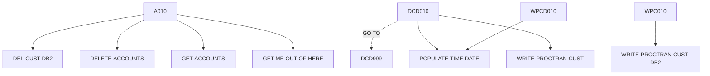

# DELCUS — source of truth

> Generated by `.github/skills/cobol-rekt/run-cobol-rekt.sh`. Do not edit by hand — re-run the script.
> **[rekt]** = from the cobol-rekt parse tree · **[scan]** = deterministic scan of the original source.

| | |
|---|---|
| Source | `src/base/cics/cobol/DELCUS.cbl` (905 lines) |
| Subsystem | `cics` |
| cobol-rekt | ✅ parsed |
| Sections / paragraphs [scan] | 24 |
| Decisions (IF / EVALUATE) [rekt] | 6 |
| EXEC CICS / EXEC SQL / DL/I calls [scan] | 20 / 3 / 0 |

## 1. Procedure structure

Control transfers inside the program [rekt]. Solid = `PERFORM`, dashed = `GO TO`.

| Section / paragraph | Lines | PERFORMs [rekt] | GO TO [rekt] | Decisions [rekt] | EXEC CICS | EXEC SQL |
|---|---|---|---|---|---|---|
| **PREMIERE** (section) | 278–278 | — | — | 0 | — | — |
| A010 | 279–351 | DEL-CUST-DB2, DELETE-ACCOUNTS, GET-ACCOUNTS, GET-ME-OUT-OF-HERE | — | 2 | 2 | — |
| A999 | 352–355 | — | — | 0 | — | — |
| **DELETE-ACCOUNTS** (section) | 356–356 | — | — | 0 | — | — |
| DA010 | 357–388 | — | — | 0 | 1 | — |
| DA999 | 389–392 | — | — | 0 | — | — |
| **GET-ACCOUNTS** (section) | 393–393 | — | — | 0 | — | — |
| GAC010 | 394–416 | — | — | 0 | 1 | — |
| GAC999 | 417–420 | — | — | 0 | — | — |
| **DEL-CUST-DB2** (section) | 421–421 | — | — | 0 | — | — |
| DCD010 | 422–712 | POPULATE-TIME-DATE, WRITE-PROCTRAN-CUST | DCD999 | 3 | 8 | 2 |
| DCD999 | 713–716 | — | — | 0 | — | — |
| **WRITE-PROCTRAN-CUST** (section) | 717–717 | — | — | 0 | — | — |
| WPC010 | 718–723 | WRITE-PROCTRAN-CUST-DB2 | — | 0 | — | — |
| WPC999 | 724–727 | — | — | 0 | — | — |
| **WRITE-PROCTRAN-CUST-DB2** (section) | 728–728 | — | — | 0 | — | — |
| WPCD010 | 729–876 | POPULATE-TIME-DATE | — | 1 | 6 | 1 |
| WPCD999 | 877–880 | — | — | 0 | — | — |
| **GET-ME-OUT-OF-HERE** (section) | 881–881 | — | — | 0 | — | — |
| GMOFH010 | 882–885 | — | — | 0 | — | — |
| GMOFH999 | 886–889 | — | — | 0 | — | — |
| **POPULATE-TIME-DATE** (section) | 890–890 | — | — | 0 | — | — |
| PTD010 | 891–903 | — | — | 0 | 2 | — |
| PTD999 | 904–905 | — | — | 0 | — | — |

## 2. Decision points

Every `IF` / `EVALUATE` found by cobol-rekt, in source order. Condition text is quoted from the original source line. These are where business rules live.

**A010**

- `src/base/cics/cobol/DELCUS.cbl:310` `IF INQCUST-INQ-SUCCESS = 'N'`
- `src/base/cics/cobol/DELCUS.cbl:328` `IF NUMBER-OF-ACCOUNTS > 0`

**DCD010**

- `src/base/cics/cobol/DELCUS.cbl:488` `IF SQLCODE = 100`
- `src/base/cics/cobol/DELCUS.cbl:496` `IF SQLCODE NOT = 0`
- `src/base/cics/cobol/DELCUS.cbl:652` `IF SQLCODE NOT = 0`

**WPCD010**

- `src/base/cics/cobol/DELCUS.cbl:808` `IF SQLCODE NOT = 0`

## 3. External touchpoints [scan]

Every `EXEC CICS`, `EXEC SQL` and IMS DL/I call, as written in the original source.

| Line | Paragraph | Kind | Verb | Statement |
|---|---|---|---|---|
| `src/base/cics/cobol/DELCUS.cbl:303` | A010 | EXEC CICS | `LINK` | `LINK PROGRAM(INQCUST-PROGRAM) COMMAREA(INQCUST-COMMAREA)` |
| `src/base/cics/cobol/DELCUS.cbl:315` | A010 | EXEC CICS | `RETURN` | `RETURN` |
| `src/base/cics/cobol/DELCUS.cbl:378` | DA010 | EXEC CICS | `LINK` | `LINK PROGRAM('DELACC  ') COMMAREA(DELACC-COMMAREA)` |
| `src/base/cics/cobol/DELCUS.cbl:409` | GAC010 | EXEC CICS | `LINK` | `LINK PROGRAM('INQACCCU') COMMAREA(INQACCCU-COMMAREA) SYNCONRETURN` |
| `src/base/cics/cobol/DELCUS.cbl:441` | DCD010 | EXEC SQL | `SELECT` | `SELECT CUSTOMER_EYECATCHER, CUSTOMER_SORTCODE, CUSTOMER_NUMBER, CUSTOMER_TITLE, CUSTOMER_FIRST_NAME, CUSTOMER…` |
| `src/base/cics/cobol/DELCUS.cbl:503` | DCD010 | EXEC CICS | `ASSIGN` | `ASSIGN APPLID(ABND-APPLID)` |
| `src/base/cics/cobol/DELCUS.cbl:523` | DCD010 | EXEC CICS | `ASSIGN` | `ASSIGN PROGRAM(ABND-PROGRAM)` |
| `src/base/cics/cobol/DELCUS.cbl:535` | DCD010 | EXEC CICS | `LINK` | `LINK PROGRAM(WS-ABEND-PGM) COMMAREA(ABNDINFO-REC)` |
| `src/base/cics/cobol/DELCUS.cbl:546` | DCD010 | EXEC CICS | `ABEND` | `ABEND ABCODE('WPV6')` |
| `src/base/cics/cobol/DELCUS.cbl:642` | DCD010 | EXEC SQL | `DELETE` | `DELETE FROM CUSTOMER WHERE CUSTOMER_SORTCODE = :HV-CUSTOMER-SORTCODE AND CUSTOMER_NUMBER = :HV-CUSTOMER-NUMBER` |
| `src/base/cics/cobol/DELCUS.cbl:659` | DCD010 | EXEC CICS | `ASSIGN` | `ASSIGN APPLID(ABND-APPLID)` |
| `src/base/cics/cobol/DELCUS.cbl:679` | DCD010 | EXEC CICS | `ASSIGN` | `ASSIGN PROGRAM(ABND-PROGRAM)` |
| `src/base/cics/cobol/DELCUS.cbl:691` | DCD010 | EXEC CICS | `LINK` | `LINK PROGRAM(WS-ABEND-PGM) COMMAREA(ABNDINFO-REC)` |
| `src/base/cics/cobol/DELCUS.cbl:702` | DCD010 | EXEC CICS | `ABEND` | `ABEND ABCODE('WPV7')` |
| `src/base/cics/cobol/DELCUS.cbl:749` | WPCD010 | EXEC CICS | `ASKTIME` | `ASKTIME ABSTIME(WS-U-TIME)` |
| `src/base/cics/cobol/DELCUS.cbl:753` | WPCD010 | EXEC CICS | `FORMATTIME` | `FORMATTIME ABSTIME(WS-U-TIME) DDMMYYYY(WS-ORIG-DATE) TIME(HV-PROCTRAN-TIME) DATESEP('.')` |
| `src/base/cics/cobol/DELCUS.cbl:774` | WPCD010 | EXEC SQL | `INSERT` | `INSERT INTO PROCTRAN ( PROCTRAN_EYECATCHER, PROCTRAN_SORTCODE, PROCTRAN_NUMBER, PROCTRAN_DATE, PROCTRAN_TIME,…` |
| `src/base/cics/cobol/DELCUS.cbl:822` | WPCD010 | EXEC CICS | `ASSIGN` | `ASSIGN APPLID(ABND-APPLID)` |
| `src/base/cics/cobol/DELCUS.cbl:842` | WPCD010 | EXEC CICS | `ASSIGN` | `ASSIGN PROGRAM(ABND-PROGRAM)` |
| `src/base/cics/cobol/DELCUS.cbl:859` | WPCD010 | EXEC CICS | `LINK` | `LINK PROGRAM(WS-ABEND-PGM) COMMAREA(ABNDINFO-REC)` |
| `src/base/cics/cobol/DELCUS.cbl:870` | WPCD010 | EXEC CICS | `ABEND` | `ABEND ABCODE('HWPT') NODUMP` |
| `src/base/cics/cobol/DELCUS.cbl:893` | PTD010 | EXEC CICS | `ASKTIME` | `ASKTIME ABSTIME(WS-U-TIME)` |
| `src/base/cics/cobol/DELCUS.cbl:897` | PTD010 | EXEC CICS | `FORMATTIME` | `FORMATTIME ABSTIME(WS-U-TIME) DDMMYYYY(WS-ORIG-DATE) TIME(WS-TIME-NOW) DATESEP` |

## 4. Dependencies [scan]

**Program / transaction transfers**

Lines refer to `src/base/cics/cobol/DELCUS.cbl`.

| Kind | Target(s) | Resolved via | Lines · paragraph |
|---|---|---|---|
| LINK | `INQCUST` | variable `INQCUST-PROGRAM` (VALUE clause) | `:303` A010 |
| LINK | `DELACC` | literal | `:378` DA010 |
| LINK | `INQACCCU` | literal | `:409` GAC010 |
| LINK | `ABNDPROC` | variable `WS-ABEND-PGM` (VALUE clause) | `:535` DCD010, `:691` DCD010, `:859` WPCD010 |

**Copybooks**

- `SORTCODE` (`src/base/cics/cobol/DELCUS.cbl:44`) → `src/base/cics/copy/SORTCODE.cpy`
- `CUSTDB2` (`src/base/cics/cobol/DELCUS.cbl:53`) → `src/base/cics/copy/CUSTDB2.cpy`
- `PROCDB2` (`src/base/cics/cobol/DELCUS.cbl:78`) → `src/base/cics/copy/PROCDB2.cpy`
- `SQLCA` (`src/base/cics/cobol/DELCUS.cbl:95`) → DB2 precompiler member (not in repo)
- `ACCOUNT` (`src/base/cics/cobol/DELCUS.cbl:109`) → `src/base/cics/copy/ACCOUNT.cpy`
- `CUSTOMER` (`src/base/cics/cobol/DELCUS.cbl:112`) → `src/base/cics/copy/CUSTOMER.cpy`
- `PROCTRAN` (`src/base/cics/cobol/DELCUS.cbl:115`) → `src/base/cics/copy/PROCTRAN.cpy`
- `INQACCCU` (`src/base/cics/cobol/DELCUS.cbl:253`) → `src/base/cics/copy/INQACCCU.cpy`
- `INQCUSTZ` (`src/base/cics/cobol/DELCUS.cbl:258`) → `src/base/cics/copy/INQCUSTZ.cpy`
- `ABNDINFO` (`src/base/cics/cobol/DELCUS.cbl:270`) → `src/base/cics/copy/ABNDINFO.cpy`
- `DELCUS` (`src/base/cics/cobol/DELCUS.cbl:274`) → `src/base/cics/copy/DELCUS.cpy`

## 5. Condition names (88-levels) [scan]

Named conditions encode business codes. Includes copybooks reached from this program.

| Condition | Value(s) | Parent item | Defined at |
|---|---|---|---|
| `ACCOUNT-EYECATCHER-VALUE` | `'ACCT'` | ACCOUNT-EYE-CATCHER | `src/base/cics/copy/ACCOUNT.cpy:9` |
| `CUSTOMER-EYECATCHER-VALUE` | `'CUST'` | CUSTOMER-EYECATCHER | `src/base/cics/copy/CUSTOMER.cpy:9` |
| `CUSTOMER-STATUS-ACTIVE` | `'ACTIVE'` | CUSTOMER-STATUS | `src/base/cics/copy/CUSTOMER.cpy:29` |
| `CUSTOMER-STATUS-INACTIVE` | `'INACTIVE'` | CUSTOMER-STATUS | `src/base/cics/copy/CUSTOMER.cpy:30` |
| `CUSTOMER-STATUS-SUSPENDED` | `'SUSPENDED'` | CUSTOMER-STATUS | `src/base/cics/copy/CUSTOMER.cpy:31` |
| `PROC-TRAN-VALID` | `'PRTR'` | PROC-TRAN-EYE-CATCHER | `src/base/cics/copy/PROCTRAN.cpy:9` |
| `PROC-TRAN-LOGICALLY-DELETED` | `X'FF'` | PROC-TRAN-LOGICAL-DELETE-FLAG | `src/base/cics/copy/PROCTRAN.cpy:13` |
| `PROC-TY-CHEQUE-ACKNOWLEDGED` | `'CHA'` | PROC-TRAN-TYPE | `src/base/cics/copy/PROCTRAN.cpy:30` |
| `PROC-TY-CHEQUE-FAILURE` | `'CHF'` | PROC-TRAN-TYPE | `src/base/cics/copy/PROCTRAN.cpy:31` |
| `PROC-TY-CHEQUE-PAID-IN` | `'CHI'` | PROC-TRAN-TYPE | `src/base/cics/copy/PROCTRAN.cpy:32` |
| `PROC-TY-CHEQUE-PAID-OUT` | `'CHO'` | PROC-TRAN-TYPE | `src/base/cics/copy/PROCTRAN.cpy:33` |
| `PROC-TY-CREDIT` | `'CRE'` | PROC-TRAN-TYPE | `src/base/cics/copy/PROCTRAN.cpy:34` |
| `PROC-TY-DEBIT` | `'DEB'` | PROC-TRAN-TYPE | `src/base/cics/copy/PROCTRAN.cpy:35` |
| `PROC-TY-WEB-CREATE-ACCOUNT` | `'ICA'` | PROC-TRAN-TYPE | `src/base/cics/copy/PROCTRAN.cpy:36` |
| `PROC-TY-WEB-CREATE-CUSTOMER` | `'ICC'` | PROC-TRAN-TYPE | `src/base/cics/copy/PROCTRAN.cpy:37` |
| `PROC-TY-WEB-DELETE-ACCOUNT` | `'IDA'` | PROC-TRAN-TYPE | `src/base/cics/copy/PROCTRAN.cpy:38` |
| `PROC-TY-WEB-DELETE-CUSTOMER` | `'IDC'` | PROC-TRAN-TYPE | `src/base/cics/copy/PROCTRAN.cpy:39` |
| `PROC-TY-BRANCH-CREATE-ACCOUNT` | `'OCA'` | PROC-TRAN-TYPE | `src/base/cics/copy/PROCTRAN.cpy:40` |
| `PROC-TY-BRANCH-CREATE-CUSTOMER` | `'OCC'` | PROC-TRAN-TYPE | `src/base/cics/copy/PROCTRAN.cpy:41` |
| `PROC-TY-BRANCH-DELETE-ACCOUNT` | `'ODA'` | PROC-TRAN-TYPE | `src/base/cics/copy/PROCTRAN.cpy:42` |
| `PROC-TY-BRANCH-DELETE-CUSTOMER` | `'ODC'` | PROC-TRAN-TYPE | `src/base/cics/copy/PROCTRAN.cpy:43` |
| `PROC-TY-CREATE-SODD` | `'OCS'` | PROC-TRAN-TYPE | `src/base/cics/copy/PROCTRAN.cpy:44` |
| `PROC-TY-PAYMENT-CREDIT` | `'PCR'` | PROC-TRAN-TYPE | `src/base/cics/copy/PROCTRAN.cpy:45` |
| `PROC-TY-PAYMENT-DEBIT` | `'PDR'` | PROC-TRAN-TYPE | `src/base/cics/copy/PROCTRAN.cpy:46` |
| `PROC-TY-TRANSFER` | `'TFR'` | PROC-TRAN-TYPE | `src/base/cics/copy/PROCTRAN.cpy:47` |
| `PROC-TRAN-DESC-XFR-FLAG` | `'TRANSFER'` | PROC-TRAN-DESC-XFR-HEADER | `src/base/cics/copy/PROCTRAN.cpy:51` |
| `PROC-DESC-DELACC-FLAG` | `'DELETE'` | PROC-DESC-DELACC-FOOTER | `src/base/cics/copy/PROCTRAN.cpy:67` |
| `PROC-DESC-CREACC-FLAG` | `'CREATE'` | PROC-DESC-CREACC-FOOTER | `src/base/cics/copy/PROCTRAN.cpy:79` |
| `PROC-DESC-DELCUS-FILLER-SET` | `'-'` | PROC-DESC-DELCUS-FILLER | `src/base/cics/copy/PROCTRAN.cpy:87` |
| `PROC-DESC-DELCUS-FILLER2-SET` | `'-'` | PROC-DESC-DELCUS-FILLER2 | `src/base/cics/copy/PROCTRAN.cpy:90` |
| `PROC-DESC-CRECUS-FILLER-SET` | `'-'` | PROC-DESC-CRECUS-FILLER | `src/base/cics/copy/PROCTRAN.cpy:98` |
| `PROC-DESC-CRECUS-FILLER2-SET` | `'-'` | PROC-DESC-CRECUS-FILLER2 | `src/base/cics/copy/PROCTRAN.cpy:101` |

## 6. Data items [rekt]

**Records (01 / 77 levels)**

| Name | Clause | Fields | Section | Defined at |
|---|---|---|---|---|
| `SYSIDERR-RETRY` | `PIC 999` | — | WORKING_STORAGE | `src/base/cics/cobol/DELCUS.cbl:48` |
| `FILE-RETRY` | `PIC 999` | — | WORKING_STORAGE | `src/base/cics/cobol/DELCUS.cbl:49` |
| `WS-EXIT-RETRY-LOOP` | `PIC X VALUE ' '` | — | WORKING_STORAGE | `src/base/cics/cobol/DELCUS.cbl:50` |
| `HOST-CUSTOMER-ROW` | `(group)` | 17 | WORKING_STORAGE | `src/base/cics/cobol/DELCUS.cbl:58` |
| `HOST-PROCTRAN-ROW` | `(group)` | 9 | WORKING_STORAGE | `src/base/cics/cobol/DELCUS.cbl:83` |
| `SQLCODE-DISPLAY` | `PIC S9(8) DISPLAY SIGN LEADING SEPARATE` | — | WORKING_STORAGE | `src/base/cics/cobol/DELCUS.cbl:99` |
| `WS-CICS-WORK-AREA` | `(group)` | 2 | WORKING_STORAGE | `src/base/cics/cobol/DELCUS.cbl:102` |
| `EXIT-BROWSE-LOOP` | `PIC X VALUE 'N'` | — | WORKING_STORAGE | `src/base/cics/cobol/DELCUS.cbl:106` |
| `OUTPUT-DATA` | `(group)` | 26 | WORKING_STORAGE | `src/base/cics/cobol/DELCUS.cbl:108` |
| `OUTPUT-CUST-DATA` | `(group)` | 30 | WORKING_STORAGE | `src/base/cics/cobol/DELCUS.cbl:111` |
| `PROCTRAN-AREA` | `(group)` | 64 | WORKING_STORAGE | `src/base/cics/cobol/DELCUS.cbl:114` |
| `PROCTRAN-RIDFLD` | `PIC S9(8) COMP` | — | WORKING_STORAGE | `src/base/cics/cobol/DELCUS.cbl:117` |
| `ACCOUNT-ACT-BAL-STORE` | `PIC S9(10)V99 VALUE 0` | — | WORKING_STORAGE | `src/base/cics/cobol/DELCUS.cbl:120` |
| `RETURNED-DATA` | `(group)` | 13 | WORKING_STORAGE | `src/base/cics/cobol/DELCUS.cbl:122` |
| `ACCTCUST-DESIRED-KEY` | `PIC 9(10) BINARY` | — | WORKING_STORAGE | `src/base/cics/cobol/DELCUS.cbl:137` |
| `DB2-DATE-REFORMAT` | `(group)` | 5 | WORKING_STORAGE | `src/base/cics/cobol/DELCUS.cbl:139` |
| `DB2-EXIT-LOOP` | `PIC X` | — | WORKING_STORAGE | `src/base/cics/cobol/DELCUS.cbl:146` |
| `FETCH-DATA-CNT` | `PIC 9(4) COMP` | — | WORKING_STORAGE | `src/base/cics/cobol/DELCUS.cbl:147` |
| `WS-CUST-ALT-KEY-LEN` | `PIC S9(4) COMP VALUE +10` | — | WORKING_STORAGE | `src/base/cics/cobol/DELCUS.cbl:148` |
| `WS-EIBTASKN12` | `PIC 9(12) VALUE 0` | — | WORKING_STORAGE | `src/base/cics/cobol/DELCUS.cbl:151` |
| `WS-CNT` | `PIC S9(4) COMP VALUE 0` | — | WORKING_STORAGE | `src/base/cics/cobol/DELCUS.cbl:153` |
| `CUSTOMER-KY` | `(group)` | 1 | WORKING_STORAGE | `src/base/cics/cobol/DELCUS.cbl:156` |
| `WS-ACC-KEY-LEN` | `PIC S9(4) COMP VALUE +14` | — | WORKING_STORAGE | `src/base/cics/cobol/DELCUS.cbl:162` |
| `WS-ACC-NUM` | `PIC S9(4) COMP VALUE 0` | — | WORKING_STORAGE | `src/base/cics/cobol/DELCUS.cbl:164` |
| `WS-CUST-KEY-LEN` | `PIC S9(4) COMP VALUE +16` | — | WORKING_STORAGE | `src/base/cics/cobol/DELCUS.cbl:167` |
| `WS-CUST-NUM` | `PIC S9(4) COMP VALUE 0` | — | WORKING_STORAGE | `src/base/cics/cobol/DELCUS.cbl:169` |
| `DESIRED-KEY-ACCTCUST` | `(group)` | 2 | WORKING_STORAGE | `src/base/cics/cobol/DELCUS.cbl:172` |
| `DESIRED-KEY` | `(group)` | 2 | WORKING_STORAGE | `src/base/cics/cobol/DELCUS.cbl:178` |
| `WS-U-TIME` | `PIC S9(15) COMP-3` | — | WORKING_STORAGE | `src/base/cics/cobol/DELCUS.cbl:182` |
| `WS-ORIG-DATE` | `PIC X(10)` | — | WORKING_STORAGE | `src/base/cics/cobol/DELCUS.cbl:183` |
| `WS-ORIG-DATE-GRP` | `REDEFINES WS-ORIG-DATE` REDEFINES WS-ORIG-DATE | 5 | WORKING_STORAGE | `src/base/cics/cobol/DELCUS.cbl:184` |
| `WS-ORIG-DATE-GRP-X` | `(group)` | 5 | WORKING_STORAGE | `src/base/cics/cobol/DELCUS.cbl:191` |
| `REMIX-STMT-DATE` | `PIC 9(8)` | — | WORKING_STORAGE | `src/base/cics/cobol/DELCUS.cbl:198` |
| `WS-APPLID` | `PIC X(8)` | — | WORKING_STORAGE | `src/base/cics/cobol/DELCUS.cbl:200` |
| `VAR-REMIX` | `(group)` | 3 | WORKING_STORAGE | `src/base/cics/cobol/DELCUS.cbl:202` |
| `WS-STOREDC-CUSTOMER` | `(group)` | 8 | WORKING_STORAGE | `src/base/cics/cobol/DELCUS.cbl:210` |
| `WS-NONE-LEFT` | `PIC X VALUE 'N'` | — | WORKING_STORAGE | `src/base/cics/cobol/DELCUS.cbl:222` |
| `WS-EXIT-FETCH` | `PIC X VALUE 'N'` | — | WORKING_STORAGE | `src/base/cics/cobol/DELCUS.cbl:224` |
| `DELACC-COMMAREA` | `(group)` | 19 | WORKING_STORAGE | `src/base/cics/cobol/DELCUS.cbl:226` |
| `WS-TOKEN` | `PIC S9(8) BINARY` | — | WORKING_STORAGE | `src/base/cics/cobol/DELCUS.cbl:248` |
| `WS-INDEX` | `PIC S9(8) BINARY` | — | WORKING_STORAGE | `src/base/cics/cobol/DELCUS.cbl:249` |
| `INQACCCU-PROGRAM` | `PIC X(8) VALUE 'INQACCCU'` | — | WORKING_STORAGE | `src/base/cics/cobol/DELCUS.cbl:251` |
| `INQACCCU-COMMAREA` | `(group)` | 31 | WORKING_STORAGE | `src/base/cics/cobol/DELCUS.cbl:252` |
| `STORM-DRAIN-CONDITION` | `PIC X(20)` | — | WORKING_STORAGE | `src/base/cics/cobol/DELCUS.cbl:255` |
| `INQCUST-PROGRAM` | `PIC X(8) VALUE 'INQCUST '` | — | WORKING_STORAGE | `src/base/cics/cobol/DELCUS.cbl:256` |
| `INQCUST-COMMAREA` | `(group)` | 31 | WORKING_STORAGE | `src/base/cics/cobol/DELCUS.cbl:257` |
| `WS-TIME-DATA` | `(group)` | 5 | WORKING_STORAGE | `src/base/cics/cobol/DELCUS.cbl:260` |
| `WS-ABEND-PGM` | `PIC X(8) VALUE 'ABNDPROC'` | — | WORKING_STORAGE | `src/base/cics/cobol/DELCUS.cbl:267` |
| `ABNDINFO-REC` | `(group)` | 13 | WORKING_STORAGE | `src/base/cics/cobol/DELCUS.cbl:269` |
| `DFHCOMMAREA` | `(group)` | 30 | LINKAGE | `src/base/cics/cobol/DELCUS.cbl:273` |

**LINKAGE SECTION — the program's interface contract (COMMAREA / parameters)**

| Level | Name | Clause | Type | Defined at |
|---|---|---|---|---|
| 01 | DFHCOMMAREA | `(group)` | OBJECT | `src/base/cics/cobol/DELCUS.cbl:273` |
| 03 | &nbsp;&nbsp;COMM-EYE | `PIC X(4)` | STRING | `src/base/cics/copy/DELCUS.cpy:7` |
| 03 | &nbsp;&nbsp;COMM-SCODE | `PIC X(6)` | STRING | `src/base/cics/copy/DELCUS.cpy:8` |
| 03 | &nbsp;&nbsp;COMM-CUSTNO | `PIC X(10)` | STRING | `src/base/cics/copy/DELCUS.cpy:9` |
| 03 | &nbsp;&nbsp;COMM-NAME | `(group)` | OBJECT | `src/base/cics/copy/DELCUS.cpy:10` |
| 05 | &nbsp;&nbsp;&nbsp;&nbsp;COMM-TITLE | `PIC X(10)` | STRING | `src/base/cics/copy/DELCUS.cpy:11` |
| 05 | &nbsp;&nbsp;&nbsp;&nbsp;COMM-FIRST-NAME | `PIC X(50)` | STRING | `src/base/cics/copy/DELCUS.cpy:12` |
| 05 | &nbsp;&nbsp;&nbsp;&nbsp;COMM-LAST-NAME | `PIC X(50)` | STRING | `src/base/cics/copy/DELCUS.cpy:13` |
| 03 | &nbsp;&nbsp;COMM-DOB | `(group)` | OBJECT | `src/base/cics/copy/DELCUS.cpy:14` |
| 05 | &nbsp;&nbsp;&nbsp;&nbsp;COMM-DOB-DAY | `PIC 99 DISPLAY` | NUMBER | `src/base/cics/copy/DELCUS.cpy:15` |
| 05 | &nbsp;&nbsp;&nbsp;&nbsp;COMM-DOB-MONTH | `PIC 99 DISPLAY` | NUMBER | `src/base/cics/copy/DELCUS.cpy:16` |
| 05 | &nbsp;&nbsp;&nbsp;&nbsp;COMM-DOB-YEAR | `PIC 9999 DISPLAY` | NUMBER | `src/base/cics/copy/DELCUS.cpy:17` |
| 03 | &nbsp;&nbsp;COMM-PHONE | `PIC X(20)` | STRING | `src/base/cics/copy/DELCUS.cpy:18` |
| 03 | &nbsp;&nbsp;COMM-ADDR | `(group)` | OBJECT | `src/base/cics/copy/DELCUS.cpy:19` |
| 05 | &nbsp;&nbsp;&nbsp;&nbsp;COMM-ADDR-LINE1 | `PIC X(50)` | STRING | `src/base/cics/copy/DELCUS.cpy:20` |
| 05 | &nbsp;&nbsp;&nbsp;&nbsp;COMM-ADDR-LINE2 | `PIC X(50)` | STRING | `src/base/cics/copy/DELCUS.cpy:21` |
| 05 | &nbsp;&nbsp;&nbsp;&nbsp;COMM-CITY | `PIC X(50)` | STRING | `src/base/cics/copy/DELCUS.cpy:22` |
| 05 | &nbsp;&nbsp;&nbsp;&nbsp;COMM-POSTCODE | `PIC X(10)` | STRING | `src/base/cics/copy/DELCUS.cpy:23` |
| 05 | &nbsp;&nbsp;&nbsp;&nbsp;COMM-COUNTRY | `PIC X(50)` | STRING | `src/base/cics/copy/DELCUS.cpy:24` |
| 03 | &nbsp;&nbsp;COMM-STATUS | `PIC X(10)` | STRING | `src/base/cics/copy/DELCUS.cpy:25` |
| 03 | &nbsp;&nbsp;COMM-CREATED-DATE | `(group)` | OBJECT | `src/base/cics/copy/DELCUS.cpy:26` |
| 05 | &nbsp;&nbsp;&nbsp;&nbsp;COMM-CREATED-DAY | `PIC 99 DISPLAY` | NUMBER | `src/base/cics/copy/DELCUS.cpy:27` |
| 05 | &nbsp;&nbsp;&nbsp;&nbsp;COMM-CREATED-MONTH | `PIC 99 DISPLAY` | NUMBER | `src/base/cics/copy/DELCUS.cpy:28` |
| 05 | &nbsp;&nbsp;&nbsp;&nbsp;COMM-CREATED-YEAR | `PIC 9999 DISPLAY` | NUMBER | `src/base/cics/copy/DELCUS.cpy:29` |
| 03 | &nbsp;&nbsp;COMM-CREDIT-SCORE | `PIC 9(3)` | NUMBER | `src/base/cics/copy/DELCUS.cpy:30` |
| 03 | &nbsp;&nbsp;COMM-CS-REVIEW-DATE | `(group)` | OBJECT | `src/base/cics/copy/DELCUS.cpy:31` |
| 05 | &nbsp;&nbsp;&nbsp;&nbsp;COMM-CS-REVIEW-DAY | `PIC 99 DISPLAY` | NUMBER | `src/base/cics/copy/DELCUS.cpy:32` |
| 05 | &nbsp;&nbsp;&nbsp;&nbsp;COMM-CS-REVIEW-MONTH | `PIC 99 DISPLAY` | NUMBER | `src/base/cics/copy/DELCUS.cpy:33` |
| 05 | &nbsp;&nbsp;&nbsp;&nbsp;COMM-CS-REVIEW-YEAR | `PIC 9999 DISPLAY` | NUMBER | `src/base/cics/copy/DELCUS.cpy:34` |
| 03 | &nbsp;&nbsp;COMM-DEL-SUCCESS | `PIC X` | STRING | `src/base/cics/copy/DELCUS.cpy:35` |
| 03 | &nbsp;&nbsp;COMM-DEL-FAIL-CD | `PIC X` | STRING | `src/base/cics/copy/DELCUS.cpy:36` |

_Working-storage fields below the 01 level are not listed — open the definition to drill in._

**Not reported by cobol-rekt** — present in the source, so read them there [scan]:

- `PROCTRAN-RETRY` (WORKING-STORAGE) `src/base/cics/cobol/DELCUS.cbl:118`
