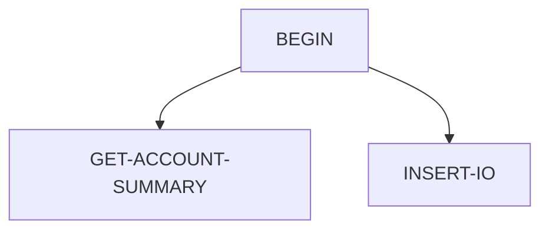

# IBACSUM — source of truth

> Generated by `.github/skills/cobol-rekt/run-cobol-rekt.sh`. Do not edit by hand — re-run the script.
> **[rekt]** = from the cobol-rekt parse tree · **[scan]** = deterministic scan of the original source.

| | |
|---|---|
| Source | `src/base/ims/cobol/IBACSUM.cbl` (289 lines) |
| Subsystem | `ims` |
| cobol-rekt | ✅ parsed |
| Sections / paragraphs [scan] | 7 |
| Decisions (IF / EVALUATE) [rekt] | 10 |
| EXEC CICS / EXEC SQL / DL/I calls [scan] | 0 / 0 / 4 |

## 1. Procedure structure

Control transfers inside the program [rekt]. Solid = `PERFORM`, dashed = `GO TO`.

| Section / paragraph | Lines | PERFORMs [rekt] | GO TO [rekt] | Decisions [rekt] | EXEC CICS | EXEC SQL |
|---|---|---|---|---|---|---|
| BEGIN | 176–202 | GET-ACCOUNT-SUMMARY, INSERT-IO THRU INSERT-IO-END | — | 2 | — | — |
| GET-ACCOUNT-SUMMARY | 203–264 | — | — | 6 | — | — |
| GET-ACCOUNT-SUMMARY-END | 265–268 | — | — | 0 | — | — |
| RULES-CHECK | 269–275 | — | — | 1 | — | — |
| RULES-CHECK-END | 276–278 | — | — | 0 | — | — |
| INSERT-IO | 279–288 | — | — | 1 | — | — |
| INSERT-IO-END | 289–289 | — | — | 0 | — | — |

## 2. Decision points

Every `IF` / `EVALUATE` found by cobol-rekt, in source order. Condition text is quoted from the original source line. These are where business rules live.

**BEGIN**

- `src/base/ims/cobol/IBACSUM.cbl:183` `IF TPSTAT = '  ' OR TPSTAT = MESSAGE-EXIST`
  - `src/base/ims/cobol/IBACSUM.cbl:191` `IF TPSTAT = NO-MORE-MESSAGE`

**GET-ACCOUNT-SUMMARY**

- `src/base/ims/cobol/IBACSUM.cbl:214` `IF DBSTAT = SPACES`
  - `src/base/ims/cobol/IBACSUM.cbl:220` `IF DBSTAT = SPACES`
    - `src/base/ims/cobol/IBACSUM.cbl:236` `IF DBSTAT = GB OR DBSTAT = GE`
      - `src/base/ims/cobol/IBACSUM.cbl:237` `IF TOTAL-ACCS < 1`
  - `src/base/ims/cobol/IBACSUM.cbl:247` `IF DBSTAT = GB OR DBSTAT = GE`
    - `src/base/ims/cobol/IBACSUM.cbl:248` `IF TOTAL-ACCS < 1`

**RULES-CHECK**

- `src/base/ims/cobol/IBACSUM.cbl:272` `IF CA-CUSTID < 16`

**INSERT-IO**

- `src/base/ims/cobol/IBACSUM.cbl:284` `IF TPSTAT NOT = SPACES`

## 3. External touchpoints [scan]

Every `EXEC CICS`, `EXEC SQL` and IMS DL/I call, as written in the original source.

| Line | Paragraph | Kind | Verb | Statement |
|---|---|---|---|---|
| `src/base/ims/cobol/IBACSUM.cbl:182` | BEGIN | IMS DL/I | `CALL 'CBLTDLI'` | `CALL 'CBLTDLI' USING GU, LTERMPCB, INPUT-AREA` |
| `src/base/ims/cobol/IBACSUM.cbl:212` | GET-ACCOUNT-SUMMARY | IMS DL/I | `CALL 'CBLTDLI'` | `CALL 'CBLTDLI' USING NEXT-CALL, DBPCB, CUSTACCS-SEG, CUSTACCS-SSA2` |
| `src/base/ims/cobol/IBACSUM.cbl:218` | GET-ACCOUNT-SUMMARY | IMS DL/I | `CALL 'CBLTDLI'` | `CALL 'CBLTDLI' USING GHU, DBPCB, ACCOUNT-SEG, ACCOUNT-SSA1` |
| `src/base/ims/cobol/IBACSUM.cbl:282` | INSERT-IO | IMS DL/I | `CALL 'CBLTDLI'` | `CALL 'CBLTDLI' USING ISRT, LTERMPCB, OUTPUT-AREA.` |

## 4. Dependencies [scan]

**Program / transaction transfers**

Lines refer to `src/base/ims/cobol/IBACSUM.cbl`.

| Kind | Target(s) | Resolved via | Lines · paragraph |
|---|---|---|---|
| CALL | `CBLTDLI` | literal | `:182` BEGIN, `:212` GET-ACCOUNT-SUMMARY, `:218` GET-ACCOUNT-SUMMARY, `:282` INSERT-IO |

**Copybooks**

## 5. Condition names (88-levels) [scan]

Named conditions encode business codes. Includes copybooks reached from this program.

_None found._

## 6. Data items [rekt]

**Records (01 / 77 levels)**

| Name | Clause | Fields | Section | Defined at |
|---|---|---|---|---|
| `BAD-STATUS` | `(group)` | 2 | WORKING_STORAGE | `src/base/ims/cobol/IBACSUM.cbl:56` |
| `CUSTACCS-SEG` | `(group)` | 3 | WORKING_STORAGE | `src/base/ims/cobol/IBACSUM.cbl:66` |
| `ACCOUNT-SEG` | `(group)` | 4 | WORKING_STORAGE | `src/base/ims/cobol/IBACSUM.cbl:72` |
| `HISTORY-SEG` | `(group)` | 6 | WORKING_STORAGE | `src/base/ims/cobol/IBACSUM.cbl:78` |
| `INPUT-AREA` | `(group)` | 4 | WORKING_STORAGE | `src/base/ims/cobol/IBACSUM.cbl:90` |
| `OUTPUT-AREA` | `(group)` | 8 | WORKING_STORAGE | `src/base/ims/cobol/IBACSUM.cbl:96` |
| `ACCOUNT-SSA1` | `(group)` | 7 | WORKING_STORAGE | `src/base/ims/cobol/IBACSUM.cbl:115` |
| `CUSTACCS-SSA2` | `(group)` | 7 | WORKING_STORAGE | `src/base/ims/cobol/IBACSUM.cbl:125` |
| `IOPCBA` | `POINTER` | — | LINKAGE | `src/base/ims/cobol/IBACSUM.cbl:136` |
| `DBPCB1` | `POINTER` | — | LINKAGE | `src/base/ims/cobol/IBACSUM.cbl:137` |
| `DBPCB2` | `POINTER` | — | LINKAGE | `src/base/ims/cobol/IBACSUM.cbl:138` |
| `LTERMPCB` | `(group)` | 8 | LINKAGE | `src/base/ims/cobol/IBACSUM.cbl:144` |
| `DBPCB` | `(group)` | 12 | LINKAGE | `src/base/ims/cobol/IBACSUM.cbl:158` |

**LINKAGE SECTION — the program's interface contract (COMMAREA / parameters)**

| Level | Name | Clause | Type | Defined at |
|---|---|---|---|---|
| 01 | IOPCBA | `POINTER` | POINTER | `src/base/ims/cobol/IBACSUM.cbl:136` |
| 01 | DBPCB1 | `POINTER` | POINTER | `src/base/ims/cobol/IBACSUM.cbl:137` |
| 01 | DBPCB2 | `POINTER` | POINTER | `src/base/ims/cobol/IBACSUM.cbl:138` |
| 01 | LTERMPCB | `(group)` | OBJECT | `src/base/ims/cobol/IBACSUM.cbl:144` |
| 05 | &nbsp;&nbsp;LOGTTERM | `PIC X(08)` | STRING | `src/base/ims/cobol/IBACSUM.cbl:145` |
| 05 | &nbsp;&nbsp;FILLER | `PIC X(02)` | STRING | `src/base/ims/cobol/IBACSUM.cbl:116` |
| 05 | &nbsp;&nbsp;TPSTAT | `PIC X(02)` | STRING | `src/base/ims/cobol/IBACSUM.cbl:147` |
| 05 | &nbsp;&nbsp;IODATE | `PIC X(04)` | STRING | `src/base/ims/cobol/IBACSUM.cbl:148` |
| 05 | &nbsp;&nbsp;IOTIME | `PIC X(04)` | STRING | `src/base/ims/cobol/IBACSUM.cbl:149` |
| 05 | &nbsp;&nbsp;FILLER | `PIC X(02)` | STRING | `src/base/ims/cobol/IBACSUM.cbl:116` |
| 05 | &nbsp;&nbsp;SEQNUM | `PIC X(02)` | STRING | `src/base/ims/cobol/IBACSUM.cbl:151` |
| 05 | &nbsp;&nbsp;MOD | `PIC X(08)` | STRING | `src/base/ims/cobol/IBACSUM.cbl:152` |
| 01 | DBPCB | `(group)` | OBJECT | `src/base/ims/cobol/IBACSUM.cbl:158` |
| 05 | &nbsp;&nbsp;DBDNAME | `PIC X(08)` | STRING | `src/base/ims/cobol/IBACSUM.cbl:159` |
| 05 | &nbsp;&nbsp;SEGLEVEL | `PIC X(02)` | STRING | `src/base/ims/cobol/IBACSUM.cbl:160` |
| 05 | &nbsp;&nbsp;DBSTAT | `PIC X(02)` | STRING | `src/base/ims/cobol/IBACSUM.cbl:161` |
| 05 | &nbsp;&nbsp;PROCOPTS | `PIC X(04)` | STRING | `src/base/ims/cobol/IBACSUM.cbl:162` |
| 05 | &nbsp;&nbsp;FILLER | `PIC 9(08) COMP` | NUMBER | `src/base/ims/cobol/IBACSUM.cbl:116` |
| 05 | &nbsp;&nbsp;SEGNAMFB | `PIC X(08)` | STRING | `src/base/ims/cobol/IBACSUM.cbl:164` |
| 05 | &nbsp;&nbsp;LENKEY | `PIC 9(08) COMP` | NUMBER | `src/base/ims/cobol/IBACSUM.cbl:165` |
| 05 | &nbsp;&nbsp;SENSSSEGS | `PIC 9(08) COMP` | NUMBER | `src/base/ims/cobol/IBACSUM.cbl:166` |
| 05 | &nbsp;&nbsp;KEYFB | `PIC X(20)` | STRING | `src/base/ims/cobol/IBACSUM.cbl:167` |
| 05 | &nbsp;&nbsp;FILLER | `REDEFINES KEYFB` REDEFINES KEYFB | OBJECT | `src/base/ims/cobol/IBACSUM.cbl:116` |
| 07 | &nbsp;&nbsp;&nbsp;&nbsp;KEYFB1 | `PIC X(9)` | STRING | `src/base/ims/cobol/IBACSUM.cbl:169` |
| 07 | &nbsp;&nbsp;&nbsp;&nbsp;FILLER | `PIC X(11)` | STRING | `src/base/ims/cobol/IBACSUM.cbl:170` |

_Working-storage fields below the 01 level are not listed — open the definition to drill in._

**Not reported by cobol-rekt** — present in the source, so read them there [scan]:

- `NOCUSTOMER` (WORKING-STORAGE) `src/base/ims/cobol/IBACSUM.cbl:24`
- `NOACCOUNT` (WORKING-STORAGE) `src/base/ims/cobol/IBACSUM.cbl:25`
- `TERM-IO` (WORKING-STORAGE) `src/base/ims/cobol/IBACSUM.cbl:28`
- `TERM-LOOP` (WORKING-STORAGE) `src/base/ims/cobol/IBACSUM.cbl:29`
- `MESSAGE-EXIST` (WORKING-STORAGE) `src/base/ims/cobol/IBACSUM.cbl:30`
- `NO-MORE-MESSAGE` (WORKING-STORAGE) `src/base/ims/cobol/IBACSUM.cbl:31`
- `GU` (WORKING-STORAGE) `src/base/ims/cobol/IBACSUM.cbl:37`
- `GHU` (WORKING-STORAGE) `src/base/ims/cobol/IBACSUM.cbl:38`
- `GN` (WORKING-STORAGE) `src/base/ims/cobol/IBACSUM.cbl:39`
- `GHN` (WORKING-STORAGE) `src/base/ims/cobol/IBACSUM.cbl:40`
- `ISRT` (WORKING-STORAGE) `src/base/ims/cobol/IBACSUM.cbl:41`
- `REPL` (WORKING-STORAGE) `src/base/ims/cobol/IBACSUM.cbl:42`
- `NEXT-CALL` (WORKING-STORAGE) `src/base/ims/cobol/IBACSUM.cbl:43`
- `GE` (WORKING-STORAGE) `src/base/ims/cobol/IBACSUM.cbl:49`
- `GB` (WORKING-STORAGE) `src/base/ims/cobol/IBACSUM.cbl:50`
- `BALANCE-ZONED` (WORKING-STORAGE) `src/base/ims/cobol/IBACSUM.cbl:64`
