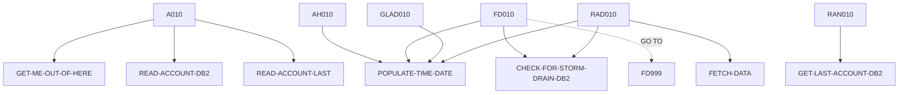

# INQACC — source of truth

> Generated by `.github/skills/cobol-rekt/run-cobol-rekt.sh`. Do not edit by hand — re-run the script.
> **[rekt]** = from the cobol-rekt parse tree · **[scan]** = deterministic scan of the original source.

| | |
|---|---|
| Source | `src/base/cics/cobol/INQACC.cbl` (1002 lines) |
| Subsystem | `cics` |
| cobol-rekt | ✅ parsed |
| Sections / paragraphs [scan] | 27 |
| Decisions (IF / EVALUATE) [rekt] | 11 |
| EXEC CICS / EXEC SQL / DL/I calls [scan] | 31 / 5 / 0 |

## 1. Procedure structure

Control transfers inside the program [rekt]. Solid = `PERFORM`, dashed = `GO TO`.

| Section / paragraph | Lines | PERFORMs [rekt] | GO TO [rekt] | Decisions [rekt] | EXEC CICS | EXEC SQL |
|---|---|---|---|---|---|---|
| **PREMIERE** (section) | 203–203 | — | — | 0 | — | — |
| A010 | 204–248 | GET-ME-OUT-OF-HERE, READ-ACCOUNT-DB2, READ-ACCOUNT-LAST | — | 2 | 1 | — |
| A999 | 249–252 | — | — | 0 | — | — |
| **READ-ACCOUNT-DB2** (section) | 253–253 | — | — | 0 | — | — |
| RAD010 | 254–421 | CHECK-FOR-STORM-DRAIN-DB2, FETCH-DATA, POPULATE-TIME-DATE | — | 2 | 8 | 2 |
| RAD999 | 422–425 | — | — | 0 | — | — |
| **FETCH-DATA** (section) | 426–426 | — | — | 0 | — | — |
| FD010 | 427–573 | CHECK-FOR-STORM-DRAIN-DB2, POPULATE-TIME-DATE | FD999 | 2 | 4 | 1 |
| FD999 | 574–577 | — | — | 0 | — | — |
| **GET-ME-OUT-OF-HERE** (section) | 578–578 | — | — | 0 | — | — |
| GMOFH010 | 579–588 | — | — | 0 | 1 | — |
| GMOFH999 | 589–595 | — | — | 0 | — | — |
| **CHECK-FOR-STORM-DRAIN-DB2** (section) | 596–596 | — | — | 0 | — | — |
| CFSDCD010 | 597–624 | — | — | 2 | — | — |
| CFSDCD999 | 625–631 | — | — | 0 | — | — |
| **ABEND-HANDLING** (section) | 632–632 | — | — | 0 | — | — |
| AH010 | 633–820 | POPULATE-TIME-DATE | — | 2 | 11 | — |
| AH999 | 821–826 | — | — | 0 | — | — |
| **READ-ACCOUNT-LAST** (section) | 827–827 | — | — | 0 | — | — |
| RAN010 | 828–832 | GET-LAST-ACCOUNT-DB2 | — | 0 | — | — |
| RAN999 | 833–836 | — | — | 0 | — | — |
| **GET-LAST-ACCOUNT-DB2** (section) | 837–837 | — | — | 0 | — | — |
| GLAD010 | 838–982 | POPULATE-TIME-DATE | — | 1 | 4 | 1 |
| GLAD999 | 983–986 | — | — | 0 | — | — |
| **POPULATE-TIME-DATE** (section) | 987–987 | — | — | 0 | — | — |
| PTD010 | 988–1000 | — | — | 0 | 2 | — |
| PTD999 | 1001–1002 | — | — | 0 | — | — |

## 2. Decision points

Every `IF` / `EVALUATE` found by cobol-rekt, in source order. Condition text is quoted from the original source line. These are where business rules live.

**A010**

- `src/base/cics/cobol/INQACC.cbl:218` `IF INQACC-ACCNO = 99999999`
- `src/base/cics/cobol/INQACC.cbl:229` `IF ACCOUNT-TYPE = SPACES OR LOW-VALUES`

**RAD010**

- `src/base/cics/cobol/INQACC.cbl:273` `IF SQLCODE NOT = 0`
- `src/base/cics/cobol/INQACC.cbl:353` `IF SQLCODE NOT = 0`

**FD010**

- `src/base/cics/cobol/INQACC.cbl:450` `IF SQLCODE = +100`
- `src/base/cics/cobol/INQACC.cbl:460` `IF SQLCODE NOT = 0`

**CFSDCD010**

- `src/base/cics/cobol/INQACC.cbl:604` `EVALUATE SQLCODE → WHEN 923 · WHEN OTHER`
- `src/base/cics/cobol/INQACC.cbl:616` `IF STORM-DRAIN-CONDITION NOT EQUAL 'Not Storm Drain     '`

**AH010**

- `src/base/cics/cobol/INQACC.cbl:646` `EVALUATE MY-ABEND-CODE → WHEN 'AD2Z' · WHEN 'AFCR' · WHEN 'AFCS' · WHEN 'AFCT'`
- `src/base/cics/cobol/INQACC.cbl:763` `IF WS-STORM-DRAIN = 'N'`

**GLAD010**

- `src/base/cics/cobol/INQACC.cbl:874` `IF SQLCODE IS NOT EQUAL TO ZERO`

## 3. External touchpoints [scan]

Every `EXEC CICS`, `EXEC SQL` and IMS DL/I call, as written in the original source.

| Line | Paragraph | Kind | Verb | Statement |
|---|---|---|---|---|
| `src/base/cics/cobol/INQACC.cbl:66` | (data division) | EXEC SQL | `DECLARE` | `DECLARE ACC-CURSOR CURSOR FOR SELECT ACCOUNT_EYECATCHER, ACCOUNT_CUSTOMER_NUMBER, ACCOUNT_SORTCODE, ACCOUNT_N…` |
| `src/base/cics/cobol/INQACC.cbl:210` | A010 | EXEC CICS | `HANDLE ABEND` | `HANDLE ABEND LABEL(ABEND-HANDLING)` |
| `src/base/cics/cobol/INQACC.cbl:270` | RAD010 | EXEC SQL | `OPEN` | `OPEN ACC-CURSOR` |
| `src/base/cics/cobol/INQACC.cbl:287` | RAD010 | EXEC CICS | `ASSIGN` | `ASSIGN APPLID(ABND-APPLID)` |
| `src/base/cics/cobol/INQACC.cbl:307` | RAD010 | EXEC CICS | `ASSIGN` | `ASSIGN PROGRAM(ABND-PROGRAM)` |
| `src/base/cics/cobol/INQACC.cbl:321` | RAD010 | EXEC CICS | `LINK` | `LINK PROGRAM(WS-ABEND-PGM) COMMAREA(ABNDINFO-REC)` |
| `src/base/cics/cobol/INQACC.cbl:335` | RAD010 | EXEC CICS | `ABEND` | `ABEND ABCODE('HRAC') CANCEL NODUMP` |
| `src/base/cics/cobol/INQACC.cbl:350` | RAD010 | EXEC SQL | `CLOSE` | `CLOSE ACC-CURSOR` |
| `src/base/cics/cobol/INQACC.cbl:367` | RAD010 | EXEC CICS | `ASSIGN` | `ASSIGN APPLID(ABND-APPLID)` |
| `src/base/cics/cobol/INQACC.cbl:387` | RAD010 | EXEC CICS | `ASSIGN` | `ASSIGN PROGRAM(ABND-PROGRAM)` |
| `src/base/cics/cobol/INQACC.cbl:401` | RAD010 | EXEC CICS | `LINK` | `LINK PROGRAM(WS-ABEND-PGM) COMMAREA(ABNDINFO-REC)` |
| `src/base/cics/cobol/INQACC.cbl:415` | RAD010 | EXEC CICS | `ABEND` | `ABEND ABCODE('HRAC') CANCEL NODUMP` |
| `src/base/cics/cobol/INQACC.cbl:431` | FD010 | EXEC SQL | `FETCH` | `FETCH FROM ACC-CURSOR INTO :HV-ACCOUNT-EYECATCHER, :HV-ACCOUNT-CUST-NO, :HV-ACCOUNT-SORTCODE, :HV-ACCOUNT-ACC…` |
| `src/base/cics/cobol/INQACC.cbl:482` | FD010 | EXEC CICS | `ASSIGN` | `ASSIGN APPLID(ABND-APPLID)` |
| `src/base/cics/cobol/INQACC.cbl:502` | FD010 | EXEC CICS | `ASSIGN` | `ASSIGN PROGRAM(ABND-PROGRAM)` |
| `src/base/cics/cobol/INQACC.cbl:516` | FD010 | EXEC CICS | `LINK` | `LINK PROGRAM(WS-ABEND-PGM) COMMAREA(ABNDINFO-REC)` |
| `src/base/cics/cobol/INQACC.cbl:524` | FD010 | EXEC CICS | `ABEND` | `ABEND ABCODE('HRAC') CANCEL NODUMP` |
| `src/base/cics/cobol/INQACC.cbl:584` | GMOFH010 | EXEC CICS | `RETURN` | `RETURN` |
| `src/base/cics/cobol/INQACC.cbl:635` | AH010 | EXEC CICS | `ASSIGN` | `ASSIGN ABCODE(MY-ABEND-CODE)` |
| `src/base/cics/cobol/INQACC.cbl:682` | AH010 | EXEC CICS | `SYNCPOINT` | `SYNCPOINT ROLLBACK RESP(WS-CICS-RESP) RESP2(WS-CICS-RESP2)` |
| `src/base/cics/cobol/INQACC.cbl:701` | AH010 | EXEC CICS | `ASSIGN` | `ASSIGN APPLID(ABND-APPLID)` |
| `src/base/cics/cobol/INQACC.cbl:721` | AH010 | EXEC CICS | `ASSIGN` | `ASSIGN PROGRAM(ABND-PROGRAM)` |
| `src/base/cics/cobol/INQACC.cbl:738` | AH010 | EXEC CICS | `LINK` | `LINK PROGRAM(WS-ABEND-PGM) COMMAREA(ABNDINFO-REC)` |
| `src/base/cics/cobol/INQACC.cbl:748` | AH010 | EXEC CICS | `ABEND` | `ABEND ABCODE ('HROL') NODUMP CANCEL` |
| `src/base/cics/cobol/INQACC.cbl:758` | AH010 | EXEC CICS | `RETURN` | `RETURN` |
| `src/base/cics/cobol/INQACC.cbl:776` | AH010 | EXEC CICS | `ASSIGN` | `ASSIGN APPLID(ABND-APPLID)` |
| `src/base/cics/cobol/INQACC.cbl:796` | AH010 | EXEC CICS | `ASSIGN` | `ASSIGN PROGRAM(ABND-PROGRAM)` |
| `src/base/cics/cobol/INQACC.cbl:810` | AH010 | EXEC CICS | `LINK` | `LINK PROGRAM(WS-ABEND-PGM) COMMAREA(ABNDINFO-REC)` |
| `src/base/cics/cobol/INQACC.cbl:814` | AH010 | EXEC CICS | `ABEND` | `ABEND ABCODE( MY-ABEND-CODE) NODUMP CANCEL` |
| `src/base/cics/cobol/INQACC.cbl:843` | GLAD010 | EXEC SQL | `SELECT` | `SELECT ACCOUNT_EYECATCHER, ACCOUNT_CUSTOMER_NUMBER, ACCOUNT_SORTCODE, ACCOUNT_NUMBER, ACCOUNT_TYPE, ACCOUNT_I…` |
| `src/base/cics/cobol/INQACC.cbl:889` | GLAD010 | EXEC CICS | `ASSIGN` | `ASSIGN APPLID(ABND-APPLID)` |
| `src/base/cics/cobol/INQACC.cbl:909` | GLAD010 | EXEC CICS | `ASSIGN` | `ASSIGN PROGRAM(ABND-PROGRAM)` |
| `src/base/cics/cobol/INQACC.cbl:924` | GLAD010 | EXEC CICS | `LINK` | `LINK PROGRAM(WS-ABEND-PGM) COMMAREA(ABNDINFO-REC)` |
| `src/base/cics/cobol/INQACC.cbl:932` | GLAD010 | EXEC CICS | `ABEND` | `ABEND ABCODE('HNCS') NODUMP CANCEL` |
| `src/base/cics/cobol/INQACC.cbl:990` | PTD010 | EXEC CICS | `ASKTIME` | `ASKTIME ABSTIME(WS-U-TIME)` |
| `src/base/cics/cobol/INQACC.cbl:994` | PTD010 | EXEC CICS | `FORMATTIME` | `FORMATTIME ABSTIME(WS-U-TIME) DDMMYYYY(WS-ORIG-DATE) TIME(WS-TIME-NOW) DATESEP` |

## 4. Dependencies [scan]

**Program / transaction transfers**

Lines refer to `src/base/cics/cobol/INQACC.cbl`.

| Kind | Target(s) | Resolved via | Lines · paragraph |
|---|---|---|---|
| LINK | `ABNDPROC` | variable `WS-ABEND-PGM` (VALUE clause) | `:321` RAD010, `:401` RAD010, `:516` FD010, `:738` AH010, `:810` AH010, `:924` GLAD010 |

**Copybooks**

- `SORTCODE` (`src/base/cics/cobol/INQACC.cbl:37`) → `src/base/cics/copy/SORTCODE.cpy`
- `ACCDB2` (`src/base/cics/cobol/INQACC.cbl:41`) → `src/base/cics/copy/ACCDB2.cpy`
- `SQLCA` (`src/base/cics/cobol/INQACC.cbl:61`) → DB2 precompiler member (not in repo)
- `ACCOUNT` (`src/base/cics/cobol/INQACC.cbl:94`) → `src/base/cics/copy/ACCOUNT.cpy`
- `ABNDINFO` (`src/base/cics/cobol/INQACC.cbl:196`) → `src/base/cics/copy/ABNDINFO.cpy`
- `INQACC` (`src/base/cics/cobol/INQACC.cbl:199`) → `src/base/cics/copy/INQACC.cpy`

## 5. Condition names (88-levels) [scan]

Named conditions encode business codes. Includes copybooks reached from this program.

| Condition | Value(s) | Parent item | Defined at |
|---|---|---|---|
| `DATASTORE-TYPE-DB2` | `'2'` | DATA-STORE-TYPE | `src/base/cics/cobol/INQACC.cbl:121` |
| `DATASTORE-TYPE-VSAM` | `'V'` | DATA-STORE-TYPE | `src/base/cics/cobol/INQACC.cbl:122` |
| `ACCOUNT-EYECATCHER-VALUE` | `'ACCT'` | ACCOUNT-EYE-CATCHER | `src/base/cics/copy/ACCOUNT.cpy:9` |

## 6. Data items [rekt]

**Records (01 / 77 levels)**

| Name | Clause | Fields | Section | Defined at |
|---|---|---|---|---|
| `HOST-ACCOUNT-ROW` | `(group)` | 12 | WORKING_STORAGE | `src/base/cics/cobol/INQACC.cbl:46` |
| `WS-CICS-WORK-AREA` | `(group)` | 2 | WORKING_STORAGE | `src/base/cics/cobol/INQACC.cbl:87` |
| `EXIT-BROWSE-LOOP` | `PIC X VALUE 'N'` | — | WORKING_STORAGE | `src/base/cics/cobol/INQACC.cbl:91` |
| `OUTPUT-DATA` | `(group)` | 26 | WORKING_STORAGE | `src/base/cics/cobol/INQACC.cbl:93` |
| `RETURNED-DATA` | `(group)` | 13 | WORKING_STORAGE | `src/base/cics/cobol/INQACC.cbl:96` |
| `DESIRED-KEY` | `PIC 9(10) BINARY` | — | WORKING_STORAGE | `src/base/cics/cobol/INQACC.cbl:111` |
| `DB2-DATE-REFORMAT` | `(group)` | 5 | WORKING_STORAGE | `src/base/cics/cobol/INQACC.cbl:113` |
| `DATA-STORE-TYPE` | `PIC X` | — | WORKING_STORAGE | `src/base/cics/cobol/INQACC.cbl:120` |
| `DB2-EXIT-LOOP` | `PIC X` | — | WORKING_STORAGE | `src/base/cics/cobol/INQACC.cbl:124` |
| `FETCH-DATA-CNT` | `PIC 9(4) COMP` | — | WORKING_STORAGE | `src/base/cics/cobol/INQACC.cbl:125` |
| `WS-CUST-ALT-KEY-LEN` | `PIC S9(4) COMP VALUE +10` | — | WORKING_STORAGE | `src/base/cics/cobol/INQACC.cbl:126` |
| `ACCOUNT-KY` | `(group)` | 2 | WORKING_STORAGE | `src/base/cics/cobol/INQACC.cbl:128` |
| `MY-ABEND-CODE` | `PIC XXXX` | — | WORKING_STORAGE | `src/base/cics/cobol/INQACC.cbl:132` |
| `WS-STORM-DRAIN` | `PIC X VALUE 'N'` | — | WORKING_STORAGE | `src/base/cics/cobol/INQACC.cbl:134` |
| `STORM-DRAIN-CONDITION` | `PIC X(20)` | — | WORKING_STORAGE | `src/base/cics/cobol/INQACC.cbl:136` |
| `SQLCODE-DISPLAY` | `PIC S9(8) DISPLAY SIGN LEADING SEPARATE` | — | WORKING_STORAGE | `src/base/cics/cobol/INQACC.cbl:138` |
| `NCS-ACC-NO-STUFF` | `(group)` | 7 | WORKING_STORAGE | `src/base/cics/cobol/INQACC.cbl:144` |
| `WS-DISP-ACC-NO-VAL` | `PIC S9(18) DISPLAY` | — | WORKING_STORAGE | `src/base/cics/cobol/INQACC.cbl:158` |
| `ACCOUNT-KY2` | `(group)` | 2 | WORKING_STORAGE | `src/base/cics/cobol/INQACC.cbl:160` |
| `WS-POINTER` | `USAGE POINTER` | — | WORKING_STORAGE | `src/base/cics/cobol/INQACC.cbl:164` |
| `WS-POINTER-BYTES` | `REDEFINES WS-POINTER PIC X(8)` REDEFINES WS-POINTER | — | WORKING_STORAGE | `src/base/cics/cobol/INQACC.cbl:165` |
| `WS-POINTER-NUMBER` | `REDEFINES WS-POINTER PIC 9(8) BINARY` REDEFINES WS-POINTER | — | WORKING_STORAGE | `src/base/cics/cobol/INQACC.cbl:166` |
| `WS-POINTER-NUMBER-DISPLAY` | `PIC 9(8) DISPLAY` | — | WORKING_STORAGE | `src/base/cics/cobol/INQACC.cbl:168` |
| `WS-U-TIME` | `PIC S9(15) COMP-3` | — | WORKING_STORAGE | `src/base/cics/cobol/INQACC.cbl:170` |
| `WS-ORIG-DATE` | `PIC X(10)` | — | WORKING_STORAGE | `src/base/cics/cobol/INQACC.cbl:171` |
| `WS-ORIG-DATE-GRP` | `REDEFINES WS-ORIG-DATE` REDEFINES WS-ORIG-DATE | 5 | WORKING_STORAGE | `src/base/cics/cobol/INQACC.cbl:172` |
| `WS-ORIG-DATE-GRP-X` | `(group)` | 5 | WORKING_STORAGE | `src/base/cics/cobol/INQACC.cbl:179` |
| `WS-TIME-DATA` | `(group)` | 5 | WORKING_STORAGE | `src/base/cics/cobol/INQACC.cbl:186` |
| `WS-ABEND-PGM` | `PIC X(8) VALUE 'ABNDPROC'` | — | WORKING_STORAGE | `src/base/cics/cobol/INQACC.cbl:193` |
| `ABNDINFO-REC` | `(group)` | 13 | WORKING_STORAGE | `src/base/cics/cobol/INQACC.cbl:195` |
| `DFHCOMMAREA` | `(group)` | 26 | LINKAGE | — |

**LINKAGE SECTION — the program's interface contract (COMMAREA / parameters)**

| Level | Name | Clause | Type | Defined at |
|---|---|---|---|---|
| 01 | DFHCOMMAREA | `(group)` | OBJECT | — |
| 03 | &nbsp;&nbsp;INQACC-EYE | `PIC X(4)` | STRING | `src/base/cics/copy/INQACC.cpy:8` |
| 03 | &nbsp;&nbsp;INQACC-CUSTNO | `PIC 9(10)` | NUMBER | `src/base/cics/copy/INQACC.cpy:9` |
| 03 | &nbsp;&nbsp;INQACC-SCODE | `PIC 9(6)` | NUMBER | `src/base/cics/copy/INQACC.cpy:10` |
| 03 | &nbsp;&nbsp;INQACC-ACCNO | `PIC 9(8)` | NUMBER | `src/base/cics/copy/INQACC.cpy:11` |
| 03 | &nbsp;&nbsp;INQACC-ACC-TYPE | `PIC X(8)` | STRING | `src/base/cics/copy/INQACC.cpy:12` |
| 03 | &nbsp;&nbsp;INQACC-INT-RATE | `PIC 9(4)V99` | NUMBER | `src/base/cics/copy/INQACC.cpy:13` |
| 03 | &nbsp;&nbsp;INQACC-OPENED | `PIC 9(8)` | NUMBER | `src/base/cics/copy/INQACC.cpy:14` |
| 03 | &nbsp;&nbsp;INQACC-OPENED-GROUP | `REDEFINES INQACC-OPENED` REDEFINES INQACC-OPENED | OBJECT | `src/base/cics/copy/INQACC.cpy:15` |
| 05 | &nbsp;&nbsp;&nbsp;&nbsp;INQACC-OPENED-DAY | `PIC 99` | NUMBER | `src/base/cics/copy/INQACC.cpy:16` |
| 05 | &nbsp;&nbsp;&nbsp;&nbsp;INQACC-OPENED-MONTH | `PIC 99` | NUMBER | `src/base/cics/copy/INQACC.cpy:17` |
| 05 | &nbsp;&nbsp;&nbsp;&nbsp;INQACC-OPENED-YEAR | `PIC 9999` | NUMBER | `src/base/cics/copy/INQACC.cpy:18` |
| 03 | &nbsp;&nbsp;INQACC-OVERDRAFT | `PIC 9(8)` | NUMBER | `src/base/cics/copy/INQACC.cpy:19` |
| 03 | &nbsp;&nbsp;INQACC-LAST-STMT-DT | `PIC 9(8)` | NUMBER | `src/base/cics/copy/INQACC.cpy:20` |
| 03 | &nbsp;&nbsp;INQACC-LAST-STMT-GROUP | `REDEFINES INQACC-LAST-STMT-DT` REDEFINES INQACC-LAST-STMT-DT | OBJECT | `src/base/cics/copy/INQACC.cpy:21` |
| 05 | &nbsp;&nbsp;&nbsp;&nbsp;INQACC-LAST-STMT-DAY | `PIC 99` | NUMBER | `src/base/cics/copy/INQACC.cpy:22` |
| 05 | &nbsp;&nbsp;&nbsp;&nbsp;INQACC-LAST-STMT-MONTH | `PIC 99` | NUMBER | `src/base/cics/copy/INQACC.cpy:23` |
| 05 | &nbsp;&nbsp;&nbsp;&nbsp;INQACC-LAST-STMT-YEAR | `PIC 9999` | NUMBER | `src/base/cics/copy/INQACC.cpy:24` |
| 03 | &nbsp;&nbsp;INQACC-NEXT-STMT-DT | `PIC 9(8)` | NUMBER | `src/base/cics/copy/INQACC.cpy:25` |
| 03 | &nbsp;&nbsp;INQACC-NEXT-STMT-GROUP | `REDEFINES INQACC-NEXT-STMT-DT` REDEFINES INQACC-NEXT-STMT-DT | OBJECT | `src/base/cics/copy/INQACC.cpy:26` |
| 05 | &nbsp;&nbsp;&nbsp;&nbsp;INQACC-NEXT-STMT-DAY | `PIC 99` | NUMBER | `src/base/cics/copy/INQACC.cpy:27` |
| 05 | &nbsp;&nbsp;&nbsp;&nbsp;INQACC-NEXT-STMT-MONTH | `PIC 99` | NUMBER | `src/base/cics/copy/INQACC.cpy:28` |
| 05 | &nbsp;&nbsp;&nbsp;&nbsp;INQACC-NEXT-STMT-YEAR | `PIC 9999` | NUMBER | `src/base/cics/copy/INQACC.cpy:29` |
| 03 | &nbsp;&nbsp;INQACC-AVAIL-BAL | `PIC S9(10)V99` | NUMBER | `src/base/cics/copy/INQACC.cpy:30` |
| 03 | &nbsp;&nbsp;INQACC-ACTUAL-BAL | `PIC S9(10)V99` | NUMBER | `src/base/cics/copy/INQACC.cpy:31` |
| 03 | &nbsp;&nbsp;INQACC-SUCCESS | `PIC X` | STRING | `src/base/cics/copy/INQACC.cpy:32` |
| 03 | &nbsp;&nbsp;INQACC-PCB1-POINTER | `POINTER` | POINTER | `src/base/cics/copy/INQACC.cpy:33` |

_Working-storage fields below the 01 level are not listed — open the definition to drill in._
