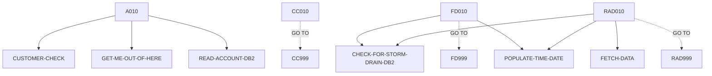

# INQACCCU — source of truth

> Generated by `.github/skills/cobol-rekt/run-cobol-rekt.sh`. Do not edit by hand — re-run the script.
> **[rekt]** = from the cobol-rekt parse tree · **[scan]** = deterministic scan of the original source.

| | |
|---|---|
| Source | `src/base/cics/cobol/INQACCCU.cbl` (882 lines) |
| Subsystem | `cics` |
| cobol-rekt | ✅ parsed |
| Sections / paragraphs [scan] | 24 |
| Decisions (IF / EVALUATE) [rekt] | 15 |
| EXEC CICS / EXEC SQL / DL/I calls [scan] | 28 / 4 / 0 |

## 1. Procedure structure

Control transfers inside the program [rekt]. Solid = `PERFORM`, dashed = `GO TO`.

| Section / paragraph | Lines | PERFORMs [rekt] | GO TO [rekt] | Decisions [rekt] | EXEC CICS | EXEC SQL |
|---|---|---|---|---|---|---|
| **PREMIERE** (section) | 194–194 | — | — | 0 | — | — |
| A010 | 195–228 | CUSTOMER-CHECK, GET-ME-OUT-OF-HERE, READ-ACCOUNT-DB2 | — | 1 | 1 | — |
| A999 | 229–232 | — | — | 0 | — | — |
| **READ-ACCOUNT-DB2** (section) | 233–233 | — | — | 0 | — | — |
| RAD010 | 234–449 | CHECK-FOR-STORM-DRAIN-DB2, FETCH-DATA, POPULATE-TIME-DATE | RAD999 | 4 | 10 | 2 |
| RAD999 | 450–453 | — | — | 0 | — | — |
| **FETCH-DATA** (section) | 454–454 | — | — | 0 | — | — |
| FD010 | 455–634 | CHECK-FOR-STORM-DRAIN-DB2, POPULATE-TIME-DATE | FD999 | 3 | 5 | 1 |
| FD999 | 635–637 | — | — | 0 | — | — |
| **GET-ME-OUT-OF-HERE** (section) | 638–638 | — | — | 0 | — | — |
| GMOFH010 | 639–647 | — | — | 0 | 1 | — |
| GMOFH999 | 648–654 | — | — | 0 | — | — |
| **CHECK-FOR-STORM-DRAIN-DB2** (section) | 655–655 | — | — | 0 | — | — |
| CFSDD010 | 656–680 | — | — | 2 | — | — |
| CFSDD999 | 681–687 | — | — | 0 | — | — |
| **ABEND-HANDLING** (section) | 688–688 | — | — | 0 | — | — |
| AH010 | 689–824 | — | — | 2 | 8 | — |
| AH999 | 825–828 | — | — | 0 | — | — |
| **CUSTOMER-CHECK** (section) | 829–829 | — | — | 0 | — | — |
| CC010 | 830–861 | — | CC999 | 3 | 1 | — |
| CC999 | 862–865 | — | — | 0 | — | — |
| **POPULATE-TIME-DATE** (section) | 866–866 | — | — | 0 | — | — |
| PTD010 | 867–880 | — | — | 0 | 2 | — |
| PTD999 | 881–882 | — | — | 0 | — | — |

## 2. Decision points

Every `IF` / `EVALUATE` found by cobol-rekt, in source order. Condition text is quoted from the original source line. These are where business rules live.

**A010**

- `src/base/cics/cobol/INQACCCU.cbl:215` `IF CUSTOMER-FOUND = 'N'`

**RAD010**

- `src/base/cics/cobol/INQACCCU.cbl:252` `IF SQLCODE NOT = 0`
  - `src/base/cics/cobol/INQACCCU.cbl:271` `IF WS-CICS-RESP NOT = DFHRESP(NORMAL)`
- `src/base/cics/cobol/INQACCCU.cbl:352` `IF SQLCODE NOT = 0`
  - `src/base/cics/cobol/INQACCCU.cbl:374` `IF WS-CICS-RESP NOT = DFHRESP(NORMAL)`

**FD010**

- `src/base/cics/cobol/INQACCCU.cbl:485` `IF SQLCODE = +100`
- `src/base/cics/cobol/INQACCCU.cbl:490` `IF SQLCODE NOT = 0`
  - `src/base/cics/cobol/INQACCCU.cbl:513` `IF WS-CICS-RESP NOT = DFHRESP(NORMAL)`

**CFSDD010**

- `src/base/cics/cobol/INQACCCU.cbl:662` `EVALUATE SQLCODE → WHEN 923 · WHEN OTHER`
- `src/base/cics/cobol/INQACCCU.cbl:672` `IF STORM-DRAIN-CONDITION NOT EQUAL 'Not Storm Drain     '`

**AH010**

- `src/base/cics/cobol/INQACCCU.cbl:703` `EVALUATE MY-ABEND-CODE → WHEN 'AD2Z' · WHEN 'AFCR' · WHEN 'AFCS' · WHEN 'AFCT'`
- `src/base/cics/cobol/INQACCCU.cbl:817` `IF WS-STORM-DRAIN = 'N'`

**CC010**

- `src/base/cics/cobol/INQACCCU.cbl:835` `IF CUSTOMER-NUMBER IN DFHCOMMAREA = ZERO`
- `src/base/cics/cobol/INQACCCU.cbl:841` `IF CUSTOMER-NUMBER IN DFHCOMMAREA = '9999999999'`
- `src/base/cics/cobol/INQACCCU.cbl:855` `IF INQCUST-INQ-SUCCESS = 'Y'`

## 3. External touchpoints [scan]

Every `EXEC CICS`, `EXEC SQL` and IMS DL/I call, as written in the original source.

| Line | Paragraph | Kind | Verb | Statement |
|---|---|---|---|---|
| `src/base/cics/cobol/INQACCCU.cbl:74` | (data division) | EXEC SQL | `DECLARE` | `DECLARE ACC-CURSOR CURSOR FOR SELECT ACCOUNT_EYECATCHER, ACCOUNT_CUSTOMER_NUMBER, ACCOUNT_SORTCODE, ACCOUNT_N…` |
| `src/base/cics/cobol/INQACCCU.cbl:199` | A010 | EXEC CICS | `HANDLE ABEND` | `HANDLE ABEND LABEL(ABEND-HANDLING)` |
| `src/base/cics/cobol/INQACCCU.cbl:246` | RAD010 | EXEC SQL | `OPEN` | `OPEN ACC-CURSOR` |
| `src/base/cics/cobol/INQACCCU.cbl:266` | RAD010 | EXEC CICS | `SYNCPOINT` | `SYNCPOINT ROLLBACK RESP(WS-CICS-RESP) RESP2(WS-CICS-RESP2)` |
| `src/base/cics/cobol/INQACCCU.cbl:284` | RAD010 | EXEC CICS | `ASSIGN` | `ASSIGN APPLID(ABND-APPLID)` |
| `src/base/cics/cobol/INQACCCU.cbl:304` | RAD010 | EXEC CICS | `ASSIGN` | `ASSIGN PROGRAM(ABND-PROGRAM)` |
| `src/base/cics/cobol/INQACCCU.cbl:321` | RAD010 | EXEC CICS | `LINK` | `LINK PROGRAM(WS-ABEND-PGM) COMMAREA(ABNDINFO-REC)` |
| `src/base/cics/cobol/INQACCCU.cbl:331` | RAD010 | EXEC CICS | `ABEND` | `ABEND ABCODE ('HROL') CANCEL` |
| `src/base/cics/cobol/INQACCCU.cbl:348` | RAD010 | EXEC SQL | `CLOSE` | `CLOSE ACC-CURSOR` |
| `src/base/cics/cobol/INQACCCU.cbl:368` | RAD010 | EXEC CICS | `SYNCPOINT` | `SYNCPOINT ROLLBACK RESP(WS-CICS-RESP) RESP2(WS-CICS-RESP2)` |
| `src/base/cics/cobol/INQACCCU.cbl:387` | RAD010 | EXEC CICS | `ASSIGN` | `ASSIGN APPLID(ABND-APPLID)` |
| `src/base/cics/cobol/INQACCCU.cbl:407` | RAD010 | EXEC CICS | `ASSIGN` | `ASSIGN PROGRAM(ABND-PROGRAM)` |
| `src/base/cics/cobol/INQACCCU.cbl:424` | RAD010 | EXEC CICS | `LINK` | `LINK PROGRAM(WS-ABEND-PGM) COMMAREA(ABNDINFO-REC)` |
| `src/base/cics/cobol/INQACCCU.cbl:439` | RAD010 | EXEC CICS | `ABEND` | `ABEND ABCODE ('HROL') CANCEL` |
| `src/base/cics/cobol/INQACCCU.cbl:466` | FD010 | EXEC SQL | `FETCH` | `FETCH FROM ACC-CURSOR INTO :HV-ACCOUNT-EYECATCHER, :HV-ACCOUNT-CUST-NO, :HV-ACCOUNT-SORTCODE, :HV-ACCOUNT-ACC…` |
| `src/base/cics/cobol/INQACCCU.cbl:507` | FD010 | EXEC CICS | `SYNCPOINT` | `SYNCPOINT ROLLBACK RESP(WS-CICS-RESP) RESP2(WS-CICS-RESP2)` |
| `src/base/cics/cobol/INQACCCU.cbl:526` | FD010 | EXEC CICS | `ASSIGN` | `ASSIGN APPLID(ABND-APPLID)` |
| `src/base/cics/cobol/INQACCCU.cbl:546` | FD010 | EXEC CICS | `ASSIGN` | `ASSIGN PROGRAM(ABND-PROGRAM)` |
| `src/base/cics/cobol/INQACCCU.cbl:563` | FD010 | EXEC CICS | `LINK` | `LINK PROGRAM(WS-ABEND-PGM) COMMAREA(ABNDINFO-REC)` |
| `src/base/cics/cobol/INQACCCU.cbl:573` | FD010 | EXEC CICS | `ABEND` | `ABEND ABCODE ('HROL') CANCEL` |
| `src/base/cics/cobol/INQACCCU.cbl:643` | GMOFH010 | EXEC CICS | `RETURN` | `RETURN` |
| `src/base/cics/cobol/INQACCCU.cbl:691` | AH010 | EXEC CICS | `ASSIGN` | `ASSIGN ABCODE(MY-ABEND-CODE)` |
| `src/base/cics/cobol/INQACCCU.cbl:738` | AH010 | EXEC CICS | `SYNCPOINT` | `SYNCPOINT ROLLBACK RESP(WS-CICS-RESP) RESP2(WS-CICS-RESP2)` |
| `src/base/cics/cobol/INQACCCU.cbl:756` | AH010 | EXEC CICS | `ASSIGN` | `ASSIGN APPLID(ABND-APPLID)` |
| `src/base/cics/cobol/INQACCCU.cbl:776` | AH010 | EXEC CICS | `ASSIGN` | `ASSIGN PROGRAM(ABND-PROGRAM)` |
| `src/base/cics/cobol/INQACCCU.cbl:794` | AH010 | EXEC CICS | `LINK` | `LINK PROGRAM(WS-ABEND-PGM) COMMAREA(ABNDINFO-REC)` |
| `src/base/cics/cobol/INQACCCU.cbl:803` | AH010 | EXEC CICS | `ABEND` | `ABEND ABCODE ('HROL') CANCEL` |
| `src/base/cics/cobol/INQACCCU.cbl:812` | AH010 | EXEC CICS | `RETURN` | `RETURN` |
| `src/base/cics/cobol/INQACCCU.cbl:818` | AH010 | EXEC CICS | `ABEND` | `ABEND ABCODE( MY-ABEND-CODE) NODUMP CANCEL` |
| `src/base/cics/cobol/INQACCCU.cbl:851` | CC010 | EXEC CICS | `LINK` | `LINK PROGRAM('INQCUST ') COMMAREA(INQCUST-COMMAREA)` |
| `src/base/cics/cobol/INQACCCU.cbl:870` | PTD010 | EXEC CICS | `ASKTIME` | `ASKTIME ABSTIME(WS-U-TIME)` |
| `src/base/cics/cobol/INQACCCU.cbl:874` | PTD010 | EXEC CICS | `FORMATTIME` | `FORMATTIME ABSTIME(WS-U-TIME) DDMMYYYY(WS-ORIG-DATE) TIME(WS-TIME-NOW) DATESEP` |

## 4. Dependencies [scan]

**Program / transaction transfers**

Lines refer to `src/base/cics/cobol/INQACCCU.cbl`.

| Kind | Target(s) | Resolved via | Lines · paragraph |
|---|---|---|---|
| LINK | `ABNDPROC` | variable `WS-ABEND-PGM` (VALUE clause) | `:321` RAD010, `:424` RAD010, `:563` FD010, `:794` AH010 |
| LINK | `INQCUST` | literal | `:851` CC010 |

**Copybooks**

- `SORTCODE` (`src/base/cics/cobol/INQACCCU.cbl:33`) → `src/base/cics/copy/SORTCODE.cpy`
- `ACCDB2` (`src/base/cics/cobol/INQACCCU.cbl:40`) → `src/base/cics/copy/ACCDB2.cpy`
- `SQLCA` (`src/base/cics/cobol/INQACCCU.cbl:68`) → DB2 precompiler member (not in repo)
- `ACCOUNT` (`src/base/cics/cobol/INQACCCU.cbl:104`) → `src/base/cics/copy/ACCOUNT.cpy`
- `CUSTOMER` (`src/base/cics/cobol/INQACCCU.cbl:155`) → `src/base/cics/copy/CUSTOMER.cpy`
- `INQCUSTZ` (`src/base/cics/cobol/INQACCCU.cbl:158`) → `src/base/cics/copy/INQCUSTZ.cpy`
- `ABNDINFO` (`src/base/cics/cobol/INQACCCU.cbl:187`) → `src/base/cics/copy/ABNDINFO.cpy`
- `INQACCCU` (`src/base/cics/cobol/INQACCCU.cbl:191`) → `src/base/cics/copy/INQACCCU.cpy`

## 5. Condition names (88-levels) [scan]

Named conditions encode business codes. Includes copybooks reached from this program.

| Condition | Value(s) | Parent item | Defined at |
|---|---|---|---|
| `DATASTORE-TYPE-DB2` | `'2'` | DATA-STORE-TYPE | `src/base/cics/cobol/INQACCCU.cbl:133` |
| `DATASTORE-TYPE-VSAM` | `'V'` | DATA-STORE-TYPE | `src/base/cics/cobol/INQACCCU.cbl:134` |
| `ACCOUNT-EYECATCHER-VALUE` | `'ACCT'` | ACCOUNT-EYE-CATCHER | `src/base/cics/copy/ACCOUNT.cpy:9` |
| `CUSTOMER-EYECATCHER-VALUE` | `'CUST'` | CUSTOMER-EYECATCHER | `src/base/cics/copy/CUSTOMER.cpy:9` |
| `CUSTOMER-STATUS-ACTIVE` | `'ACTIVE'` | CUSTOMER-STATUS | `src/base/cics/copy/CUSTOMER.cpy:29` |
| `CUSTOMER-STATUS-INACTIVE` | `'INACTIVE'` | CUSTOMER-STATUS | `src/base/cics/copy/CUSTOMER.cpy:30` |
| `CUSTOMER-STATUS-SUSPENDED` | `'SUSPENDED'` | CUSTOMER-STATUS | `src/base/cics/copy/CUSTOMER.cpy:31` |

## 6. Data items [rekt]

**Records (01 / 77 levels)**

| Name | Clause | Fields | Section | Defined at |
|---|---|---|---|---|
| `HOST-ACCOUNT-ROW` | `(group)` | 12 | WORKING_STORAGE | `src/base/cics/cobol/INQACCCU.cbl:45` |
| `EIBRCODE-NICE` | `(group)` | 6 | WORKING_STORAGE | `src/base/cics/cobol/INQACCCU.cbl:59` |
| `WS-CICS-WORK-AREA` | `(group)` | 3 | WORKING_STORAGE | `src/base/cics/cobol/INQACCCU.cbl:96` |
| `EXIT-BROWSE-LOOP` | `PIC X VALUE 'N'` | — | WORKING_STORAGE | `src/base/cics/cobol/INQACCCU.cbl:101` |
| `OUTPUT-DATA` | `(group)` | 26 | WORKING_STORAGE | `src/base/cics/cobol/INQACCCU.cbl:103` |
| `RETURNED-DATA` | `(group)` | 13 | WORKING_STORAGE | `src/base/cics/cobol/INQACCCU.cbl:106` |
| `DESIRED-KEY` | `(group)` | 2 | WORKING_STORAGE | `src/base/cics/cobol/INQACCCU.cbl:121` |
| `DB2-DATE-REFORMAT` | `(group)` | 5 | WORKING_STORAGE | `src/base/cics/cobol/INQACCCU.cbl:125` |
| `DATA-STORE-TYPE` | `PIC X` | — | WORKING_STORAGE | `src/base/cics/cobol/INQACCCU.cbl:132` |
| `DB2-EXIT-LOOP` | `PIC X` | — | WORKING_STORAGE | `src/base/cics/cobol/INQACCCU.cbl:136` |
| `FETCH-DATA-CNT` | `PIC 9(4) COMP` | — | WORKING_STORAGE | `src/base/cics/cobol/INQACCCU.cbl:137` |
| `WS-CUST-ALT-KEY-LEN` | `PIC S9(4) COMP VALUE +10` | — | WORKING_STORAGE | `src/base/cics/cobol/INQACCCU.cbl:138` |
| `CUSTOMER-KY` | `(group)` | 2 | WORKING_STORAGE | `src/base/cics/cobol/INQACCCU.cbl:141` |
| `SQLCODE-DISPLAY` | `PIC S9(8) DISPLAY SIGN LEADING SEPARATE` | — | WORKING_STORAGE | `src/base/cics/cobol/INQACCCU.cbl:145` |
| `MY-ABEND-CODE` | `PIC XXXX` | — | WORKING_STORAGE | `src/base/cics/cobol/INQACCCU.cbl:148` |
| `WS-STORM-DRAIN` | `PIC X VALUE 'N'` | — | WORKING_STORAGE | `src/base/cics/cobol/INQACCCU.cbl:150` |
| `STORM-DRAIN-CONDITION` | `PIC X(20)` | — | WORKING_STORAGE | `src/base/cics/cobol/INQACCCU.cbl:152` |
| `CUSTOMER-AREA` | `(group)` | 30 | WORKING_STORAGE | `src/base/cics/cobol/INQACCCU.cbl:154` |
| `INQCUST-COMMAREA` | `(group)` | 31 | WORKING_STORAGE | `src/base/cics/cobol/INQACCCU.cbl:157` |
| `WS-U-TIME` | `PIC S9(15) COMP-3` | — | WORKING_STORAGE | `src/base/cics/cobol/INQACCCU.cbl:160` |
| `WS-ORIG-DATE` | `PIC X(10)` | — | WORKING_STORAGE | `src/base/cics/cobol/INQACCCU.cbl:161` |
| `WS-ORIG-DATE-GRP` | `REDEFINES WS-ORIG-DATE` REDEFINES WS-ORIG-DATE | 5 | WORKING_STORAGE | `src/base/cics/cobol/INQACCCU.cbl:162` |
| `WS-ORIG-DATE-GRP-X` | `(group)` | 5 | WORKING_STORAGE | `src/base/cics/cobol/INQACCCU.cbl:169` |
| `WS-TIME-DATA` | `(group)` | 5 | WORKING_STORAGE | `src/base/cics/cobol/INQACCCU.cbl:177` |
| `WS-ABEND-PGM` | `PIC X(8) VALUE 'ABNDPROC'` | — | WORKING_STORAGE | `src/base/cics/cobol/INQACCCU.cbl:184` |
| `ABNDINFO-REC` | `(group)` | 13 | WORKING_STORAGE | `src/base/cics/cobol/INQACCCU.cbl:186` |
| `DFHCOMMAREA` | `(group)` | 31 | LINKAGE | `src/base/cics/cobol/INQACCCU.cbl:190` |

**LINKAGE SECTION — the program's interface contract (COMMAREA / parameters)**

| Level | Name | Clause | Type | Defined at |
|---|---|---|---|---|
| 01 | DFHCOMMAREA | `(group)` | OBJECT | `src/base/cics/cobol/INQACCCU.cbl:190` |
| 03 | &nbsp;&nbsp;NUMBER-OF-ACCOUNTS | `PIC S9(8) BINARY` | NUMBER | `src/base/cics/copy/INQACCCU.cpy:7` |
| 03 | &nbsp;&nbsp;CUSTOMER-NUMBER | `PIC 9(10)` | NUMBER | `src/base/cics/copy/INQACCCU.cpy:8` |
| 03 | &nbsp;&nbsp;COMM-SUCCESS | `PIC X` | STRING | `src/base/cics/copy/INQACCCU.cpy:9` |
| 03 | &nbsp;&nbsp;COMM-FAIL-CODE | `PIC X` | STRING | `src/base/cics/copy/INQACCCU.cpy:10` |
| 03 | &nbsp;&nbsp;CUSTOMER-FOUND | `PIC X` | STRING | `src/base/cics/copy/INQACCCU.cpy:11` |
| 03 | &nbsp;&nbsp;COMM-PCB-POINTER | `POINTER` | POINTER | `src/base/cics/copy/INQACCCU.cpy:12` |
| 03 | &nbsp;&nbsp;ACCOUNT-DETAILS | `OCCURS 1 TO 20 DEPENDING ON NUMBER-OF-ACCOUNTS` | OBJECT | `src/base/cics/copy/INQACCCU.cpy:13` |
| 05 | &nbsp;&nbsp;&nbsp;&nbsp;COMM-EYE | `PIC X(4)` | STRING | `src/base/cics/copy/INQACCCU.cpy:15` |
| 05 | &nbsp;&nbsp;&nbsp;&nbsp;COMM-CUSTNO | `PIC X(10)` | STRING | `src/base/cics/copy/INQACCCU.cpy:16` |
| 05 | &nbsp;&nbsp;&nbsp;&nbsp;COMM-SCODE | `PIC X(6)` | STRING | `src/base/cics/copy/INQACCCU.cpy:17` |
| 05 | &nbsp;&nbsp;&nbsp;&nbsp;COMM-ACCNO | `PIC 9(8)` | NUMBER | `src/base/cics/copy/INQACCCU.cpy:18` |
| 05 | &nbsp;&nbsp;&nbsp;&nbsp;COMM-ACC-TYPE | `PIC X(8)` | STRING | `src/base/cics/copy/INQACCCU.cpy:19` |
| 05 | &nbsp;&nbsp;&nbsp;&nbsp;COMM-INT-RATE | `PIC 9(4)V99` | NUMBER | `src/base/cics/copy/INQACCCU.cpy:20` |
| 05 | &nbsp;&nbsp;&nbsp;&nbsp;COMM-OPENED | `PIC 9(8)` | NUMBER | `src/base/cics/copy/INQACCCU.cpy:21` |
| 05 | &nbsp;&nbsp;&nbsp;&nbsp;COMM-OPENED-GROUP | `REDEFINES COMM-OPENED` REDEFINES COMM-OPENED | OBJECT | `src/base/cics/copy/INQACCCU.cpy:22` |
| 07 | &nbsp;&nbsp;&nbsp;&nbsp;&nbsp;&nbsp;COMM-OPENED-DAY | `PIC 99` | NUMBER | `src/base/cics/copy/INQACCCU.cpy:23` |
| 07 | &nbsp;&nbsp;&nbsp;&nbsp;&nbsp;&nbsp;COMM-OPENED-MONTH | `PIC 99` | NUMBER | `src/base/cics/copy/INQACCCU.cpy:24` |
| 07 | &nbsp;&nbsp;&nbsp;&nbsp;&nbsp;&nbsp;COMM-OPENED-YEAR | `PIC 9999` | NUMBER | `src/base/cics/copy/INQACCCU.cpy:25` |
| 05 | &nbsp;&nbsp;&nbsp;&nbsp;COMM-OVERDRAFT | `PIC 9(8)` | NUMBER | `src/base/cics/copy/INQACCCU.cpy:26` |
| 05 | &nbsp;&nbsp;&nbsp;&nbsp;COMM-LAST-STMT-DT | `PIC 9(8)` | NUMBER | `src/base/cics/copy/INQACCCU.cpy:27` |
| 05 | &nbsp;&nbsp;&nbsp;&nbsp;COMM-LAST-STMT-GROUP | `REDEFINES COMM-LAST-STMT-DT` REDEFINES COMM-LAST-STMT-DT | OBJECT | `src/base/cics/copy/INQACCCU.cpy:28` |
| 07 | &nbsp;&nbsp;&nbsp;&nbsp;&nbsp;&nbsp;COMM-LAST-STMT-DAY | `PIC 99` | NUMBER | `src/base/cics/copy/INQACCCU.cpy:29` |
| 07 | &nbsp;&nbsp;&nbsp;&nbsp;&nbsp;&nbsp;COMM-LAST-STMT-MONTH | `PIC 99` | NUMBER | `src/base/cics/copy/INQACCCU.cpy:30` |
| 07 | &nbsp;&nbsp;&nbsp;&nbsp;&nbsp;&nbsp;COMM-LAST-STMT-YEAR | `PIC 9999` | NUMBER | `src/base/cics/copy/INQACCCU.cpy:31` |
| 05 | &nbsp;&nbsp;&nbsp;&nbsp;COMM-NEXT-STMT-DT | `PIC 9(8)` | NUMBER | `src/base/cics/copy/INQACCCU.cpy:32` |
| 05 | &nbsp;&nbsp;&nbsp;&nbsp;COMM-NEXT-STMT-GROUP | `REDEFINES COMM-NEXT-STMT-DT` REDEFINES COMM-NEXT-STMT-DT | OBJECT | `src/base/cics/copy/INQACCCU.cpy:33` |
| 07 | &nbsp;&nbsp;&nbsp;&nbsp;&nbsp;&nbsp;COMM-NEXT-STMT-DAY | `PIC 99` | NUMBER | `src/base/cics/copy/INQACCCU.cpy:34` |
| 07 | &nbsp;&nbsp;&nbsp;&nbsp;&nbsp;&nbsp;COMM-NEXT-STMT-MONTH | `PIC 99` | NUMBER | `src/base/cics/copy/INQACCCU.cpy:35` |
| 07 | &nbsp;&nbsp;&nbsp;&nbsp;&nbsp;&nbsp;COMM-NEXT-STMT-YEAR | `PIC 9999` | NUMBER | `src/base/cics/copy/INQACCCU.cpy:36` |
| 05 | &nbsp;&nbsp;&nbsp;&nbsp;COMM-AVAIL-BAL | `PIC S9(10)V99` | NUMBER | `src/base/cics/copy/INQACCCU.cpy:37` |
| 05 | &nbsp;&nbsp;&nbsp;&nbsp;COMM-ACTUAL-BAL | `PIC S9(10)V99` | NUMBER | `src/base/cics/copy/INQACCCU.cpy:38` |

_Working-storage fields below the 01 level are not listed — open the definition to drill in._
