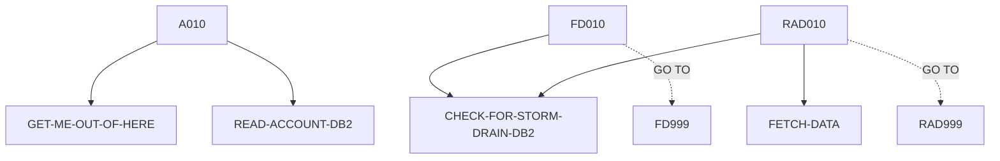

# INQACCS — source of truth

> Generated by `.github/skills/cobol-rekt/run-cobol-rekt.sh`. Do not edit by hand — re-run the script.
> **[rekt]** = from the cobol-rekt parse tree · **[scan]** = deterministic scan of the original source.

| | |
|---|---|
| Source | `src/base/cics/cobol/INQACCS.cbl` (413 lines) |
| Subsystem | `cics` |
| cobol-rekt | ✅ parsed |
| Sections / paragraphs [scan] | 21 |
| Decisions (IF / EVALUATE) [rekt] | 8 |
| EXEC CICS / EXEC SQL / DL/I calls [scan] | 11 / 4 / 0 |

## 1. Procedure structure

Control transfers inside the program [rekt]. Solid = `PERFORM`, dashed = `GO TO`.

| Section / paragraph | Lines | PERFORMs [rekt] | GO TO [rekt] | Decisions [rekt] | EXEC CICS | EXEC SQL |
|---|---|---|---|---|---|---|
| **PREMIERE** (section) | 137–137 | — | — | 0 | — | — |
| A010 | 138–151 | GET-ME-OUT-OF-HERE, READ-ACCOUNT-DB2 | — | 0 | 1 | — |
| A999 | 152–155 | — | — | 0 | — | — |
| **READ-ACCOUNT-DB2** (section) | 156–156 | — | — | 0 | — | — |
| RAD010 | 157–209 | CHECK-FOR-STORM-DRAIN-DB2, FETCH-DATA | RAD999 | 2 | 2 | 2 |
| RAD999 | 210–213 | — | — | 0 | — | — |
| **FETCH-DATA** (section) | 214–214 | — | — | 0 | — | — |
| FD010 | 215–313 | CHECK-FOR-STORM-DRAIN-DB2 | FD999 | 2 | 1 | 1 |
| FD999 | 314–316 | — | — | 0 | — | — |
| **GET-ME-OUT-OF-HERE** (section) | 317–317 | — | — | 0 | — | — |
| GMOFH010 | 318–323 | — | — | 0 | 1 | — |
| GMOFH999 | 324–327 | — | — | 0 | — | — |
| **CHECK-FOR-STORM-DRAIN-DB2** (section) | 328–328 | — | — | 0 | — | — |
| CFSDD010 | 329–348 | — | — | 2 | — | — |
| CFSDD999 | 349–352 | — | — | 0 | — | — |
| **ABEND-HANDLING** (section) | 353–353 | — | — | 0 | — | — |
| AH010 | 354–393 | — | — | 2 | 4 | — |
| AH999 | 394–397 | — | — | 0 | — | — |
| **POPULATE-TIME-DATE** (section) | 398–398 | — | — | 0 | — | — |
| PTD010 | 399–411 | — | — | 0 | 2 | — |
| PTD999 | 412–413 | — | — | 0 | — | — |

## 2. Decision points

Every `IF` / `EVALUATE` found by cobol-rekt, in source order. Condition text is quoted from the original source line. These are where business rules live.

**RAD010**

- `src/base/cics/cobol/INQACCS.cbl:165` `IF SQLCODE NOT = 0`
- `src/base/cics/cobol/INQACCS.cbl:188` `IF SQLCODE NOT = 0`

**FD010**

- `src/base/cics/cobol/INQACCS.cbl:236` `IF SQLCODE = +100`
- `src/base/cics/cobol/INQACCS.cbl:241` `IF SQLCODE NOT = 0`

**CFSDD010**

- `src/base/cics/cobol/INQACCS.cbl:331` `EVALUATE SQLCODE → WHEN 923 · WHEN OTHER`
- `src/base/cics/cobol/INQACCS.cbl:341` `IF STORM-DRAIN-CONDITION NOT EQUAL 'Not Storm Drain     '`

**AH010**

- `src/base/cics/cobol/INQACCS.cbl:360` `EVALUATE MY-ABEND-CODE → WHEN 'AD2Z' · WHEN 'AFCR' · WHEN 'AFCS' · WHEN 'AFCT'`
- `src/base/cics/cobol/INQACCS.cbl:386` `IF WS-STORM-DRAIN = 'N'`

## 3. External touchpoints [scan]

Every `EXEC CICS`, `EXEC SQL` and IMS DL/I call, as written in the original source.

| Line | Paragraph | Kind | Verb | Statement |
|---|---|---|---|---|
| `src/base/cics/cobol/INQACCS.cbl:71` | (data division) | EXEC SQL | `DECLARE` | `DECLARE ACC-ALL-CURSOR CURSOR FOR SELECT ACCOUNT_EYECATCHER, ACCOUNT_CUSTOMER_NUMBER, ACCOUNT_SORTCODE, ACCOU…` |
| `src/base/cics/cobol/INQACCS.cbl:142` | A010 | EXEC CICS | `HANDLE ABEND` | `HANDLE ABEND LABEL(ABEND-HANDLING)` |
| `src/base/cics/cobol/INQACCS.cbl:159` | RAD010 | EXEC SQL | `OPEN` | `OPEN ACC-ALL-CURSOR` |
| `src/base/cics/cobol/INQACCS.cbl:174` | RAD010 | EXEC CICS | `SYNCPOINT` | `SYNCPOINT ROLLBACK RESP(WS-CICS-RESP) RESP2(WS-CICS-RESP2)` |
| `src/base/cics/cobol/INQACCS.cbl:184` | RAD010 | EXEC SQL | `CLOSE` | `CLOSE ACC-ALL-CURSOR` |
| `src/base/cics/cobol/INQACCS.cbl:199` | RAD010 | EXEC CICS | `SYNCPOINT` | `SYNCPOINT ROLLBACK RESP(WS-CICS-RESP) RESP2(WS-CICS-RESP2)` |
| `src/base/cics/cobol/INQACCS.cbl:221` | FD010 | EXEC SQL | `FETCH` | `FETCH FROM ACC-ALL-CURSOR INTO :HV-ACCOUNT-EYECATCHER, :HV-ACCOUNT-CUST-NO, :HV-ACCOUNT-SORTCODE, :HV-ACCOUNT…` |
| `src/base/cics/cobol/INQACCS.cbl:254` | FD010 | EXEC CICS | `SYNCPOINT` | `SYNCPOINT ROLLBACK RESP(WS-CICS-RESP) RESP2(WS-CICS-RESP2)` |
| `src/base/cics/cobol/INQACCS.cbl:319` | GMOFH010 | EXEC CICS | `RETURN` | `RETURN` |
| `src/base/cics/cobol/INQACCS.cbl:356` | AH010 | EXEC CICS | `ASSIGN` | `ASSIGN ABCODE(MY-ABEND-CODE)` |
| `src/base/cics/cobol/INQACCS.cbl:374` | AH010 | EXEC CICS | `SYNCPOINT` | `SYNCPOINT ROLLBACK RESP(WS-CICS-RESP) RESP2(WS-CICS-RESP2)` |
| `src/base/cics/cobol/INQACCS.cbl:381` | AH010 | EXEC CICS | `RETURN` | `RETURN` |
| `src/base/cics/cobol/INQACCS.cbl:387` | AH010 | EXEC CICS | `ABEND` | `ABEND ABCODE( MY-ABEND-CODE) NODUMP CANCEL` |
| `src/base/cics/cobol/INQACCS.cbl:401` | PTD010 | EXEC CICS | `ASKTIME` | `ASKTIME ABSTIME(WS-U-TIME)` |
| `src/base/cics/cobol/INQACCS.cbl:405` | PTD010 | EXEC CICS | `FORMATTIME` | `FORMATTIME ABSTIME(WS-U-TIME) DDMMYYYY(WS-ORIG-DATE) TIME(WS-TIME-NOW) DATESEP` |

## 4. Dependencies [scan]

**Program / transaction transfers**

_None found._

**Copybooks**

- `SORTCODE` (`src/base/cics/cobol/INQACCS.cbl:31`) → `src/base/cics/copy/SORTCODE.cpy`
- `ACCDB2` (`src/base/cics/cobol/INQACCS.cbl:37`) → `src/base/cics/copy/ACCDB2.cpy`
- `SQLCA` (`src/base/cics/cobol/INQACCS.cbl:65`) → DB2 precompiler member (not in repo)
- `ABNDINFO` (`src/base/cics/cobol/INQACCS.cbl:130`) → `src/base/cics/copy/ABNDINFO.cpy`
- `INQACCS` (`src/base/cics/cobol/INQACCS.cbl:134`) → `src/base/cics/copy/INQACCS.cpy`

## 5. Condition names (88-levels) [scan]

Named conditions encode business codes. Includes copybooks reached from this program.

_None found._

## 6. Data items [rekt]

**Records (01 / 77 levels)**

| Name | Clause | Fields | Section | Defined at |
|---|---|---|---|---|
| `HOST-ACCOUNT-ROW` | `(group)` | 12 | WORKING_STORAGE | `src/base/cics/cobol/INQACCS.cbl:42` |
| `EIBRCODE-NICE` | `(group)` | 6 | WORKING_STORAGE | `src/base/cics/cobol/INQACCS.cbl:56` |
| `WS-CICS-WORK-AREA` | `(group)` | 2 | WORKING_STORAGE | `src/base/cics/cobol/INQACCS.cbl:91` |
| `DB2-DATE-REFORMAT` | `(group)` | 5 | WORKING_STORAGE | `src/base/cics/cobol/INQACCS.cbl:95` |
| `SQLCODE-DISPLAY` | `PIC S9(8) DISPLAY SIGN LEADING SEPARATE` | — | WORKING_STORAGE | `src/base/cics/cobol/INQACCS.cbl:102` |
| `MY-ABEND-CODE` | `PIC XXXX` | — | WORKING_STORAGE | `src/base/cics/cobol/INQACCS.cbl:105` |
| `WS-STORM-DRAIN` | `PIC X VALUE 'N'` | — | WORKING_STORAGE | `src/base/cics/cobol/INQACCS.cbl:107` |
| `STORM-DRAIN-CONDITION` | `PIC X(20)` | — | WORKING_STORAGE | `src/base/cics/cobol/INQACCS.cbl:109` |
| `WS-U-TIME` | `PIC S9(15) COMP-3` | — | WORKING_STORAGE | `src/base/cics/cobol/INQACCS.cbl:111` |
| `WS-ORIG-DATE` | `PIC X(10)` | — | WORKING_STORAGE | `src/base/cics/cobol/INQACCS.cbl:112` |
| `WS-ORIG-DATE-GRP` | `REDEFINES WS-ORIG-DATE` REDEFINES WS-ORIG-DATE | 5 | WORKING_STORAGE | `src/base/cics/cobol/INQACCS.cbl:113` |
| `WS-TIME-DATA` | `(group)` | 5 | WORKING_STORAGE | `src/base/cics/cobol/INQACCS.cbl:120` |
| `WS-ABEND-PGM` | `PIC X(8) VALUE 'ABNDPROC'` | — | WORKING_STORAGE | `src/base/cics/cobol/INQACCS.cbl:127` |
| `ABNDINFO-REC` | `(group)` | 13 | WORKING_STORAGE | `src/base/cics/cobol/INQACCS.cbl:129` |
| `DFHCOMMAREA` | `(group)` | 29 | LINKAGE | `src/base/cics/cobol/INQACCS.cbl:133` |

**LINKAGE SECTION — the program's interface contract (COMMAREA / parameters)**

| Level | Name | Clause | Type | Defined at |
|---|---|---|---|---|
| 01 | DFHCOMMAREA | `(group)` | OBJECT | `src/base/cics/cobol/INQACCS.cbl:133` |
| 03 | &nbsp;&nbsp;NUMBER-OF-ACCOUNTS | `PIC S9(8) BINARY` | NUMBER | `src/base/cics/copy/INQACCS.cpy:7` |
| 03 | &nbsp;&nbsp;COMM-SUCCESS | `PIC X` | STRING | `src/base/cics/copy/INQACCS.cpy:8` |
| 03 | &nbsp;&nbsp;COMM-FAIL-CODE | `PIC X` | STRING | `src/base/cics/copy/INQACCS.cpy:9` |
| 03 | &nbsp;&nbsp;COMM-PCB-POINTER | `PIC X(4)` | STRING | `src/base/cics/copy/INQACCS.cpy:10` |
| 03 | &nbsp;&nbsp;ACCOUNT-DETAILS | `OCCURS 1 TO 20 DEPENDING ON NUMBER-OF-ACCOUNTS` | OBJECT | `src/base/cics/copy/INQACCS.cpy:11` |
| 05 | &nbsp;&nbsp;&nbsp;&nbsp;COMM-EYE | `PIC X(4)` | STRING | `src/base/cics/copy/INQACCS.cpy:13` |
| 05 | &nbsp;&nbsp;&nbsp;&nbsp;COMM-CUSTNO | `PIC X(10)` | STRING | `src/base/cics/copy/INQACCS.cpy:14` |
| 05 | &nbsp;&nbsp;&nbsp;&nbsp;COMM-SCODE | `PIC X(6)` | STRING | `src/base/cics/copy/INQACCS.cpy:15` |
| 05 | &nbsp;&nbsp;&nbsp;&nbsp;COMM-ACCNO | `PIC 9(8)` | NUMBER | `src/base/cics/copy/INQACCS.cpy:16` |
| 05 | &nbsp;&nbsp;&nbsp;&nbsp;COMM-ACC-TYPE | `PIC X(8)` | STRING | `src/base/cics/copy/INQACCS.cpy:17` |
| 05 | &nbsp;&nbsp;&nbsp;&nbsp;COMM-INT-RATE | `PIC 9(4)V99` | NUMBER | `src/base/cics/copy/INQACCS.cpy:18` |
| 05 | &nbsp;&nbsp;&nbsp;&nbsp;COMM-OPENED | `PIC 9(8)` | NUMBER | `src/base/cics/copy/INQACCS.cpy:19` |
| 05 | &nbsp;&nbsp;&nbsp;&nbsp;COMM-OPENED-GROUP | `REDEFINES COMM-OPENED` REDEFINES COMM-OPENED | OBJECT | `src/base/cics/copy/INQACCS.cpy:20` |
| 07 | &nbsp;&nbsp;&nbsp;&nbsp;&nbsp;&nbsp;COMM-OPENED-DAY | `PIC 99` | NUMBER | `src/base/cics/copy/INQACCS.cpy:21` |
| 07 | &nbsp;&nbsp;&nbsp;&nbsp;&nbsp;&nbsp;COMM-OPENED-MONTH | `PIC 99` | NUMBER | `src/base/cics/copy/INQACCS.cpy:22` |
| 07 | &nbsp;&nbsp;&nbsp;&nbsp;&nbsp;&nbsp;COMM-OPENED-YEAR | `PIC 9999` | NUMBER | `src/base/cics/copy/INQACCS.cpy:23` |
| 05 | &nbsp;&nbsp;&nbsp;&nbsp;COMM-OVERDRAFT | `PIC 9(8)` | NUMBER | `src/base/cics/copy/INQACCS.cpy:24` |
| 05 | &nbsp;&nbsp;&nbsp;&nbsp;COMM-LAST-STMT-DT | `PIC 9(8)` | NUMBER | `src/base/cics/copy/INQACCS.cpy:25` |
| 05 | &nbsp;&nbsp;&nbsp;&nbsp;COMM-LAST-STMT-GROUP | `REDEFINES COMM-LAST-STMT-DT` REDEFINES COMM-LAST-STMT-DT | OBJECT | `src/base/cics/copy/INQACCS.cpy:26` |
| 07 | &nbsp;&nbsp;&nbsp;&nbsp;&nbsp;&nbsp;COMM-LAST-STMT-DAY | `PIC 99` | NUMBER | `src/base/cics/copy/INQACCS.cpy:27` |
| 07 | &nbsp;&nbsp;&nbsp;&nbsp;&nbsp;&nbsp;COMM-LAST-STMT-MONTH | `PIC 99` | NUMBER | `src/base/cics/copy/INQACCS.cpy:28` |
| 07 | &nbsp;&nbsp;&nbsp;&nbsp;&nbsp;&nbsp;COMM-LAST-STMT-YEAR | `PIC 9999` | NUMBER | `src/base/cics/copy/INQACCS.cpy:29` |
| 05 | &nbsp;&nbsp;&nbsp;&nbsp;COMM-NEXT-STMT-DT | `PIC 9(8)` | NUMBER | `src/base/cics/copy/INQACCS.cpy:30` |
| 05 | &nbsp;&nbsp;&nbsp;&nbsp;COMM-NEXT-STMT-GROUP | `REDEFINES COMM-NEXT-STMT-DT` REDEFINES COMM-NEXT-STMT-DT | OBJECT | `src/base/cics/copy/INQACCS.cpy:31` |
| 07 | &nbsp;&nbsp;&nbsp;&nbsp;&nbsp;&nbsp;COMM-NEXT-STMT-DAY | `PIC 99` | NUMBER | `src/base/cics/copy/INQACCS.cpy:32` |
| 07 | &nbsp;&nbsp;&nbsp;&nbsp;&nbsp;&nbsp;COMM-NEXT-STMT-MONTH | `PIC 99` | NUMBER | `src/base/cics/copy/INQACCS.cpy:33` |
| 07 | &nbsp;&nbsp;&nbsp;&nbsp;&nbsp;&nbsp;COMM-NEXT-STMT-YEAR | `PIC 9999` | NUMBER | `src/base/cics/copy/INQACCS.cpy:34` |
| 05 | &nbsp;&nbsp;&nbsp;&nbsp;COMM-AVAIL-BAL | `PIC S9(10)V99` | NUMBER | `src/base/cics/copy/INQACCS.cpy:35` |
| 05 | &nbsp;&nbsp;&nbsp;&nbsp;COMM-ACTUAL-BAL | `PIC S9(10)V99` | NUMBER | `src/base/cics/copy/INQACCS.cpy:36` |

_Working-storage fields below the 01 level are not listed — open the definition to drill in._
