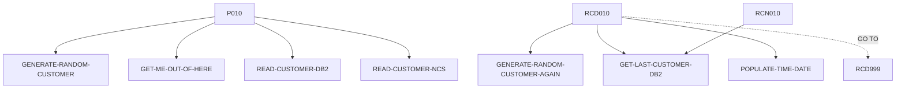

# INQCUST — source of truth

> Generated by `.github/skills/cobol-rekt/run-cobol-rekt.sh`. Do not edit by hand — re-run the script.
> **[rekt]** = from the cobol-rekt parse tree · **[scan]** = deterministic scan of the original source.

| | |
|---|---|
| Source | `src/base/cics/cobol/INQCUST.cbl` (771 lines) |
| Subsystem | `cics` |
| cobol-rekt | ✅ parsed |
| Sections / paragraphs [scan] | 26 |
| Decisions (IF / EVALUATE) [rekt] | 17 |
| EXEC CICS / EXEC SQL / DL/I calls [scan] | 16 / 2 / 0 |

## 1. Procedure structure

Control transfers inside the program [rekt]. Solid = `PERFORM`, dashed = `GO TO`.

| Section / paragraph | Lines | PERFORMs [rekt] | GO TO [rekt] | Decisions [rekt] | EXEC CICS | EXEC SQL |
|---|---|---|---|---|---|---|
| **PREMIERE** (section) | 197–197 | — | — | 0 | — | — |
| P010 | 198–282 | GENERATE-RANDOM-CUSTOMER, GET-ME-OUT-OF-HERE, READ-CUSTOMER-DB2, READ-CUSTOMER-NCS | — | 5 | 1 | — |
| P999 | 283–286 | — | — | 0 | — | — |
| **READ-CUSTOMER-NCS** (section) | 287–287 | — | — | 0 | — | — |
| RCN010 | 288–295 | GET-LAST-CUSTOMER-DB2 | — | 1 | — | — |
| RCN999 | 296–298 | — | — | 0 | — | — |
| **READ-CUSTOMER-DB2** (section) | 299–299 | — | — | 0 | — | — |
| RCD010 | 300–523 | GENERATE-RANDOM-CUSTOMER-AGAIN, GET-LAST-CUSTOMER-DB2, POPULATE-TIME-DATE | RCD999 | 7 | 4 | 1 |
| RCD999 | 524–527 | — | — | 0 | — | — |
| **GET-ME-OUT-OF-HERE** (section) | 528–528 | — | — | 0 | — | — |
| GMOFH010 | 529–535 | — | — | 0 | 1 | — |
| GMOFH999 | 536–539 | — | — | 0 | — | — |
| **ABEND-HANDLING** (section) | 540–540 | — | — | 0 | — | — |
| AH010 | 541–659 | — | — | 2 | 8 | — |
| AH999 | 660–663 | — | — | 0 | — | — |
| **GET-LAST-CUSTOMER-DB2** (section) | 664–664 | — | — | 0 | — | — |
| GLCD010 | 665–734 | — | — | 2 | — | 1 |
| **POPULATE-TIME-DATE** (section) | 735–735 | — | — | 0 | — | — |
| PTD010 | 736–748 | — | — | 0 | 2 | — |
| PTD999 | 749–754 | — | — | 0 | — | — |
| **GENERATE-RANDOM-CUSTOMER** (section) | 755–755 | — | — | 0 | — | — |
| GRC010 | 756–759 | — | — | 0 | — | — |
| GRC999 | 760–764 | — | — | 0 | — | — |
| **GENERATE-RANDOM-CUSTOMER-AGAIN** (section) | 765–765 | — | — | 0 | — | — |
| GRCA10 | 766–769 | — | — | 0 | — | — |
| GRCA99 | 770–771 | — | — | 0 | — | — |

## 2. Decision points

Every `IF` / `EVALUATE` found by cobol-rekt, in source order. Condition text is quoted from the original source line. These are where business rules live.

**P010**

- `src/base/cics/cobol/INQCUST.cbl:209` `IF INQCUST-SCODE = SPACES OR LOW-VALUES`
- `src/base/cics/cobol/INQCUST.cbl:225` `IF INQCUST-CUSTNO = 0000000000 OR INQCUST-CUSTNO = 9999999999`
  - `src/base/cics/cobol/INQCUST.cbl:228` `IF INQCUST-INQ-SUCCESS = 'Y'`
- `src/base/cics/cobol/INQCUST.cbl:239` `IF INQCUST-CUSTNO = 0000000000`
- `src/base/cics/cobol/INQCUST.cbl:255` `IF INQCUST-INQ-SUCCESS = 'Y'`

**RCN010**

- `src/base/cics/cobol/INQCUST.cbl:293` `IF INQCUST-INQ-SUCCESS = 'Y'`

**RCD010**

- `src/base/cics/cobol/INQCUST.cbl:353` `IF SQLCODE = 0`
- `src/base/cics/cobol/INQCUST.cbl:403` `IF SQLCODE = 100 AND`
  - `src/base/cics/cobol/INQCUST.cbl:405` `IF INQCUST-RETRY < 1000`
- `src/base/cics/cobol/INQCUST.cbl:417` `IF SQLCODE = 100 AND`
- `src/base/cics/cobol/INQCUST.cbl:434` `IF (SQLCODE = 100 AND INQCUST-CUSTNO NOT = 9999999999) AND (SQLCODE = 100 AND INQCUST-CUSTNO NOT = 0000000000)`
- `src/base/cics/cobol/INQCUST.cbl:460` `IF SQLCODE NOT = 0 AND SQLCODE NOT = 100`
  - `src/base/cics/cobol/INQCUST.cbl:514` `IF WS-V-RETRIED = 'Y'`

**AH010**

- `src/base/cics/cobol/INQCUST.cbl:556` `EVALUATE MY-ABEND-CODE → WHEN 'AFCR' · WHEN 'AFCS' · WHEN 'AFCT'`
- `src/base/cics/cobol/INQCUST.cbl:652` `IF WS-STORM-DRAIN = 'N'`

**GLCD010**

- `src/base/cics/cobol/INQCUST.cbl:716` `IF SQLCODE = 0`
- `src/base/cics/cobol/INQCUST.cbl:722` `IF SQLCODE = 100`

## 3. External touchpoints [scan]

Every `EXEC CICS`, `EXEC SQL` and IMS DL/I call, as written in the original source.

| Line | Paragraph | Kind | Verb | Statement |
|---|---|---|---|---|
| `src/base/cics/cobol/INQCUST.cbl:202` | P010 | EXEC CICS | `HANDLE ABEND` | `HANDLE ABEND LABEL(ABEND-HANDLING)` |
| `src/base/cics/cobol/INQCUST.cbl:310` | RCD010 | EXEC SQL | `SELECT` | `SELECT CUSTOMER_EYECATCHER, CUSTOMER_SORTCODE, CUSTOMER_NUMBER, CUSTOMER_TITLE, CUSTOMER_FIRST_NAME, CUSTOMER…` |
| `src/base/cics/cobol/INQCUST.cbl:472` | RCD010 | EXEC CICS | `ASSIGN` | `ASSIGN APPLID(ABND-APPLID)` |
| `src/base/cics/cobol/INQCUST.cbl:492` | RCD010 | EXEC CICS | `ASSIGN` | `ASSIGN PROGRAM(ABND-PROGRAM)` |
| `src/base/cics/cobol/INQCUST.cbl:506` | RCD010 | EXEC CICS | `LINK` | `LINK PROGRAM(WS-ABEND-PGM) COMMAREA(ABNDINFO-REC)` |
| `src/base/cics/cobol/INQCUST.cbl:518` | RCD010 | EXEC CICS | `ABEND` | `ABEND ABCODE('CVR1') CANCEL` |
| `src/base/cics/cobol/INQCUST.cbl:533` | GMOFH010 | EXEC CICS | `RETURN` | `RETURN` |
| `src/base/cics/cobol/INQCUST.cbl:545` | AH010 | EXEC CICS | `ASSIGN` | `ASSIGN ABCODE(MY-ABEND-CODE)` |
| `src/base/cics/cobol/INQCUST.cbl:572` | AH010 | EXEC CICS | `SYNCPOINT` | `SYNCPOINT ROLLBACK RESP(WS-CICS-RESP) RESP2(WS-CICS-RESP2)` |
| `src/base/cics/cobol/INQCUST.cbl:591` | AH010 | EXEC CICS | `ASSIGN` | `ASSIGN APPLID(ABND-APPLID)` |
| `src/base/cics/cobol/INQCUST.cbl:611` | AH010 | EXEC CICS | `ASSIGN` | `ASSIGN PROGRAM(ABND-PROGRAM)` |
| `src/base/cics/cobol/INQCUST.cbl:628` | AH010 | EXEC CICS | `LINK` | `LINK PROGRAM(WS-ABEND-PGM) COMMAREA(ABNDINFO-REC)` |
| `src/base/cics/cobol/INQCUST.cbl:637` | AH010 | EXEC CICS | `ABEND` | `ABEND ABCODE ('HROL') CANCEL` |
| `src/base/cics/cobol/INQCUST.cbl:647` | AH010 | EXEC CICS | `RETURN` | `RETURN` |
| `src/base/cics/cobol/INQCUST.cbl:654` | AH010 | EXEC CICS | `ABEND` | `ABEND ABCODE( MY-ABEND-CODE) NODUMP` |
| `src/base/cics/cobol/INQCUST.cbl:675` | GLCD010 | EXEC SQL | `SELECT` | `SELECT CUSTOMER_EYECATCHER, CUSTOMER_SORTCODE, CUSTOMER_NUMBER, CUSTOMER_TITLE, CUSTOMER_FIRST_NAME, CUSTOMER…` |
| `src/base/cics/cobol/INQCUST.cbl:738` | PTD010 | EXEC CICS | `ASKTIME` | `ASKTIME ABSTIME(WS-U-TIME)` |
| `src/base/cics/cobol/INQCUST.cbl:742` | PTD010 | EXEC CICS | `FORMATTIME` | `FORMATTIME ABSTIME(WS-U-TIME) DDMMYYYY(WS-ORIG-DATE) TIME(WS-TIME-NOW) DATESEP` |

## 4. Dependencies [scan]

**Program / transaction transfers**

Lines refer to `src/base/cics/cobol/INQCUST.cbl`.

| Kind | Target(s) | Resolved via | Lines · paragraph |
|---|---|---|---|
| LINK | `ABNDPROC` | variable `WS-ABEND-PGM` (VALUE clause) | `:506` RCD010, `:628` AH010 |

**Copybooks**

- `CUSTDB2` (`src/base/cics/cobol/INQCUST.cbl:43`) → `src/base/cics/copy/CUSTDB2.cpy`
- `SQLCA` (`src/base/cics/cobol/INQCUST.cbl:68`) → DB2 precompiler member (not in repo)
- `SORTCODE` (`src/base/cics/cobol/INQCUST.cbl:80`) → `src/base/cics/copy/SORTCODE.cpy`
- `CUSTOMER` (`src/base/cics/cobol/INQCUST.cbl:85`) → `src/base/cics/copy/CUSTOMER.cpy`
- `ABNDINFO` (`src/base/cics/cobol/INQCUST.cbl:188`) → `src/base/cics/copy/ABNDINFO.cpy`
- `INQCUSTZ` (`src/base/cics/cobol/INQCUST.cbl:193`) → `src/base/cics/copy/INQCUSTZ.cpy`

## 5. Condition names (88-levels) [scan]

Named conditions encode business codes. Includes copybooks reached from this program.

| Condition | Value(s) | Parent item | Defined at |
|---|---|---|---|
| `CUSTOMER-EYECATCHER-VALUE` | `'CUST'` | CUSTOMER-EYECATCHER | `src/base/cics/copy/CUSTOMER.cpy:9` |
| `CUSTOMER-STATUS-ACTIVE` | `'ACTIVE'` | CUSTOMER-STATUS | `src/base/cics/copy/CUSTOMER.cpy:29` |
| `CUSTOMER-STATUS-INACTIVE` | `'INACTIVE'` | CUSTOMER-STATUS | `src/base/cics/copy/CUSTOMER.cpy:30` |
| `CUSTOMER-STATUS-SUSPENDED` | `'SUSPENDED'` | CUSTOMER-STATUS | `src/base/cics/copy/CUSTOMER.cpy:31` |

## 6. Data items [rekt]

**Records (01 / 77 levels)**

| Name | Clause | Fields | Section | Defined at |
|---|---|---|---|---|
| `HOST-CUSTOMER-ROW` | `(group)` | 17 | WORKING_STORAGE | `src/base/cics/cobol/INQCUST.cbl:48` |
| `SQLCODE-DISPLAY` | `PIC S9(8) DISPLAY SIGN LEADING SEPARATE` | — | WORKING_STORAGE | `src/base/cics/cobol/INQCUST.cbl:72` |
| `WS-CICS-WORK-AREA` | `(group)` | 2 | WORKING_STORAGE | `src/base/cics/cobol/INQCUST.cbl:75` |
| `DFHCOMMAREA` | `(group)` | 31 | LINKAGE | `src/base/cics/cobol/INQCUST.cbl:192` |

**LINKAGE SECTION — the program's interface contract (COMMAREA / parameters)**

| Level | Name | Clause | Type | Defined at |
|---|---|---|---|---|
| 01 | DFHCOMMAREA | `(group)` | OBJECT | `src/base/cics/cobol/INQCUST.cbl:192` |
| 03 | &nbsp;&nbsp;INQCUST-EYE | `PIC X(4)` | STRING | `src/base/cics/copy/INQCUSTZ.cpy:6` |
| 03 | &nbsp;&nbsp;INQCUST-SCODE | `PIC X(6)` | STRING | `src/base/cics/copy/INQCUSTZ.cpy:7` |
| 03 | &nbsp;&nbsp;INQCUST-CUSTNO | `PIC 9(10)` | NUMBER | `src/base/cics/copy/INQCUSTZ.cpy:8` |
| 03 | &nbsp;&nbsp;INQCUST-NAME | `(group)` | OBJECT | `src/base/cics/copy/INQCUSTZ.cpy:9` |
| 05 | &nbsp;&nbsp;&nbsp;&nbsp;INQCUST-TITLE | `PIC X(10)` | STRING | `src/base/cics/copy/INQCUSTZ.cpy:10` |
| 05 | &nbsp;&nbsp;&nbsp;&nbsp;INQCUST-FIRST-NAME | `PIC X(50)` | STRING | `src/base/cics/copy/INQCUSTZ.cpy:11` |
| 05 | &nbsp;&nbsp;&nbsp;&nbsp;INQCUST-LAST-NAME | `PIC X(50)` | STRING | `src/base/cics/copy/INQCUSTZ.cpy:12` |
| 03 | &nbsp;&nbsp;INQCUST-DOB | `(group)` | OBJECT | `src/base/cics/copy/INQCUSTZ.cpy:13` |
| 05 | &nbsp;&nbsp;&nbsp;&nbsp;INQCUST-DOB-DD | `PIC 99 DISPLAY` | NUMBER | `src/base/cics/copy/INQCUSTZ.cpy:14` |
| 05 | &nbsp;&nbsp;&nbsp;&nbsp;INQCUST-DOB-MM | `PIC 99 DISPLAY` | NUMBER | `src/base/cics/copy/INQCUSTZ.cpy:15` |
| 05 | &nbsp;&nbsp;&nbsp;&nbsp;INQCUST-DOB-YYYY | `PIC 9999 DISPLAY` | NUMBER | `src/base/cics/copy/INQCUSTZ.cpy:16` |
| 03 | &nbsp;&nbsp;INQCUST-PHONE | `PIC X(20)` | STRING | `src/base/cics/copy/INQCUSTZ.cpy:17` |
| 03 | &nbsp;&nbsp;INQCUST-ADDR | `(group)` | OBJECT | `src/base/cics/copy/INQCUSTZ.cpy:18` |
| 05 | &nbsp;&nbsp;&nbsp;&nbsp;INQCUST-ADDR-LINE1 | `PIC X(50)` | STRING | `src/base/cics/copy/INQCUSTZ.cpy:19` |
| 05 | &nbsp;&nbsp;&nbsp;&nbsp;INQCUST-ADDR-LINE2 | `PIC X(50)` | STRING | `src/base/cics/copy/INQCUSTZ.cpy:20` |
| 05 | &nbsp;&nbsp;&nbsp;&nbsp;INQCUST-CITY | `PIC X(50)` | STRING | `src/base/cics/copy/INQCUSTZ.cpy:21` |
| 05 | &nbsp;&nbsp;&nbsp;&nbsp;INQCUST-POSTCODE | `PIC X(10)` | STRING | `src/base/cics/copy/INQCUSTZ.cpy:22` |
| 05 | &nbsp;&nbsp;&nbsp;&nbsp;INQCUST-COUNTRY | `PIC X(50)` | STRING | `src/base/cics/copy/INQCUSTZ.cpy:23` |
| 03 | &nbsp;&nbsp;INQCUST-STATUS | `PIC X(10)` | STRING | `src/base/cics/copy/INQCUSTZ.cpy:24` |
| 03 | &nbsp;&nbsp;INQCUST-CREATED-DATE | `(group)` | OBJECT | `src/base/cics/copy/INQCUSTZ.cpy:25` |
| 05 | &nbsp;&nbsp;&nbsp;&nbsp;INQCUST-CREATED-DD | `PIC 99 DISPLAY` | NUMBER | `src/base/cics/copy/INQCUSTZ.cpy:26` |
| 05 | &nbsp;&nbsp;&nbsp;&nbsp;INQCUST-CREATED-MM | `PIC 99 DISPLAY` | NUMBER | `src/base/cics/copy/INQCUSTZ.cpy:27` |
| 05 | &nbsp;&nbsp;&nbsp;&nbsp;INQCUST-CREATED-YYYY | `PIC 9999 DISPLAY` | NUMBER | `src/base/cics/copy/INQCUSTZ.cpy:28` |
| 03 | &nbsp;&nbsp;INQCUST-CREDIT-SCORE | `PIC 999` | NUMBER | `src/base/cics/copy/INQCUSTZ.cpy:29` |
| 03 | &nbsp;&nbsp;INQCUST-CS-REVIEW-DT | `(group)` | OBJECT | `src/base/cics/copy/INQCUSTZ.cpy:30` |
| 05 | &nbsp;&nbsp;&nbsp;&nbsp;INQCUST-CS-REVIEW-DD | `PIC 99 DISPLAY` | NUMBER | `src/base/cics/copy/INQCUSTZ.cpy:31` |
| 05 | &nbsp;&nbsp;&nbsp;&nbsp;INQCUST-CS-REVIEW-MM | `PIC 99 DISPLAY` | NUMBER | `src/base/cics/copy/INQCUSTZ.cpy:32` |
| 05 | &nbsp;&nbsp;&nbsp;&nbsp;INQCUST-CS-REVIEW-YYYY | `PIC 9999 DISPLAY` | NUMBER | `src/base/cics/copy/INQCUSTZ.cpy:33` |
| 03 | &nbsp;&nbsp;INQCUST-INQ-SUCCESS | `PIC X` | STRING | `src/base/cics/copy/INQCUSTZ.cpy:34` |
| 03 | &nbsp;&nbsp;INQCUST-INQ-FAIL-CD | `PIC X` | STRING | `src/base/cics/copy/INQCUSTZ.cpy:35` |
| 03 | &nbsp;&nbsp;INQCUST-PCB-POINTER | `PIC X(4)` | STRING | `src/base/cics/copy/INQCUSTZ.cpy:36` |

_Working-storage fields below the 01 level are not listed — open the definition to drill in._

**Not reported by cobol-rekt** — present in the source, so read them there [scan]:

- `SYSIDERR-RETRY` (WORKING-STORAGE) `src/base/cics/cobol/INQCUST.cbl:39`
- `INQCUST-RETRY` (WORKING-STORAGE) `src/base/cics/cobol/INQCUST.cbl:40`
- `OUTPUT-DATA` (LOCAL-STORAGE) `src/base/cics/cobol/INQCUST.cbl:84`
- `CUSTOMER-KY` (LOCAL-STORAGE) `src/base/cics/cobol/INQCUST.cbl:87`
- `CUSTOMER-KY2` (LOCAL-STORAGE) `src/base/cics/cobol/INQCUST.cbl:91`
- `RANDOM-CUSTOMER` (LOCAL-STORAGE) `src/base/cics/cobol/INQCUST.cbl:95`
- `HIGHEST-CUST-NUMBER` (LOCAL-STORAGE) `src/base/cics/cobol/INQCUST.cbl:96`
- `EXIT-VSAM-READ` (LOCAL-STORAGE) `src/base/cics/cobol/INQCUST.cbl:98`
- `EXIT-DB2-READ` (LOCAL-STORAGE) `src/base/cics/cobol/INQCUST.cbl:99`
- `EXIT-IMS-READ` (LOCAL-STORAGE) `src/base/cics/cobol/INQCUST.cbl:100`
- `WS-V-RETRIED` (LOCAL-STORAGE) `src/base/cics/cobol/INQCUST.cbl:103`
- `WS-D-RETRIED` (LOCAL-STORAGE) `src/base/cics/cobol/INQCUST.cbl:104`
- `WS-PROGRAM` (LOCAL-STORAGE) `src/base/cics/cobol/INQCUST.cbl:106`
- `NCS-CUST-NO-STUFF` (LOCAL-STORAGE) `src/base/cics/cobol/INQCUST.cbl:112`
- `WS-PASSED-DATA` (LOCAL-STORAGE) `src/base/cics/cobol/INQCUST.cbl:124`
- `WS-SORT-DIV` (LOCAL-STORAGE) `src/base/cics/cobol/INQCUST.cbl:132`
- `WS-DISP-CUST-NO-VAL` (LOCAL-STORAGE) `src/base/cics/cobol/INQCUST.cbl:137`
- `VAR-REMIX` (LOCAL-STORAGE) `src/base/cics/cobol/INQCUST.cbl:139`
- `VAR-REMIX2` (LOCAL-STORAGE) `src/base/cics/cobol/INQCUST.cbl:144`
- `MY-ABEND-CODE` (LOCAL-STORAGE) `src/base/cics/cobol/INQCUST.cbl:149`
- `WS-STORM-DRAIN` (LOCAL-STORAGE) `src/base/cics/cobol/INQCUST.cbl:151`
- `STORM-DRAIN-CONDITION` (LOCAL-STORAGE) `src/base/cics/cobol/INQCUST.cbl:152`
- `WS-INVOKING-PROGRAM` (LOCAL-STORAGE) `src/base/cics/cobol/INQCUST.cbl:154`
- `WS-POINTER` (LOCAL-STORAGE) `src/base/cics/cobol/INQCUST.cbl:156`
- `WS-POINTER-BYTES` (LOCAL-STORAGE) `src/base/cics/cobol/INQCUST.cbl:157`
- `WS-POINTER-NUMBER` (LOCAL-STORAGE) `src/base/cics/cobol/INQCUST.cbl:158`
- `WS-POINTER-NUMBER-DISPLAY` (LOCAL-STORAGE) `src/base/cics/cobol/INQCUST.cbl:160`
- `WS-U-TIME` (LOCAL-STORAGE) `src/base/cics/cobol/INQCUST.cbl:162`
- `WS-ORIG-DATE` (LOCAL-STORAGE) `src/base/cics/cobol/INQCUST.cbl:163`
- `WS-ORIG-DATE-GRP` (LOCAL-STORAGE) `src/base/cics/cobol/INQCUST.cbl:164`
- `WS-ORIG-DATE-GRP-X` (LOCAL-STORAGE) `src/base/cics/cobol/INQCUST.cbl:171`
- `WS-TIME-DATA` (LOCAL-STORAGE) `src/base/cics/cobol/INQCUST.cbl:178`
- `WS-ABEND-PGM` (LOCAL-STORAGE) `src/base/cics/cobol/INQCUST.cbl:185`
- `ABNDINFO-REC` (LOCAL-STORAGE) `src/base/cics/cobol/INQCUST.cbl:187`
