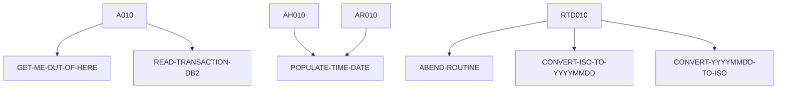

# INQTRAND — source of truth

> Generated by `.github/skills/cobol-rekt/run-cobol-rekt.sh`. Do not edit by hand — re-run the script.
> **[rekt]** = from the cobol-rekt parse tree · **[scan]** = deterministic scan of the original source.

| | |
|---|---|
| Source | `src/base/cics/cobol/INQTRAND.cbl` (437 lines) |
| Subsystem | `cics` |
| cobol-rekt | ✅ parsed |
| Sections / paragraphs [scan] | 24 |
| Decisions (IF / EVALUATE) [rekt] | 5 |
| EXEC CICS / EXEC SQL / DL/I calls [scan] | 12 / 4 / 0 |

## 1. Procedure structure

Control transfers inside the program [rekt]. Solid = `PERFORM`, dashed = `GO TO`.

| Section / paragraph | Lines | PERFORMs [rekt] | GO TO [rekt] | Decisions [rekt] | EXEC CICS | EXEC SQL |
|---|---|---|---|---|---|---|
| **PREMIERE** (section) | 143–143 | — | — | 0 | — | — |
| A010 | 144–175 | GET-ME-OUT-OF-HERE, READ-TRANSACTION-DB2 | — | 1 | 1 | — |
| A999 | 176–179 | — | — | 0 | — | — |
| **READ-TRANSACTION-DB2** (section) | 180–180 | — | — | 0 | — | — |
| RTD010 | 181–281 | ABEND-ROUTINE, CONVERT-ISO-TO-YYYYMMDD, CONVERT-YYYYMMDD-TO-ISO | — | 4 | — | 3 |
| RTD999 | 282–285 | — | — | 0 | — | — |
| **GET-ME-OUT-OF-HERE** (section) | 286–286 | — | — | 0 | — | — |
| GMOFH010 | 287–291 | — | — | 0 | 1 | — |
| GMOFH999 | 292–295 | — | — | 0 | — | — |
| **ABEND-ROUTINE** (section) | 296–296 | — | — | 0 | — | — |
| AR010 | 297–342 | POPULATE-TIME-DATE | — | 0 | 4 | — |
| AR999 | 343–346 | — | — | 0 | — | — |
| **ABEND-HANDLING** (section) | 347–347 | — | — | 0 | — | — |
| AH010 | 348–388 | POPULATE-TIME-DATE | — | 0 | 4 | — |
| AH999 | 389–392 | — | — | 0 | — | — |
| **POPULATE-TIME-DATE** (section) | 393–393 | — | — | 0 | — | — |
| PTD010 | 394–406 | — | — | 0 | 2 | — |
| PTD999 | 407–409 | — | — | 0 | — | — |
| **CONVERT-YYYYMMDD-TO-ISO** (section) | 410–410 | — | — | 0 | — | — |
| CYI010 | 411–420 | — | — | 0 | — | — |
| CYI999 | 421–424 | — | — | 0 | — | — |
| **CONVERT-ISO-TO-YYYYMMDD** (section) | 425–425 | — | — | 0 | — | — |
| CIY010 | 426–433 | — | — | 0 | — | — |
| CIY999 | 434–437 | — | — | 0 | — | — |

## 2. Decision points

Every `IF` / `EVALUATE` found by cobol-rekt, in source order. Condition text is quoted from the original source line. These are where business rules live.

**A010**

- `src/base/cics/cobol/INQTRAND.cbl:156` `IF NOT INQTRAND-EYE-VALID`

**RTD010**

- `src/base/cics/cobol/INQTRAND.cbl:203` `IF SQLCODE NOT = 0`
- `src/base/cics/cobol/INQTRAND.cbl:223` `IF SQLCODE = 0`
  - `src/base/cics/cobol/INQTRAND.cbl:256` `IF SQLCODE = 100`
- `src/base/cics/cobol/INQTRAND.cbl:277` `IF SQLCODE NOT = 0`

## 3. External touchpoints [scan]

Every `EXEC CICS`, `EXEC SQL` and IMS DL/I call, as written in the original source.

| Line | Paragraph | Kind | Verb | Statement |
|---|---|---|---|---|
| `src/base/cics/cobol/INQTRAND.cbl:64` | (data division) | EXEC SQL | `DECLARE` | `DECLARE TRAND-CURSOR CURSOR FOR SELECT PROCTRAN_EYECATCHER, PROCTRAN_SORTCODE, PROCTRAN_NUMBER, PROCTRAN_DATE…` |
| `src/base/cics/cobol/INQTRAND.cbl:149` | A010 | EXEC CICS | `HANDLE ABEND` | `HANDLE ABEND LABEL(ABEND-HANDLING)` |
| `src/base/cics/cobol/INQTRAND.cbl:200` | RTD010 | EXEC SQL | `OPEN` | `OPEN TRAND-CURSOR` |
| `src/base/cics/cobol/INQTRAND.cbl:211` | RTD010 | EXEC SQL | `FETCH` | `FETCH TRAND-CURSOR INTO :HV-PROCTRAN-EYECATCHER, :HV-PROCTRAN-SORTCODE, :HV-PROCTRAN-NUMBER, :HV-PROCTRAN-DAT…` |
| `src/base/cics/cobol/INQTRAND.cbl:274` | RTD010 | EXEC SQL | `CLOSE` | `CLOSE TRAND-CURSOR` |
| `src/base/cics/cobol/INQTRAND.cbl:289` | GMOFH010 | EXEC CICS | `RETURN` | `RETURN` |
| `src/base/cics/cobol/INQTRAND.cbl:303` | AR010 | EXEC CICS | `ASSIGN` | `ASSIGN APPLID(ABND-APPLID)` |
| `src/base/cics/cobol/INQTRAND.cbl:323` | AR010 | EXEC CICS | `ASSIGN` | `ASSIGN PROGRAM(ABND-PROGRAM)` |
| `src/base/cics/cobol/INQTRAND.cbl:334` | AR010 | EXEC CICS | `LINK` | `LINK PROGRAM(WS-ABEND-PGM) COMMAREA(ABNDINFO-REC)` |
| `src/base/cics/cobol/INQTRAND.cbl:338` | AR010 | EXEC CICS | `ABEND` | `ABEND ABCODE('ITRD') CANCEL NODUMP` |
| `src/base/cics/cobol/INQTRAND.cbl:354` | AH010 | EXEC CICS | `ASSIGN` | `ASSIGN APPLID(ABND-APPLID)` |
| `src/base/cics/cobol/INQTRAND.cbl:374` | AH010 | EXEC CICS | `ASSIGN` | `ASSIGN PROGRAM(ABND-PROGRAM)` |
| `src/base/cics/cobol/INQTRAND.cbl:382` | AH010 | EXEC CICS | `LINK` | `LINK PROGRAM(WS-ABEND-PGM) COMMAREA(ABNDINFO-REC)` |
| `src/base/cics/cobol/INQTRAND.cbl:386` | AH010 | EXEC CICS | `RETURN` | `RETURN` |
| `src/base/cics/cobol/INQTRAND.cbl:396` | PTD010 | EXEC CICS | `ASKTIME` | `ASKTIME ABSTIME(WS-U-TIME)` |
| `src/base/cics/cobol/INQTRAND.cbl:400` | PTD010 | EXEC CICS | `FORMATTIME` | `FORMATTIME ABSTIME(WS-U-TIME) DDMMYYYY(WS-ORIG-DATE) TIME(WS-TIME-NOW) DATESEP('/')` |

## 4. Dependencies [scan]

**Program / transaction transfers**

Lines refer to `src/base/cics/cobol/INQTRAND.cbl`.

| Kind | Target(s) | Resolved via | Lines · paragraph |
|---|---|---|---|
| LINK | `ABNDPROC` | variable `WS-ABEND-PGM` (VALUE clause) | `:334` AR010, `:382` AH010 |

**Copybooks**

- `SORTCODE` (`src/base/cics/cobol/INQTRAND.cbl:39`) → `src/base/cics/copy/SORTCODE.cpy`
- `PROCDB2` (`src/base/cics/cobol/INQTRAND.cbl:42`) → `src/base/cics/copy/PROCDB2.cpy`
- `SQLCA` (`src/base/cics/cobol/INQTRAND.cbl:59`) → DB2 precompiler member (not in repo)
- `ABNDINFO` (`src/base/cics/cobol/INQTRAND.cbl:93`) → `src/base/cics/copy/ABNDINFO.cpy`
- `INQTRAND` (`src/base/cics/cobol/INQTRAND.cbl:139`) → `src/base/cics/copy/INQTRAND.cpy`

## 5. Condition names (88-levels) [scan]

Named conditions encode business codes. Includes copybooks reached from this program.

| Condition | Value(s) | Parent item | Defined at |
|---|---|---|---|
| `INQTRAND-EYE-VALID` | `'ITRD'` | INQTRAND-EYE | `src/base/cics/copy/INQTRAND.cpy:13` |
| `INQTRAND-SUCCESS-TRUE` | `'Y'` | INQTRAND-SUCCESS | `src/base/cics/copy/INQTRAND.cpy:24` |
| `INQTRAND-SUCCESS-FALSE` | `'N'` | INQTRAND-SUCCESS | `src/base/cics/copy/INQTRAND.cpy:25` |
| `INQTRAND-FOUND-TRUE` | `'Y'` | INQTRAND-FOUND | `src/base/cics/copy/INQTRAND.cpy:27` |
| `INQTRAND-FOUND-FALSE` | `'N'` | INQTRAND-FOUND | `src/base/cics/copy/INQTRAND.cpy:28` |

## 6. Data items [rekt]

**Records (01 / 77 levels)**

| Name | Clause | Fields | Section | Defined at |
|---|---|---|---|---|
| `HOST-PROCTRAN-ROW` | `(group)` | 9 | WORKING_STORAGE | `src/base/cics/cobol/INQTRAND.cbl:47` |
| `WS-CICS-WORK-AREA` | `(group)` | 2 | WORKING_STORAGE | `src/base/cics/cobol/INQTRAND.cbl:83` |
| `SQLCODE-DISPLAY` | `PIC S9(8) DISPLAY SIGN LEADING SEPARATE` | — | WORKING_STORAGE | `src/base/cics/cobol/INQTRAND.cbl:87` |
| `WS-ABEND-PGM` | `PIC X(8) VALUE 'ABNDPROC'` | — | WORKING_STORAGE | `src/base/cics/cobol/INQTRAND.cbl:90` |
| `ABNDINFO-REC` | `(group)` | 13 | WORKING_STORAGE | `src/base/cics/cobol/INQTRAND.cbl:92` |
| `WS-U-TIME` | `PIC S9(15) COMP-3` | — | WORKING_STORAGE | `src/base/cics/cobol/INQTRAND.cbl:95` |
| `WS-ORIG-DATE` | `PIC X(10)` | — | WORKING_STORAGE | `src/base/cics/cobol/INQTRAND.cbl:96` |
| `WS-ORIG-DATE-GRP` | `REDEFINES WS-ORIG-DATE` REDEFINES WS-ORIG-DATE | 5 | WORKING_STORAGE | `src/base/cics/cobol/INQTRAND.cbl:97` |
| `WS-TIME-DATA` | `(group)` | 5 | WORKING_STORAGE | `src/base/cics/cobol/INQTRAND.cbl:104` |
| `WS-TRAN-ID-PARTS` | `(group)` | 9 | WORKING_STORAGE | `src/base/cics/cobol/INQTRAND.cbl:112` |
| `WS-DATE-WORK` | `(group)` | 12 | WORKING_STORAGE | `src/base/cics/cobol/INQTRAND.cbl:124` |
| `DFHCOMMAREA` | `(group)` | 25 | LINKAGE | — |

**LINKAGE SECTION — the program's interface contract (COMMAREA / parameters)**

| Level | Name | Clause | Type | Defined at |
|---|---|---|---|---|
| 01 | DFHCOMMAREA | `(group)` | OBJECT | — |
| 03 | &nbsp;&nbsp;INQTRAND-EYE | `PIC X(4)` | STRING | `src/base/cics/copy/INQTRAND.cpy:12` |
| 03 | &nbsp;&nbsp;INQTRAND-SORTCODE | `PIC 9(6)` | NUMBER | `src/base/cics/copy/INQTRAND.cpy:16` |
| 03 | &nbsp;&nbsp;INQTRAND-ACCNO | `PIC 9(8)` | NUMBER | `src/base/cics/copy/INQTRAND.cpy:17` |
| 03 | &nbsp;&nbsp;INQTRAND-DATE | `PIC 9(8)` | NUMBER | `src/base/cics/copy/INQTRAND.cpy:18` |
| 03 | &nbsp;&nbsp;INQTRAND-TIME | `PIC 9(6)` | NUMBER | `src/base/cics/copy/INQTRAND.cpy:19` |
| 03 | &nbsp;&nbsp;INQTRAND-REF | `PIC 9(12)` | NUMBER | `src/base/cics/copy/INQTRAND.cpy:20` |
| 03 | &nbsp;&nbsp;INQTRAND-SUCCESS | `PIC X` | STRING | `src/base/cics/copy/INQTRAND.cpy:23` |
| 03 | &nbsp;&nbsp;INQTRAND-FOUND | `PIC X` | STRING | `src/base/cics/copy/INQTRAND.cpy:26` |
| 03 | &nbsp;&nbsp;INQTRAND-TRAN-ID | `PIC X(50)` | STRING | `src/base/cics/copy/INQTRAND.cpy:31` |
| 03 | &nbsp;&nbsp;INQTRAND-TRAN-SORTCODE | `PIC 9(6)` | NUMBER | `src/base/cics/copy/INQTRAND.cpy:32` |
| 03 | &nbsp;&nbsp;INQTRAND-TRAN-ACCNO | `PIC 9(8)` | NUMBER | `src/base/cics/copy/INQTRAND.cpy:33` |
| 03 | &nbsp;&nbsp;INQTRAND-TRAN-DATE | `PIC 9(8)` | NUMBER | `src/base/cics/copy/INQTRAND.cpy:34` |
| 03 | &nbsp;&nbsp;INQTRAND-TRAN-DATE-GRP | `REDEFINES INQTRAND-TRAN-DATE` REDEFINES INQTRAND-TRAN-DATE | OBJECT | `src/base/cics/copy/INQTRAND.cpy:35` |
| 05 | &nbsp;&nbsp;&nbsp;&nbsp;INQTRAND-TRAN-DATE-YYYY | `PIC 9999` | NUMBER | `src/base/cics/copy/INQTRAND.cpy:36` |
| 05 | &nbsp;&nbsp;&nbsp;&nbsp;INQTRAND-TRAN-DATE-MM | `PIC 99` | NUMBER | `src/base/cics/copy/INQTRAND.cpy:37` |
| 05 | &nbsp;&nbsp;&nbsp;&nbsp;INQTRAND-TRAN-DATE-DD | `PIC 99` | NUMBER | `src/base/cics/copy/INQTRAND.cpy:38` |
| 03 | &nbsp;&nbsp;INQTRAND-TRAN-TIME | `PIC 9(6)` | NUMBER | `src/base/cics/copy/INQTRAND.cpy:39` |
| 03 | &nbsp;&nbsp;INQTRAND-TRAN-TIME-GRP | `REDEFINES INQTRAND-TRAN-TIME` REDEFINES INQTRAND-TRAN-TIME | OBJECT | `src/base/cics/copy/INQTRAND.cpy:40` |
| 05 | &nbsp;&nbsp;&nbsp;&nbsp;INQTRAND-TRAN-TIME-HH | `PIC 99` | NUMBER | `src/base/cics/copy/INQTRAND.cpy:41` |
| 05 | &nbsp;&nbsp;&nbsp;&nbsp;INQTRAND-TRAN-TIME-MM | `PIC 99` | NUMBER | `src/base/cics/copy/INQTRAND.cpy:42` |
| 05 | &nbsp;&nbsp;&nbsp;&nbsp;INQTRAND-TRAN-TIME-SS | `PIC 99` | NUMBER | `src/base/cics/copy/INQTRAND.cpy:43` |
| 03 | &nbsp;&nbsp;INQTRAND-TRAN-REF | `PIC 9(12)` | NUMBER | `src/base/cics/copy/INQTRAND.cpy:44` |
| 03 | &nbsp;&nbsp;INQTRAND-TRAN-TYPE | `PIC X(3)` | STRING | `src/base/cics/copy/INQTRAND.cpy:45` |
| 03 | &nbsp;&nbsp;INQTRAND-TRAN-DESC | `PIC X(40)` | STRING | `src/base/cics/copy/INQTRAND.cpy:46` |
| 03 | &nbsp;&nbsp;INQTRAND-TRAN-AMOUNT | `PIC S9(10)V99` | NUMBER | `src/base/cics/copy/INQTRAND.cpy:47` |

_Working-storage fields below the 01 level are not listed — open the definition to drill in._
