# INQTRANL — source of truth

> Generated by `.github/skills/cobol-rekt/run-cobol-rekt.sh`. Do not edit by hand — re-run the script.
> **[rekt]** = from the cobol-rekt parse tree · **[scan]** = deterministic scan of the original source.

| | |
|---|---|
| Source | `src/base/cics/cobol/INQTRANL.cbl` (660 lines) |
| Subsystem | `cics` |
| cobol-rekt | ✅ parsed |
| Sections / paragraphs [scan] | 30 |
| Decisions (IF / EVALUATE) [rekt] | 13 |
| EXEC CICS / EXEC SQL / DL/I calls [scan] | 12 / 8 / 0 |

## 1. Procedure structure

Control transfers inside the program [rekt]. Solid = `PERFORM`, dashed = `GO TO`.

```mermaid
flowchart TD
  n_A010["A010"]
  n_ABEND_ROUTINE["ABEND-ROUTINE"]
  n_AH010["AH010"]
  n_AR010["AR010"]
  n_CONVERT_ISO_TO_YYYYMMDD["CONVERT-ISO-TO-YYYYMMDD"]
  n_CONVERT_YYYYMMDD_TO_ISO["CONVERT-YYYYMMDD-TO-ISO"]
  n_FETCH_TRANSACTION_DATA["FETCH-TRANSACTION-DATA"]
  n_FTD010["FTD010"]
  n_GET_ME_OUT_OF_HERE["GET-ME-OUT-OF-HERE"]
  n_GET_TOTAL_COUNT["GET-TOTAL-COUNT"]
  n_GTC010["GTC010"]
  n_POPULATE_TIME_DATE["POPULATE-TIME-DATE"]
  n_READ_TRANSACTIONS_DB2["READ-TRANSACTIONS-DB2"]
  n_RTD010["RTD010"]
  n_A010 --> n_GET_ME_OUT_OF_HERE
  n_A010 --> n_GET_TOTAL_COUNT
  n_A010 --> n_READ_TRANSACTIONS_DB2
  n_AH010 --> n_POPULATE_TIME_DATE
  n_AR010 --> n_POPULATE_TIME_DATE
  n_FTD010 --> n_ABEND_ROUTINE
  n_FTD010 --> n_CONVERT_ISO_TO_YYYYMMDD
  n_GTC010 --> n_ABEND_ROUTINE
  n_GTC010 --> n_CONVERT_YYYYMMDD_TO_ISO
  n_RTD010 --> n_ABEND_ROUTINE
  n_RTD010 --> n_CONVERT_YYYYMMDD_TO_ISO
  n_RTD010 --> n_FETCH_TRANSACTION_DATA
```

| Section / paragraph | Lines | PERFORMs [rekt] | GO TO [rekt] | Decisions [rekt] | EXEC CICS | EXEC SQL |
|---|---|---|---|---|---|---|
| **PREMIERE** (section) | 174–174 | — | — | 0 | — | — |
| A010 | 175–264 | GET-ME-OUT-OF-HERE, GET-TOTAL-COUNT, READ-TRANSACTIONS-DB2 | — | 5 | 1 | — |
| A999 | 265–268 | — | — | 0 | — | — |
| **GET-TOTAL-COUNT** (section) | 269–269 | — | — | 0 | — | — |
| GTC010 | 270–348 | ABEND-ROUTINE, CONVERT-YYYYMMDD-TO-ISO | — | 3 | — | 3 |
| GTC999 | 349–352 | — | — | 0 | — | — |
| **READ-TRANSACTIONS-DB2** (section) | 353–353 | — | — | 0 | — | — |
| RTD010 | 354–421 | ABEND-ROUTINE, CONVERT-YYYYMMDD-TO-ISO, FETCH-TRANSACTION-DATA | — | 2 | — | 2 |
| RTD999 | 422–425 | — | — | 0 | — | — |
| **FETCH-TRANSACTION-DATA** (section) | 426–426 | — | — | 0 | — | — |
| FTD010 | 427–504 | ABEND-ROUTINE, CONVERT-ISO-TO-YYYYMMDD | — | 3 | — | 1 |
| FTD999 | 505–508 | — | — | 0 | — | — |
| **GET-ME-OUT-OF-HERE** (section) | 509–509 | — | — | 0 | — | — |
| GMOFH010 | 510–514 | — | — | 0 | 1 | — |
| GMOFH999 | 515–518 | — | — | 0 | — | — |
| **ABEND-ROUTINE** (section) | 519–519 | — | — | 0 | — | — |
| AR010 | 520–565 | POPULATE-TIME-DATE | — | 0 | 4 | — |
| AR999 | 566–569 | — | — | 0 | — | — |
| **ABEND-HANDLING** (section) | 570–570 | — | — | 0 | — | — |
| AH010 | 571–611 | POPULATE-TIME-DATE | — | 0 | 4 | — |
| AH999 | 612–615 | — | — | 0 | — | — |
| **POPULATE-TIME-DATE** (section) | 616–616 | — | — | 0 | — | — |
| PTD010 | 617–629 | — | — | 0 | 2 | — |
| PTD999 | 630–632 | — | — | 0 | — | — |
| **CONVERT-YYYYMMDD-TO-ISO** (section) | 633–633 | — | — | 0 | — | — |
| CYI010 | 634–643 | — | — | 0 | — | — |
| CYI999 | 644–647 | — | — | 0 | — | — |
| **CONVERT-ISO-TO-YYYYMMDD** (section) | 648–648 | — | — | 0 | — | — |
| CIY010 | 649–656 | — | — | 0 | — | — |
| CIY999 | 657–660 | — | — | 0 | — | — |

## 2. Decision points

Every `IF` / `EVALUATE` found by cobol-rekt, in source order. Condition text is quoted from the original source line. These are where business rules live.

**A010**

- `src/base/cics/cobol/INQTRANL.cbl:197` `IF NOT INQTRANL-EYE-VALID`
- `src/base/cics/cobol/INQTRANL.cbl:210` `IF INQTRANL-NO-FROM-DATE`
- `src/base/cics/cobol/INQTRANL.cbl:214` `IF INQTRANL-NO-TO-DATE`
- `src/base/cics/cobol/INQTRANL.cbl:218` `IF INQTRANL-LIMIT = 0`
- `src/base/cics/cobol/INQTRANL.cbl:225` `IF INQTRANL-LIMIT > 100`

**GTC010**

- `src/base/cics/cobol/INQTRANL.cbl:308` `IF SQLCODE NOT = 0`
- `src/base/cics/cobol/INQTRANL.cbl:325` `IF SQLCODE NOT = 0 AND SQLCODE NOT = 100`
- `src/base/cics/cobol/INQTRANL.cbl:341` `IF SQLCODE NOT = 0`

**RTD010**

- `src/base/cics/cobol/INQTRANL.cbl:391` `IF SQLCODE NOT = 0`
- `src/base/cics/cobol/INQTRANL.cbl:414` `IF SQLCODE NOT = 0`

**FTD010**

- `src/base/cics/cobol/INQTRANL.cbl:448` `IF SQLCODE = 0`
  - `src/base/cics/cobol/INQTRANL.cbl:454` `IF WS-SKIP-COUNT < HV-QUERY-OFFSET`
  - `src/base/cics/cobol/INQTRANL.cbl:497` `IF SQLCODE NOT = 100`

## 3. External touchpoints [scan]

Every `EXEC CICS`, `EXEC SQL` and IMS DL/I call, as written in the original source.

| Line | Paragraph | Kind | Verb | Statement |
|---|---|---|---|---|
| `src/base/cics/cobol/INQTRANL.cbl:74` | (data division) | EXEC SQL | `DECLARE` | `DECLARE TRAN-CURSOR CURSOR FOR SELECT PROCTRAN_EYECATCHER, PROCTRAN_SORTCODE, PROCTRAN_NUMBER, PROCTRAN_DATE,…` |
| `src/base/cics/cobol/INQTRANL.cbl:95` | (data division) | EXEC SQL | `DECLARE` | `DECLARE TRAN-COUNT-CURSOR CURSOR FOR SELECT COUNT(*) FROM PROCTRAN WHERE PROCTRAN_SORTCODE = :HV-QUERY-SORTCO…` |
| `src/base/cics/cobol/INQTRANL.cbl:188` | A010 | EXEC CICS | `HANDLE ABEND` | `HANDLE ABEND LABEL(ABEND-HANDLING)` |
| `src/base/cics/cobol/INQTRANL.cbl:302` | GTC010 | EXEC SQL | `OPEN` | `OPEN TRAN-COUNT-CURSOR` |
| `src/base/cics/cobol/INQTRANL.cbl:318` | GTC010 | EXEC SQL | `FETCH` | `FETCH TRAN-COUNT-CURSOR INTO :WS-TOTAL-COUNT` |
| `src/base/cics/cobol/INQTRANL.cbl:335` | GTC010 | EXEC SQL | `CLOSE` | `CLOSE TRAN-COUNT-CURSOR` |
| `src/base/cics/cobol/INQTRANL.cbl:385` | RTD010 | EXEC SQL | `OPEN` | `OPEN TRAN-CURSOR` |
| `src/base/cics/cobol/INQTRANL.cbl:408` | RTD010 | EXEC SQL | `CLOSE` | `CLOSE TRAN-CURSOR` |
| `src/base/cics/cobol/INQTRANL.cbl:436` | FTD010 | EXEC SQL | `FETCH` | `FETCH TRAN-CURSOR INTO :HV-PROCTRAN-EYECATCHER, :HV-PROCTRAN-SORTCODE, :HV-PROCTRAN-NUMBER, :HV-PROCTRAN-DATE…` |
| `src/base/cics/cobol/INQTRANL.cbl:512` | GMOFH010 | EXEC CICS | `RETURN` | `RETURN` |
| `src/base/cics/cobol/INQTRANL.cbl:526` | AR010 | EXEC CICS | `ASSIGN` | `ASSIGN APPLID(ABND-APPLID)` |
| `src/base/cics/cobol/INQTRANL.cbl:546` | AR010 | EXEC CICS | `ASSIGN` | `ASSIGN PROGRAM(ABND-PROGRAM)` |
| `src/base/cics/cobol/INQTRANL.cbl:557` | AR010 | EXEC CICS | `LINK` | `LINK PROGRAM(WS-ABEND-PGM) COMMAREA(ABNDINFO-REC)` |
| `src/base/cics/cobol/INQTRANL.cbl:561` | AR010 | EXEC CICS | `ABEND` | `ABEND ABCODE('ITRL') CANCEL NODUMP` |
| `src/base/cics/cobol/INQTRANL.cbl:577` | AH010 | EXEC CICS | `ASSIGN` | `ASSIGN APPLID(ABND-APPLID)` |
| `src/base/cics/cobol/INQTRANL.cbl:597` | AH010 | EXEC CICS | `ASSIGN` | `ASSIGN PROGRAM(ABND-PROGRAM)` |
| `src/base/cics/cobol/INQTRANL.cbl:605` | AH010 | EXEC CICS | `LINK` | `LINK PROGRAM(WS-ABEND-PGM) COMMAREA(ABNDINFO-REC)` |
| `src/base/cics/cobol/INQTRANL.cbl:609` | AH010 | EXEC CICS | `RETURN` | `RETURN` |
| `src/base/cics/cobol/INQTRANL.cbl:619` | PTD010 | EXEC CICS | `ASKTIME` | `ASKTIME ABSTIME(WS-U-TIME)` |
| `src/base/cics/cobol/INQTRANL.cbl:623` | PTD010 | EXEC CICS | `FORMATTIME` | `FORMATTIME ABSTIME(WS-U-TIME) DDMMYYYY(WS-ORIG-DATE) TIME(WS-TIME-NOW) DATESEP('/')` |

## 4. Dependencies [scan]

**Program / transaction transfers**

Lines refer to `src/base/cics/cobol/INQTRANL.cbl`.

| Kind | Target(s) | Resolved via | Lines · paragraph |
|---|---|---|---|
| LINK | `ABNDPROC` | variable `WS-ABEND-PGM` (VALUE clause) | `:557` AR010, `:605` AH010 |

**Copybooks**

- `SORTCODE` (`src/base/cics/cobol/INQTRANL.cbl:40`) → `src/base/cics/copy/SORTCODE.cpy`
- `PROCDB2` (`src/base/cics/cobol/INQTRANL.cbl:43`) → `src/base/cics/copy/PROCDB2.cpy`
- `SQLCA` (`src/base/cics/cobol/INQTRANL.cbl:68`) → DB2 precompiler member (not in repo)
- `ABNDINFO` (`src/base/cics/cobol/INQTRANL.cbl:120`) → `src/base/cics/copy/ABNDINFO.cpy`
- `INQTRANL` (`src/base/cics/cobol/INQTRANL.cbl:170`) → `src/base/cics/copy/INQTRANL.cpy`

## 5. Condition names (88-levels) [scan]

Named conditions encode business codes. Includes copybooks reached from this program.

| Condition | Value(s) | Parent item | Defined at |
|---|---|---|---|
| `INQTRANL-EYE-VALID` | `'ITRL'` | INQTRANL-EYE | `src/base/cics/copy/INQTRANL.cpy:14` |
| `INQTRANL-NO-FROM-DATE` | `0` | INQTRANL-FROM-DATE | `src/base/cics/copy/INQTRANL.cpy:20` |
| `INQTRANL-NO-TO-DATE` | `99999999` | INQTRANL-TO-DATE | `src/base/cics/copy/INQTRANL.cpy:22` |
| `INQTRANL-DEFAULT-LIMIT` | `50` | INQTRANL-LIMIT | `src/base/cics/copy/INQTRANL.cpy:24` |
| `INQTRANL-SUCCESS-TRUE` | `'Y'` | INQTRANL-SUCCESS | `src/base/cics/copy/INQTRANL.cpy:31` |
| `INQTRANL-SUCCESS-FALSE` | `'N'` | INQTRANL-SUCCESS | `src/base/cics/copy/INQTRANL.cpy:32` |

## 6. Data items [rekt]

**Records (01 / 77 levels)**

| Name | Clause | Fields | Section | Defined at |
|---|---|---|---|---|
| `HOST-PROCTRAN-ROW` | `(group)` | 9 | WORKING_STORAGE | `src/base/cics/cobol/INQTRANL.cbl:48` |
| `HV-QUERY-SORTCODE` | `PIC X(6)` | — | WORKING_STORAGE | `src/base/cics/cobol/INQTRANL.cbl:60` |
| `HV-QUERY-ACCNO` | `PIC X(8)` | — | WORKING_STORAGE | `src/base/cics/cobol/INQTRANL.cbl:61` |
| `HV-QUERY-FROM-DATE` | `PIC X(10)` | — | WORKING_STORAGE | `src/base/cics/cobol/INQTRANL.cbl:62` |
| `HV-QUERY-TO-DATE` | `PIC X(10)` | — | WORKING_STORAGE | `src/base/cics/cobol/INQTRANL.cbl:63` |
| `HV-QUERY-LIMIT` | `PIC S9(4) COMP` | — | WORKING_STORAGE | `src/base/cics/cobol/INQTRANL.cbl:64` |
| `HV-QUERY-OFFSET` | `PIC S9(8) COMP` | — | WORKING_STORAGE | `src/base/cics/cobol/INQTRANL.cbl:65` |
| `WS-CICS-WORK-AREA` | `(group)` | 2 | WORKING_STORAGE | `src/base/cics/cobol/INQTRANL.cbl:104` |
| `WS-TRANSACTION-COUNT` | `PIC S9(5) COMP VALUE 0` | — | WORKING_STORAGE | `src/base/cics/cobol/INQTRANL.cbl:108` |
| `WS-FETCH-COUNT` | `PIC S9(3) COMP VALUE 0` | — | WORKING_STORAGE | `src/base/cics/cobol/INQTRANL.cbl:109` |
| `WS-TOTAL-COUNT` | `PIC S9(5) COMP VALUE 0` | — | WORKING_STORAGE | `src/base/cics/cobol/INQTRANL.cbl:110` |
| `WS-SKIP-COUNT` | `PIC S9(8) COMP VALUE 0` | — | WORKING_STORAGE | `src/base/cics/cobol/INQTRANL.cbl:111` |
| `WS-ROW-COUNT` | `PIC S9(8) COMP VALUE 0` | — | WORKING_STORAGE | `src/base/cics/cobol/INQTRANL.cbl:112` |
| `SQLCODE-DISPLAY` | `PIC S9(8) DISPLAY SIGN LEADING SEPARATE` | — | WORKING_STORAGE | `src/base/cics/cobol/INQTRANL.cbl:114` |
| `WS-ABEND-PGM` | `PIC X(8) VALUE 'ABNDPROC'` | — | WORKING_STORAGE | `src/base/cics/cobol/INQTRANL.cbl:117` |
| `ABNDINFO-REC` | `(group)` | 13 | WORKING_STORAGE | `src/base/cics/cobol/INQTRANL.cbl:119` |
| `WS-U-TIME` | `PIC S9(15) COMP-3` | — | WORKING_STORAGE | `src/base/cics/cobol/INQTRANL.cbl:122` |
| `WS-ORIG-DATE` | `PIC X(10)` | — | WORKING_STORAGE | `src/base/cics/cobol/INQTRANL.cbl:123` |
| `WS-ORIG-DATE-GRP` | `REDEFINES WS-ORIG-DATE` REDEFINES WS-ORIG-DATE | 5 | WORKING_STORAGE | `src/base/cics/cobol/INQTRANL.cbl:124` |
| `WS-TIME-DATA` | `(group)` | 5 | WORKING_STORAGE | `src/base/cics/cobol/INQTRANL.cbl:131` |
| `WS-TRAN-ID-PARTS` | `(group)` | 9 | WORKING_STORAGE | `src/base/cics/cobol/INQTRANL.cbl:139` |
| `WS-DATE-WORK` | `(group)` | 12 | WORKING_STORAGE | `src/base/cics/cobol/INQTRANL.cbl:151` |
| `WS-SORTCODE-CHAR` | `PIC X(6)` | — | WORKING_STORAGE | `src/base/cics/cobol/INQTRANL.cbl:166` |
| `WS-ACCNO-CHAR` | `PIC X(8)` | — | WORKING_STORAGE | `src/base/cics/cobol/INQTRANL.cbl:167` |
| `DFHCOMMAREA` | `(group)` | 28 | LINKAGE | — |

**LINKAGE SECTION — the program's interface contract (COMMAREA / parameters)**

| Level | Name | Clause | Type | Defined at |
|---|---|---|---|---|
| 01 | DFHCOMMAREA | `(group)` | OBJECT | — |
| 03 | &nbsp;&nbsp;INQTRANL-EYE | `PIC X(4)` | STRING | `src/base/cics/copy/INQTRANL.cpy:13` |
| 03 | &nbsp;&nbsp;INQTRANL-SORTCODE | `PIC 9(6)` | NUMBER | `src/base/cics/copy/INQTRANL.cpy:17` |
| 03 | &nbsp;&nbsp;INQTRANL-ACCNO | `PIC 9(8)` | NUMBER | `src/base/cics/copy/INQTRANL.cpy:18` |
| 03 | &nbsp;&nbsp;INQTRANL-FROM-DATE | `PIC 9(8)` | NUMBER | `src/base/cics/copy/INQTRANL.cpy:19` |
| 03 | &nbsp;&nbsp;INQTRANL-TO-DATE | `PIC 9(8)` | NUMBER | `src/base/cics/copy/INQTRANL.cpy:21` |
| 03 | &nbsp;&nbsp;INQTRANL-LIMIT | `PIC 9(3)` | NUMBER | `src/base/cics/copy/INQTRANL.cpy:23` |
| 03 | &nbsp;&nbsp;INQTRANL-OFFSET | `PIC 9(5)` | NUMBER | `src/base/cics/copy/INQTRANL.cpy:25` |
| 03 | &nbsp;&nbsp;INQTRANL-TOTAL-COUNT | `PIC 9(5)` | NUMBER | `src/base/cics/copy/INQTRANL.cpy:28` |
| 03 | &nbsp;&nbsp;INQTRANL-RETURNED-COUNT | `PIC 9(3)` | NUMBER | `src/base/cics/copy/INQTRANL.cpy:29` |
| 03 | &nbsp;&nbsp;INQTRANL-SUCCESS | `PIC X` | STRING | `src/base/cics/copy/INQTRANL.cpy:30` |
| 03 | &nbsp;&nbsp;INQTRANL-TRANSACTIONS | `OCCURS 100 TIMES` | OBJECT | `src/base/cics/copy/INQTRANL.cpy:35` |
| 05 | &nbsp;&nbsp;&nbsp;&nbsp;INQTRANL-TRAN-ID | `PIC X(50)` | STRING | `src/base/cics/copy/INQTRANL.cpy:36` |
| 05 | &nbsp;&nbsp;&nbsp;&nbsp;INQTRANL-TRAN-SORTCODE | `PIC 9(6)` | NUMBER | `src/base/cics/copy/INQTRANL.cpy:37` |
| 05 | &nbsp;&nbsp;&nbsp;&nbsp;INQTRANL-TRAN-ACCNO | `PIC 9(8)` | NUMBER | `src/base/cics/copy/INQTRANL.cpy:38` |
| 05 | &nbsp;&nbsp;&nbsp;&nbsp;INQTRANL-TRAN-DATE | `PIC 9(8)` | NUMBER | `src/base/cics/copy/INQTRANL.cpy:39` |
| 05 | &nbsp;&nbsp;&nbsp;&nbsp;INQTRANL-TRAN-DATE-GRP | `REDEFINES INQTRANL-TRAN-DATE` REDEFINES INQTRANL-TRAN-DATE | OBJECT | `src/base/cics/copy/INQTRANL.cpy:40` |
| 07 | &nbsp;&nbsp;&nbsp;&nbsp;&nbsp;&nbsp;INQTRANL-TRAN-DATE-YYYY | `PIC 9999` | NUMBER | `src/base/cics/copy/INQTRANL.cpy:41` |
| 07 | &nbsp;&nbsp;&nbsp;&nbsp;&nbsp;&nbsp;INQTRANL-TRAN-DATE-MM | `PIC 99` | NUMBER | `src/base/cics/copy/INQTRANL.cpy:42` |
| 07 | &nbsp;&nbsp;&nbsp;&nbsp;&nbsp;&nbsp;INQTRANL-TRAN-DATE-DD | `PIC 99` | NUMBER | `src/base/cics/copy/INQTRANL.cpy:43` |
| 05 | &nbsp;&nbsp;&nbsp;&nbsp;INQTRANL-TRAN-TIME | `PIC 9(6)` | NUMBER | `src/base/cics/copy/INQTRANL.cpy:44` |
| 05 | &nbsp;&nbsp;&nbsp;&nbsp;INQTRANL-TRAN-TIME-GRP | `REDEFINES INQTRANL-TRAN-TIME` REDEFINES INQTRANL-TRAN-TIME | OBJECT | `src/base/cics/copy/INQTRANL.cpy:45` |
| 07 | &nbsp;&nbsp;&nbsp;&nbsp;&nbsp;&nbsp;INQTRANL-TRAN-TIME-HH | `PIC 99` | NUMBER | `src/base/cics/copy/INQTRANL.cpy:46` |
| 07 | &nbsp;&nbsp;&nbsp;&nbsp;&nbsp;&nbsp;INQTRANL-TRAN-TIME-MM | `PIC 99` | NUMBER | `src/base/cics/copy/INQTRANL.cpy:47` |
| 07 | &nbsp;&nbsp;&nbsp;&nbsp;&nbsp;&nbsp;INQTRANL-TRAN-TIME-SS | `PIC 99` | NUMBER | `src/base/cics/copy/INQTRANL.cpy:48` |
| 05 | &nbsp;&nbsp;&nbsp;&nbsp;INQTRANL-TRAN-REF | `PIC 9(12)` | NUMBER | `src/base/cics/copy/INQTRANL.cpy:49` |
| 05 | &nbsp;&nbsp;&nbsp;&nbsp;INQTRANL-TRAN-TYPE | `PIC X(3)` | STRING | `src/base/cics/copy/INQTRANL.cpy:50` |
| 05 | &nbsp;&nbsp;&nbsp;&nbsp;INQTRANL-TRAN-DESC | `PIC X(40)` | STRING | `src/base/cics/copy/INQTRANL.cpy:51` |
| 05 | &nbsp;&nbsp;&nbsp;&nbsp;INQTRANL-TRAN-AMOUNT | `PIC S9(10)V99` | NUMBER | `src/base/cics/copy/INQTRANL.cpy:52` |

_Working-storage fields below the 01 level are not listed — open the definition to drill in._
