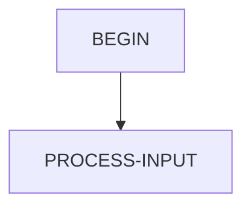

# LOADACCT — source of truth

> Generated by `.github/skills/cobol-rekt/run-cobol-rekt.sh`. Do not edit by hand — re-run the script.
> **[rekt]** = from the cobol-rekt parse tree · **[scan]** = deterministic scan of the original source.

| | |
|---|---|
| Source | `src/base/ims/cobol/LOADACCT.cbl` (185 lines) |
| Subsystem | `ims` |
| cobol-rekt | ✅ parsed |
| Sections / paragraphs [scan] | 3 |
| Decisions (IF / EVALUATE) [rekt] | 3 |
| EXEC CICS / EXEC SQL / DL/I calls [scan] | 0 / 0 / 1 |

## 1. Procedure structure

Control transfers inside the program [rekt]. Solid = `PERFORM`, dashed = `GO TO`.

| Section / paragraph | Lines | PERFORMs [rekt] | GO TO [rekt] | Decisions [rekt] | EXEC CICS | EXEC SQL |
|---|---|---|---|---|---|---|
| BEGIN | 117–137 | PROCESS-INPUT (loop) | — | 0 | — | — |
| PROCESS-INPUT | 138–184 | — | — | 3 | — | — |
| PROCESS-INPUT-END | 185–185 | — | — | 0 | — | — |

## 2. Decision points

Every `IF` / `EVALUATE` found by cobol-rekt, in source order. Condition text is quoted from the original source line. These are where business rules live.

**PROCESS-INPUT**

- `src/base/ims/cobol/LOADACCT.cbl:161` `IF DBSTAT NOT = SPACES`
- `src/base/ims/cobol/LOADACCT.cbl:179` `IF FUNCTION MOD (INPUT-RECORDS 1000) = 0`
- `src/base/ims/cobol/LOADACCT.cbl:182` `IF INPUT-RECORDS = 1`

## 3. External touchpoints [scan]

Every `EXEC CICS`, `EXEC SQL` and IMS DL/I call, as written in the original source.

| Line | Paragraph | Kind | Verb | Statement |
|---|---|---|---|---|
| `src/base/ims/cobol/LOADACCT.cbl:159` | PROCESS-INPUT | IMS DL/I | `CALL "CBLTDLI"` | `CALL "CBLTDLI" USING ISRT, DBPCB, ACCOUNT-SEG, ACCOUNT-SSA.` |

## 4. Dependencies [scan]

**Program / transaction transfers**

Lines refer to `src/base/ims/cobol/LOADACCT.cbl`.

| Kind | Target(s) | Resolved via | Lines · paragraph |
|---|---|---|---|
| CALL | `CBLTDLI` | literal | `:159` PROCESS-INPUT |

**Copybooks**

## 5. Condition names (88-levels) [scan]

Named conditions encode business codes. Includes copybooks reached from this program.

_None found._

## 6. Data items [rekt]

**Records (01 / 77 levels)**

| Name | Clause | Fields | Section | Defined at |
|---|---|---|---|---|
| `BAD-STATUS` | `(group)` | 2 | WORKING_STORAGE | `src/base/ims/cobol/LOADACCT.cbl:41` |
| `ACCOUNT-SSA` | `(group)` | 2 | WORKING_STORAGE | `src/base/ims/cobol/LOADACCT.cbl:48` |
| `ACCOUNT-SEG` | `(group)` | 4 | WORKING_STORAGE | `src/base/ims/cobol/LOADACCT.cbl:52` |
| `TXT-ACCID` | `PIC X(19)` | — | WORKING_STORAGE | `src/base/ims/cobol/LOADACCT.cbl:58` |
| `TXT-ACCTYPE` | `PIC X(1)` | — | WORKING_STORAGE | `src/base/ims/cobol/LOADACCT.cbl:59` |
| `TXT-ACCTYPE-QUOTE` | `PIC X(3)` | — | WORKING_STORAGE | `src/base/ims/cobol/LOADACCT.cbl:60` |
| `TXT-BALANCE` | `PIC X(16)` | — | WORKING_STORAGE | `src/base/ims/cobol/LOADACCT.cbl:61` |
| `TXT-LASTTXID` | `PIC X(19)` | — | WORKING_STORAGE | `src/base/ims/cobol/LOADACCT.cbl:62` |
| `INPUT-RECORDS` | `PIC S9(9) COMP-5` | — | WORKING_STORAGE | `src/base/ims/cobol/LOADACCT.cbl:64` |
| `IOPCBA` | `POINTER` | — | LINKAGE | `src/base/ims/cobol/LOADACCT.cbl:69` |
| `DBPCB1` | `POINTER` | — | LINKAGE | `src/base/ims/cobol/LOADACCT.cbl:70` |
| `DBPCB2` | `POINTER` | — | LINKAGE | `src/base/ims/cobol/LOADACCT.cbl:71` |
| `DBPCB3` | `POINTER` | — | LINKAGE | `src/base/ims/cobol/LOADACCT.cbl:72` |
| `DBPCB4` | `POINTER` | — | LINKAGE | `src/base/ims/cobol/LOADACCT.cbl:73` |
| `DBPCB5` | `POINTER` | — | LINKAGE | `src/base/ims/cobol/LOADACCT.cbl:74` |
| `DBPCB6` | `POINTER` | — | LINKAGE | `src/base/ims/cobol/LOADACCT.cbl:75` |
| `DBPCB7` | `POINTER` | — | LINKAGE | `src/base/ims/cobol/LOADACCT.cbl:76` |
| `DBPCB8` | `POINTER` | — | LINKAGE | `src/base/ims/cobol/LOADACCT.cbl:77` |
| `DBPCB9` | `POINTER` | — | LINKAGE | `src/base/ims/cobol/LOADACCT.cbl:78` |
| `LTERMPCB` | `(group)` | 8 | LINKAGE | `src/base/ims/cobol/LOADACCT.cbl:84` |
| `DBPCB` | `(group)` | 12 | LINKAGE | `src/base/ims/cobol/LOADACCT.cbl:98` |
| `ACCTIN-IN` | `PIC X(200)` | — | FILE_DESCRIPTOR | `src/base/ims/cobol/LOADACCT.cbl:27` |

**LINKAGE SECTION — the program's interface contract (COMMAREA / parameters)**

| Level | Name | Clause | Type | Defined at |
|---|---|---|---|---|
| 01 | IOPCBA | `POINTER` | POINTER | `src/base/ims/cobol/LOADACCT.cbl:69` |
| 01 | DBPCB1 | `POINTER` | POINTER | `src/base/ims/cobol/LOADACCT.cbl:70` |
| 01 | DBPCB2 | `POINTER` | POINTER | `src/base/ims/cobol/LOADACCT.cbl:71` |
| 01 | DBPCB3 | `POINTER` | POINTER | `src/base/ims/cobol/LOADACCT.cbl:72` |
| 01 | DBPCB4 | `POINTER` | POINTER | `src/base/ims/cobol/LOADACCT.cbl:73` |
| 01 | DBPCB5 | `POINTER` | POINTER | `src/base/ims/cobol/LOADACCT.cbl:74` |
| 01 | DBPCB6 | `POINTER` | POINTER | `src/base/ims/cobol/LOADACCT.cbl:75` |
| 01 | DBPCB7 | `POINTER` | POINTER | `src/base/ims/cobol/LOADACCT.cbl:76` |
| 01 | DBPCB8 | `POINTER` | POINTER | `src/base/ims/cobol/LOADACCT.cbl:77` |
| 01 | DBPCB9 | `POINTER` | POINTER | `src/base/ims/cobol/LOADACCT.cbl:78` |
| 01 | LTERMPCB | `(group)` | OBJECT | `src/base/ims/cobol/LOADACCT.cbl:84` |
| 05 | &nbsp;&nbsp;LOGTTERM | `PIC X(08)` | STRING | `src/base/ims/cobol/LOADACCT.cbl:85` |
| 05 | &nbsp;&nbsp;FILLER | `PIC X(02)` | STRING | `src/base/ims/cobol/LOADACCT.cbl:49` |
| 05 | &nbsp;&nbsp;TPSTAT | `PIC X(02)` | STRING | `src/base/ims/cobol/LOADACCT.cbl:87` |
| 05 | &nbsp;&nbsp;IODATE | `PIC X(04)` | STRING | `src/base/ims/cobol/LOADACCT.cbl:88` |
| 05 | &nbsp;&nbsp;IOTIME | `PIC X(04)` | STRING | `src/base/ims/cobol/LOADACCT.cbl:89` |
| 05 | &nbsp;&nbsp;FILLER | `PIC X(02)` | STRING | `src/base/ims/cobol/LOADACCT.cbl:49` |
| 05 | &nbsp;&nbsp;SEQNUM | `PIC X(02)` | STRING | `src/base/ims/cobol/LOADACCT.cbl:91` |
| 05 | &nbsp;&nbsp;MOD | `PIC X(08)` | STRING | `src/base/ims/cobol/LOADACCT.cbl:92` |
| 01 | DBPCB | `(group)` | OBJECT | `src/base/ims/cobol/LOADACCT.cbl:98` |
| 05 | &nbsp;&nbsp;DBDNAME | `PIC X(08)` | STRING | `src/base/ims/cobol/LOADACCT.cbl:99` |
| 05 | &nbsp;&nbsp;SEGLEVEL | `PIC X(02)` | STRING | `src/base/ims/cobol/LOADACCT.cbl:100` |
| 05 | &nbsp;&nbsp;DBSTAT | `PIC X(02)` | STRING | `src/base/ims/cobol/LOADACCT.cbl:101` |
| 05 | &nbsp;&nbsp;PROCOPTS | `PIC X(04)` | STRING | `src/base/ims/cobol/LOADACCT.cbl:102` |
| 05 | &nbsp;&nbsp;FILLER | `PIC 9(08) COMP` | NUMBER | `src/base/ims/cobol/LOADACCT.cbl:49` |
| 05 | &nbsp;&nbsp;SEGNAMFB | `PIC X(08)` | STRING | `src/base/ims/cobol/LOADACCT.cbl:104` |
| 05 | &nbsp;&nbsp;LENKEY | `PIC 9(08) COMP` | NUMBER | `src/base/ims/cobol/LOADACCT.cbl:105` |
| 05 | &nbsp;&nbsp;SENSSSEGS | `PIC 9(08) COMP` | NUMBER | `src/base/ims/cobol/LOADACCT.cbl:106` |
| 05 | &nbsp;&nbsp;KEYFB | `PIC X(20)` | STRING | `src/base/ims/cobol/LOADACCT.cbl:107` |
| 05 | &nbsp;&nbsp;FILLER | `REDEFINES KEYFB` REDEFINES KEYFB | OBJECT | `src/base/ims/cobol/LOADACCT.cbl:49` |
| 07 | &nbsp;&nbsp;&nbsp;&nbsp;KEYFB1 | `PIC X(9)` | STRING | `src/base/ims/cobol/LOADACCT.cbl:109` |
| 07 | &nbsp;&nbsp;&nbsp;&nbsp;FILLER | `PIC X(11)` | STRING | `src/base/ims/cobol/LOADACCT.cbl:110` |

_Working-storage fields below the 01 level are not listed — open the definition to drill in._

**Not reported by cobol-rekt** — present in the source, so read them there [scan]:

- `ISRT` (WORKING-STORAGE) `src/base/ims/cobol/LOADACCT.cbl:35`
- `TERM-IO` (WORKING-STORAGE) `src/base/ims/cobol/LOADACCT.cbl:65`
