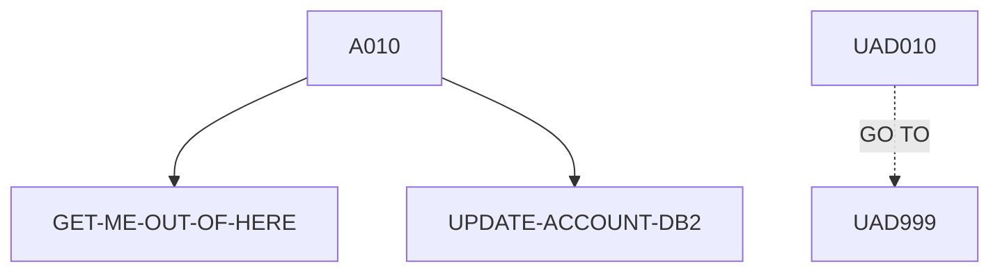

# UPDACC — source of truth

> Generated by `.github/skills/cobol-rekt/run-cobol-rekt.sh`. Do not edit by hand — re-run the script.
> **[rekt]** = from the cobol-rekt parse tree · **[scan]** = deterministic scan of the original source.

| | |
|---|---|
| Source | `src/base/cics/cobol/UPDACC.cbl` (406 lines) |
| Subsystem | `cics` |
| cobol-rekt | ✅ parsed |
| Sections / paragraphs [scan] | 12 |
| Decisions (IF / EVALUATE) [rekt] | 3 |
| EXEC CICS / EXEC SQL / DL/I calls [scan] | 3 / 2 / 0 |

## 1. Procedure structure

Control transfers inside the program [rekt]. Solid = `PERFORM`, dashed = `GO TO`.

| Section / paragraph | Lines | PERFORMs [rekt] | GO TO [rekt] | Decisions [rekt] | EXEC CICS | EXEC SQL |
|---|---|---|---|---|---|---|
| **PREMIERE** (section) | 158–158 | — | — | 0 | — | — |
| A010 | 159–175 | GET-ME-OUT-OF-HERE, UPDATE-ACCOUNT-DB2 | — | 0 | — | — |
| A999 | 176–179 | — | — | 0 | — | — |
| **UPDATE-ACCOUNT-DB2** (section) | 180–180 | — | — | 0 | — | — |
| UAD010 | 181–328 | — | UAD999 | 3 | — | 2 |
| UAD999 | 329–380 | — | — | 0 | — | — |
| **GET-ME-OUT-OF-HERE** (section) | 381–381 | — | — | 0 | — | — |
| GMOOH010 | 382–386 | — | — | 0 | 1 | — |
| GMOOH999 | 387–390 | — | — | 0 | — | — |
| **POPULATE-TIME-DATE** (section) | 391–391 | — | — | 0 | — | — |
| PTD010 | 392–404 | — | — | 0 | 2 | — |
| PTD999 | 405–406 | — | — | 0 | — | — |

## 2. Decision points

Every `IF` / `EVALUATE` found by cobol-rekt, in source order. Condition text is quoted from the original source line. These are where business rules live.

**UAD010**

- `src/base/cics/cobol/UPDACC.cbl:225` `IF SQLCODE NOT = 0`
- `src/base/cics/cobol/UPDACC.cbl:267` `IF (COMM-ACC-TYPE = SPACES OR COMM-ACC-TYPE(1:1) = ' ')`
- `src/base/cics/cobol/UPDACC.cbl:290` `IF SQLCODE NOT = 0`

## 3. External touchpoints [scan]

Every `EXEC CICS`, `EXEC SQL` and IMS DL/I call, as written in the original source.

| Line | Paragraph | Kind | Verb | Statement |
|---|---|---|---|---|
| `src/base/cics/cobol/UPDACC.cbl:191` | UAD010 | EXEC SQL | `SELECT` | `SELECT ACCOUNT_EYECATCHER, ACCOUNT_CUSTOMER_NUMBER, ACCOUNT_SORTCODE, ACCOUNT_NUMBER, ACCOUNT_TYPE, ACCOUNT_I…` |
| `src/base/cics/cobol/UPDACC.cbl:278` | UAD010 | EXEC SQL | `UPDATE` | `UPDATE ACCOUNT SET ACCOUNT_TYPE = :HV-ACCOUNT-ACC-TYPE, ACCOUNT_INTEREST_RATE = :HV-ACCOUNT-INT-RATE, ACCOUNT…` |
| `src/base/cics/cobol/UPDACC.cbl:384` | GMOOH010 | EXEC CICS | `RETURN` | `RETURN` |
| `src/base/cics/cobol/UPDACC.cbl:394` | PTD010 | EXEC CICS | `ASKTIME` | `ASKTIME ABSTIME(WS-U-TIME)` |
| `src/base/cics/cobol/UPDACC.cbl:398` | PTD010 | EXEC CICS | `FORMATTIME` | `FORMATTIME ABSTIME(WS-U-TIME) DDMMYYYY(WS-ORIG-DATE) TIME(WS-TIME-NOW) DATESEP` |

## 4. Dependencies [scan]

**Program / transaction transfers**

_None found._

**Copybooks**

- `SORTCODE` (`src/base/cics/cobol/UPDACC.cbl:49`) → `src/base/cics/copy/SORTCODE.cpy`
- `ACCDB2` (`src/base/cics/cobol/UPDACC.cbl:56`) → `src/base/cics/copy/ACCDB2.cpy`
- `SQLCA` (`src/base/cics/cobol/UPDACC.cbl:78`) → DB2 precompiler member (not in repo)
- `ACCOUNT` (`src/base/cics/cobol/UPDACC.cbl:100`) → `src/base/cics/copy/ACCOUNT.cpy`
- `ABNDINFO` (`src/base/cics/cobol/UPDACC.cbl:151`) → `src/base/cics/copy/ABNDINFO.cpy`
- `UPDACC` (`src/base/cics/cobol/UPDACC.cbl:155`) → `src/base/cics/copy/UPDACC.cpy`

## 5. Condition names (88-levels) [scan]

Named conditions encode business codes. Includes copybooks reached from this program.

| Condition | Value(s) | Parent item | Defined at |
|---|---|---|---|
| `ACCOUNT-EYECATCHER-VALUE` | `'ACCT'` | ACCOUNT-EYE-CATCHER | `src/base/cics/copy/ACCOUNT.cpy:9` |

## 6. Data items [rekt]

**Records (01 / 77 levels)**

| Name | Clause | Fields | Section | Defined at |
|---|---|---|---|---|
| `HOST-ACCOUNT-ROW` | `(group)` | 13 | WORKING_STORAGE | `src/base/cics/cobol/UPDACC.cbl:61` |
| `SQLCODE-DISPLAY` | `PIC S9(8) DISPLAY SIGN LEADING SEPARATE` | — | WORKING_STORAGE | `src/base/cics/cobol/UPDACC.cbl:82` |
| `WS-CICS-WORK-AREA` | `(group)` | 2 | WORKING_STORAGE | `src/base/cics/cobol/UPDACC.cbl:85` |
| `DFHCOMMAREA` | `(group)` | 25 | LINKAGE | `src/base/cics/cobol/UPDACC.cbl:154` |

**LINKAGE SECTION — the program's interface contract (COMMAREA / parameters)**

| Level | Name | Clause | Type | Defined at |
|---|---|---|---|---|
| 01 | DFHCOMMAREA | `(group)` | OBJECT | `src/base/cics/cobol/UPDACC.cbl:154` |
| 03 | &nbsp;&nbsp;COMM-EYE | `PIC X(4)` | STRING | `src/base/cics/copy/UPDACC.cpy:7` |
| 03 | &nbsp;&nbsp;COMM-CUSTNO | `PIC X(10)` | STRING | `src/base/cics/copy/UPDACC.cpy:8` |
| 03 | &nbsp;&nbsp;COMM-SCODE | `PIC X(6)` | STRING | `src/base/cics/copy/UPDACC.cpy:9` |
| 03 | &nbsp;&nbsp;COMM-ACCNO | `PIC 9(8)` | NUMBER | `src/base/cics/copy/UPDACC.cpy:10` |
| 03 | &nbsp;&nbsp;COMM-ACC-TYPE | `PIC X(8)` | STRING | `src/base/cics/copy/UPDACC.cpy:11` |
| 03 | &nbsp;&nbsp;COMM-INT-RATE | `PIC 9(4)V99` | NUMBER | `src/base/cics/copy/UPDACC.cpy:12` |
| 03 | &nbsp;&nbsp;COMM-OPENED | `PIC 9(8)` | NUMBER | `src/base/cics/copy/UPDACC.cpy:13` |
| 03 | &nbsp;&nbsp;COMM-OPENED-GROUP | `REDEFINES COMM-OPENED` REDEFINES COMM-OPENED | OBJECT | `src/base/cics/copy/UPDACC.cpy:14` |
| 05 | &nbsp;&nbsp;&nbsp;&nbsp;COMM-OPENED-DAY | `PIC 99` | NUMBER | `src/base/cics/copy/UPDACC.cpy:15` |
| 05 | &nbsp;&nbsp;&nbsp;&nbsp;COMM-OPENED-MONTH | `PIC 99` | NUMBER | `src/base/cics/copy/UPDACC.cpy:16` |
| 05 | &nbsp;&nbsp;&nbsp;&nbsp;COMM-OPENED-YEAR | `PIC 9999` | NUMBER | `src/base/cics/copy/UPDACC.cpy:17` |
| 03 | &nbsp;&nbsp;COMM-OVERDRAFT | `PIC 9(8)` | NUMBER | `src/base/cics/copy/UPDACC.cpy:18` |
| 03 | &nbsp;&nbsp;COMM-LAST-STMT-DT | `PIC 9(8)` | NUMBER | `src/base/cics/copy/UPDACC.cpy:19` |
| 03 | &nbsp;&nbsp;COMM-LAST-STMNT-GROUP | `REDEFINES COMM-LAST-STMT-DT` REDEFINES COMM-LAST-STMT-DT | OBJECT | `src/base/cics/copy/UPDACC.cpy:20` |
| 05 | &nbsp;&nbsp;&nbsp;&nbsp;COMM-LASTST-DAY | `PIC 99` | NUMBER | `src/base/cics/copy/UPDACC.cpy:21` |
| 05 | &nbsp;&nbsp;&nbsp;&nbsp;COMM-LASTST-MONTH | `PIC 99` | NUMBER | `src/base/cics/copy/UPDACC.cpy:22` |
| 05 | &nbsp;&nbsp;&nbsp;&nbsp;COMM-LASTST-YEAR | `PIC 9999` | NUMBER | `src/base/cics/copy/UPDACC.cpy:23` |
| 03 | &nbsp;&nbsp;COMM-NEXT-STMT-DT | `PIC 9(8)` | NUMBER | `src/base/cics/copy/UPDACC.cpy:24` |
| 03 | &nbsp;&nbsp;COMM-NEXT-STMNT-GROUP | `REDEFINES COMM-NEXT-STMT-DT` REDEFINES COMM-NEXT-STMT-DT | OBJECT | `src/base/cics/copy/UPDACC.cpy:25` |
| 05 | &nbsp;&nbsp;&nbsp;&nbsp;COMM-NEXTST-DAY | `PIC 99` | NUMBER | `src/base/cics/copy/UPDACC.cpy:26` |
| 05 | &nbsp;&nbsp;&nbsp;&nbsp;COMM-NEXTST-MONTH | `PIC 99` | NUMBER | `src/base/cics/copy/UPDACC.cpy:27` |
| 05 | &nbsp;&nbsp;&nbsp;&nbsp;COMM-NEXTST-YEAR | `PIC 9999` | NUMBER | `src/base/cics/copy/UPDACC.cpy:28` |
| 03 | &nbsp;&nbsp;COMM-AVAIL-BAL | `PIC S9(10)V99` | NUMBER | `src/base/cics/copy/UPDACC.cpy:29` |
| 03 | &nbsp;&nbsp;COMM-ACTUAL-BAL | `PIC S9(10)V99` | NUMBER | `src/base/cics/copy/UPDACC.cpy:30` |
| 03 | &nbsp;&nbsp;COMM-SUCCESS | `PIC X` | STRING | `src/base/cics/copy/UPDACC.cpy:31` |

_Working-storage fields below the 01 level are not listed — open the definition to drill in._

**Not reported by cobol-rekt** — present in the source, so read them there [scan]:

- `SYSIDERR-RETRY` (WORKING-STORAGE) `src/base/cics/cobol/UPDACC.cbl:53`
- `DB2-DATE-REFORMAT` (LOCAL-STORAGE) `src/base/cics/cobol/UPDACC.cbl:91`
- `WS-ACC-DATA` (LOCAL-STORAGE) `src/base/cics/cobol/UPDACC.cbl:99`
- `WS-EIBTASKN12` (LOCAL-STORAGE) `src/base/cics/cobol/UPDACC.cbl:102`
- `WS-SQLCODE-DISP` (LOCAL-STORAGE) `src/base/cics/cobol/UPDACC.cbl:103`
- `DESIRED-ACC-KEY` (LOCAL-STORAGE) `src/base/cics/cobol/UPDACC.cbl:108`
- `NEW-ACCOUNT-AVAILABLE-BALANCE` (LOCAL-STORAGE) `src/base/cics/cobol/UPDACC.cbl:112`
- `NEW-ACCOUNT-ACTUAL-BALANCE` (LOCAL-STORAGE) `src/base/cics/cobol/UPDACC.cbl:113`
- `WS-ACC-REC-LEN` (LOCAL-STORAGE) `src/base/cics/cobol/UPDACC.cbl:114`
- `WS-U-TIME` (LOCAL-STORAGE) `src/base/cics/cobol/UPDACC.cbl:117`
- `WS-ORIG-DATE` (LOCAL-STORAGE) `src/base/cics/cobol/UPDACC.cbl:118`
- `WS-ORIG-DATE-GRP` (LOCAL-STORAGE) `src/base/cics/cobol/UPDACC.cbl:119`
- `WS-ORIG-DATE-GRP-X` (LOCAL-STORAGE) `src/base/cics/cobol/UPDACC.cbl:126`
- `REJ-REASON` (LOCAL-STORAGE) `src/base/cics/cobol/UPDACC.cbl:133`
- `CUSTOMER-KY` (LOCAL-STORAGE) `src/base/cics/cobol/UPDACC.cbl:135`
- `STORM-DRAIN-CONDITION` (LOCAL-STORAGE) `src/base/cics/cobol/UPDACC.cbl:139`
- `WS-TIME-DATA` (LOCAL-STORAGE) `src/base/cics/cobol/UPDACC.cbl:141`
- `WS-ABEND-PGM` (LOCAL-STORAGE) `src/base/cics/cobol/UPDACC.cbl:148`
- `ABNDINFO-REC` (LOCAL-STORAGE) `src/base/cics/cobol/UPDACC.cbl:150`
