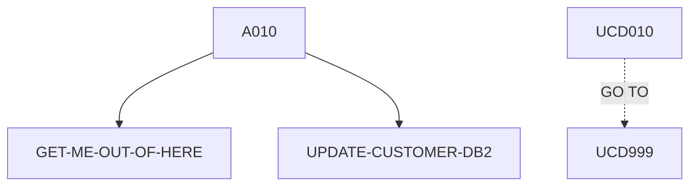

# UPDCUST — source of truth

> Generated by `.github/skills/cobol-rekt/run-cobol-rekt.sh`. Do not edit by hand — re-run the script.
> **[rekt]** = from the cobol-rekt parse tree · **[scan]** = deterministic scan of the original source.

| | |
|---|---|
| Source | `src/base/cics/cobol/UPDCUST.cbl` (457 lines) |
| Subsystem | `cics` |
| cobol-rekt | ✅ parsed |
| Sections / paragraphs [scan] | 12 |
| Decisions (IF / EVALUATE) [rekt] | 12 |
| EXEC CICS / EXEC SQL / DL/I calls [scan] | 3 / 2 / 0 |

## 1. Procedure structure

Control transfers inside the program [rekt]. Solid = `PERFORM`, dashed = `GO TO`.

| Section / paragraph | Lines | PERFORMs [rekt] | GO TO [rekt] | Decisions [rekt] | EXEC CICS | EXEC SQL |
|---|---|---|---|---|---|---|
| **PREMIERE** (section) | 170–170 | — | — | 0 | — | — |
| A010 | 171–216 | GET-ME-OUT-OF-HERE, UPDATE-CUSTOMER-DB2 | — | 2 | — | — |
| A999 | 217–220 | — | — | 0 | — | — |
| **UPDATE-CUSTOMER-DB2** (section) | 221–221 | — | — | 0 | — | — |
| UCD010 | 222–427 | — | UCD999 | 10 | — | 2 |
| UCD999 | 428–431 | — | — | 0 | — | — |
| **GET-ME-OUT-OF-HERE** (section) | 432–432 | — | — | 0 | — | — |
| GMOOH010 | 433–437 | — | — | 0 | 1 | — |
| GMOOH999 | 438–441 | — | — | 0 | — | — |
| **POPULATE-TIME-DATE** (section) | 442–442 | — | — | 0 | — | — |
| PTD010 | 443–455 | — | — | 0 | 2 | — |
| PTD999 | 456–457 | — | — | 0 | — | — |

## 2. Decision points

Every `IF` / `EVALUATE` found by cobol-rekt, in source order. Condition text is quoted from the original source line. These are where business rules live.

**A010**

- `src/base/cics/cobol/UPDCUST.cbl:183` `EVALUATE TRUE → WHEN WS-UNSTR-TITLE = 'Professor' OR · WHEN OTHER`
- `src/base/cics/cobol/UPDCUST.cbl:201` `IF WS-TITLE-VALID = 'N'`

**UCD010**

- `src/base/cics/cobol/UPDCUST.cbl:234` `IF (COMM-FIRST-NAME = SPACES OR COMM-FIRST-NAME(1:1) = ' ') AND (COMM-LAST-NAME = SPACES OR COMM-LAST-NAME(1:1) = ' ') AND (COMM-ADDR-LINE1 = SPACES OR COMM-ADDR-LINE1(1:1) =`
- `src/base/cics/cobol/UPDCUST.cbl:249` `IF COMM-SCODE = SPACES OR COMM-SCODE = LOW-VALUES`
- `src/base/cics/cobol/UPDCUST.cbl:308` `IF SQLCODE = 100`
- `src/base/cics/cobol/UPDCUST.cbl:314` `IF SQLCODE NOT = 0`
- `src/base/cics/cobol/UPDCUST.cbl:327` `IF COMM-FIRST-NAME OF COMM-NAME (1:1) NOT = ' '`
- `src/base/cics/cobol/UPDCUST.cbl:335` `IF COMM-PHONE(1:1) NOT = ' '`
- `src/base/cics/cobol/UPDCUST.cbl:339` `IF COMM-ADDR-LINE1 OF COMM-ADDR (1:1) NOT = ' '`
- `src/base/cics/cobol/UPDCUST.cbl:349` `IF COMM-STATUS(1:1) NOT = ' '`
- `src/base/cics/cobol/UPDCUST.cbl:353` `IF COMM-DOB-YEAR NOT = 0`
- `src/base/cics/cobol/UPDCUST.cbl:383` `IF SQLCODE NOT = 0`

## 3. External touchpoints [scan]

Every `EXEC CICS`, `EXEC SQL` and IMS DL/I call, as written in the original source.

| Line | Paragraph | Kind | Verb | Statement |
|---|---|---|---|---|
| `src/base/cics/cobol/UPDCUST.cbl:265` | UCD010 | EXEC SQL | `SELECT` | `SELECT CUSTOMER_EYECATCHER, CUSTOMER_SORTCODE, CUSTOMER_NUMBER, CUSTOMER_TITLE, CUSTOMER_FIRST_NAME, CUSTOMER…` |
| `src/base/cics/cobol/UPDCUST.cbl:363` | UCD010 | EXEC SQL | `UPDATE` | `UPDATE CUSTOMER SET CUSTOMER_TITLE = :HV-CUSTOMER-TITLE, CUSTOMER_FIRST_NAME = :HV-CUSTOMER-FIRST-NAME, CUSTO…` |
| `src/base/cics/cobol/UPDCUST.cbl:435` | GMOOH010 | EXEC CICS | `RETURN` | `RETURN` |
| `src/base/cics/cobol/UPDCUST.cbl:445` | PTD010 | EXEC CICS | `ASKTIME` | `ASKTIME ABSTIME(WS-U-TIME)` |
| `src/base/cics/cobol/UPDCUST.cbl:449` | PTD010 | EXEC CICS | `FORMATTIME` | `FORMATTIME ABSTIME(WS-U-TIME) DDMMYYYY(WS-ORIG-DATE) TIME(WS-TIME-NOW) DATESEP` |

## 4. Dependencies [scan]

**Program / transaction transfers**

_None found._

**Copybooks**

- `SORTCODE` (`src/base/cics/cobol/UPDCUST.cbl:44`) → `src/base/cics/copy/SORTCODE.cpy`
- `CUSTDB2` (`src/base/cics/cobol/UPDCUST.cbl:51`) → `src/base/cics/copy/CUSTDB2.cpy`
- `SQLCA` (`src/base/cics/cobol/UPDCUST.cbl:76`) → DB2 precompiler member (not in repo)
- `CUSTOMER` (`src/base/cics/cobol/UPDCUST.cbl:98`) → `src/base/cics/copy/CUSTOMER.cpy`
- `ABNDINFO` (`src/base/cics/cobol/UPDCUST.cbl:163`) → `src/base/cics/copy/ABNDINFO.cpy`
- `UPDCUST` (`src/base/cics/cobol/UPDCUST.cbl:167`) → `src/base/cics/copy/UPDCUST.cpy`

## 5. Condition names (88-levels) [scan]

Named conditions encode business codes. Includes copybooks reached from this program.

| Condition | Value(s) | Parent item | Defined at |
|---|---|---|---|
| `CUSTOMER-EYECATCHER-VALUE` | `'CUST'` | CUSTOMER-EYECATCHER | `src/base/cics/copy/CUSTOMER.cpy:9` |
| `CUSTOMER-STATUS-ACTIVE` | `'ACTIVE'` | CUSTOMER-STATUS | `src/base/cics/copy/CUSTOMER.cpy:29` |
| `CUSTOMER-STATUS-INACTIVE` | `'INACTIVE'` | CUSTOMER-STATUS | `src/base/cics/copy/CUSTOMER.cpy:30` |
| `CUSTOMER-STATUS-SUSPENDED` | `'SUSPENDED'` | CUSTOMER-STATUS | `src/base/cics/copy/CUSTOMER.cpy:31` |

## 6. Data items [rekt]

**Records (01 / 77 levels)**

| Name | Clause | Fields | Section | Defined at |
|---|---|---|---|---|
| `HOST-CUSTOMER-ROW` | `(group)` | 17 | WORKING_STORAGE | `src/base/cics/cobol/UPDCUST.cbl:56` |
| `SQLCODE-DISPLAY` | `PIC S9(8) DISPLAY SIGN LEADING SEPARATE` | — | WORKING_STORAGE | `src/base/cics/cobol/UPDCUST.cbl:80` |
| `WS-CICS-WORK-AREA` | `(group)` | 2 | WORKING_STORAGE | `src/base/cics/cobol/UPDCUST.cbl:83` |
| `DFHCOMMAREA` | `(group)` | 30 | LINKAGE | `src/base/cics/cobol/UPDCUST.cbl:166` |

**LINKAGE SECTION — the program's interface contract (COMMAREA / parameters)**

| Level | Name | Clause | Type | Defined at |
|---|---|---|---|---|
| 01 | DFHCOMMAREA | `(group)` | OBJECT | `src/base/cics/cobol/UPDCUST.cbl:166` |
| 03 | &nbsp;&nbsp;COMM-EYE | `PIC X(4)` | STRING | `src/base/cics/copy/UPDCUST.cpy:7` |
| 03 | &nbsp;&nbsp;COMM-SCODE | `PIC X(6)` | STRING | `src/base/cics/copy/UPDCUST.cpy:8` |
| 03 | &nbsp;&nbsp;COMM-CUSTNO | `PIC X(10)` | STRING | `src/base/cics/copy/UPDCUST.cpy:9` |
| 03 | &nbsp;&nbsp;COMM-NAME | `(group)` | OBJECT | `src/base/cics/copy/UPDCUST.cpy:10` |
| 05 | &nbsp;&nbsp;&nbsp;&nbsp;COMM-TITLE | `PIC X(10)` | STRING | `src/base/cics/copy/UPDCUST.cpy:11` |
| 05 | &nbsp;&nbsp;&nbsp;&nbsp;COMM-FIRST-NAME | `PIC X(50)` | STRING | `src/base/cics/copy/UPDCUST.cpy:12` |
| 05 | &nbsp;&nbsp;&nbsp;&nbsp;COMM-LAST-NAME | `PIC X(50)` | STRING | `src/base/cics/copy/UPDCUST.cpy:13` |
| 03 | &nbsp;&nbsp;COMM-DOB | `(group)` | OBJECT | `src/base/cics/copy/UPDCUST.cpy:14` |
| 05 | &nbsp;&nbsp;&nbsp;&nbsp;COMM-DOB-DAY | `PIC 99 DISPLAY` | NUMBER | `src/base/cics/copy/UPDCUST.cpy:15` |
| 05 | &nbsp;&nbsp;&nbsp;&nbsp;COMM-DOB-MONTH | `PIC 99 DISPLAY` | NUMBER | `src/base/cics/copy/UPDCUST.cpy:16` |
| 05 | &nbsp;&nbsp;&nbsp;&nbsp;COMM-DOB-YEAR | `PIC 9999 DISPLAY` | NUMBER | `src/base/cics/copy/UPDCUST.cpy:17` |
| 03 | &nbsp;&nbsp;COMM-PHONE | `PIC X(20)` | STRING | `src/base/cics/copy/UPDCUST.cpy:18` |
| 03 | &nbsp;&nbsp;COMM-ADDR | `(group)` | OBJECT | `src/base/cics/copy/UPDCUST.cpy:19` |
| 05 | &nbsp;&nbsp;&nbsp;&nbsp;COMM-ADDR-LINE1 | `PIC X(50)` | STRING | `src/base/cics/copy/UPDCUST.cpy:20` |
| 05 | &nbsp;&nbsp;&nbsp;&nbsp;COMM-ADDR-LINE2 | `PIC X(50)` | STRING | `src/base/cics/copy/UPDCUST.cpy:21` |
| 05 | &nbsp;&nbsp;&nbsp;&nbsp;COMM-CITY | `PIC X(50)` | STRING | `src/base/cics/copy/UPDCUST.cpy:22` |
| 05 | &nbsp;&nbsp;&nbsp;&nbsp;COMM-POSTCODE | `PIC X(10)` | STRING | `src/base/cics/copy/UPDCUST.cpy:23` |
| 05 | &nbsp;&nbsp;&nbsp;&nbsp;COMM-COUNTRY | `PIC X(50)` | STRING | `src/base/cics/copy/UPDCUST.cpy:24` |
| 03 | &nbsp;&nbsp;COMM-STATUS | `PIC X(10)` | STRING | `src/base/cics/copy/UPDCUST.cpy:25` |
| 03 | &nbsp;&nbsp;COMM-CREATED-DATE | `(group)` | OBJECT | `src/base/cics/copy/UPDCUST.cpy:26` |
| 05 | &nbsp;&nbsp;&nbsp;&nbsp;COMM-CREATED-DAY | `PIC 99 DISPLAY` | NUMBER | `src/base/cics/copy/UPDCUST.cpy:27` |
| 05 | &nbsp;&nbsp;&nbsp;&nbsp;COMM-CREATED-MONTH | `PIC 99 DISPLAY` | NUMBER | `src/base/cics/copy/UPDCUST.cpy:28` |
| 05 | &nbsp;&nbsp;&nbsp;&nbsp;COMM-CREATED-YEAR | `PIC 9999 DISPLAY` | NUMBER | `src/base/cics/copy/UPDCUST.cpy:29` |
| 03 | &nbsp;&nbsp;COMM-CREDIT-SCORE | `PIC 9(3)` | NUMBER | `src/base/cics/copy/UPDCUST.cpy:30` |
| 03 | &nbsp;&nbsp;COMM-CS-REVIEW-DATE | `(group)` | OBJECT | `src/base/cics/copy/UPDCUST.cpy:31` |
| 05 | &nbsp;&nbsp;&nbsp;&nbsp;COMM-CS-REVIEW-DAY | `PIC 99 DISPLAY` | NUMBER | `src/base/cics/copy/UPDCUST.cpy:32` |
| 05 | &nbsp;&nbsp;&nbsp;&nbsp;COMM-CS-REVIEW-MONTH | `PIC 99 DISPLAY` | NUMBER | `src/base/cics/copy/UPDCUST.cpy:33` |
| 05 | &nbsp;&nbsp;&nbsp;&nbsp;COMM-CS-REVIEW-YEAR | `PIC 9999 DISPLAY` | NUMBER | `src/base/cics/copy/UPDCUST.cpy:34` |
| 03 | &nbsp;&nbsp;COMM-UPD-SUCCESS | `PIC X` | STRING | `src/base/cics/copy/UPDCUST.cpy:35` |
| 03 | &nbsp;&nbsp;COMM-UPD-FAIL-CD | `PIC X` | STRING | `src/base/cics/copy/UPDCUST.cpy:36` |

_Working-storage fields below the 01 level are not listed — open the definition to drill in._

**Not reported by cobol-rekt** — present in the source, so read them there [scan]:

- `SYSIDERR-RETRY` (WORKING-STORAGE) `src/base/cics/cobol/UPDCUST.cbl:48`
- `DB2-DATE-REFORMAT` (LOCAL-STORAGE) `src/base/cics/cobol/UPDCUST.cbl:89`
- `WS-CUST-DATA` (LOCAL-STORAGE) `src/base/cics/cobol/UPDCUST.cbl:97`
- `WS-EIBTASKN12` (LOCAL-STORAGE) `src/base/cics/cobol/UPDCUST.cbl:100`
- `WS-SQLCODE-DISP` (LOCAL-STORAGE) `src/base/cics/cobol/UPDCUST.cbl:101`
- `DESIRED-CUST-KEY` (LOCAL-STORAGE) `src/base/cics/cobol/UPDCUST.cbl:106`
- `WS-CUST-REC-LEN` (LOCAL-STORAGE) `src/base/cics/cobol/UPDCUST.cbl:110`
- `WS-U-TIME` (LOCAL-STORAGE) `src/base/cics/cobol/UPDCUST.cbl:112`
- `WS-ORIG-DATE` (LOCAL-STORAGE) `src/base/cics/cobol/UPDCUST.cbl:113`
- `WS-ORIG-DATE-GRP` (LOCAL-STORAGE) `src/base/cics/cobol/UPDCUST.cbl:115`
- `WS-ORIG-DATE-GRP-X` (LOCAL-STORAGE) `src/base/cics/cobol/UPDCUST.cbl:122`
- `REJ-REASON` (LOCAL-STORAGE) `src/base/cics/cobol/UPDCUST.cbl:129`
- `WS-PASSED-DATA` (LOCAL-STORAGE) `src/base/cics/cobol/UPDCUST.cbl:131`
- `WS-SORT-DIV` (LOCAL-STORAGE) `src/base/cics/cobol/UPDCUST.cbl:139`
- `CUSTOMER-KY` (LOCAL-STORAGE) `src/base/cics/cobol/UPDCUST.cbl:144`
- `STORM-DRAIN-CONDITION` (LOCAL-STORAGE) `src/base/cics/cobol/UPDCUST.cbl:148`
- `WS-UNSTR-TITLE` (LOCAL-STORAGE) `src/base/cics/cobol/UPDCUST.cbl:150`
- `WS-TITLE-VALID` (LOCAL-STORAGE) `src/base/cics/cobol/UPDCUST.cbl:151`
- `WS-TIME-DATA` (LOCAL-STORAGE) `src/base/cics/cobol/UPDCUST.cbl:153`
- `WS-ABEND-PGM` (LOCAL-STORAGE) `src/base/cics/cobol/UPDCUST.cbl:160`
- `ABNDINFO-REC` (LOCAL-STORAGE) `src/base/cics/cobol/UPDCUST.cbl:162`
