# XFRFUN — source of truth

> Generated by `.github/skills/cobol-rekt/run-cobol-rekt.sh`. Do not edit by hand — re-run the script.
> **[rekt]** = from the cobol-rekt parse tree · **[scan]** = deterministic scan of the original source.

| | |
|---|---|
| Source | `src/base/cics/cobol/XFRFUN.cbl` (2069 lines) |
| Subsystem | `cics` |
| cobol-rekt | ✅ parsed |
| Sections / paragraphs [scan] | 30 |
| Decisions (IF / EVALUATE) [rekt] | 40 |
| EXEC CICS / EXEC SQL / DL/I calls [scan] | 81 / 6 / 0 |

## 1. Procedure structure

Control transfers inside the program [rekt]. Solid = `PERFORM`, dashed = `GO TO`.

```mermaid
flowchart TD
  n_A010["A010"]
  n_CHECK_FOR_STORM_DRAIN_DB2["CHECK-FOR-STORM-DRAIN-DB2"]
  n_GET_ME_OUT_OF_HERE["GET-ME-OUT-OF-HERE"]
  n_POPULATE_TIME_DATE["POPULATE-TIME-DATE"]
  n_UAD010["UAD010"]
  n_UAD999["UAD999"]
  n_UADF010["UADF010"]
  n_UADF999["UADF999"]
  n_UADT010["UADT010"]
  n_UADT999["UADT999"]
  n_UPDATE_ACCOUNT_DB2["UPDATE-ACCOUNT-DB2"]
  n_UPDATE_ACCOUNT_DB2_FROM["UPDATE-ACCOUNT-DB2-FROM"]
  n_UPDATE_ACCOUNT_DB2_TO["UPDATE-ACCOUNT-DB2-TO"]
  n_WRITE_TO_PROCTRAN["WRITE-TO-PROCTRAN"]
  n_WRITE_TO_PROCTRAN_DB2["WRITE-TO-PROCTRAN-DB2"]
  n_WTP010["WTP010"]
  n_WTPD010["WTPD010"]
  n_A010 --> n_GET_ME_OUT_OF_HERE
  n_A010 --> n_UPDATE_ACCOUNT_DB2
  n_UAD010 --> n_POPULATE_TIME_DATE
  n_UAD010 -.->|GO TO| n_UAD999
  n_UAD010 --> n_UPDATE_ACCOUNT_DB2_FROM
  n_UAD010 --> n_UPDATE_ACCOUNT_DB2_TO
  n_UAD010 --> n_WRITE_TO_PROCTRAN
  n_UADF010 --> n_CHECK_FOR_STORM_DRAIN_DB2
  n_UADF010 -.->|GO TO| n_UADF999
  n_UADT010 --> n_CHECK_FOR_STORM_DRAIN_DB2
  n_UADT010 --> n_POPULATE_TIME_DATE
  n_UADT010 -.->|GO TO| n_UADT999
  n_UADT010 -.->|GO TO| n_UPDATE_ACCOUNT_DB2
  n_WTP010 --> n_WRITE_TO_PROCTRAN_DB2
  n_WTPD010 --> n_CHECK_FOR_STORM_DRAIN_DB2
  n_WTPD010 --> n_POPULATE_TIME_DATE
```

| Section / paragraph | Lines | PERFORMs [rekt] | GO TO [rekt] | Decisions [rekt] | EXEC CICS | EXEC SQL |
|---|---|---|---|---|---|---|
| **PREMIERE** (section) | 269–269 | — | — | 0 | — | — |
| A010 | 270–303 | GET-ME-OUT-OF-HERE, UPDATE-ACCOUNT-DB2 | — | 1 | 1 | — |
| A999 | 304–307 | — | — | 0 | — | — |
| **UPDATE-ACCOUNT-DB2** (section) | 308–308 | — | — | 0 | — | — |
| UAD010 | 309–914 | POPULATE-TIME-DATE, UPDATE-ACCOUNT-DB2-FROM, UPDATE-ACCOUNT-DB2-TO, WRITE-TO-PROCTRAN | UAD999 | 14 | 34 | — |
| UAD999 | 915–918 | — | — | 0 | — | — |
| **UPDATE-ACCOUNT-DB2-FROM** (section) | 919–919 | — | — | 0 | — | — |
| UADF010 | 920–1036 | CHECK-FOR-STORM-DRAIN-DB2 | UADF999 | 3 | — | 2 |
| UADF999 | 1037–1040 | — | — | 0 | — | — |
| **UPDATE-ACCOUNT-DB2-TO** (section) | 1041–1041 | — | — | 0 | — | — |
| UADT010 | 1042–1558 | CHECK-FOR-STORM-DRAIN-DB2, POPULATE-TIME-DATE | UADT999, UPDATE-ACCOUNT-DB2 | 16 | 25 | 2 |
| UADT999 | 1559–1562 | — | — | 0 | — | — |
| **WRITE-TO-PROCTRAN** (section) | 1563–1563 | — | — | 0 | — | — |
| WTP010 | 1564–1566 | WRITE-TO-PROCTRAN-DB2 | — | 0 | — | — |
| WTP999 | 1567–1570 | — | — | 0 | — | — |
| **WRITE-TO-PROCTRAN-DB2** (section) | 1571–1571 | — | — | 0 | — | — |
| WTPD010 | 1572–1866 | CHECK-FOR-STORM-DRAIN-DB2, POPULATE-TIME-DATE | — | 2 | 10 | 2 |
| WTPD999 | 1867–1870 | — | — | 0 | — | — |
| **GET-ME-OUT-OF-HERE** (section) | 1871–1871 | — | — | 0 | — | — |
| GMOOH010 | 1872–1877 | — | — | 0 | 1 | — |
| GMOOH999 | 1878–1881 | — | — | 0 | — | — |
| **CHECK-FOR-STORM-DRAIN-DB2** (section) | 1882–1882 | — | — | 0 | — | — |
| CFSDD010 | 1883–1909 | — | — | 2 | — | — |
| CFSDD999 | 1910–1913 | — | — | 0 | — | — |
| **ABEND-HANDLING** (section) | 1914–1914 | — | — | 0 | — | — |
| AH010 | 1915–2049 | — | — | 2 | 8 | — |
| AH999 | 2050–2053 | — | — | 0 | — | — |
| **POPULATE-TIME-DATE** (section) | 2054–2054 | — | — | 0 | — | — |
| PTD010 | 2055–2067 | — | — | 0 | 2 | — |
| PTD999 | 2068–2069 | — | — | 0 | — | — |

## 2. Decision points

Every `IF` / `EVALUATE` found by cobol-rekt, in source order. Condition text is quoted from the original source line. These are where business rules live.

**A010**

- `src/base/cics/cobol/XFRFUN.cbl:289` `IF COMM-AMT <= ZERO`

**UAD010**

- `src/base/cics/cobol/XFRFUN.cbl:316` `IF COMM-FACCNO = COMM-TACCNO AND COMM-FSCODE = COMM-TSCODE`
- `src/base/cics/cobol/XFRFUN.cbl:378` `IF COMM-FACCNO < COMM-TACCNO`
  - `src/base/cics/cobol/XFRFUN.cbl:394` `IF COMM-SUCCESS = 'Y'`
    - `src/base/cics/cobol/XFRFUN.cbl:404` `IF COMM-SUCCESS = 'N'`
      - `src/base/cics/cobol/XFRFUN.cbl:406` `IF COMM-FAIL-CODE = '2'`
        - `src/base/cics/cobol/XFRFUN.cbl:413` `IF WS-CICS-RESP IS NOT EQUAL TO DFHRESP(NORMAL)`
    - `src/base/cics/cobol/XFRFUN.cbl:501` `IF COMM-FAIL-CODE = '1'`
      - `src/base/cics/cobol/XFRFUN.cbl:512` `IF WS-CICS-RESP IS NOT EQUAL TO DFHRESP(NORMAL)`
  - `src/base/cics/cobol/XFRFUN.cbl:606` `IF COMM-SUCCESS = 'Y'`
    - `src/base/cics/cobol/XFRFUN.cbl:615` `IF COMM-SUCCESS = 'N'`
      - `src/base/cics/cobol/XFRFUN.cbl:617` `IF COMM-FAIL-CODE NOT = '1'`
        - `src/base/cics/cobol/XFRFUN.cbl:687` `IF WS-CICS-RESP IS NOT EQUAL TO DFHRESP(NORMAL)`
    - `src/base/cics/cobol/XFRFUN.cbl:766` `IF COMM-FAIL-CODE NOT = '2'`
      - `src/base/cics/cobol/XFRFUN.cbl:832` `IF WS-CICS-RESP IS NOT EQUAL TO DFHRESP(NORMAL)`

**UADF010**

- `src/base/cics/cobol/XFRFUN.cbl:964` `IF SQLCODE NOT = 0`
  - `src/base/cics/cobol/XFRFUN.cbl:967` `IF SQLCODE = +100`
- `src/base/cics/cobol/XFRFUN.cbl:1014` `IF SQLCODE NOT = 0`

**UADT010**

- `src/base/cics/cobol/XFRFUN.cbl:1091` `IF SQLCODE NOT = 0`
  - `src/base/cics/cobol/XFRFUN.cbl:1102` `IF SQLCODE = +100`
    - `src/base/cics/cobol/XFRFUN.cbl:1116` `IF WS-CICS-RESP IS NOT EQUAL TO DFHRESP(NORMAL)`
    - `src/base/cics/cobol/XFRFUN.cbl:1197` `IF SQLCODE = -911`
      - `src/base/cics/cobol/XFRFUN.cbl:1199` `IF SQLERRD(3) = 13172872`
        - `src/base/cics/cobol/XFRFUN.cbl:1203` `IF DB2-DEADLOCK-RETRY < 6`
          - `src/base/cics/cobol/XFRFUN.cbl:1210` `IF WS-CICS-RESP IS NOT EQUAL TO`
      - `src/base/cics/cobol/XFRFUN.cbl:1288` `IF SQLERRD(3) = 13172894`
      - `src/base/cics/cobol/XFRFUN.cbl:1329` `IF SQLERRD(3) = 13172894`
- `src/base/cics/cobol/XFRFUN.cbl:1384` `IF SQLCODE NOT = 0`
  - `src/base/cics/cobol/XFRFUN.cbl:1397` `IF SQLCODE = -911`
    - `src/base/cics/cobol/XFRFUN.cbl:1398` `IF SQLERRD(3) = 13172872`
      - `src/base/cics/cobol/XFRFUN.cbl:1402` `IF DB2-DEADLOCK-RETRY < 6`
        - `src/base/cics/cobol/XFRFUN.cbl:1409` `IF WS-CICS-RESP IS NOT EQUAL TO DFHRESP(NORMAL)`
    - `src/base/cics/cobol/XFRFUN.cbl:1485` `IF SQLERRD(3) = 13172872`
  - `src/base/cics/cobol/XFRFUN.cbl:1529` `IF SQLERRD(3) = 13172872`

**WTPD010**

- `src/base/cics/cobol/XFRFUN.cbl:1654` `IF SQLCODE NOT = 0`
- `src/base/cics/cobol/XFRFUN.cbl:1791` `IF SQLCODE NOT = 0`

**CFSDD010**

- `src/base/cics/cobol/XFRFUN.cbl:1889` `EVALUATE SQLCODE → WHEN 923 · WHEN OTHER`
- `src/base/cics/cobol/XFRFUN.cbl:1899` `IF STORM-DRAIN-CONDITION NOT EQUAL 'Not Storm Drain     '`

**AH010**

- `src/base/cics/cobol/XFRFUN.cbl:1931` `EVALUATE MY-ABEND-CODE → WHEN 'AD2Z' · WHEN 'AFCR' · WHEN 'AFCS' · WHEN 'AFCT'`
- `src/base/cics/cobol/XFRFUN.cbl:2042` `IF WS-STORM-DRAIN = 'N'`

## 3. External touchpoints [scan]

Every `EXEC CICS`, `EXEC SQL` and IMS DL/I call, as written in the original source.

| Line | Paragraph | Kind | Verb | Statement |
|---|---|---|---|---|
| `src/base/cics/cobol/XFRFUN.cbl:272` | A010 | EXEC CICS | `HANDLE ABEND` | `HANDLE ABEND LABEL(ABEND-HANDLING)` |
| `src/base/cics/cobol/XFRFUN.cbl:330` | UAD010 | EXEC CICS | `ASSIGN` | `ASSIGN APPLID(ABND-APPLID)` |
| `src/base/cics/cobol/XFRFUN.cbl:350` | UAD010 | EXEC CICS | `ASSIGN` | `ASSIGN PROGRAM(ABND-PROGRAM)` |
| `src/base/cics/cobol/XFRFUN.cbl:364` | UAD010 | EXEC CICS | `LINK` | `LINK PROGRAM(WS-ABEND-PGM) COMMAREA(ABNDINFO-REC)` |
| `src/base/cics/cobol/XFRFUN.cbl:370` | UAD010 | EXEC CICS | `ABEND` | `ABEND ABCODE('SAME') NODUMP CANCEL` |
| `src/base/cics/cobol/XFRFUN.cbl:407` | UAD010 | EXEC CICS | `SYNCPOINT` | `SYNCPOINT ROLLBACK RESP(WS-CICS-RESP) RESP2(WS-CICS-RESP2)` |
| `src/base/cics/cobol/XFRFUN.cbl:426` | UAD010 | EXEC CICS | `ASSIGN` | `ASSIGN APPLID(ABND-APPLID)` |
| `src/base/cics/cobol/XFRFUN.cbl:446` | UAD010 | EXEC CICS | `ASSIGN` | `ASSIGN PROGRAM(ABND-PROGRAM)` |
| `src/base/cics/cobol/XFRFUN.cbl:463` | UAD010 | EXEC CICS | `LINK` | `LINK PROGRAM(WS-ABEND-PGM) COMMAREA(ABNDINFO-REC)` |
| `src/base/cics/cobol/XFRFUN.cbl:472` | UAD010 | EXEC CICS | `ABEND` | `ABEND ABCODE('HROL') NODUMP CANCEL` |
| `src/base/cics/cobol/XFRFUN.cbl:488` | UAD010 | EXEC CICS | `ABEND` | `ABEND ABCODE('TO  ') NODUMP` |
| `src/base/cics/cobol/XFRFUN.cbl:503` | UAD010 | EXEC CICS | `SYNCPOINT` | `SYNCPOINT ROLLBACK RESP(WS-CICS-RESP) RESP2(WS-CICS-RESP2)` |
| `src/base/cics/cobol/XFRFUN.cbl:519` | UAD010 | EXEC CICS | `ABEND` | `ABEND ABCODE('HROL') NODUMP` |
| `src/base/cics/cobol/XFRFUN.cbl:539` | UAD010 | EXEC CICS | `ASSIGN` | `ASSIGN APPLID(ABND-APPLID)` |
| `src/base/cics/cobol/XFRFUN.cbl:559` | UAD010 | EXEC CICS | `ASSIGN` | `ASSIGN PROGRAM(ABND-PROGRAM)` |
| `src/base/cics/cobol/XFRFUN.cbl:573` | UAD010 | EXEC CICS | `LINK` | `LINK PROGRAM(WS-ABEND-PGM) COMMAREA(ABNDINFO-REC)` |
| `src/base/cics/cobol/XFRFUN.cbl:579` | UAD010 | EXEC CICS | `ABEND` | `ABEND ABCODE('FROM') NODUMP CANCEL` |
| `src/base/cics/cobol/XFRFUN.cbl:630` | UAD010 | EXEC CICS | `ASSIGN` | `ASSIGN APPLID(ABND-APPLID)` |
| `src/base/cics/cobol/XFRFUN.cbl:650` | UAD010 | EXEC CICS | `ASSIGN` | `ASSIGN PROGRAM(ABND-PROGRAM)` |
| `src/base/cics/cobol/XFRFUN.cbl:664` | UAD010 | EXEC CICS | `LINK` | `LINK PROGRAM(WS-ABEND-PGM) COMMAREA(ABNDINFO-REC)` |
| `src/base/cics/cobol/XFRFUN.cbl:669` | UAD010 | EXEC CICS | `ABEND` | `ABEND ABCODE('FROM') NODUMP CANCEL` |
| `src/base/cics/cobol/XFRFUN.cbl:679` | UAD010 | EXEC CICS | `SYNCPOINT` | `SYNCPOINT ROLLBACK RESP(WS-CICS-RESP) RESP2(WS-CICS-RESP2)` |
| `src/base/cics/cobol/XFRFUN.cbl:700` | UAD010 | EXEC CICS | `ASSIGN` | `ASSIGN APPLID(ABND-APPLID)` |
| `src/base/cics/cobol/XFRFUN.cbl:720` | UAD010 | EXEC CICS | `ASSIGN` | `ASSIGN PROGRAM(ABND-PROGRAM)` |
| `src/base/cics/cobol/XFRFUN.cbl:737` | UAD010 | EXEC CICS | `LINK` | `LINK PROGRAM(WS-ABEND-PGM) COMMAREA(ABNDINFO-REC)` |
| `src/base/cics/cobol/XFRFUN.cbl:747` | UAD010 | EXEC CICS | `ABEND` | `ABEND ABCODE('HROL') NODUMP CANCEL` |
| `src/base/cics/cobol/XFRFUN.cbl:779` | UAD010 | EXEC CICS | `ASSIGN` | `ASSIGN APPLID(ABND-APPLID)` |
| `src/base/cics/cobol/XFRFUN.cbl:799` | UAD010 | EXEC CICS | `ASSIGN` | `ASSIGN PROGRAM(ABND-PROGRAM)` |
| `src/base/cics/cobol/XFRFUN.cbl:813` | UAD010 | EXEC CICS | `LINK` | `LINK PROGRAM(WS-ABEND-PGM) COMMAREA(ABNDINFO-REC)` |
| `src/base/cics/cobol/XFRFUN.cbl:819` | UAD010 | EXEC CICS | `ABEND` | `ABEND ABCODE('TO  ') CANCEL NODUMP` |
| `src/base/cics/cobol/XFRFUN.cbl:826` | UAD010 | EXEC CICS | `SYNCPOINT` | `SYNCPOINT ROLLBACK RESP(WS-CICS-RESP) RESP2(WS-CICS-RESP2)` |
| `src/base/cics/cobol/XFRFUN.cbl:845` | UAD010 | EXEC CICS | `ASSIGN` | `ASSIGN APPLID(ABND-APPLID)` |
| `src/base/cics/cobol/XFRFUN.cbl:865` | UAD010 | EXEC CICS | `ASSIGN` | `ASSIGN PROGRAM(ABND-PROGRAM)` |
| `src/base/cics/cobol/XFRFUN.cbl:881` | UAD010 | EXEC CICS | `LINK` | `LINK PROGRAM(WS-ABEND-PGM) COMMAREA(ABNDINFO-REC)` |
| `src/base/cics/cobol/XFRFUN.cbl:890` | UAD010 | EXEC CICS | `ABEND` | `ABEND ABCODE('HROL') NODUMP CANCEL` |
| `src/base/cics/cobol/XFRFUN.cbl:930` | UADF010 | EXEC SQL | `SELECT` | `SELECT ACCOUNT_EYECATCHER, ACCOUNT_CUSTOMER_NUMBER, ACCOUNT_SORTCODE, ACCOUNT_NUMBER, ACCOUNT_TYPE, ACCOUNT_I…` |
| `src/base/cics/cobol/XFRFUN.cbl:992` | UADF010 | EXEC SQL | `UPDATE` | `UPDATE ACCOUNT SET ACCOUNT_EYECATCHER = :HV-ACCOUNT-EYECATCHER, ACCOUNT_CUSTOMER_NUMBER = :HV-ACCOUNT-CUST-NO…` |
| `src/base/cics/cobol/XFRFUN.cbl:1057` | UADT010 | EXEC SQL | `SELECT` | `SELECT ACCOUNT_EYECATCHER, ACCOUNT_CUSTOMER_NUMBER, ACCOUNT_SORTCODE, ACCOUNT_NUMBER, ACCOUNT_TYPE, ACCOUNT_I…` |
| `src/base/cics/cobol/XFRFUN.cbl:1111` | UADT010 | EXEC CICS | `SYNCPOINT` | `SYNCPOINT ROLLBACK RESP(WS-CICS-RESP) RESP2(WS-CICS-RESP2)` |
| `src/base/cics/cobol/XFRFUN.cbl:1129` | UADT010 | EXEC CICS | `ASSIGN` | `ASSIGN APPLID(ABND-APPLID)` |
| `src/base/cics/cobol/XFRFUN.cbl:1149` | UADT010 | EXEC CICS | `ASSIGN` | `ASSIGN PROGRAM(ABND-PROGRAM)` |
| `src/base/cics/cobol/XFRFUN.cbl:1165` | UADT010 | EXEC CICS | `LINK` | `LINK PROGRAM(WS-ABEND-PGM) COMMAREA(ABNDINFO-REC)` |
| `src/base/cics/cobol/XFRFUN.cbl:1174` | UADT010 | EXEC CICS | `ABEND` | `ABEND ABCODE('HROL') NODUMP CANCEL` |
| `src/base/cics/cobol/XFRFUN.cbl:1204` | UADT010 | EXEC CICS | `SYNCPOINT` | `SYNCPOINT ROLLBACK RESP(WS-CICS-RESP) RESP2(WS-CICS-RESP2)` |
| `src/base/cics/cobol/XFRFUN.cbl:1225` | UADT010 | EXEC CICS | `ASSIGN` | `ASSIGN APPLID(ABND-APPLID)` |
| `src/base/cics/cobol/XFRFUN.cbl:1246` | UADT010 | EXEC CICS | `ASSIGN` | `ASSIGN PROGRAM(ABND-PROGRAM)` |
| `src/base/cics/cobol/XFRFUN.cbl:1262` | UADT010 | EXEC CICS | `LINK` | `LINK PROGRAM(WS-ABEND-PGM) COMMAREA(ABNDINFO-REC)` |
| `src/base/cics/cobol/XFRFUN.cbl:1271` | UADT010 | EXEC CICS | `ABEND` | `ABEND ABCODE('HROL') NODUMP CANCEL` |
| `src/base/cics/cobol/XFRFUN.cbl:1279` | UADT010 | EXEC CICS | `DELAY` | `DELAY FOR SECONDS(1)` |
| `src/base/cics/cobol/XFRFUN.cbl:1304` | UADT010 | EXEC CICS | `ASSIGN` | `ASSIGN APPLID(ABND-APPLID)` |
| `src/base/cics/cobol/XFRFUN.cbl:1324` | UADT010 | EXEC CICS | `ASSIGN` | `ASSIGN PROGRAM(ABND-PROGRAM)` |
| `src/base/cics/cobol/XFRFUN.cbl:1341` | UADT010 | EXEC CICS | `LINK` | `LINK PROGRAM(WS-ABEND-PGM) COMMAREA(ABNDINFO-REC)` |
| `src/base/cics/cobol/XFRFUN.cbl:1345` | UADT010 | EXEC CICS | `ABEND` | `ABEND ABCODE('RUF2')` |
| `src/base/cics/cobol/XFRFUN.cbl:1362` | UADT010 | EXEC SQL | `UPDATE` | `UPDATE ACCOUNT SET ACCOUNT_EYECATCHER = :HV-ACCOUNT-EYECATCHER, ACCOUNT_CUSTOMER_NUMBER = :HV-ACCOUNT-CUST-NO…` |
| `src/base/cics/cobol/XFRFUN.cbl:1403` | UADT010 | EXEC CICS | `SYNCPOINT` | `SYNCPOINT ROLLBACK RESP(WS-CICS-RESP) RESP2(WS-CICS-RESP2)` |
| `src/base/cics/cobol/XFRFUN.cbl:1423` | UADT010 | EXEC CICS | `ASSIGN` | `ASSIGN APPLID(ABND-APPLID)` |
| `src/base/cics/cobol/XFRFUN.cbl:1443` | UADT010 | EXEC CICS | `ASSIGN` | `ASSIGN PROGRAM(ABND-PROGRAM)` |
| `src/base/cics/cobol/XFRFUN.cbl:1459` | UADT010 | EXEC CICS | `LINK` | `LINK PROGRAM(WS-ABEND-PGM) COMMAREA(ABNDINFO-REC)` |
| `src/base/cics/cobol/XFRFUN.cbl:1468` | UADT010 | EXEC CICS | `ABEND` | `ABEND ABCODE('HROL') NODUMP CANCEL` |
| `src/base/cics/cobol/XFRFUN.cbl:1476` | UADT010 | EXEC CICS | `DELAY` | `DELAY FOR SECONDS(1)` |
| `src/base/cics/cobol/XFRFUN.cbl:1504` | UADT010 | EXEC CICS | `ASSIGN` | `ASSIGN APPLID(ABND-APPLID)` |
| `src/base/cics/cobol/XFRFUN.cbl:1524` | UADT010 | EXEC CICS | `ASSIGN` | `ASSIGN PROGRAM(ABND-PROGRAM)` |
| `src/base/cics/cobol/XFRFUN.cbl:1541` | UADT010 | EXEC CICS | `LINK` | `LINK PROGRAM(WS-ABEND-PGM) COMMAREA(ABNDINFO-REC)` |
| `src/base/cics/cobol/XFRFUN.cbl:1545` | UADT010 | EXEC CICS | `ABEND` | `ABEND ABCODE ('RUF3')` |
| `src/base/cics/cobol/XFRFUN.cbl:1591` | WTPD010 | EXEC CICS | `ASKTIME` | `ASKTIME ABSTIME(WS-U-TIME)` |
| `src/base/cics/cobol/XFRFUN.cbl:1595` | WTPD010 | EXEC CICS | `FORMATTIME` | `FORMATTIME ABSTIME(WS-U-TIME) DDMMYYYY(WS-ORIG-DATE) TIME(HV-PROCTRAN-TIME) DATESEP('.')` |
| `src/base/cics/cobol/XFRFUN.cbl:1624` | WTPD010 | EXEC SQL | `INSERT` | `INSERT INTO PROCTRAN ( PROCTRAN_EYECATCHER, PROCTRAN_SORTCODE, PROCTRAN_NUMBER, PROCTRAN_DATE, PROCTRAN_TIME,…` |
| `src/base/cics/cobol/XFRFUN.cbl:1669` | WTPD010 | EXEC CICS | `ASSIGN` | `ASSIGN APPLID(ABND-APPLID)` |
| `src/base/cics/cobol/XFRFUN.cbl:1689` | WTPD010 | EXEC CICS | `ASSIGN` | `ASSIGN PROGRAM(ABND-PROGRAM)` |
| `src/base/cics/cobol/XFRFUN.cbl:1709` | WTPD010 | EXEC CICS | `LINK` | `LINK PROGRAM(WS-ABEND-PGM) COMMAREA(ABNDINFO-REC)` |
| `src/base/cics/cobol/XFRFUN.cbl:1724` | WTPD010 | EXEC CICS | `ABEND` | `ABEND ABCODE('WPCD')` |
| `src/base/cics/cobol/XFRFUN.cbl:1761` | WTPD010 | EXEC SQL | `INSERT` | `INSERT INTO PROCTRAN ( PROCTRAN_EYECATCHER, PROCTRAN_SORTCODE, PROCTRAN_NUMBER, PROCTRAN_DATE, PROCTRAN_TIME,…` |
| `src/base/cics/cobol/XFRFUN.cbl:1806` | WTPD010 | EXEC CICS | `ASSIGN` | `ASSIGN APPLID(ABND-APPLID)` |
| `src/base/cics/cobol/XFRFUN.cbl:1826` | WTPD010 | EXEC CICS | `ASSIGN` | `ASSIGN PROGRAM(ABND-PROGRAM)` |
| `src/base/cics/cobol/XFRFUN.cbl:1846` | WTPD010 | EXEC CICS | `LINK` | `LINK PROGRAM(WS-ABEND-PGM) COMMAREA(ABNDINFO-REC)` |
| `src/base/cics/cobol/XFRFUN.cbl:1861` | WTPD010 | EXEC CICS | `ABEND` | `ABEND ABCODE('WPCT')` |
| `src/base/cics/cobol/XFRFUN.cbl:1873` | GMOOH010 | EXEC CICS | `RETURN` | `RETURN` |
| `src/base/cics/cobol/XFRFUN.cbl:1919` | AH010 | EXEC CICS | `ASSIGN` | `ASSIGN ABCODE(MY-ABEND-CODE)` |
| `src/base/cics/cobol/XFRFUN.cbl:1960` | AH010 | EXEC CICS | `SYNCPOINT` | `SYNCPOINT ROLLBACK RESP(WS-CICS-RESP) RESP2(WS-CICS-RESP2)` |
| `src/base/cics/cobol/XFRFUN.cbl:1979` | AH010 | EXEC CICS | `ASSIGN` | `ASSIGN APPLID(ABND-APPLID)` |
| `src/base/cics/cobol/XFRFUN.cbl:1999` | AH010 | EXEC CICS | `ASSIGN` | `ASSIGN PROGRAM(ABND-PROGRAM)` |
| `src/base/cics/cobol/XFRFUN.cbl:2018` | AH010 | EXEC CICS | `LINK` | `LINK PROGRAM(WS-ABEND-PGM) COMMAREA(ABNDINFO-REC)` |
| `src/base/cics/cobol/XFRFUN.cbl:2027` | AH010 | EXEC CICS | `ABEND` | `ABEND ABCODE ('HROL')` |
| `src/base/cics/cobol/XFRFUN.cbl:2037` | AH010 | EXEC CICS | `RETURN` | `RETURN` |
| `src/base/cics/cobol/XFRFUN.cbl:2044` | AH010 | EXEC CICS | `ABEND` | `ABEND ABCODE( MY-ABEND-CODE) NODUMP` |
| `src/base/cics/cobol/XFRFUN.cbl:2057` | PTD010 | EXEC CICS | `ASKTIME` | `ASKTIME ABSTIME(WS-U-TIME)` |
| `src/base/cics/cobol/XFRFUN.cbl:2061` | PTD010 | EXEC CICS | `FORMATTIME` | `FORMATTIME ABSTIME(WS-U-TIME) DDMMYYYY(WS-ORIG-DATE) TIME(WS-TIME-NOW) DATESEP` |

## 4. Dependencies [scan]

**Program / transaction transfers**

Lines refer to `src/base/cics/cobol/XFRFUN.cbl`.

| Kind | Target(s) | Resolved via | Lines · paragraph |
|---|---|---|---|
| LINK | `ABNDPROC` | variable `WS-ABEND-PGM` (VALUE clause) | `:364` UAD010, `:463` UAD010, `:573` UAD010, `:664` UAD010, `:737` UAD010, `:813` UAD010, `:881` UAD010, `:1165` UADT010, `:1262` UADT010, `:1341` UADT010, `:1459` UADT010, `:1541` UADT010 … +3 more |

**Copybooks**

- `SORTCODE` (`src/base/cics/cobol/XFRFUN.cbl:56`) → `src/base/cics/copy/SORTCODE.cpy`
- `ACCDB2` (`src/base/cics/cobol/XFRFUN.cbl:60`) → `src/base/cics/copy/ACCDB2.cpy`
- `PROCDB2` (`src/base/cics/cobol/XFRFUN.cbl:81`) → `src/base/cics/copy/PROCDB2.cpy`
- `SQLCA` (`src/base/cics/cobol/XFRFUN.cbl:98`) → DB2 precompiler member (not in repo)
- `ACCOUNT` (`src/base/cics/cobol/XFRFUN.cbl:125`) → `src/base/cics/copy/ACCOUNT.cpy`
- `PROCTRAN` (`src/base/cics/cobol/XFRFUN.cbl:175`) → `src/base/cics/copy/PROCTRAN.cpy`
- `SQLDA` (`src/base/cics/cobol/XFRFUN.cbl:202`) → DB2 precompiler member (not in repo)
- `ABNDINFO` (`src/base/cics/cobol/XFRFUN.cbl:260`) → `src/base/cics/copy/ABNDINFO.cpy`
- `XFRFUN` (`src/base/cics/cobol/XFRFUN.cbl:265`) → `src/base/cics/copy/XFRFUN.cpy`

## 5. Condition names (88-levels) [scan]

Named conditions encode business codes. Includes copybooks reached from this program.

| Condition | Value(s) | Parent item | Defined at |
|---|---|---|---|
| `ACCOUNT-EYECATCHER-VALUE` | `'ACCT'` | ACCOUNT-EYE-CATCHER | `src/base/cics/copy/ACCOUNT.cpy:9` |
| `PROC-TRAN-VALID` | `'PRTR'` | PROC-TRAN-EYE-CATCHER | `src/base/cics/copy/PROCTRAN.cpy:9` |
| `PROC-TRAN-LOGICALLY-DELETED` | `X'FF'` | PROC-TRAN-LOGICAL-DELETE-FLAG | `src/base/cics/copy/PROCTRAN.cpy:13` |
| `PROC-TY-CHEQUE-ACKNOWLEDGED` | `'CHA'` | PROC-TRAN-TYPE | `src/base/cics/copy/PROCTRAN.cpy:30` |
| `PROC-TY-CHEQUE-FAILURE` | `'CHF'` | PROC-TRAN-TYPE | `src/base/cics/copy/PROCTRAN.cpy:31` |
| `PROC-TY-CHEQUE-PAID-IN` | `'CHI'` | PROC-TRAN-TYPE | `src/base/cics/copy/PROCTRAN.cpy:32` |
| `PROC-TY-CHEQUE-PAID-OUT` | `'CHO'` | PROC-TRAN-TYPE | `src/base/cics/copy/PROCTRAN.cpy:33` |
| `PROC-TY-CREDIT` | `'CRE'` | PROC-TRAN-TYPE | `src/base/cics/copy/PROCTRAN.cpy:34` |
| `PROC-TY-DEBIT` | `'DEB'` | PROC-TRAN-TYPE | `src/base/cics/copy/PROCTRAN.cpy:35` |
| `PROC-TY-WEB-CREATE-ACCOUNT` | `'ICA'` | PROC-TRAN-TYPE | `src/base/cics/copy/PROCTRAN.cpy:36` |
| `PROC-TY-WEB-CREATE-CUSTOMER` | `'ICC'` | PROC-TRAN-TYPE | `src/base/cics/copy/PROCTRAN.cpy:37` |
| `PROC-TY-WEB-DELETE-ACCOUNT` | `'IDA'` | PROC-TRAN-TYPE | `src/base/cics/copy/PROCTRAN.cpy:38` |
| `PROC-TY-WEB-DELETE-CUSTOMER` | `'IDC'` | PROC-TRAN-TYPE | `src/base/cics/copy/PROCTRAN.cpy:39` |
| `PROC-TY-BRANCH-CREATE-ACCOUNT` | `'OCA'` | PROC-TRAN-TYPE | `src/base/cics/copy/PROCTRAN.cpy:40` |
| `PROC-TY-BRANCH-CREATE-CUSTOMER` | `'OCC'` | PROC-TRAN-TYPE | `src/base/cics/copy/PROCTRAN.cpy:41` |
| `PROC-TY-BRANCH-DELETE-ACCOUNT` | `'ODA'` | PROC-TRAN-TYPE | `src/base/cics/copy/PROCTRAN.cpy:42` |
| `PROC-TY-BRANCH-DELETE-CUSTOMER` | `'ODC'` | PROC-TRAN-TYPE | `src/base/cics/copy/PROCTRAN.cpy:43` |
| `PROC-TY-CREATE-SODD` | `'OCS'` | PROC-TRAN-TYPE | `src/base/cics/copy/PROCTRAN.cpy:44` |
| `PROC-TY-PAYMENT-CREDIT` | `'PCR'` | PROC-TRAN-TYPE | `src/base/cics/copy/PROCTRAN.cpy:45` |
| `PROC-TY-PAYMENT-DEBIT` | `'PDR'` | PROC-TRAN-TYPE | `src/base/cics/copy/PROCTRAN.cpy:46` |
| `PROC-TY-TRANSFER` | `'TFR'` | PROC-TRAN-TYPE | `src/base/cics/copy/PROCTRAN.cpy:47` |
| `PROC-TRAN-DESC-XFR-FLAG` | `'TRANSFER'` | PROC-TRAN-DESC-XFR-HEADER | `src/base/cics/copy/PROCTRAN.cpy:51` |
| `PROC-DESC-DELACC-FLAG` | `'DELETE'` | PROC-DESC-DELACC-FOOTER | `src/base/cics/copy/PROCTRAN.cpy:67` |
| `PROC-DESC-CREACC-FLAG` | `'CREATE'` | PROC-DESC-CREACC-FOOTER | `src/base/cics/copy/PROCTRAN.cpy:79` |
| `PROC-DESC-DELCUS-FILLER-SET` | `'-'` | PROC-DESC-DELCUS-FILLER | `src/base/cics/copy/PROCTRAN.cpy:87` |
| `PROC-DESC-DELCUS-FILLER2-SET` | `'-'` | PROC-DESC-DELCUS-FILLER2 | `src/base/cics/copy/PROCTRAN.cpy:90` |
| `PROC-DESC-CRECUS-FILLER-SET` | `'-'` | PROC-DESC-CRECUS-FILLER | `src/base/cics/copy/PROCTRAN.cpy:98` |
| `PROC-DESC-CRECUS-FILLER2-SET` | `'-'` | PROC-DESC-CRECUS-FILLER2 | `src/base/cics/copy/PROCTRAN.cpy:101` |

## 6. Data items [rekt]

**Records (01 / 77 levels)**

| Name | Clause | Fields | Section | Defined at |
|---|---|---|---|---|
| `HOST-ACCOUNT-ROW` | `(group)` | 13 | WORKING_STORAGE | `src/base/cics/cobol/XFRFUN.cbl:65` |
| `HOST-PROCTRAN-ROW` | `(group)` | 9 | WORKING_STORAGE | `src/base/cics/cobol/XFRFUN.cbl:86` |
| `WS-CICS-WORK-AREA` | `(group)` | 2 | WORKING_STORAGE | `src/base/cics/cobol/XFRFUN.cbl:102` |
| `DFHCOMMAREA` | `(group)` | 11 | LINKAGE | `src/base/cics/cobol/XFRFUN.cbl:264` |

**LINKAGE SECTION — the program's interface contract (COMMAREA / parameters)**

| Level | Name | Clause | Type | Defined at |
|---|---|---|---|---|
| 01 | DFHCOMMAREA | `(group)` | OBJECT | `src/base/cics/cobol/XFRFUN.cbl:264` |
| 03 | &nbsp;&nbsp;COMM-FACCNO | `PIC 9(8)` | NUMBER | `src/base/cics/copy/XFRFUN.cpy:7` |
| 03 | &nbsp;&nbsp;COMM-FSCODE | `PIC 9(6)` | NUMBER | `src/base/cics/copy/XFRFUN.cpy:8` |
| 03 | &nbsp;&nbsp;COMM-TACCNO | `PIC 9(8)` | NUMBER | `src/base/cics/copy/XFRFUN.cpy:9` |
| 03 | &nbsp;&nbsp;COMM-TSCODE | `PIC 9(6)` | NUMBER | `src/base/cics/copy/XFRFUN.cpy:10` |
| 03 | &nbsp;&nbsp;COMM-AMT | `PIC S9(10)V99` | NUMBER | `src/base/cics/copy/XFRFUN.cpy:11` |
| 03 | &nbsp;&nbsp;COMM-FAVBAL | `PIC S9(10)V99` | NUMBER | `src/base/cics/copy/XFRFUN.cpy:12` |
| 03 | &nbsp;&nbsp;COMM-FACTBAL | `PIC S9(10)V99` | NUMBER | `src/base/cics/copy/XFRFUN.cpy:13` |
| 03 | &nbsp;&nbsp;COMM-TAVBAL | `PIC S9(10)V99` | NUMBER | `src/base/cics/copy/XFRFUN.cpy:14` |
| 03 | &nbsp;&nbsp;COMM-TACTBAL | `PIC S9(10)V99` | NUMBER | `src/base/cics/copy/XFRFUN.cpy:15` |
| 03 | &nbsp;&nbsp;COMM-FAIL-CODE | `PIC X` | STRING | `src/base/cics/copy/XFRFUN.cpy:16` |
| 03 | &nbsp;&nbsp;COMM-SUCCESS | `PIC X` | STRING | `src/base/cics/copy/XFRFUN.cpy:17` |

_Working-storage fields below the 01 level are not listed — open the definition to drill in._

**Not reported by cobol-rekt** — present in the source, so read them there [scan]:

- `SYSIDERR-RETRY` (LOCAL-STORAGE) `src/base/cics/cobol/XFRFUN.cbl:108`
- `FILE-RETRY` (LOCAL-STORAGE) `src/base/cics/cobol/XFRFUN.cbl:109`
- `WS-EXIT-RETRY-LOOP` (LOCAL-STORAGE) `src/base/cics/cobol/XFRFUN.cbl:110`
- `DB2-DEADLOCK-RETRY` (LOCAL-STORAGE) `src/base/cics/cobol/XFRFUN.cbl:111`
- `DB2-DATE-REFORMAT` (LOCAL-STORAGE) `src/base/cics/cobol/XFRFUN.cbl:113`
- `WS-ACC-DATA` (LOCAL-STORAGE) `src/base/cics/cobol/XFRFUN.cbl:124`
- `WS-ACC-DATA2` (LOCAL-STORAGE) `src/base/cics/cobol/XFRFUN.cbl:127`
- `WS-EIBTASKN12` (LOCAL-STORAGE) `src/base/cics/cobol/XFRFUN.cbl:130`
- `WS-SQLCODE-DISP` (LOCAL-STORAGE) `src/base/cics/cobol/XFRFUN.cbl:131`
- `DESIRED-ACC-KEY` (LOCAL-STORAGE) `src/base/cics/cobol/XFRFUN.cbl:137`
- `NEW-ACCOUNT-AVAILABLE-BALANCE` (LOCAL-STORAGE) `src/base/cics/cobol/XFRFUN.cbl:145`
- `NEW-ACCOUNT-ACTUAL-BALANCE` (LOCAL-STORAGE) `src/base/cics/cobol/XFRFUN.cbl:146`
- `WS-ACC-REC-LEN` (LOCAL-STORAGE) `src/base/cics/cobol/XFRFUN.cbl:147`
- `NEW-ACCOUNT-AVAILABLE-BALANCE2` (LOCAL-STORAGE) `src/base/cics/cobol/XFRFUN.cbl:150`
- `NEW-ACCOUNT-ACTUAL-BALANCE2` (LOCAL-STORAGE) `src/base/cics/cobol/XFRFUN.cbl:152`
- `WS-ACC-REC-LEN2` (LOCAL-STORAGE) `src/base/cics/cobol/XFRFUN.cbl:153`
- `WS-U-TIME` (LOCAL-STORAGE) `src/base/cics/cobol/XFRFUN.cbl:156`
- `WS-ORIG-DATE` (LOCAL-STORAGE) `src/base/cics/cobol/XFRFUN.cbl:157`
- `WS-ORIG-DATE-GRP` (LOCAL-STORAGE) `src/base/cics/cobol/XFRFUN.cbl:158`
- `WS-ORIG-DATE-GRP-X` (LOCAL-STORAGE) `src/base/cics/cobol/XFRFUN.cbl:165`
- `REJ-REASON` (LOCAL-STORAGE) `src/base/cics/cobol/XFRFUN.cbl:172`
- `PROCTRAN-AREA` (LOCAL-STORAGE) `src/base/cics/cobol/XFRFUN.cbl:174`
- `REJTRAN-RIDFLD` (LOCAL-STORAGE) `src/base/cics/cobol/XFRFUN.cbl:177`
- `PROCTRAN-RIDFLD` (LOCAL-STORAGE) `src/base/cics/cobol/XFRFUN.cbl:178`
- `WS-REJ-REAS` (LOCAL-STORAGE) `src/base/cics/cobol/XFRFUN.cbl:180`
- `WS-PROC-REAS` (LOCAL-STORAGE) `src/base/cics/cobol/XFRFUN.cbl:192`
- `WS-TESTING-DB-NAME` (LOCAL-STORAGE) `src/base/cics/cobol/XFRFUN.cbl:196`
- `WS-SQLCODE1` (LOCAL-STORAGE) `src/base/cics/cobol/XFRFUN.cbl:200`
- `STMTBUF` (LOCAL-STORAGE) `src/base/cics/cobol/XFRFUN.cbl:204`
- `STMTBUF2` (LOCAL-STORAGE) `src/base/cics/cobol/XFRFUN.cbl:209`
- `DISP-LOT` (LOCAL-STORAGE) `src/base/cics/cobol/XFRFUN.cbl:214`
- `WS-WANTED` (LOCAL-STORAGE) `src/base/cics/cobol/XFRFUN.cbl:218`
- `WS-WANTED2` (LOCAL-STORAGE) `src/base/cics/cobol/XFRFUN.cbl:223`
- `WS-INPUT-TAB-NAME` (LOCAL-STORAGE) `src/base/cics/cobol/XFRFUN.cbl:228`
- `WS-INPUT-TAB-NAME2` (LOCAL-STORAGE) `src/base/cics/cobol/XFRFUN.cbl:229`
- `WS-PASSED-DATA` (LOCAL-STORAGE) `src/base/cics/cobol/XFRFUN.cbl:231`
- `MY-ABEND-CODE` (LOCAL-STORAGE) `src/base/cics/cobol/XFRFUN.cbl:240`
- `WS-STORM-DRAIN` (LOCAL-STORAGE) `src/base/cics/cobol/XFRFUN.cbl:242`
- `STORM-DRAIN-CONDITION` (LOCAL-STORAGE) `src/base/cics/cobol/XFRFUN.cbl:243`
- `SQLCODE-DISPLAY` (LOCAL-STORAGE) `src/base/cics/cobol/XFRFUN.cbl:245`
- `NUMERIC-AMOUNT-DISPLAY` (LOCAL-STORAGE) `src/base/cics/cobol/XFRFUN.cbl:248`
- `WS-TIME-DATA` (LOCAL-STORAGE) `src/base/cics/cobol/XFRFUN.cbl:250`
- `WS-ABEND-PGM` (LOCAL-STORAGE) `src/base/cics/cobol/XFRFUN.cbl:257`
- `ABNDINFO-REC` (LOCAL-STORAGE) `src/base/cics/cobol/XFRFUN.cbl:259`
