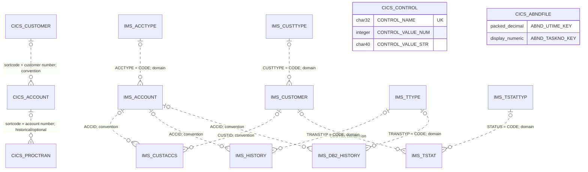

# Data model

Diagram edges are **logical joins, not declared foreign keys**; optional ends do not promise absence of orphan/history rows. Evidence: CICS account/customer lookup (`src/base/cics/cobol/INQACCCU.cbl:74`), customer-event account sentinel (`src/base/cics/cobol/DELCUS.cbl:738`), IMS customer/account traversal (`src/base/ims/cobol/IBACSUM.cbl:208`), DBD fields and domains below. CONTROL and ABNDFILE have no evidenced entity join (`.setup/jcl/cics/Db2-create.j2:67`, `src/base/cics/copy/ABNDINFO.cpy:7`). Cross-system correspondence is described separately, not drawn as referential integrity.

## Evidence and representation

This pass models checked-in definitions, not deployed contents. DDL/DBDs define physical storage; SQL `DECLARE ... TABLE` copybooks are declarations, **not COBOL host-variable records**. Host variables live in programs; business/COMMAREA layouts can differ. For example, compare `src/base/cics/copy/ACCDB2.cpy:7`, `src/base/cics/cobol/UPDACC.cbl:61` and `src/base/cics/copy/ACCOUNT.cpy:7`.

**Tooling boundary:** BNK1CCS, BNK1DCS, CRECUST, IBTRAN and BNKSTMTC have control flow **unverified by tooling** (`docs/modernization/00-source-of-truth/index.md:16`). CRECUST and IBTRAN observations below are direct source readings, not verified execution guarantees. BMS, DDL, DBD/PSB, Java and seed-data observations also use direct citations; these are outside the COBOL parser's scope (`docs/modernization/00-source-of-truth/index.md:106`). Contradictions and unresolved semantics are recorded as DM-Q01 through DM-Q11 in `open-questions.md`.

In the following tables, SQL names omit the repeated `ACCOUNT_`, `CUSTOMER_` or `PROCTRAN_` prefix only where stated. `S` means signed; `V` is an implied decimal point; `COMP-3` is packed fixed-point decimal, not floating point. Unsuffixed numeric PICTUREs below retain their source DISPLAY representation. IMS native binary IDs use `COMP-5`; do not reinterpret a binary ID as a CICS character key (`src/base/cics/copy/ACCOUNT.cpy:12`, `src/base/ims/cobol/LOADACCT.cbl:53`).

## CICS / DB2

### BANKZ.ACCOUNT

The unique index is `(ACCOUNT_SORTCODE, ACCOUNT_NUMBER)`; the customer index `(ACCOUNT_SORTCODE, ACCOUNT_CUSTOMER_NUMBER)` is nonunique. These are indexes, not a declared primary/foreign-key pair (`.setup/jcl/cics/Db2-create.j2:41`, `.setup/jcl/cics/Db2-create.j2:45`). Only sort code and account number are explicitly `NOT NULL`; the remaining columns are nullable in this DDL (`.setup/jcl/cics/Db2-create.j2:24`).

Column names below have prefix `ACCOUNT_`. Host PICTUREs are from UPDACC; record PICTUREs are from the authoritative base ACCOUNT member.

| Column(s) | SQL type / nullability | Business record field / PICTURE | DB2 host PICTURE | Evidence |
|---|---|---|---|---|
| EYECATCHER | CHAR(4), nullable | ACCOUNT-EYE-CATCHER X(4) | X(4) | `.setup/jcl/cics/Db2-create.j2:25`; `src/base/cics/copy/ACCOUNT.cpy:8`; `src/base/cics/cobol/UPDACC.cbl:62` |
| CUSTOMER_NUMBER | CHAR(10), nullable | ACCOUNT-CUST-NO 9(10) | X(10) | `.setup/jcl/cics/Db2-create.j2:26`; `src/base/cics/copy/ACCOUNT.cpy:10`; `src/base/cics/cobol/UPDACC.cbl:63` |
| SORTCODE | CHAR(6), NOT NULL | ACCOUNT-SORT-CODE 9(6) | X(6) | `.setup/jcl/cics/Db2-create.j2:27`; `src/base/cics/copy/ACCOUNT.cpy:12`; `src/base/cics/cobol/UPDACC.cbl:65` |
| NUMBER | CHAR(8), NOT NULL | ACCOUNT-NUMBER 9(8) | X(8) | `.setup/jcl/cics/Db2-create.j2:28`; `src/base/cics/copy/ACCOUNT.cpy:13`; `src/base/cics/cobol/UPDACC.cbl:66` |
| TYPE | CHAR(8), nullable | ACCOUNT-TYPE X(8) | X(8) | `.setup/jcl/cics/Db2-create.j2:29`; `src/base/cics/copy/ACCOUNT.cpy:14`; `src/base/cics/cobol/UPDACC.cbl:67` |
| INTEREST_RATE | DECIMAL(6,2), nullable | ACCOUNT-INTEREST-RATE 9(4)V99, unsigned | S9(4)V99 COMP-3 | `.setup/jcl/cics/Db2-create.j2:30`; `src/base/cics/copy/ACCOUNT.cpy:15`; `src/base/cics/cobol/UPDACC.cbl:68` |
| OPENED | DATE, nullable | ACCOUNT-OPENED 9(8), DDMMYYYY REDEFINES | X(10) | `.setup/jcl/cics/Db2-create.j2:31`; `src/base/cics/copy/ACCOUNT.cpy:16`; `src/base/cics/cobol/UPDACC.cbl:69` |
| OVERDRAFT_LIMIT | INTEGER, nullable | ACCOUNT-OVERDRAFT-LIMIT 9(8), unsigned | S9(9) COMP | `.setup/jcl/cics/Db2-create.j2:32`; `src/base/cics/copy/ACCOUNT.cpy:21`; `src/base/cics/cobol/UPDACC.cbl:70` |
| LAST_STATEMENT | DATE, nullable | ACCOUNT-LAST-STMT-DATE 9(8), DDMMYYYY REDEFINES | X(10) | `.setup/jcl/cics/Db2-create.j2:33`; `src/base/cics/copy/ACCOUNT.cpy:22`; `src/base/cics/cobol/UPDACC.cbl:71` |
| NEXT_STATEMENT | DATE, nullable | ACCOUNT-NEXT-STMT-DATE 9(8), DDMMYYYY REDEFINES | X(10) | `.setup/jcl/cics/Db2-create.j2:34`; `src/base/cics/copy/ACCOUNT.cpy:28`; `src/base/cics/cobol/UPDACC.cbl:72` |
| AVAILABLE_BALANCE | DECIMAL(12,2), nullable | ACCOUNT-AVAILABLE-BALANCE S9(10)V99 | S9(10)V99 COMP-3 | `.setup/jcl/cics/Db2-create.j2:35`; `src/base/cics/copy/ACCOUNT.cpy:34`; `src/base/cics/cobol/UPDACC.cbl:73` |
| ACTUAL_BALANCE | DECIMAL(12,2), nullable | ACCOUNT-ACTUAL-BALANCE S9(10)V99 | S9(10)V99 COMP-3 | `.setup/jcl/cics/Db2-create.j2:36`; `src/base/cics/copy/ACCOUNT.cpy:35`; `src/base/cics/cobol/UPDACC.cbl:74` |

Do not substitute ACCDB2's narrower `DECIMAL(4,2)` interest / `DECIMAL(10,2)` balances for the DDL above; DM-Q01 records this contradiction (`src/base/cics/copy/ACCDB2.cpy:13`, `src/base/cics/copy/ACCDB2.cpy:18`).

### BANKZ.CUSTOMER

Unique index `(CUSTOMER_SORTCODE, CUSTOMER_NUMBER)`; nonunique surname/first-name index. No foreign key is declared in this table (`.setup/jcl/cics/Db2-create.j2:81`, `.setup/jcl/cics/Db2-create.j2:103`, `.setup/jcl/cics/Db2-create.j2:107`). Only sort code and number are explicitly `NOT NULL`. Column names below have prefix `CUSTOMER_`.

| Column(s) | SQL type | Base CUSTOMER layout / PICTURE | DB2 host PICTURE | Evidence |
|---|---|---|---|---|
| EYECATCHER | CHAR(4) | CUSTOMER-EYECATCHER X(4) | X(4) | `.setup/jcl/cics/Db2-create.j2:82`; `src/base/cics/copy/CUSTOMER.cpy:8`; `src/base/cics/cobol/UPDCUST.cbl:57` |
| SORTCODE | CHAR(6), NOT NULL | CUSTOMER-SORTCODE 9(6) DISPLAY | X(6) | `.setup/jcl/cics/Db2-create.j2:83`; `src/base/cics/copy/CUSTOMER.cpy:11`; `src/base/cics/cobol/UPDCUST.cbl:58` |
| NUMBER | CHAR(10), NOT NULL | CUSTOMER-NUMBER 9(10) DISPLAY | X(10) | `.setup/jcl/cics/Db2-create.j2:84`; `src/base/cics/copy/CUSTOMER.cpy:12`; `src/base/cics/cobol/UPDCUST.cbl:59` |
| TITLE | CHAR(10) | CUSTOMER-TITLE X(10) | X(10) | `.setup/jcl/cics/Db2-create.j2:85`; `src/base/cics/copy/CUSTOMER.cpy:14`; `src/base/cics/cobol/UPDCUST.cbl:60` |
| FIRST_NAME, LAST_NAME | CHAR(50) each | CUSTOMER-FIRST-NAME / LAST-NAME X(50) each | X(50) each | `.setup/jcl/cics/Db2-create.j2:86`; `src/base/cics/copy/CUSTOMER.cpy:15`; `src/base/cics/cobol/UPDCUST.cbl:61` |
| DATE_OF_BIRTH | INTEGER | CUSTOMER-DOB group: day 99, month 99, year 9999 DISPLAY | S9(9) COMP | `.setup/jcl/cics/Db2-create.j2:88`; `src/base/cics/copy/CUSTOMER.cpy:17`; `src/base/cics/cobol/UPDCUST.cbl:63` |
| PHONE | CHAR(20) | CUSTOMER-PHONE X(20) | X(20) | `.setup/jcl/cics/Db2-create.j2:89`; `src/base/cics/copy/CUSTOMER.cpy:21`; `src/base/cics/cobol/UPDCUST.cbl:64` |
| ADDR_LINE1, ADDR_LINE2 | CHAR(50) each | CUSTOMER-ADDR-LINE1 / LINE2 X(50) each | X(50) each | `.setup/jcl/cics/Db2-create.j2:90`; `src/base/cics/copy/CUSTOMER.cpy:23`; `src/base/cics/cobol/UPDCUST.cbl:65` |
| CITY | CHAR(50) | CUSTOMER-CITY X(50) | X(50) | `.setup/jcl/cics/Db2-create.j2:92`; `src/base/cics/copy/CUSTOMER.cpy:25`; `src/base/cics/cobol/UPDCUST.cbl:67` |
| POSTCODE | CHAR(10) | CUSTOMER-POSTCODE X(10) | X(10) | `.setup/jcl/cics/Db2-create.j2:93`; `src/base/cics/copy/CUSTOMER.cpy:26`; `src/base/cics/cobol/UPDCUST.cbl:68` |
| COUNTRY | CHAR(50) | CUSTOMER-COUNTRY X(50) | X(50) | `.setup/jcl/cics/Db2-create.j2:94`; `src/base/cics/copy/CUSTOMER.cpy:27`; `src/base/cics/cobol/UPDCUST.cbl:69` |
| STATUS | CHAR(10) | CUSTOMER-STATUS X(10) | X(10) | `.setup/jcl/cics/Db2-create.j2:95`; `src/base/cics/copy/CUSTOMER.cpy:28`; `src/base/cics/cobol/UPDCUST.cbl:70` |
| CREATED_DATE | INTEGER | CUSTOMER-CREATED-DATE: day 99, month 99, year 9999 DISPLAY | S9(9) COMP | `.setup/jcl/cics/Db2-create.j2:96`; `src/base/cics/copy/CUSTOMER.cpy:32`; `src/base/cics/cobol/UPDCUST.cbl:71` |
| CREDIT_SCORE | SMALLINT | CUSTOMER-CREDIT-SCORE 999, unsigned DISPLAY | S9(4) COMP | `.setup/jcl/cics/Db2-create.j2:97`; `src/base/cics/copy/CUSTOMER.cpy:36`; `src/base/cics/cobol/UPDCUST.cbl:72` |
| CS_REVIEW_DATE | INTEGER | CUSTOMER-CS-REVIEW-DATE: day 99, month 99, year 9999 DISPLAY | S9(9) COMP | `.setup/jcl/cics/Db2-create.j2:98`; `src/base/cics/copy/CUSTOMER.cpy:37`; `src/base/cics/cobol/UPDCUST.cbl:73` |

The integer DOB is explicitly built as `year * 10000 + month * 100 + day`, not as the record's DDMMYYYY byte order (`src/base/cics/cobol/UPDCUST.cbl:353`). CRECUST likewise builds DOB, creation and review dates as YYYYMMDD integers; its control flow is **unverified by tooling** (`src/base/cics/cobol/CRECUST.cbl:1167`, `src/base/cics/cobol/CRECUST.cbl:1184`, `src/base/cics/cobol/CRECUST.cbl:1194`).

### BANKZ.PROCTRAN

This is processed-event history, not solely transfers. The DDL declares neither a unique transaction key nor an account FK (`.setup/jcl/cics/Db2-create.j2:51`). INQTRAND selects by `(sortcode, number, date, time, ref)` and represents that tuple with hyphen separators; this is an application locator, **not guaranteed unique by DDL** (`src/base/cics/cobol/INQTRAND.cbl:75`, `src/base/cics/cobol/INQTRAND.cbl:112`; DM-Q10).

Column names below have prefix `PROCTRAN_`.

| Column | SQL type | Base PROCTRAN field / PICTURE | DB2 host PICTURE | Evidence |
|---|---|---|---|---|
| EYECATCHER | CHAR(4), nullable | PROC-TRAN-EYE-CATCHER X(4) | X(4) | `.setup/jcl/cics/Db2-create.j2:52`; `src/base/cics/copy/PROCTRAN.cpy:8`; `src/base/cics/cobol/INQTRAND.cbl:48` |
| SORTCODE | CHAR(6), NOT NULL | PROC-TRAN-SORT-CODE 9(6) | X(6) | `.setup/jcl/cics/Db2-create.j2:53`; `src/base/cics/copy/PROCTRAN.cpy:16`; `src/base/cics/cobol/INQTRAND.cbl:49` |
| NUMBER | CHAR(8), NOT NULL | PROC-TRAN-NUMBER 9(8) | X(8) | `.setup/jcl/cics/Db2-create.j2:54`; `src/base/cics/copy/PROCTRAN.cpy:17`; `src/base/cics/cobol/INQTRAND.cbl:50` |
| DATE | DATE, nullable | PROC-TRAN-DATE 9(8), YYYYMMDD REDEFINES | X(10) | `.setup/jcl/cics/Db2-create.j2:55`; `src/base/cics/copy/PROCTRAN.cpy:18`; `src/base/cics/cobol/INQTRAND.cbl:51` |
| TIME | CHAR(6), nullable | PROC-TRAN-TIME 9(6), HHMMSS REDEFINES | X(6) | `.setup/jcl/cics/Db2-create.j2:56`; `src/base/cics/copy/PROCTRAN.cpy:23`; `src/base/cics/cobol/INQTRAND.cbl:52` |
| REF | CHAR(12), nullable | PROC-TRAN-REF 9(12) | X(12) | `.setup/jcl/cics/Db2-create.j2:57`; `src/base/cics/copy/PROCTRAN.cpy:28`; `src/base/cics/cobol/INQTRAND.cbl:53` |
| TYPE | CHAR(3), nullable | PROC-TRAN-TYPE X(3) | X(3) | `.setup/jcl/cics/Db2-create.j2:58`; `src/base/cics/copy/PROCTRAN.cpy:29`; `src/base/cics/cobol/INQTRAND.cbl:54` |
| DESC | CHAR(40), nullable | PROC-TRAN-DESC X(40), overlays below | X(40) | `.setup/jcl/cics/Db2-create.j2:59`; `src/base/cics/copy/PROCTRAN.cpy:48`; `src/base/cics/cobol/INQTRAND.cbl:55` |
| AMOUNT | DECIMAL(12,2), nullable | PROC-TRAN-AMOUNT S9(10)V99 DISPLAY | S9(10)V99 COMP-3 | `.setup/jcl/cics/Db2-create.j2:60`; `src/base/cics/copy/PROCTRAN.cpy:103`; `src/base/cics/cobol/INQTRAND.cbl:56` |

`PROC-TRAN-ID` groups the account's sort code and number; it does not add a per-event unique key (`src/base/cics/copy/PROCTRAN.cpy:15`). The description's `REDEFINES` are alternate interpretations of the same 40 bytes, not additional SQL columns:

| Overlay | Fields in order | Evidence |
|---|---|---|
| Transfer | header X(26), target sort code 9(6), target account 9(8); header condition value `TRANSFER` | `src/base/cics/copy/PROCTRAN.cpy:49` |
| Account deletion / creation | customer 9(10), account type X(8), last DD/MM/YYYY (99/99/9999), next DD/MM/YYYY (99/99/9999), footer X(6) with `DELETE` / `CREATE` | `src/base/cics/copy/PROCTRAN.cpy:57`, `src/base/cics/copy/PROCTRAN.cpy:69` |
| Customer deletion / creation | sort code 9(6), customer 9(10), name X(14), DOB YYYY-MM-DD (9999/X/99/X/99); separator 88-values `-` | `src/base/cics/copy/PROCTRAN.cpy:81`, `src/base/cics/copy/PROCTRAN.cpy:92` |

Customer deletion writes account number zero, customer identity in description positions 1-16, type `ODC` and amount zero. Therefore not every history row refers to a live account (`src/base/cics/cobol/DELCUS.cbl:738`, `src/base/cics/cobol/DELCUS.cbl:763`, `src/base/cics/cobol/DELCUS.cbl:768`).

### BANKZ.CONTROL

| Column | DDL type | Host PICTURE | Evidence |
|---|---|---|---|
| CONTROL_NAME | CHAR(32), nullable; unique index | X(32) | `.setup/jcl/cics/Db2-create.j2:68`, `.setup/jcl/cics/Db2-create.j2:75`; `src/base/cics/cobol/CREACC.cbl:123` |
| CONTROL_VALUE_NUM | INTEGER, nullable | S9(9) COMP | `.setup/jcl/cics/Db2-create.j2:69`; `src/base/cics/cobol/CREACC.cbl:124` |
| CONTROL_VALUE_STR | CHAR(40), nullable | X(40) | `.setup/jcl/cics/Db2-create.j2:70`; `src/base/cics/cobol/CREACC.cbl:125` |

Account allocation looks up `<sortcode>-ACCOUNT-LAST` and `<sortcode>-ACCOUNT-COUNT` by name (`src/base/cics/cobol/CREACC.cbl:483`, `src/base/cics/cobol/CREACC.cbl:677`). Customer allocation builds `BANKZCUST` + six-character sort code + two spaces, then increments CONTROL_VALUE_NUM; it is not the same naming pattern. CRECUST control flow is **unverified by tooling** (`src/base/cics/cobol/CRECUST.cbl:178`, `src/base/cics/cobol/CRECUST.cbl:1481`, `src/base/cics/cobol/CRECUST.cbl:1519`).

CONTDB2 instead declares `STTESTER.CONTROL` with a NOT NULL name (DM-Q02). CONTROLI is a separate four-counter record, not the table row: customer count/last `9(10) PACKED-DECIMAL`, account count/last `9(8) PACKED-DECIMAL` (`src/base/cics/copy/CONTDB2.cpy:7`, `src/base/cics/copy/CONTROLI.cpy:7`). Do not infer a 10-digit SQL counter capacity from that record; the table uses INTEGER (`.setup/jcl/cics/Db2-create.j2:69`).

### CICS ABNDFILE diagnostic record

ABNDPROC writes the ABNDINFO layout using ABND-VSAM-KEY as RIDFLD; this is diagnostic data, not a banking transaction row (`src/base/cics/cobol/ABNDPROC.cbl:141`).

| Fields | PICTURE / usage | Evidence |
|---|---|---|
| ABND-UTIME-KEY + ABND-TASKNO-KEY | S9(15) COMP-3 + 9(4) DISPLAY; grouped key | `src/base/cics/copy/ABNDINFO.cpy:7` |
| ABND-APPLID, ABND-TRANID | X(8), X(4) | `src/base/cics/copy/ABNDINFO.cpy:10` |
| ABND-DATE, ABND-TIME | X(10), X(8) | `src/base/cics/copy/ABNDINFO.cpy:12` |
| ABND-CODE, ABND-PROGRAM | X(4), X(8) | `src/base/cics/copy/ABNDINFO.cpy:14` |
| ABND-RESPCODE, ABND-RESP2CODE, ABND-SQLCODE | each S9(8) DISPLAY SIGN LEADING SEPARATE | `src/base/cics/copy/ABNDINFO.cpy:16` |
| ABND-FREEFORM | X(600) | `src/base/cics/copy/ABNDINFO.cpy:22` |

## IMS databases and the IMS DB2 history table

The DBDs below define root segments (`PARENT=0`), not one parent/child hierarchy spanning databases. Program views explicitly name separate PCBs: IBACSUM exposes ACCOUNT/CUSTACCS; customer inquiry/update exposes CUSTOMER; IBTRAN exposes ACCOUNT/CUSTACCS/HISTORY. IBTRAN's control flow is **unverified by tooling** (`src/base/ims/DBD/ACCOUNT.asm:26`, `src/base/ims/DBD/CUSTACCS.asm:26`, `src/base/ims/DBD/CUSTOMER.asm:26`, `src/base/ims/DBD/HISTORY.asm:31`, `src/base/ims/PSB/IBACSUM.asm:10`, `src/base/ims/PSB/IBGCUDAT.asm:10`, `src/base/ims/PSB/IBSCUDAT.asm:10`, `src/base/ims/PSB/IBTRAN.asm:10`).

Positions below are **one-based byte offsets**, as in the DBD. COBOL declarations come from the loader's inline segment area, not generated API copybooks.

### ACCOUNT: 25 bytes, unique sequence field ACCID

| Field | Position / bytes | DBD datatype | COBOL PICTURE / usage | Evidence |
|---|---|---|---|---|
| ACCID | 1 / 8 | LONG; SEQ,U | S9(18) COMP-5 | `src/base/ims/DBD/ACCOUNT.asm:31`; `src/base/ims/cobol/LOADACCT.cbl:53` |
| ACCTYPE | 9 / 1 | CHAR | X(1) | `src/base/ims/DBD/ACCOUNT.asm:37`; `src/base/ims/cobol/LOADACCT.cbl:54` |
| BALANCE | 10 / 8 | DECIMAL(15,2) | S9(13)V9(2) COMP-3, signed, two decimals | `src/base/ims/DBD/ACCOUNT.asm:43`; `src/base/ims/cobol/LOADACCT.cbl:55` |
| LASTTXID | 18 / 8 | LONG | S9(18) COMP-5 | `src/base/ims/DBD/ACCOUNT.asm:49`; `src/base/ims/cobol/LOADACCT.cbl:56` |

### CUSTOMER: 279 bytes, unique sequence field CUSTID

| Field(s) | Position / bytes | DBD datatype | COBOL PICTURE / usage | Evidence |
|---|---|---|---|---|
| CUSTID | 1 / 4 | INT; SEQ,U | S9(9) COMP-5 | `src/base/ims/DBD/CUSTOMER.asm:31`; `src/base/ims/cobol/LOADCUST.cbl:65` |
| LASTNAME, FIRSTNM (external FIRSTNAME) | 5 / 50; 55 / 50 | CHAR each | X(50) each | `src/base/ims/DBD/CUSTOMER.asm:37`, `src/base/ims/DBD/CUSTOMER.asm:43`; `src/base/ims/cobol/LOADCUST.cbl:66` |
| ADDRESS | 105 / 80 | CHAR | ADDRESS-SEG X(80) | `src/base/ims/DBD/CUSTOMER.asm:50`; `src/base/ims/cobol/LOADCUST.cbl:68` |
| CITY | 185 / 25 | CHAR | X(25) | `src/base/ims/DBD/CUSTOMER.asm:56`; `src/base/ims/cobol/LOADCUST.cbl:69` |
| STATE | 210 / 2 | CHAR | X(2) | `src/base/ims/DBD/CUSTOMER.asm:62`; `src/base/ims/cobol/LOADCUST.cbl:70` |
| ZIPCODE | 212 / 15 | CHAR | X(15) | `src/base/ims/DBD/CUSTOMER.asm:68`; `src/base/ims/cobol/LOADCUST.cbl:71` |
| PHONE | 227 / 12 | CHAR | X(12) | `src/base/ims/DBD/CUSTOMER.asm:74`; `src/base/ims/cobol/LOADCUST.cbl:72` |
| STATUS | 239 / 1 | CHAR | STATUS-SEG X(1) | `src/base/ims/DBD/CUSTOMER.asm:80`; `src/base/ims/cobol/LOADCUST.cbl:73` |
| PASSWORD | 240 / 16 | CHAR | PASSWORD-SEG X(16) | `src/base/ims/DBD/CUSTOMER.asm:86`; `src/base/ims/cobol/LOADCUST.cbl:74` |
| CUSTTYPE (external CUSTOMERTYPE) | 256 / 1 | CHAR | X(1) | `src/base/ims/DBD/CUSTOMER.asm:92`; `src/base/ims/cobol/LOADCUST.cbl:75` |
| LASTLOGI (external LASTLOGIN) | 257 / 23 | TIMESTAMP, character conversion | X(23) | `src/base/ims/DBD/CUSTOMER.asm:99`; `src/base/ims/cobol/LOADCUST.cbl:76` |

LASTLOGIN uses the DBD conversion pattern `yyyy-MM-dd HH:mm:ss.SSS` (`src/base/ims/DBD/CUSTOMER.asm:106`).

### CUSTACCS: 16-byte association record

| Field | Position / bytes | DBD datatype / key property | COBOL PICTURE / usage | Evidence |
|---|---|---|---|---|
| CUSTID | 1 / 4 | INT; **SEQ,M**, not SEQ,U | S9(9) COMP-5 | `src/base/ims/DBD/CUSTACCS.asm:32`; `src/base/ims/cobol/LOADCUSA.cbl:65` |
| CUSACCID | 1 / 12 | BINARY; overlaps CUSTID + ACCID; no SEQ,U clause | Composite bytes, no separate loader item | `src/base/ims/DBD/CUSTACCS.asm:38`; `src/base/ims/cobol/LOADCUSA.cbl:64` |
| ACCID | 5 / 8 | LONG | S9(18) COMP-5 | `src/base/ims/DBD/CUSTACCS.asm:44`; `src/base/ims/cobol/LOADCUSA.cbl:66` |
| ACCNUM | 13 / 4 | INT | S9(9) COMP-5; business meaning unresolved | `src/base/ims/DBD/CUSTACCS.asm:50`; `src/base/ims/cobol/LOADCUSA.cbl:67` |

IBACSUM reads associations for CA-CUSTID, then looks up ACCOUNT by the returned ACCID. This is a join by convention, not a database-enforced FK (`src/base/ims/cobol/IBACSUM.cbl:208`, `src/base/ims/cobol/IBACSUM.cbl:216`). The overlapping 12-byte CUSACCID is **not evidence of a declared unique composite key**; PSB KEYLEN=12 does not change the DBD's SEQ,M declaration (DM-Q04; `src/base/ims/PSB/IBACSUM.asm:13`).

### HISTORY: 56-byte IMS root segment

| Field | Position / bytes | DBD datatype | Loader PICTURE / usage | Evidence |
|---|---|---|---|---|
| TXID | 1 / 8 | LONG; SEQ,U | S9(18) COMP-5 | `src/base/ims/DBD/HISTORY.asm:36`; `src/base/ims/cobol/LOADHIST.cbl:65` |
| TIME | 9 / 23 | TIMESTAMP | TIMESTMP X(23) | `src/base/ims/DBD/HISTORY.asm:42`; `src/base/ims/cobol/LOADHIST.cbl:66` |
| TRANSTYP (external TRANSTYPE) | 32 / 1 | CHAR | X(1) | `src/base/ims/DBD/HISTORY.asm:51`; `src/base/ims/cobol/LOADHIST.cbl:67` |
| AMOUNT | 33 / 8 | DECIMAL(15,2) | S9(13)V9(2) COMP-3 | `src/base/ims/DBD/HISTORY.asm:58`; `src/base/ims/cobol/LOADHIST.cbl:68` |
| REFTXID | 41 / 8 | LONG | S9(18) COMP-5 | `src/base/ims/DBD/HISTORY.asm:64`; `src/base/ims/cobol/LOADHIST.cbl:69` |
| ACCID | 49 / 8 | LONG | S9(18) COMP-5 | `src/base/ims/DBD/HISTORY.asm:72`; `src/base/ims/cobol/LOADHIST.cbl:70` |

TIME uses `yyyy-MM-dd HH:mm:ss.SSS`. There is **no BALANCE field in the checked-in DBD**; IBTRAN adds an eight-byte packed BALANCE-HIST after ACCID-HIST, making its buffer 64 bytes. The Java bridge reads that extra balance, but it is not an IMS HISTORY column (DM-Q03; `src/base/ims/DBD/HISTORY.asm:48`, `src/base/ims/DBD/HISTORY.asm:72`, `src/base/ims/cobol/IBTRAN.cbl:88`, `src/base/ims/java/src/main/java/nazare/jmp/controller/InsertHist.java:76`). IBTRAN control flow is **unverified by tooling**.

### TSTAT: 59-byte transaction-status root segment

| Field | Position / bytes | DBD datatype | Loader PICTURE / usage | Evidence |
|---|---|---|---|---|
| TXID | 1 / 8 | LONG; SEQ,U | S9(18) COMP-5 | `src/base/ims/DBD/TSTAT.asm:32`; `src/base/ims/cobol/LOADTSTA.cbl:65` |
| STATUS | 9 / 1 | CHAR | STATUS-SEG X(1) | `src/base/ims/DBD/TSTAT.asm:38`; `src/base/ims/cobol/LOADTSTA.cbl:66` |
| STARTTIM (external STARTTIME) | 10 / 23 | TIMESTAMP | STARTTIME X(23) | `src/base/ims/DBD/TSTAT.asm:44`; `src/base/ims/cobol/LOADTSTA.cbl:67` |
| STOPTIME | 33 / 23 | TIMESTAMP | X(23) | `src/base/ims/DBD/TSTAT.asm:54`; `src/base/ims/cobol/LOADTSTA.cbl:68` |
| CUSTID | 56 / 4 | INT | S9(9) COMP-5 | `src/base/ims/DBD/TSTAT.asm:65`; `src/base/ims/cobol/LOADTSTA.cbl:69` |

STARTTIME/STOPTIME use `yyyy-MM-dd HH:mm:ss.SSS`. CUSTID is an ordinary field; the secondary-index text is a comment, not an index definition. No TXID foreign key to HISTORY is declared here (`src/base/ims/DBD/TSTAT.asm:51`, `src/base/ims/DBD/TSTAT.asm:60`, `src/base/ims/DBD/TSTAT.asm:62`).

### ACCTYPE, CUSTTYPE, TTYPE, TSTATTYP: reference domains

Each is a separate 21-byte root segment: CODE at byte 1, length 1, CHAR with `(CODE,SEQ,U)`; DESCRIPT (external DESCRIPTION) at byte 2, length 20, CHAR. There is no COBOL PICTURE in these assembler definitions; the corresponding character shapes are one and twenty bytes, not evidence of an additional copybook (`src/base/ims/DBD/ACCTYPE.asm:26`, `src/base/ims/DBD/ACCTYPE.asm:31`, `src/base/ims/DBD/CUSTTYPE.asm:26`, `src/base/ims/DBD/CUSTTYPE.asm:32`, `src/base/ims/DBD/TTYPE.asm:26`, `src/base/ims/DBD/TTYPE.asm:32`, `src/base/ims/DBD/TSTATTYP.asm:17`, `src/base/ims/DBD/TSTATTYP.asm:23`).

The general IB and IBLOAD views expose these databases; this does not prove that transaction programs validate their codes against them (`src/base/ims/PSB/IB.asm:13`, `src/base/ims/PSB/IB.asm:22`, `src/base/ims/PSB/IB.asm:31`, `src/base/ims/PSB/IBLOAD.asm:13`). Checked-in seed meanings:

| Domain / field | Code -> meaning | Evidence |
|---|---|---|
| ACCTYPE / ACCOUNT.ACCTYPE | `s` -> Savings Account; `c` -> Checking Account | `src/base/ims/LoadData/ACCTYPE.data:1`, `src/base/ims/LoadData/ACCTYPE.data:2` |
| CUSTTYPE / CUSTOMER.CUSTTYPE | `c` -> A Regular Customer; `t` -> A Teller Customer | `src/base/ims/LoadData/CUSTTYPE.data:1`, `src/base/ims/LoadData/CUSTTYPE.data:2` |
| TTYPE / HISTORY.TRANSTYP | `d` -> Deposit; `t` -> Transfer; `w` -> Withdrawal | `src/base/ims/LoadData/TTYPE.data:1`, `src/base/ims/LoadData/TTYPE.data:2`, `src/base/ims/LoadData/TTYPE.data:3` |
| TSTATTYP / TSTAT.STATUS | `c` -> Synchronous Trans; `q` -> Asynchronous Trans | `src/base/ims/LoadData/TSTATTYP.data:1`, `src/base/ims/LoadData/TSTATTYP.data:2` |

### IMSBANK.HISTORY: DB2 history used by Java

The IMS DDL is parameterized; checked-in configuration supplies database `IMSBANK` and table `HISTORY`. All seven columns are NOT NULL; TXID has UNIQUE plus a unique index. There are no declared foreign keys (`.setup/config/config.yaml:243`, `.setup/jcl/ims/Db2-create.j2:25`, `.setup/jcl/ims/Db2-create.j2:38`).

| Column | SQL type | Corresponding COBOL buffer / Java access | Evidence |
|---|---|---|---|
| TXID | BIGINT UNIQUE NOT NULL | TXID-HIST S9(18) COMP-5 / getLong | `.setup/jcl/ims/Db2-create.j2:27`; `src/base/ims/cobol/IBTRAN.cbl:89`; `src/base/ims/java/src/main/java/nazare/jmp/controller/InsertHist.java:52` |
| TIMESTMP | TIMESTAMP NOT NULL | TIMESTMP-HIST X(23) / IBM-1047 character decoding | `.setup/jcl/ims/Db2-create.j2:28`; `src/base/ims/cobol/IBTRAN.cbl:90`; `src/base/ims/java/src/main/java/nazare/jmp/controller/InsertHist.java:56` |
| TRANSTYP | CHAR(1) NOT NULL | TRANSTYP-HIST X(1) / IBM-1047 character decoding | `.setup/jcl/ims/Db2-create.j2:29`; `src/base/ims/cobol/IBTRAN.cbl:91`; `src/base/ims/java/src/main/java/nazare/jmp/controller/InsertHist.java:62` |
| AMOUNT | DECIMAL(15,2) NOT NULL | AMOUNT-HIST S9(13)V9(2) COMP-3 / BigDecimal | `.setup/jcl/ims/Db2-create.j2:30`; `src/base/ims/cobol/IBTRAN.cbl:92`; `src/base/ims/java/src/main/java/nazare/jmp/controller/InsertHist.java:68` |
| REFTXID | BIGINT NOT NULL | REFTXID-HIST S9(18) COMP-5 / getLong | `.setup/jcl/ims/Db2-create.j2:31`; `src/base/ims/cobol/IBTRAN.cbl:93`; `src/base/ims/java/src/main/java/nazare/jmp/controller/InsertHist.java:71` |
| ACCID | BIGINT NOT NULL | ACCID-HIST S9(18) COMP-5 / getLong | `.setup/jcl/ims/Db2-create.j2:32`; `src/base/ims/cobol/IBTRAN.cbl:94`; `src/base/ims/java/src/main/java/nazare/jmp/controller/InsertHist.java:73` |
| BALANCE | DECIMAL(15,2) NOT NULL | BALANCE-HIST S9(13)V9(2) COMP-3 / BigDecimal | `.setup/jcl/ims/Db2-create.j2:33`; `src/base/ims/cobol/IBTRAN.cbl:95`; `src/base/ims/java/src/main/java/nazare/jmp/controller/InsertHist.java:79` |

IBTRAN control flow is **unverified by tooling**. Java binds amount/balance with `setBigDecimal`, and inserts all seven fields; these are exact-decimal values (`src/base/ims/java/src/main/java/nazare/jmp/history/TransactionService.java:140`, `src/base/ims/java/src/main/java/nazare/jmp/history/TransactionService.java:148`). The code attempts both DB2 and IMS history writes; equality, durability and atomicity between those stores are not established (DM-Q08; `src/base/ims/cobol/IBTRAN.cbl:350`, `src/base/ims/cobol/IBTRAN.cbl:358`).

## Relationships and correspondence

| Relationship | Evidence and limits |
|---|---|
| CICS CUSTOMER -> ACCOUNT | Join `(CUSTOMER_SORTCODE, CUSTOMER_NUMBER)` to `(ACCOUNT_SORTCODE, ACCOUNT_CUSTOMER_NUMBER)`. The cursor uses both values; the DDL provides an index but no FK (`src/base/cics/cobol/INQACCCU.cbl:87`, `.setup/jcl/cics/Db2-create.j2:45`). |
| CICS ACCOUNT -> PROCTRAN | Join sort code + account number by convention; account deletion/customer events make a mandatory live-account relationship incorrect (`.setup/jcl/cics/Db2-create.j2:53`, `src/base/cics/cobol/DELCUS.cbl:738`; description overlays above). |
| IMS CUSTOMER <-> ACCOUNT | Association rows carry CUSTID and ACCID; repeated CUSTID is allowed by SEQ,M. ACCOUNT is fetched by ACCID from each association; exclusivity of account ownership is not established (`src/base/ims/DBD/CUSTACCS.asm:32`, `src/base/ims/cobol/IBACSUM.cbl:216`; DM-Q04). |
| IMS ACCOUNT -> HISTORY / DB2 HISTORY | ACCID is present in both history shapes, but neither declares an account FK (`src/base/ims/DBD/HISTORY.asm:72`, `.setup/jcl/ims/Db2-create.j2:32`). |
| LASTTXID and TXID | IBTRAN increments ACCOUNT.LASTTXID and constructs TXID as `ACCID * 10000000000 + previous LASTTXID + 1`; LASTTXID is thus not the complete history TXID in that writer. REFTXID is set to zero there; do not assume a mandatory self-FK (`src/base/ims/cobol/IBTRAN.cbl:42`, `src/base/ims/cobol/IBTRAN.cbl:316`, `src/base/ims/cobol/IBTRAN.cbl:320`, `src/base/ims/cobol/IBTRAN.cbl:339`). **Control flow unverified by tooling**. |
| IMS TSTAT / domains | TSTAT.CUSTID corresponds by name/type to CUSTOMER.CUSTID. Code/description databases supply reference meanings, not declared cross-database FKs (`src/base/ims/DBD/TSTAT.asm:65`, `src/base/ims/DBD/CUSTOMER.asm:31`, `src/base/ims/DBD/TSTATTYP.asm:23`). |

The same business concepts have different representations; this is a **structural correspondence**, not an evidenced replication or identity-conversion contract (DM-Q05).

| Concept | CICS / DB2 representation | IMS representation / mismatch | Evidence |
|---|---|---|---|
| Customer identity | CHAR(6) sort code + CHAR(10) customer number | Four-byte signed native CUSTID; no sort-code field in CUSTOMER DBD | `.setup/jcl/cics/Db2-create.j2:83`; `src/base/ims/DBD/CUSTOMER.asm:31` |
| Customer details | Title, first/last names, two address lines, city, postcode, country, phone | First/last names; one 80-byte address; city 25, state 2, ZIP 15, phone 12. No lossless address/phone mapping established | `.setup/jcl/cics/Db2-create.j2:85`; `src/base/ims/DBD/CUSTOMER.asm:37` |
| Customer status/profile | ACTIVE/INACTIVE/SUSPENDED; DOB, creation date, credit score/review | STATUS is login state; PASSWORD, CUSTTYPE, LASTLOGIN. No DOB/credit-score counterparts in DBD | `src/base/cics/copy/CUSTOMER.cpy:17`; `src/base/ims/DBD/CUSTOMER.asm:80`; `src/base/ims/cobol/IBLOGIN1.cbl:29` |
| Account identity/ownership | Sort code + eight-character number; customer number on account | Eight-byte signed ACCID; ownership via CUSTACCS, not a CUSTOMER field on ACCOUNT | `.setup/jcl/cics/Db2-create.j2:26`; `src/base/ims/DBD/ACCOUNT.asm:31`; `src/base/ims/DBD/CUSTACCS.asm:32` |
| Account type | X(8), e.g. SAVING/CURRENT | One-byte `s`/`c` seed meanings; no implemented conversion inferred | `src/base/cics/copy/ACCOUNT.cpy:14`; `src/base/cics/cobol/CREACC.cbl:1309`; `src/base/ims/LoadData/ACCTYPE.data:1` |
| Balance | Available + actual, DECIMAL(12,2); overdraft, interest, statement dates | One BALANCE DECIMAL(15,2) + LASTTXID; neither CICS balance is identified as its equivalent | `.setup/jcl/cics/Db2-create.j2:30`; `src/base/ims/DBD/ACCOUNT.asm:43` |
| History | PROCTRAN: date + second-resolution time + ref, 3-character type, description, DECIMAL(12,2) amount | HISTORY: binary TXID, millisecond timestamp, one-character type, DECIMAL(15,2) amount, REFTXID/ACCID. DB2 companion additionally stores BALANCE | `.setup/jcl/cics/Db2-create.j2:51`; `src/base/ims/DBD/HISTORY.asm:36`; `.setup/jcl/ims/Db2-create.j2:27` |

## Code-enforced invariants and update semantics

These are **path-specific checks**, not universal DB constraints. An 88-level names a condition but does not itself enforce the domain.

| Invariant / behavior | Enforcement point and boundary |
|---|---|
| Existing customer before CICS account creation | CREACC rejects failed customer inquiry before writing ACCOUNT; rejects an existing account count `> 9` (a count of 9 passes this gate). This is not a DDL cardinality constraint (`src/base/cics/cobol/CREACC.cbl:341`, `src/base/cics/cobol/CREACC.cbl:380`). |
| Account type validation differs by operation | CREACC accepts prefixes ISA (3), MORTGAGE (8), SAVING (6), CURRENT (7), LOAN (4), otherwise fail A. UPDACC only rejects blank/leading-space type in its gate, then assigns type/rate/overdraft. The creation prefix checks are not a globally enforced closed SQL domain (`src/base/cics/cobol/CREACC.cbl:1309`, `src/base/cics/cobol/UPDACC.cbl:267`). |
| Account-screen rate/overdraft constraints | BNK1CAC rejects rate `< 0` or `> 9999.99`; the exact upper endpoint is allowed by these comparisons despite the message saying "less than". It rejects nondigit overdraft input, with an omitted-value zeroing path. These screen checks are not proved for every caller (`src/base/cics/cobol/BNK1CAC.cbl:663`, `src/base/cics/cobol/BNK1CAC.cbl:673`, `src/base/cics/cobol/BNK1CAC.cbl:701`, `src/base/cics/cobol/BNK1CAC.cbl:717`, `src/base/cics/cobol/BNK1CAC.cbl:724`). |
| Next statement date on account creation | WAD010 builds the DB2 host date from today's Gregorian date +30 days, not "same date next month". The earlier CALCULATE-DATES helper separately assigns ACCOUNT-NEXT-STMT-DATE using +28/29 days in February and +30 otherwise; the different representations and omitted parsed leap-year decisions are DM-Q11 (`src/base/cics/cobol/CREACC.cbl:892`, `src/base/cics/cobol/CREACC.cbl:898`, `src/base/cics/cobol/CREACC.cbl:914`, `src/base/cics/cobol/CREACC.cbl:1231`, `src/base/cics/cobol/CREACC.cbl:1278`). |
| Customer title domain | UPDCUST allows Professor, Mr, Mrs, Miss, Ms, Dr, Drs, Lord, Sir, Lady or spaces, otherwise fail T (`src/base/cics/cobol/UPDCUST.cbl:183`, `src/base/cics/cobol/UPDCUST.cbl:201`). CRECUST has corresponding literal checks; its control flow is **unverified by tooling** (`src/base/cics/cobol/CRECUST.cbl:415`). |
| DOB validation in customer creation | CRECUST rejects year <1601, CEEDAYS conversion failure, current-year minus birth-year >150, or DOB later than current Lillian date. The age test is year subtraction, not completed birthdays. **Control flow unverified by tooling**; not asserted for UPDCUST (`src/base/cics/cobol/CRECUST.cbl:1560`, `src/base/cics/cobol/CRECUST.cbl:1575`, `src/base/cics/cobol/CRECUST.cbl:1600`, `src/base/cics/cobol/CRECUST.cbl:1606`). |
| Customer partial-update sentinels | First-name leading nonspace gates replacement of the entire name group; address-line1 gates the address group; phone/status have separate nonspace gates; DOB year zero means do not replace DOB. These are request semantics, not SQL NULL semantics (`src/base/cics/cobol/UPDCUST.cbl:327`, `src/base/cics/cobol/UPDCUST.cbl:335`, `src/base/cics/cobol/UPDCUST.cbl:339`, `src/base/cics/cobol/UPDCUST.cbl:349`, `src/base/cics/cobol/UPDCUST.cbl:353`). |
| Payment-specific balance/type restriction | For negative COMM-AMT, DBCRFUN rejects available + amount <0 only when COMM-FACILTYPE=496; MORTGAGE/LOAN with 496 is rejected for both signs. The check is not available + overdraft, and is not a universal nonnegative-balance invariant (`src/base/cics/cobol/DBCRFUN.cbl:307`, `src/base/cics/cobol/DBCRFUN.cbl:330`, `src/base/cics/cobol/DBCRFUN.cbl:344`, `src/base/cics/cobol/DBCRFUN.cbl:368`). |
| Balance movement preserves the existing available/actual difference within numeric ranges on the shown arithmetic paths | DBCRFUN adds the same signed amount to both. XFRFUN subtracts the transfer amount from both FROM balances and adds it to both TO balances. This does not imply available=actual or guarantee a completed atomic transfer; existing XFRFUN questions remain open (`src/base/cics/cobol/DBCRFUN.cbl:384`, `src/base/cics/cobol/XFRFUN.cbl:986`, `src/base/cics/cobol/XFRFUN.cbl:1357`; `docs/modernization/01-rediscovery/open-questions.md:45`, `docs/modernization/01-rediscovery/open-questions.md:65`). |
| Transfer identity/amount checks | XFRFUN rejects amount <=0 and equal FROM/TO **composite identities** (account number AND sort code), not simply equal account numbers (`src/base/cics/cobol/XFRFUN.cbl:289`, `src/base/cics/cobol/XFRFUN.cbl:316`). |
| IMS login state | IBLOGIN1 rejects a password mismatch or already-logged-in state, then sets LASTLOGIN and STATUS=1; IBLOGOUT writes STATUS=0. This is not CICS customer lifecycle status (`src/base/ims/cobol/IBLOGIN1.cbl:235`, `src/base/ims/cobol/IBLOGIN1.cbl:240`, `src/base/ims/cobol/IBLOGIN1.cbl:253`, `src/base/ims/cobol/IBLOGOUT.cbl:201`). |
| IMS customer update scope | IBSCUDAT reads CUSTOMER successfully before replacing first/last name, address, city, state, ZIP and phone; STATUS/PASSWORD/CUSTTYPE/LASTLOGIN are not assigned by that replacement block (`src/base/ims/cobol/IBSCUDAT.cbl:227`, `src/base/ims/cobol/IBSCUDAT.cbl:238`, `src/base/ims/cobol/IBSCUDAT.cbl:255`). |
| IMS transaction domain/arithmetic | IBTRAN accepts d/D/w/W, rejects other types, stores the incoming case unchanged, subtracts for w/W and adds otherwise; amount is NUMVAL-converted, with no positivity test in this shown activity block. The reference seed's `t` does not mean this handler accepts transfers. **Control flow unverified by tooling** (`src/base/ims/cobol/IBTRAN.cbl:294`, `src/base/ims/cobol/IBTRAN.cbl:318`, `src/base/ims/cobol/IBTRAN.cbl:319`, `src/base/ims/cobol/IBTRAN.cbl:339`; DM-Q09). |

## Encoded values

### CICS transaction types (PROC-TRAN-TYPE)

Meanings below are the 88-level condition names, not claims that every code is produced by a reachable writer. All values are PIC X(3) (`src/base/cics/copy/PROCTRAN.cpy:29`).

| Code | Condition suffix / meaning | Evidence |
|---|---|---|
| CHA | CHEQUE-ACKNOWLEDGED | `src/base/cics/copy/PROCTRAN.cpy:30` |
| CHF | CHEQUE-FAILURE | `src/base/cics/copy/PROCTRAN.cpy:31` |
| CHI | CHEQUE-PAID-IN | `src/base/cics/copy/PROCTRAN.cpy:32` |
| CHO | CHEQUE-PAID-OUT | `src/base/cics/copy/PROCTRAN.cpy:33` |
| CRE | CREDIT | `src/base/cics/copy/PROCTRAN.cpy:34` |
| DEB | DEBIT | `src/base/cics/copy/PROCTRAN.cpy:35` |
| ICA | WEB-CREATE-ACCOUNT | `src/base/cics/copy/PROCTRAN.cpy:36` |
| ICC | WEB-CREATE-CUSTOMER | `src/base/cics/copy/PROCTRAN.cpy:37` |
| IDA | WEB-DELETE-ACCOUNT | `src/base/cics/copy/PROCTRAN.cpy:38` |
| IDC | WEB-DELETE-CUSTOMER | `src/base/cics/copy/PROCTRAN.cpy:39` |
| OCA | BRANCH-CREATE-ACCOUNT | `src/base/cics/copy/PROCTRAN.cpy:40` |
| OCC | BRANCH-CREATE-CUSTOMER | `src/base/cics/copy/PROCTRAN.cpy:41` |
| ODA | BRANCH-DELETE-ACCOUNT | `src/base/cics/copy/PROCTRAN.cpy:42` |
| ODC | BRANCH-DELETE-CUSTOMER | `src/base/cics/copy/PROCTRAN.cpy:43` |
| OCS | CREATE-SODD; expansion of SODD is not defined by this declaration | `src/base/cics/copy/PROCTRAN.cpy:44` |
| PCR | PAYMENT-CREDIT | `src/base/cics/copy/PROCTRAN.cpy:45` |
| PDR | PAYMENT-DEBIT | `src/base/cics/copy/PROCTRAN.cpy:46` |
| TFR | TRANSFER | `src/base/cics/copy/PROCTRAN.cpy:47` |

Other persisted/record codes:

| Field / representation | Values and literal meaning | Evidence |
|---|---|---|
| ACCOUNT-EYE-CATCHER X(4) | `ACCT` = ACCOUNT-EYECATCHER-VALUE | `src/base/cics/copy/ACCOUNT.cpy:9` |
| CUSTOMER-EYECATCHER X(4) | `CUST` = CUSTOMER-EYECATCHER-VALUE | `src/base/cics/copy/CUSTOMER.cpy:9` |
| CUSTOMER-STATUS X(10) | `ACTIVE`, `INACTIVE`, `SUSPENDED` = corresponding named conditions; transitions not specified by the 88s | `src/base/cics/copy/CUSTOMER.cpy:28` |
| PROC-TRAN-EYE-CATCHER X(4) | `PRTR` = valid; first-byte REDEFINES flag X'FF' = logically deleted. The overlay alone does not establish a DB2 deletion workflow | `src/base/cics/copy/PROCTRAN.cpy:9`, `src/base/cics/copy/PROCTRAN.cpy:10` |
| IMS CUSTOMER.STATUS X(1) | `1` = logged in; `0` = logged out | `src/base/ims/cobol/IBLOGIN1.cbl:29`, `src/base/ims/cobol/IBLOGIN1.cbl:30` |

PROCISRT is an interface discriminator, **not** PROCTRAN_TYPE: PIC X values `1` debit, `2` credit, `3` local transfer, `4` delete customer, `5` create customer, `6` delete account, `7` create account; its alternate payloads use REDEFINES (`src/base/cics/copy/PROCISRT.cpy:8`, `src/base/cics/copy/PROCISRT.cpy:17`, `src/base/cics/copy/PROCISRT.cpy:22`). Response flags/failure codes and JNI return codes are interface/technical status, not additional stored entities (`src/base/cics/copy/INQACCCU.cpy:9`, `src/base/ims/copy/JNI.cpy:59`).

## Source-of-truth coverage

All four tables and all eleven DL/I programs in the generated data-access map are accounted for. The following program/store associations were checked against individual digests and original call sites; ISRT to LTERMPCB is a message response, not an insert into a business database (`docs/modernization/00-source-of-truth/data-access.md:5`, `docs/modernization/00-source-of-truth/data-access.md:26`; e.g. `src/base/ims/cobol/IBGCUDAT.cbl:212`).

| Inventory item | Model coverage / original-source evidence |
|---|---|
| ACCOUNT, CONTROL, CUSTOMER, PROCTRAN | CICS/DB2 sections above; physical declarations `.setup/jcl/cics/Db2-create.j2:24`, `.setup/jcl/cics/Db2-create.j2:67`, `.setup/jcl/cics/Db2-create.j2:81`, `.setup/jcl/cics/Db2-create.j2:51` |
| ABNDFILE | Diagnostic entity above; `src/base/cics/cobol/ABNDPROC.cbl:141` |
| IBACSUM | CUSTACCS + ACCOUNT reads; `src/base/ims/cobol/IBACSUM.cbl:212`, `src/base/ims/cobol/IBACSUM.cbl:218` |
| IBGCUDAT | CUSTOMER read; `src/base/ims/cobol/IBGCUDAT.cbl:184` |
| IBLOGIN1 | CUSTOMER hold/read + replace; `src/base/ims/cobol/IBLOGIN1.cbl:219`, `src/base/ims/cobol/IBLOGIN1.cbl:257` |
| IBLOGOUT | CUSTOMER hold/read + replace; `src/base/ims/cobol/IBLOGOUT.cbl:189`, `src/base/ims/cobol/IBLOGOUT.cbl:203` |
| IBSCUDAT | CUSTOMER hold/read + replace; `src/base/ims/cobol/IBSCUDAT.cbl:223`, `src/base/ims/cobol/IBSCUDAT.cbl:254` |
| IBTRAN | ACCOUNT/CUSTACCS/HISTORY plus Java DB2 writer; **control flow unverified by tooling**; `src/base/ims/cobol/IBTRAN.cbl:301`, `src/base/ims/cobol/IBTRAN.cbl:358`, `src/base/ims/cobol/IBTRAN.cbl:394`, `src/base/ims/java/src/main/java/nazare/jmp/history/TransactionService.java:140` |
| LOADACCT | ACCOUNT insert; `src/base/ims/cobol/LOADACCT.cbl:159` |
| LOADCUSA | CUSTACCS insert; `src/base/ims/cobol/LOADCUSA.cbl:158` |
| LOADCUST | CUSTOMER insert; `src/base/ims/cobol/LOADCUST.cbl:196` |
| LOADHIST | HISTORY insert; `src/base/ims/cobol/LOADHIST.cbl:175` |
| LOADTSTA | TSTAT insert; `src/base/ims/cobol/LOADTSTA.cbl:168` |
| Additional physical definitions | ACCTYPE/CUSTTYPE/TTYPE/TSTATTYP and IMSBANK.HISTORY are included above even though absent from the COBOL SQL table inventory (`src/base/ims/PSB/IB.asm:13`, `src/base/ims/PSB/IB.asm:22`, `src/base/ims/PSB/IB.asm:31`, `.setup/jcl/ims/Db2-create.j2:25`). |

**Inventory contradiction:** the generated CUSTOMER row and CRECUST digest omit the original source's `INSERT INTO CUSTOMER`; DM-Q07 quotes both. That operation is retained here as a source-observed write, **control flow unverified by tooling** (`docs/modernization/00-source-of-truth/data-access.md:11`, `docs/modernization/00-source-of-truth/programs/CRECUST.md:91`, `src/base/cics/cobol/CRECUST.cbl:1219`).

### Not modelled

No table or DL/I program from the required inventory is excluded. No persistent queue entity is added: the inventory reports none (`docs/modernization/00-source-of-truth/data-access.md:22`). BMS symbolic-map fields, SQLCA/SQLDA and JNI plumbing are not banking storage entities; generated/missing-member limitations remain as recorded, not reconstructed (`docs/modernization/00-source-of-truth/index.md:67`, `src/base/ims/cobol/IBTRAN.cbl:208`). UI/request/response arrays are not storage cardinality constraints: for example, the IBTRAN copybook's 1-to-6 account summaries are a message layout, not a limit declared by CUSTACCS (`src/base/ims/copy/IBTRAN.cpy:31`, `src/base/ims/DBD/CUSTACCS.asm:32`).
