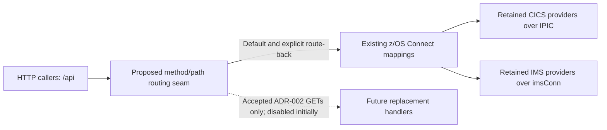
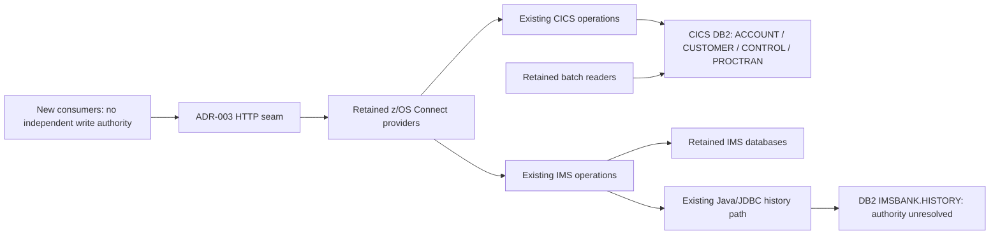
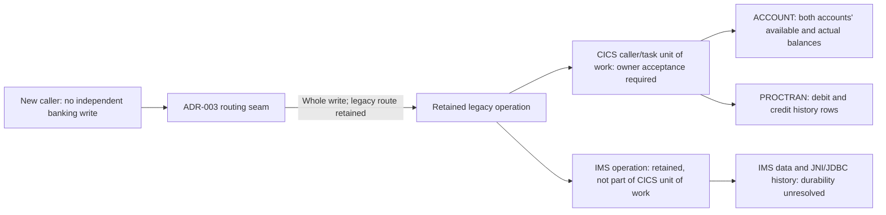

# Target architecture

## ADR-001 - Target runtime and platform

**Status: open; neither option selected.** The target language, framework and deployment platform remain undecided pending an accepted hosting and service contract.

### Justification

The existing REST mappings and configurable CICS/IMS connections provide a candidate boundary for evaluating a new runtime, not evidence of deployed use or approved contract preservation (A01/A02: `docs/modernization/01-rediscovery/integrations.md:334`, `docs/modernization/01-rediscovery/integrations.md:362`; audit rows: `docs/modernization/02-substitution-audit/audit.md:35`, `docs/modernization/02-substitution-audit/audit.md:54`). Existing Java/JDBC and Liberty configuration make JVM-based candidates worth evaluating, but do not prove application portability, team capability or supported target versions (I03: `docs/modernization/01-rediscovery/integrations.md:319`, `docs/modernization/01-rediscovery/integrations.md:327`; A02: `docs/modernization/01-rediscovery/integrations.md:364`; audit: `docs/modernization/02-substitution-audit/audit.md:48`). INT-Q01 leaves deployed callers, owners and service contracts unknown, while INT-Q06/Q07 leave identity enforcement and security/accounting dependencies unresolved; these inputs do not establish an approved host, capacity, availability target or platform preference (`docs/modernization/01-rediscovery/open-questions.md:332`, `docs/modernization/01-rediscovery/open-questions.md:404`, `docs/modernization/01-rediscovery/open-questions.md:415`). The audit also blocks transaction-manager substitution, so a framework transaction annotation cannot be assumed equivalent to the required banking unit of work (`docs/modernization/02-substitution-audit/audit.md:37`, `docs/modernization/02-substitution-audit/audit.md:56`).

### Two options

These are evaluation candidates, not approved substitutions or claims of compatibility.

| Option | Language, framework and deployment target | Trade-offs against the evidence |
|---|---|---|
| A - Off-mainframe JVM application | Java with Spring Boot, packaged as a Linux container on an operator-approved container hosting platform; provider and versions unselected. | Allows a separately operated HTTP application to be evaluated against the A01/A02 seam without initially relocating its dependencies. Adds a cross-platform network and identity boundary whose connectivity, latency, availability and support ownership need acceptance under INT-Q01/Q06/Q07; no evidence establishes container-hosting capability or that existing Java/JNI dependencies will run there. |
| B - Mainframe-hosted JVM application | Java with Jakarta EE on a supported Liberty runtime on z/OS; product edition and versions unselected. | Allows evaluation within the existing z/OS operational setting evidenced by A02, while retaining dependence on mainframe capacity, licensing and release operations. Existing z/OS Connect Liberty configuration is not evidence that it can host the new application, that its dependencies are Jakarta-compatible, or that co-location preserves transaction or identity semantics. |

### Consequences and selection gates

- Neither option authorizes provisioning, implementation, dependency upgrades, traffic movement or retirement. INT-Q01 and the consumed audit rows remain unresolved, not reclassified as keep/replace verdicts (`docs/modernization/01-rediscovery/open-questions.md:332`; `docs/modernization/02-substitution-audit/audit.md:7`).
- Before selection, obtain an owner-accepted deployment/service contract covering supported runtime versions, operating responsibility, cost/capacity, network access, latency, availability/recovery and enforced identity. Assess both candidates against that contract and the A01/A02 metadata requirements rather than assuming an existing Java or Liberty artifact determines the target (`docs/modernization/01-rediscovery/open-questions.md:332`, `docs/modernization/01-rediscovery/open-questions.md:404`, `docs/modernization/01-rediscovery/open-questions.md:415`).
- This record transfers no data ownership and selects no DB2/IMS migration or direct-access mechanism. A later coexistence decision must identify owners and supported access paths; preserve fixed-point money, distinguish NULL from zero/spaces and retain unresolved numeric declarations rather than normalizing them silently (`docs/modernization/02-substitution-audit/audit.md:39`; `docs/modernization/01-rediscovery/data-model.md:34`).
- A later transaction decision must define the atomic boundary for balances and history, commit/rollback ownership and failure/retry behavior before moving writes; neither HTTP calls nor co-location establish a shared unit of work. CICS and IMS durability questions remain blockers, not permission to split a transfer into independently committed calls (`docs/modernization/02-substitution-audit/audit.md:37`, `docs/modernization/02-substitution-audit/audit.md:56`).

**Verification boundary:** BNK1CCS, BNK1DCS, CRECUST, IBTRAN and BNKSTMTC have control flow **unverified by tooling**; the API and durability evidence above does not remove those limitations (`docs/modernization/00-source-of-truth/index.md:16`; `docs/modernization/01-rediscovery/integrations.md:9`). No module boundaries, integration replacement contracts or migration mechanism are selected in this runtime-only record.

## ADR-002 - Which transactions move first

**Choice:** Prioritize the two CICS-backed account-detail and balance GET operations sharing INQACC as the first migration candidate wave, with all live traffic remaining legacy until the acceptance gates below are met.

**Status: conditional sequencing decision, not cutover approval.** "Transactions" here means REST business operations, not CICS transaction-ID reassignment; this selects neither a target runtime nor an approved INQACC substitution.

### Justification

A01 maps both operations to the same INQACC provider, giving a bounded existing seam without selecting the entire account lifecycle (rediscovery: `docs/modernization/01-rediscovery/integrations.md:342`, `docs/modernization/01-rediscovery/integrations.md:345`; mappings: `src/api/src/main/operations/%2Faccounts%2F%7BaccountId%7D/get/operation.yaml:3`, `src/api/src/main/operations/%2Faccounts%2F%7BaccountId%7D%2Fbalances/get/operation.yaml:3`). INQACC reads ACCOUNT through a fetch-only cursor and a SELECT, with no business-table mutation in its scanned SQL inventory, so this wave avoids moving balance/history writes; it is not side-effect-free, because diagnostic LINKs and an abend rollback remain part of its contract (`src/base/cics/cobol/INQACC.cbl:66`; `docs/modernization/00-source-of-truth/programs/INQACC.md:118`; C03: `docs/modernization/01-rediscovery/integrations.md:74`). C02 shows INQACC is also called by display/delete and update screens, making a REST-only wave safer in scope than replacing their whole CICS transactions (`docs/modernization/01-rediscovery/integrations.md:41`, `docs/modernization/01-rediscovery/integrations.md:44`; `docs/modernization/00-source-of-truth/call-graph.md:249`, `docs/modernization/00-source-of-truth/call-graph.md:287`). This is a risk-containment ordering, not a proven business-value ranking or safety verdict: the back-end, REST, identity, unit-of-work and ACCOUNT data audit rows remain blocked (`docs/modernization/02-substitution-audit/audit.md:19`, `docs/modernization/02-substitution-audit/audit.md:35`, `docs/modernization/02-substitution-audit/audit.md:36`, `docs/modernization/02-substitution-audit/audit.md:37`, `docs/modernization/02-substitution-audit/audit.md:39`).

### First-wave boundary

Paths are relative to `/api` (A01: `docs/modernization/01-rediscovery/integrations.md:336`).

| Priority | Business operation | Shared legacy boundary |
|---|---|---|
| First wave, same acceptance scope | GET `/accounts/{accountId}` | INQACC; A01: `docs/modernization/01-rediscovery/integrations.md:342`. |
| First wave, same acceptance scope | GET `/accounts/{accountId}/balances` | INQACC; A01: `docs/modernization/01-rediscovery/integrations.md:345`. |

No other operation is included, and no second-wave order is selected. In particular, account/customer lists, customer inquiries, history, all writes, IMS and batch remain outside this wave; their existence is catalogued separately, not implied by the shared word "account" (`docs/modernization/01-rediscovery/repo-map.md:132`).

### Consequences and acceptance gates

- **Move only at the REST seam.** Use a strangler routing boundary for the two named GETs after acceptance, with an explicit route back to their existing z/OS Connect mappings. Keep routing disabled by default; require an owner-approved cohort, observable failure/latency criteria and a rehearsed route-back before any traffic shift (A01/A02 and INT-Q01: `docs/modernization/01-rediscovery/integrations.md:334`, `docs/modernization/01-rediscovery/integrations.md:362`, `docs/modernization/01-rediscovery/open-questions.md:572`). The routing product, percentages and numerical thresholds are not established by this evidence and are not selected here.
- **Do not reroute shared CICS callers or retire INQACC.** Display/delete and update screens retain their LINK paths; replacing the two GET handlers must not implicitly replace deletion, update or screen state. The provider's EIB-only OMEN property is metadata, not a BNKMENU dispatch instruction or a new transaction binding (C02/A02: `docs/modernization/01-rediscovery/integrations.md:41`, `docs/modernization/01-rediscovery/integrations.md:44`, `docs/modernization/01-rediscovery/integrations.md:366`; `src/api/src/main/zosAssets/INQACC/zosAsset.yaml:6`).
- **Keep data ownership and writes unchanged.** ACCOUNT, CUSTOMER, CONTROL and PROCTRAN remain under legacy write authority for this wave; no new writer, CDC store, cache, database migration or IMS/CICS entity merger is authorized. A separate coexistence decision must name accountable owners and approve the target read path and consistency/isolation contract before cutover; calling the unchanged legacy provider alone does not count as migrating inquiry behavior (S01/data representation and ownership blockers: `docs/modernization/01-rediscovery/data-model.md:34`, `docs/modernization/01-rediscovery/data-model.md:40`, `docs/modernization/01-rediscovery/open-questions.md:565`, `docs/modernization/01-rediscovery/open-questions.md:572`; shared access map: `docs/modernization/00-source-of-truth/data-access.md:9`).
- **Accept behavior, not just HTTP success.** Close the applicable INT-Q01/Q06/Q07, AUD-Q03/Q04 and DM-Q01/Q06 blockers with responsible reviewers: deployed callers/service ownership, enforced account access and attribution, per-operation result/error/recovery behavior, complete inquiry rules, decimal precision and NULL/value domains (`docs/modernization/01-rediscovery/open-questions.md:561`, `docs/modernization/01-rediscovery/open-questions.md:566`, `docs/modernization/01-rediscovery/open-questions.md:572`, `docs/modernization/01-rediscovery/open-questions.md:579`, `docs/modernization/01-rediscovery/open-questions.md:580`, `docs/modernization/01-rediscovery/open-questions.md:594`, `docs/modernization/01-rediscovery/open-questions.md:595`). Require accepted parity evidence for both response projections, missing accounts, boundary IDs, fixed-point balances, errors and concurrent legacy updates; do not silently convert NULL to zero/spaces or money to floating point (ACCOUNT model: `docs/modernization/01-rediscovery/data-model.md:40`). Specifically review the account-number `99999999` branch and blank/low-value account-type outcome rather than assuming ordinary point-lookup semantics (`src/base/cics/cobol/INQACC.cbl:218`, `src/base/cics/cobol/INQACC.cbl:229`; verified decisions: `docs/modernization/00-source-of-truth/programs/INQACC.md:85`).
- **Preserve failure and unit-of-work boundaries.** Accept the inquiry's diagnostic/rollback behavior under AUD-Q03 before substitution; "read-only business data" does not authorize removing ABNDPROC or caller rollback effects (`docs/modernization/00-source-of-truth/programs/INQACC.md:137`, `docs/modernization/00-source-of-truth/programs/INQACC.md:140`; `docs/modernization/02-substitution-audit/audit.md:24`). Keep transfers, deposits and other writes on their existing paths; a later write-migration decision must establish one atomic commit/rollback boundary for all balance/history effects, not independently committed debit, credit and history calls (CICS unit-of-work and IMS durability blockers: `docs/modernization/02-substitution-audit/audit.md:37`, `docs/modernization/02-substitution-audit/audit.md:56`).

ADR-001 remains open and gates implementation; this record supplies no runtime choice, replacement API/event schema or phase-3b rewrite tasks (`docs/modernization/03a-architecture/target-architecture.md:5`). Every consumed audit verdict remains **blocked** until separately reviewed; prioritization does not resolve an unknown or authorize production movement (`docs/modernization/02-substitution-audit/audit.md:7`).

**Verification boundary:** INQACC parsed successfully, but generated analysis does not prove a deployed contract (`docs/modernization/00-source-of-truth/programs/INQACC.md:10`; INT-Q01 above). BNK1CCS, BNK1DCS, CRECUST, IBTRAN and BNKSTMTC have control flow **unverified by tooling**; deferring their flows is not a completeness, retirement or equivalence verdict (`docs/modernization/00-source-of-truth/index.md:16`). API configuration evidence is direct-source evidence, outside COBOL parser scope (`docs/modernization/00-source-of-truth/index.md:106`).

## ADR-003 - Integration seam (z/OS Connect APIs)

**Choice:** Use the existing `/api` HTTP operation boundary in front of z/OS Connect as the strangler integration seam, retaining legacy provider calls behind it and admitting replacement handlers only after operation-specific contract acceptance.

**Status: seam selected; contracts and live traffic shifts remain gated.** This refines ADR-002's routing boundary without selecting a gateway product, target runtime or additional migration wave.

### Justification

A01 supplies an existing method/path-to-provider boundary for both CICS and IMS, so callers need not acquire COMMAREA or IMS message-layout coupling to reach retained behavior (`docs/modernization/01-rediscovery/integrations.md:334`; direct API base-path evidence: `src/api/src/main/api/openapi.yaml:25`). A02 already separates CICS IPIC and IMS connections, allowing the seam to retain those distinct legacy destinations rather than treating CICS and IMS operations as interchangeable (`docs/modernization/01-rediscovery/integrations.md:362`; direct connections: `src/api/src/main/liberty/config/cics.xml:7`, `src/api/src/main/liberty/config/ims.xml:7`). Choosing this boundary avoids a simultaneous replacement of the C02 LINK/COMMAREA contracts, but does not approve any existing REST contract as sufficient: the CICS REST, identity and IMS REST audit rows remain blocked (`docs/modernization/01-rediscovery/integrations.md:31`; `docs/modernization/02-substitution-audit/audit.md:35`, `docs/modernization/02-substitution-audit/audit.md:36`, `docs/modernization/02-substitution-audit/audit.md:54`). INT-Q01, INT-Q06/Q07 and AUD-Q03 therefore gate traffic movement on accepted ownership, authorization/attribution and result/recovery semantics, not merely a matching URL (`docs/modernization/01-rediscovery/open-questions.md:572`, `docs/modernization/01-rediscovery/open-questions.md:594`, `docs/modernization/01-rediscovery/open-questions.md:595`, `docs/modernization/01-rediscovery/open-questions.md:579`).

### Consequences and acceptance gates

- **Route whole operations, not internal steps.** Match method and path, retaining `/api` and the distinct `/ims` namespace. Only GET `/accounts/{accountId}` and GET `/accounts/{accountId}/balances` are candidate replacement routes under ADR-002; every other operation remains on its existing z/OS Connect mapping. Neither a shared provider nor similar path spelling authorizes broader routing (A01: `docs/modernization/01-rediscovery/integrations.md:342`, `docs/modernization/01-rediscovery/integrations.md:345`, `docs/modernization/01-rediscovery/integrations.md:355`; direct mappings: `src/api/src/main/operations/%2Faccounts%2F%7BaccountId%7D/get/operation.yaml:3`, `src/api/src/main/operations/%2Faccounts%2F%7BaccountId%7D%2Fbalances/get/operation.yaml:3`).
- **Accept the wire contract before substituting it.** Treat OpenAPI plus the operation request/response mappings as evidence to reconcile with owner-accepted behavior, not proof of deployed equivalence. Preserve accepted identifiers, validation, decimal precision, response projections, status/error bodies and failure/retry semantics; the detail and balance GETs have distinct declared response schemas despite sharing a provider (`src/api/src/main/api/openapi.yaml:473`, `src/api/src/main/api/openapi.yaml:570`). Do not expose raw COMMAREAs, silently normalize NULL/zero/spaces, convert money to floating point, or replace synchronous results with events under this decision (A01, representation and AUD-Q03: `docs/modernization/01-rediscovery/integrations.md:334`, `docs/modernization/01-rediscovery/data-model.md:34`, `docs/modernization/01-rediscovery/open-questions.md:579`; audit: `docs/modernization/02-substitution-audit/audit.md:39`).
- **Keep coexistence behind legacy APIs.** For operations still delegated, access legacy data through the retained z/OS Connect providers; new consumers must not bypass that boundary with direct DB2/IMS writes. This grants no new table/segment write authority, replication or entity merger, and leaves legacy writers and CICS LINK callers unchanged. ADR-002's separate target read-path/consistency gate still applies: forwarding to an unchanged provider is integration, not migration of inquiry behavior (C02/A02: `docs/modernization/01-rediscovery/integrations.md:31`, `docs/modernization/01-rediscovery/integrations.md:362`; data-contract blockers: `docs/modernization/02-substitution-audit/audit.md:39`, `docs/modernization/01-rediscovery/open-questions.md:572`).
- **Do not split a banking unit of work across HTTP calls.** Retain each legacy write operation intact; no separately committed debit, credit or history calls, dual writes, automatic write replay, or retry on a replacement after an ambiguous legacy timeout is authorized. HTTP routing establishes neither distributed atomicity nor idempotency; write substitution needs an accepted commit/rollback owner and failure/retry contract, including the unresolved IMS/DB2 durability boundary (AUD-Q03 and unit-of-work audit rows: `docs/modernization/01-rediscovery/open-questions.md:579`; `docs/modernization/02-substitution-audit/audit.md:37`, `docs/modernization/02-substitution-audit/audit.md:56`).
- **Gate both routes on identity and operational acceptance.** Require owner-approved caller authorization, backend identity propagation/attribution and dependent transaction-accounting semantics on both legacy and replacement paths; placeholder OAuth declarations and EIB-only transaction IDs establish none of these. Keep replacements disabled by default, with explicit method/path/cohort controls, correlated route/outcome/latency visibility, accepted thresholds and a rehearsed route-back for subsequent requests. Route-back does not undo committed effects or authorize replay; routing product, numerical thresholds and security mechanism remain unselected (A02/A03 and INT-Q01/Q06/Q07: `docs/modernization/01-rediscovery/integrations.md:366`, `docs/modernization/01-rediscovery/integrations.md:375`, `docs/modernization/01-rediscovery/open-questions.md:572`, `docs/modernization/01-rediscovery/open-questions.md:594`, `docs/modernization/01-rediscovery/open-questions.md:595`).

**Risks and limits:** Client/contract drift, lost authorization/accounting context and partial or duplicate writes are mitigated by the acceptance gates above, not assumed resolved. All consumed audit rows remain **blocked**; ADR-001 remains open, and no deployment, provider retirement, internal LINK replacement or phase-3b rewrite task is authorized. BNK1CCS, BNK1DCS, CRECUST, IBTRAN and BNKSTMTC have control flow **unverified by tooling**; this seam decision does not certify their behavior (`docs/modernization/00-source-of-truth/index.md:16`). API/configuration evidence is outside the COBOL parser's scope and uses direct-source citations (`docs/modernization/00-source-of-truth/index.md:106`).

## ADR-004 - System of record and data migration path

**Choice:** Retain the existing CICS DB2 and IMS stores under their respective legacy write authorities during strangler coexistence, sharing data through retained APIs rather than introducing a second writable system of record.

**Status: coexistence policy selected; physical migration and permanent target database not selected.** This is a constraint on later changes, not a keep-as-is audit verdict or live cutover approval; the authority between IMS HISTORY and DB2 IMSBANK.HISTORY on partial failure remains unknown.

### Justification

S01-S04 show shared CICS account, customer, allocation and processed-history dependencies, including batch readers, so moving an HTTP handler cannot transfer ownership of its underlying tables (`docs/modernization/01-rediscovery/integrations.md:173`, `docs/modernization/01-rediscovery/integrations.md:188`, `docs/modernization/01-rediscovery/integrations.md:200`, `docs/modernization/01-rediscovery/integrations.md:214`; batch data audit: `docs/modernization/02-substitution-audit/audit.md:68`). The CICS/IMS correspondence is structural only, with different identities, balances and customer-state meanings; DM-Q05 provides no crosswalk that would justify merging their records (`docs/modernization/01-rediscovery/data-model.md:251`; `docs/modernization/01-rediscovery/open-questions.md:565`; IMS store audit: `docs/modernization/02-substitution-audit/audit.md:57`). Transfer balance updates and paired history insert attempts belong to the same banking operation, while IMS/DB2 history durability is unresolved, making a second writer or independently committed history path unjustified (XFRFUN-R06/R09/R11: `docs/modernization/01-rediscovery/business-rules.md:19`, `docs/modernization/01-rediscovery/business-rules.md:25`, `docs/modernization/01-rediscovery/business-rules.md:29`; I02: `docs/modernization/01-rediscovery/integrations.md:317`; audit: `docs/modernization/02-substitution-audit/audit.md:37`, `docs/modernization/02-substitution-audit/audit.md:56`). A01/A02 supply retained API access for coexistence, but INT-Q01 and the blocked data audit rows require accountable owners and accepted contracts before any ownership transfer (`docs/modernization/01-rediscovery/integrations.md:334`, `docs/modernization/01-rediscovery/integrations.md:362`; `docs/modernization/01-rediscovery/open-questions.md:572`; `docs/modernization/02-substitution-audit/audit.md:39`, `docs/modernization/02-substitution-audit/audit.md:59`).

### Data authority during coexistence

The authorities below are architectural responsibility boundaries, not claims about named deployed teams. Accountable business, runtime and recovery owners remain **unknown** under INT-Q01 and must be recorded before traffic movement (`docs/modernization/01-rediscovery/open-questions.md:572`).

| Store / data | Retained authority and access constraint | Evidence |
|---|---|---|
| CICS DB2 ACCOUNT and CUSTOMER | Existing CICS business paths retain online write authority; existing setup paths remain separately controlled. New consumers use retained APIs, not direct writes; existing batch readers remain unchanged. | S01/S03: `docs/modernization/01-rediscovery/integrations.md:173`, `docs/modernization/01-rediscovery/integrations.md:200`; schemas: `docs/modernization/01-rediscovery/data-model.md:40`, `docs/modernization/01-rediscovery/data-model.md:63`. |
| CICS DB2 CONTROL | Existing CICS allocation/serialization boundary retains counter authority; no parallel allocator or new sequence is authorized. Qualification/nullability must be reconciled, not guessed. | S02: `docs/modernization/01-rediscovery/integrations.md:188`; model: `docs/modernization/01-rediscovery/data-model.md:115`; DM-Q02: `docs/modernization/01-rediscovery/open-questions.md:562`. |
| CICS DB2 PROCTRAN | Existing business operations retain history-write authority, with existing inquiry and statement readers; it is banking history, not a disposable diagnostic projection. | S04: `docs/modernization/01-rediscovery/integrations.md:214`; model: `docs/modernization/01-rediscovery/data-model.md:87`; audit: `docs/modernization/02-substitution-audit/audit.md:40`. |
| IMS ACCOUNT, CUSTOMER and CUSTACCS | Existing IMS transaction/load boundaries retain authority; CICS entities do not supersede these records. Installed login-writer identity and association cardinality remain acceptance gates. | S06/S07: `docs/modernization/01-rediscovery/integrations.md:235`, `docs/modernization/01-rediscovery/integrations.md:255`; DM-Q04/Q05 and INT-Q04: `docs/modernization/01-rediscovery/open-questions.md:564`, `docs/modernization/01-rediscovery/open-questions.md:565`, `docs/modernization/01-rediscovery/open-questions.md:573`. |
| IMS HISTORY and separate DB2 IMSBANK.HISTORY | Retain both existing paths without declaring either authoritative on disagreement or redundant. An IMS/runtime and DB2 owner must settle recovery authority before either path can migrate. | I02/I03: `docs/modernization/01-rediscovery/integrations.md:317`, `docs/modernization/01-rediscovery/integrations.md:324`; DM-Q03/Q08: `docs/modernization/01-rediscovery/open-questions.md:563`, `docs/modernization/01-rediscovery/open-questions.md:568`; audit: `docs/modernization/02-substitution-audit/audit.md:59`. |
| IMS TSTAT, ACCTYPE, CUSTTYPE, TTYPE and TSTATTYP | Retain existing load/view boundaries; authority for online consumers is unknown. Do not copy, merge or retire them based on absent established callers. | S07: `docs/modernization/01-rediscovery/integrations.md:255`; INT-Q05: `docs/modernization/01-rediscovery/open-questions.md:574`; audit: `docs/modernization/02-substitution-audit/audit.md:60`. |

ABNDFILE remains the separate retained diagnostic store, not a replacement transaction ledger or reconciliation source; its write can fail (`docs/modernization/01-rediscovery/integrations.md:231`; `docs/modernization/01-rediscovery/data-model.md:127`; audit: `docs/modernization/02-substitution-audit/audit.md:24`).

The diagram expresses retained access boundaries, not verified cross-store atomicity (S01-S04/I02/A02: `docs/modernization/01-rediscovery/integrations.md:173`, `docs/modernization/01-rediscovery/integrations.md:214`, `docs/modernization/01-rediscovery/integrations.md:317`, `docs/modernization/01-rediscovery/integrations.md:362`).

### Migration path and consequences

1. **Start without a data move.** Retain existing stores, writers and readers; new consumers share legacy-managed data through the ADR-003 providers. No direct target DB2/IMS write, application dual write, replica, cache or CDC pipeline is authorized. ADR-002's inquiry read-path/consistency gate remains open: forwarding to INQACC is coexistence, not replacement of inquiry behavior; this ADR does not approve direct SQL or stale replicated balances (S01/A02 and INT-Q01: `docs/modernization/01-rediscovery/integrations.md:173`, `docs/modernization/01-rediscovery/integrations.md:362`, `docs/modernization/01-rediscovery/open-questions.md:572`; ADR-002: `docs/modernization/03a-architecture/target-architecture.md:52`).
2. **Accept the data contract before designing relocation.** Require owner-approved deployed schemas, fixed-point precision/scale, NULL/value domains, identifier widths/leading zeros, date/encoding conversions and association/history identity. Preserve CICS and IMS identities separately; do not manufacture a crosswalk, infer unique PROCTRAN locators or impose unproven foreign keys. Resolve applicable DM-Q01-Q06/DM-Q10 and the HISTORY 56/64-byte mismatch before a copy can be judged lossless (`docs/modernization/01-rediscovery/data-model.md:34`, `docs/modernization/01-rediscovery/data-model.md:89`, `docs/modernization/01-rediscovery/data-model.md:180`, `docs/modernization/01-rediscovery/data-model.md:236`, `docs/modernization/01-rediscovery/data-model.md:251`; `docs/modernization/01-rediscovery/open-questions.md:561`, `docs/modernization/01-rediscovery/open-questions.md:563`, `docs/modernization/01-rediscovery/open-questions.md:570`).
3. **Require a separate relocation decision before copying or switching authority.** That decision must name the destination and owners, cover every writer/reader including setup and batch, and approve a consistent extraction boundary, change capture or write-quiescence mechanism, reconciliation and recovery. Acceptance must account for every in-scope record, exact balances/amounts, history multiplicity, relationships and allocation continuity at the same boundary, with no unexplained differences; no supported CDC facility, outage window or numerical recovery objective is assumed here (shared dependencies S01-S04/S08/B03: `docs/modernization/01-rediscovery/integrations.md:173`, `docs/modernization/01-rediscovery/integrations.md:214`, `docs/modernization/01-rediscovery/integrations.md:267`, `docs/modernization/01-rediscovery/integrations.md:412`; unresolved ownership, history and service contracts: `docs/modernization/01-rediscovery/open-questions.md:568`, `docs/modernization/01-rediscovery/open-questions.md:570`, `docs/modernization/01-rediscovery/open-questions.md:572`, `docs/modernization/01-rediscovery/open-questions.md:597`).
4. **Transfer a complete write authority, never individual transfer steps.** Any later cutover must fence old writers, drain/reconcile in-flight work and activate exactly one authority for the accepted data scope. For a replacement CICS transfer, both accounts' available/actual balance changes and both history rows must commit or roll back in one transactional boundary; no saga or asynchronously written history is approved as equivalent. Resolve the legacy caller/syncpoint, rollback and retry questions before asserting parity; retain the whole legacy operation until then. IMS account/history migration additionally requires an accepted IMS/DB2 durability and partial-failure contract, not an assumption of coordinated commit (XFRFUN-R06/R09/R11 and DM-Q08: `docs/modernization/01-rediscovery/business-rules.md:19`, `docs/modernization/01-rediscovery/business-rules.md:25`, `docs/modernization/01-rediscovery/business-rules.md:29`, `docs/modernization/01-rediscovery/open-questions.md:568`; audit: `docs/modernization/02-substitution-audit/audit.md:37`, `docs/modernization/02-substitution-audit/audit.md:56`).
5. **Separate route-back from data rollback.** Before authority moves, ADR-003 route-back continues to use the same stores; after new writes, routing back alone cannot restore old data. A later relocation decision must require write fencing, reconciliation and an accepted reverse-data recovery or forward-recovery procedure before reopening legacy writes. Never replay an ambiguously completed write automatically, retire a history store without DM-Q08 resolution, or disconnect statement readers before their accepted cutoff/recovery contract is preserved (AUD-Q03, DM-Q08 and INT-Q10: `docs/modernization/01-rediscovery/open-questions.md:579`, `docs/modernization/01-rediscovery/open-questions.md:568`, `docs/modernization/01-rediscovery/open-questions.md:597`).

**Risks and limits:** API-mediated coexistence retains mainframe availability/latency dependencies; INT-Q01 service acceptance gates live use rather than an invented performance guarantee. Divergent schemas/identities and uncertain history durability block physical migration, mitigated by contract reconciliation and explicit authority/recovery acceptance, not silent normalization. Every consumed audit row remains **blocked** (`docs/modernization/02-substitution-audit/audit.md:7`). BNK1CCS, BNK1DCS, CRECUST, IBTRAN and BNKSTMTC have control flow **unverified by tooling**; existing XFRFUN coverage/retry questions also remain unresolved (`docs/modernization/00-source-of-truth/index.md:16`; `docs/modernization/01-rediscovery/open-questions.md:557`, `docs/modernization/01-rediscovery/open-questions.md:559`). This decision selects no permanent database, replication product, implementation task or new migration wave.

## ADR-005 - Coexistence and transaction boundaries

**Choice:** During API-mediated coexistence, delegate each write operation intact to its legacy transaction boundary, and permit a later replacement only with an accepted commit/rollback owner covering all required effects, including both accounts' balances and both history rows for a CICS transfer.

**Status: boundary constraint selected; write replacement and live cutover not approved.** This refines ADR-003/004 without choosing a runtime, distributed transaction mechanism or additional migration wave.

### Justification

C02 and A01/A02 expose synchronous business operations at existing LINK/COMMAREA and REST/provider seams, supporting whole-operation delegation rather than remote orchestration of individual database changes (`docs/modernization/01-rediscovery/integrations.md:31`, `docs/modernization/01-rediscovery/integrations.md:334`, `docs/modernization/01-rediscovery/integrations.md:362`; audit: `docs/modernization/02-substitution-audit/audit.md:18`, `docs/modernization/02-substitution-audit/audit.md:35`). XFRFUN-R04/R05/R06/R09/R11 couple ordered balance updates, rollback/restart paths and paired history inserts, but neither a success flag nor returned balances prove commitment (`docs/modernization/01-rediscovery/business-rules.md:15`, `docs/modernization/01-rediscovery/business-rules.md:17`, `docs/modernization/01-rediscovery/business-rules.md:19`, `docs/modernization/01-rediscovery/business-rules.md:25`, `docs/modernization/01-rediscovery/business-rules.md:29`; audit: `docs/modernization/02-substitution-audit/audit.md:37`). S01-S04 show shared stores and allocation serialization, so an HTTP route cannot confer independent write authority or bypass concurrent legacy callers (`docs/modernization/01-rediscovery/integrations.md:173`, `docs/modernization/01-rediscovery/integrations.md:188`, `docs/modernization/01-rediscovery/integrations.md:200`, `docs/modernization/01-rediscovery/integrations.md:214`; audit: `docs/modernization/02-substitution-audit/audit.md:28`, `docs/modernization/02-substitution-audit/audit.md:39`, `docs/modernization/02-substitution-audit/audit.md:40`). I02 and DM-Q08 leave coordinated IMS/DB2 history durability unknown, requiring a separate accepted recovery contract rather than extending a CICS atomicity claim to IMS (`docs/modernization/01-rediscovery/integrations.md:317`, `docs/modernization/01-rediscovery/open-questions.md:568`; audit: `docs/modernization/02-substitution-audit/audit.md:56`).

The diagram distinguishes responsibility boundaries, not a verified commit protocol; ACCOUNT/PROCTRAN access and rollback touchpoints are corroborated by the generated inventories (`docs/modernization/00-source-of-truth/data-access.md:9`, `docs/modernization/00-source-of-truth/data-access.md:12`, `docs/modernization/00-source-of-truth/programs/XFRFUN.md:165`). The IMS history qualification is I02 above; HTTP does not join these boundaries.

### Consequences and acceptance gates

- **Share data without a second writer.** ADR-004's authority table remains controlling: CICS business paths retain ACCOUNT/CUSTOMER/CONTROL/PROCTRAN authority, IMS paths retain their separate stores, and IMS/DB2 history precedence stays unknown. New consumers use retained providers; no direct new writes, application dual writes, CDC-backed writable copy or cross-system entity merger is authorized. Existing screens, MQ, setup/load paths and batch readers remain outside the HTTP route switch; accountable operating/recovery owners must be named under INT-Q01, not inferred from a program name (`docs/modernization/03a-architecture/target-architecture.md:103`; C02/M01/M02/B03: `docs/modernization/01-rediscovery/integrations.md:31`, `docs/modernization/01-rediscovery/integrations.md:380`, `docs/modernization/01-rediscovery/integrations.md:390`, `docs/modernization/01-rediscovery/integrations.md:408`; `docs/modernization/01-rediscovery/open-questions.md:572`).
- **Keep the transfer indivisible.** A later replacement must use one transaction covering both accounts' available/actual balance changes and both PROCTRAN rows, with one commit decision and rollback of all those effects on failure; no independently committed debit, credit or asynchronous history, and no compensating saga is approved as equivalent. Preserve the accepted lower-account-first ordering and fixed-point arithmetic; concurrency/isolation acceptance must demonstrate no lost balance updates under retained writers, not merely balanced arithmetic in one request. This is a target constraint, not proof of legacy atomicity or approval to correct unresolved source behavior (XFRFUN-R04/R05/R06/R11: `docs/modernization/01-rediscovery/business-rules.md:15`, `docs/modernization/01-rediscovery/business-rules.md:17`, `docs/modernization/01-rediscovery/business-rules.md:19`, `docs/modernization/01-rediscovery/business-rules.md:29`; shared access S01: `docs/modernization/01-rediscovery/integrations.md:173`; audit: `docs/modernization/02-substitution-audit/audit.md:37`).
- **Accept the caller's full unit of work, not just the callee.** Before moving any write, document per supported REST, LINK and MQ entry point who starts/ends the transaction, where successful commit occurs, what rollback/abend rolls back, and whether caller work precedes or follows the operation. Do not insert a callee commit, shrink caller rollback scope or assume a COMMAREA success/HTTP response certifies durable completion. Require accepted success/failure/status and recovery mappings under INT-Q01/AUD-Q03; the caller-owned unit-of-work audit row remains blocked (`docs/modernization/01-rediscovery/integrations.md:31`, `docs/modernization/01-rediscovery/business-rules.md:19`, `docs/modernization/01-rediscovery/business-rules.md:29`, `docs/modernization/01-rediscovery/open-questions.md:572`, `docs/modernization/01-rediscovery/open-questions.md:579`; `docs/modernization/02-substitution-audit/audit.md:37`).
- **Separate retry, uncertain outcome and route-back.** Leave legacy retries inside the retained operation; do not stack a gateway retry policy on XFRFUN's unresolved restart loop. An ambiguous timeout is an unknown outcome, not a rejection or permission to replay on either destination; require owner-directed outcome investigation/reconciliation until an accepted duplicate-prevention and retry contract exists. PROCTRAN's locator is not a proven idempotency key. Route-back changes subsequent routing only and must not replay an in-flight write or undo committed data (XFRFUN-R09 and XFRFUN-Q02/Q03/Q05: `docs/modernization/01-rediscovery/business-rules.md:25`, `docs/modernization/01-rediscovery/open-questions.md:558`, `docs/modernization/01-rediscovery/open-questions.md:559`, `docs/modernization/01-rediscovery/open-questions.md:560`; DM-Q10/AUD-Q03: `docs/modernization/01-rediscovery/open-questions.md:570`, `docs/modernization/01-rediscovery/open-questions.md:579`).
- **Do not invent coordinated IMS durability.** Retain the whole IMS write/history path until DM-Q08 and TOOL-Q05 establish the transaction owner, durable outcomes and authoritative store/recovery action on partial failure, including JDBC/JNI failures. No new distributed transaction or eventual-consistency contract is selected, and neither IMS HISTORY nor DB2 IMSBANK.HISTORY is declared disposable. IBTRAN has control flow **unverified by tooling**; JNI/Java semantics are outside parser scope (I02: `docs/modernization/01-rediscovery/integrations.md:301`, `docs/modernization/01-rediscovery/integrations.md:317`; `docs/modernization/01-rediscovery/open-questions.md:555`, `docs/modernization/01-rediscovery/open-questions.md:568`; audit: `docs/modernization/02-substitution-audit/audit.md:56`, `docs/modernization/02-substitution-audit/audit.md:59`).
- **Gate write movement on outcome evidence and fencing.** Require accepted failure/concurrency evidence for each update and history-insert boundary, missing accounts, rollback failure, deadlock/retry exhaustion, timeout after commit and duplicate delivery. For an accepted replacement transfer, require exact fixed-point balance deltas and exactly two matching history rows on committed success, and zero committed transfer balance/history effects on rolled-back failure; unresolved legacy paths must receive reviewer-approved outcomes before equivalence is claimed. Before authority moves, fence every old writer in the accepted scope and drain/reconcile in-flight work, including non-HTTP paths; overlapping transfer endpoints cannot be split between independent authorities. ADR-002 read candidates still need an accepted read-path/isolation contract; this record authorizes neither a direct SQL read nor a stale balance replica (XFRFUN-R06/R09/R11 and XFRFUN-Q01/Q02/Q03: `docs/modernization/01-rediscovery/business-rules.md:19`, `docs/modernization/01-rediscovery/business-rules.md:25`, `docs/modernization/01-rediscovery/business-rules.md:29`, `docs/modernization/01-rediscovery/open-questions.md:557`, `docs/modernization/01-rediscovery/open-questions.md:558`, `docs/modernization/01-rediscovery/open-questions.md:559`; ownership/recovery: `docs/modernization/01-rediscovery/open-questions.md:572`, `docs/modernization/01-rediscovery/open-questions.md:579`; ADR-002/004: `docs/modernization/03a-architecture/target-architecture.md:52`, `docs/modernization/03a-architecture/target-architecture.md:137`).

**Risks and limits:** Unknown caller rollback scope, duplicate replay, concurrent writers and partial IMS/DB2 history effects block write substitution; the gates above contain these risks without declaring them resolved. Diagnostics are not commit evidence or a substitute ledger: ABNDFILE persistence can itself fail (S05: `docs/modernization/01-rediscovery/integrations.md:231`; audit: `docs/modernization/02-substitution-audit/audit.md:24`). All consumed audit verdicts remain **blocked**; XFRFUN-Q01/Q02/Q03/Q05 and DM-Q08 remain open, not silently corrected (`docs/modernization/02-substitution-audit/audit.md:7`; `docs/modernization/01-rediscovery/open-questions.md:557`, `docs/modernization/01-rediscovery/open-questions.md:568`). BNK1CCS, BNK1DCS, CRECUST, IBTRAN and BNKSTMTC have control flow **unverified by tooling**; no portability, retirement or equivalence verdict is implied (`docs/modernization/00-source-of-truth/index.md:16`).
