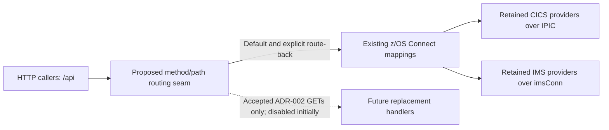

# Target architecture

## ADR-001 - Target runtime and platform

**Status: open; neither option selected.** The target language, framework and deployment platform remain undecided pending an accepted hosting and service contract.

### Justification

The existing REST mappings and configurable CICS/IMS connections provide a candidate boundary for evaluating a new runtime, not evidence of deployed use or approved contract preservation (A01/A02: `docs/modernization/01-rediscovery/integrations.md:334`, `docs/modernization/01-rediscovery/integrations.md:362`; audit rows: `docs/modernization/02-substitution-audit/audit.md:35`, `docs/modernization/02-substitution-audit/audit.md:54`). Existing Java/JDBC and Liberty configuration make JVM-based candidates worth evaluating, but do not prove application portability, team capability or supported target versions (I03: `docs/modernization/01-rediscovery/integrations.md:319`, `docs/modernization/01-rediscovery/integrations.md:327`; A02: `docs/modernization/01-rediscovery/integrations.md:364`; audit: `docs/modernization/02-substitution-audit/audit.md:48`). INT-Q01 leaves deployed callers, owners and service contracts unknown, while INT-Q06/Q07 leave identity enforcement and security/accounting dependencies unresolved; these inputs do not establish an approved host, capacity, availability target or platform preference (`docs/modernization/01-rediscovery/open-questions.md:332`, `docs/modernization/01-rediscovery/open-questions.md:404`, `docs/modernization/01-rediscovery/open-questions.md:415`). The audit also blocks transaction-manager substitution, so a framework transaction annotation cannot be assumed equivalent to the required banking unit of work (`docs/modernization/02-substitution-audit/audit.md:37`, `docs/modernization/02-substitution-audit/audit.md:56`).

### Two options

These are evaluation candidates, not approved substitutions or claims of compatibility.

| Option | Language, framework and deployment target | Trade-offs against the evidence |
|---|---|---|
| A - Off-mainframe JVM application | Java with Spring Boot, packaged as a Linux container on an operator-approved container hosting platform; provider and versions unselected. | Allows a separately operated HTTP application to be evaluated against the A01/A02 seam without initially relocating its dependencies. Adds a cross-platform network and identity boundary whose connectivity, latency, availability and support ownership need acceptance under INT-Q01/Q06/Q07; no evidence establishes container-hosting capability or that existing Java/JNI dependencies will run there. |
| B - Mainframe-hosted JVM application | Java with Jakarta EE on a supported Liberty runtime on z/OS; product edition and versions unselected. | Allows evaluation within the existing z/OS operational setting evidenced by A02, while retaining dependence on mainframe capacity, licensing and release operations. Existing z/OS Connect Liberty configuration is not evidence that it can host the new application, that its dependencies are Jakarta-compatible, or that co-location preserves transaction or identity semantics. |

### Consequences and selection gates

- Neither option authorizes provisioning, implementation, dependency upgrades, traffic movement or retirement. INT-Q01 and the consumed audit rows remain unresolved, not reclassified as keep/replace verdicts (`docs/modernization/01-rediscovery/open-questions.md:332`; `docs/modernization/02-substitution-audit/audit.md:7`).
- Before selection, obtain an owner-accepted deployment/service contract covering supported runtime versions, operating responsibility, cost/capacity, network access, latency, availability/recovery and enforced identity. Assess both candidates against that contract and the A01/A02 metadata requirements rather than assuming an existing Java or Liberty artifact determines the target (`docs/modernization/01-rediscovery/open-questions.md:332`, `docs/modernization/01-rediscovery/open-questions.md:404`, `docs/modernization/01-rediscovery/open-questions.md:415`).
- This record transfers no data ownership and selects no DB2/IMS migration or direct-access mechanism. A later coexistence decision must identify owners and supported access paths; preserve fixed-point money, distinguish NULL from zero/spaces and retain unresolved numeric declarations rather than normalizing them silently (`docs/modernization/02-substitution-audit/audit.md:39`; `docs/modernization/01-rediscovery/data-model.md:34`).
- A later transaction decision must define the atomic boundary for balances and history, commit/rollback ownership and failure/retry behavior before moving writes; neither HTTP calls nor co-location establish a shared unit of work. CICS and IMS durability questions remain blockers, not permission to split a transfer into independently committed calls (`docs/modernization/02-substitution-audit/audit.md:37`, `docs/modernization/02-substitution-audit/audit.md:56`).

**Verification boundary:** BNK1CCS, BNK1DCS, CRECUST, IBTRAN and BNKSTMTC have control flow **unverified by tooling**; the API and durability evidence above does not remove those limitations (`docs/modernization/00-source-of-truth/index.md:16`; `docs/modernization/01-rediscovery/integrations.md:9`). No module boundaries, integration replacement contracts or migration mechanism are selected in this runtime-only record.

## ADR-002 - Which transactions move first

**Choice:** Prioritize the two CICS-backed account-detail and balance GET operations sharing INQACC as the first migration candidate wave, with all live traffic remaining legacy until the acceptance gates below are met.

**Status: conditional sequencing decision, not cutover approval.** "Transactions" here means REST business operations, not CICS transaction-ID reassignment; this selects neither a target runtime nor an approved INQACC substitution.

### Justification

A01 maps both operations to the same INQACC provider, giving a bounded existing seam without selecting the entire account lifecycle (rediscovery: `docs/modernization/01-rediscovery/integrations.md:342`, `docs/modernization/01-rediscovery/integrations.md:345`; mappings: `src/api/src/main/operations/%2Faccounts%2F%7BaccountId%7D/get/operation.yaml:3`, `src/api/src/main/operations/%2Faccounts%2F%7BaccountId%7D%2Fbalances/get/operation.yaml:3`). INQACC reads ACCOUNT through a fetch-only cursor and a SELECT, with no business-table mutation in its scanned SQL inventory, so this wave avoids moving balance/history writes; it is not side-effect-free, because diagnostic LINKs and an abend rollback remain part of its contract (`src/base/cics/cobol/INQACC.cbl:66`; `docs/modernization/00-source-of-truth/programs/INQACC.md:118`; C03: `docs/modernization/01-rediscovery/integrations.md:74`). C02 shows INQACC is also called by display/delete and update screens, making a REST-only wave safer in scope than replacing their whole CICS transactions (`docs/modernization/01-rediscovery/integrations.md:41`, `docs/modernization/01-rediscovery/integrations.md:44`; `docs/modernization/00-source-of-truth/call-graph.md:249`, `docs/modernization/00-source-of-truth/call-graph.md:287`). This is a risk-containment ordering, not a proven business-value ranking or safety verdict: the back-end, REST, identity, unit-of-work and ACCOUNT data audit rows remain blocked (`docs/modernization/02-substitution-audit/audit.md:19`, `docs/modernization/02-substitution-audit/audit.md:35`, `docs/modernization/02-substitution-audit/audit.md:36`, `docs/modernization/02-substitution-audit/audit.md:37`, `docs/modernization/02-substitution-audit/audit.md:39`).

### First-wave boundary

Paths are relative to `/api` (A01: `docs/modernization/01-rediscovery/integrations.md:336`).

| Priority | Business operation | Shared legacy boundary |
|---|---|---|
| First wave, same acceptance scope | GET `/accounts/{accountId}` | INQACC; A01: `docs/modernization/01-rediscovery/integrations.md:342`. |
| First wave, same acceptance scope | GET `/accounts/{accountId}/balances` | INQACC; A01: `docs/modernization/01-rediscovery/integrations.md:345`. |

No other operation is included, and no second-wave order is selected. In particular, account/customer lists, customer inquiries, history, all writes, IMS and batch remain outside this wave; their existence is catalogued separately, not implied by the shared word "account" (`docs/modernization/01-rediscovery/repo-map.md:132`).

### Consequences and acceptance gates

- **Move only at the REST seam.** Use a strangler routing boundary for the two named GETs after acceptance, with an explicit route back to their existing z/OS Connect mappings. Keep routing disabled by default; require an owner-approved cohort, observable failure/latency criteria and a rehearsed route-back before any traffic shift (A01/A02 and INT-Q01: `docs/modernization/01-rediscovery/integrations.md:334`, `docs/modernization/01-rediscovery/integrations.md:362`, `docs/modernization/01-rediscovery/open-questions.md:572`). The routing product, percentages and numerical thresholds are not established by this evidence and are not selected here.
- **Do not reroute shared CICS callers or retire INQACC.** Display/delete and update screens retain their LINK paths; replacing the two GET handlers must not implicitly replace deletion, update or screen state. The provider's EIB-only OMEN property is metadata, not a BNKMENU dispatch instruction or a new transaction binding (C02/A02: `docs/modernization/01-rediscovery/integrations.md:41`, `docs/modernization/01-rediscovery/integrations.md:44`, `docs/modernization/01-rediscovery/integrations.md:366`; `src/api/src/main/zosAssets/INQACC/zosAsset.yaml:6`).
- **Keep data ownership and writes unchanged.** ACCOUNT, CUSTOMER, CONTROL and PROCTRAN remain under legacy write authority for this wave; no new writer, CDC store, cache, database migration or IMS/CICS entity merger is authorized. A separate coexistence decision must name accountable owners and approve the target read path and consistency/isolation contract before cutover; calling the unchanged legacy provider alone does not count as migrating inquiry behavior (S01/data representation and ownership blockers: `docs/modernization/01-rediscovery/data-model.md:34`, `docs/modernization/01-rediscovery/data-model.md:40`, `docs/modernization/01-rediscovery/open-questions.md:565`, `docs/modernization/01-rediscovery/open-questions.md:572`; shared access map: `docs/modernization/00-source-of-truth/data-access.md:9`).
- **Accept behavior, not just HTTP success.** Close the applicable INT-Q01/Q06/Q07, AUD-Q03/Q04 and DM-Q01/Q06 blockers with responsible reviewers: deployed callers/service ownership, enforced account access and attribution, per-operation result/error/recovery behavior, complete inquiry rules, decimal precision and NULL/value domains (`docs/modernization/01-rediscovery/open-questions.md:561`, `docs/modernization/01-rediscovery/open-questions.md:566`, `docs/modernization/01-rediscovery/open-questions.md:572`, `docs/modernization/01-rediscovery/open-questions.md:579`, `docs/modernization/01-rediscovery/open-questions.md:580`, `docs/modernization/01-rediscovery/open-questions.md:594`, `docs/modernization/01-rediscovery/open-questions.md:595`). Require accepted parity evidence for both response projections, missing accounts, boundary IDs, fixed-point balances, errors and concurrent legacy updates; do not silently convert NULL to zero/spaces or money to floating point (ACCOUNT model: `docs/modernization/01-rediscovery/data-model.md:40`). Specifically review the account-number `99999999` branch and blank/low-value account-type outcome rather than assuming ordinary point-lookup semantics (`src/base/cics/cobol/INQACC.cbl:218`, `src/base/cics/cobol/INQACC.cbl:229`; verified decisions: `docs/modernization/00-source-of-truth/programs/INQACC.md:85`).
- **Preserve failure and unit-of-work boundaries.** Accept the inquiry's diagnostic/rollback behavior under AUD-Q03 before substitution; "read-only business data" does not authorize removing ABNDPROC or caller rollback effects (`docs/modernization/00-source-of-truth/programs/INQACC.md:137`, `docs/modernization/00-source-of-truth/programs/INQACC.md:140`; `docs/modernization/02-substitution-audit/audit.md:24`). Keep transfers, deposits and other writes on their existing paths; a later write-migration decision must establish one atomic commit/rollback boundary for all balance/history effects, not independently committed debit, credit and history calls (CICS unit-of-work and IMS durability blockers: `docs/modernization/02-substitution-audit/audit.md:37`, `docs/modernization/02-substitution-audit/audit.md:56`).

ADR-001 remains open and gates implementation; this record supplies no runtime choice, replacement API/event schema or phase-3b rewrite tasks (`docs/modernization/03a-architecture/target-architecture.md:5`). Every consumed audit verdict remains **blocked** until separately reviewed; prioritization does not resolve an unknown or authorize production movement (`docs/modernization/02-substitution-audit/audit.md:7`).

**Verification boundary:** INQACC parsed successfully, but generated analysis does not prove a deployed contract (`docs/modernization/00-source-of-truth/programs/INQACC.md:10`; INT-Q01 above). BNK1CCS, BNK1DCS, CRECUST, IBTRAN and BNKSTMTC have control flow **unverified by tooling**; deferring their flows is not a completeness, retirement or equivalence verdict (`docs/modernization/00-source-of-truth/index.md:16`). API configuration evidence is direct-source evidence, outside COBOL parser scope (`docs/modernization/00-source-of-truth/index.md:106`).

## ADR-003 - Integration seam (z/OS Connect APIs)

**Choice:** Use the existing `/api` HTTP operation boundary in front of z/OS Connect as the strangler integration seam, retaining legacy provider calls behind it and admitting replacement handlers only after operation-specific contract acceptance.

**Status: seam selected; contracts and live traffic shifts remain gated.** This refines ADR-002's routing boundary without selecting a gateway product, target runtime or additional migration wave.

### Justification

A01 supplies an existing method/path-to-provider boundary for both CICS and IMS, so callers need not acquire COMMAREA or IMS message-layout coupling to reach retained behavior (`docs/modernization/01-rediscovery/integrations.md:334`; direct API base-path evidence: `src/api/src/main/api/openapi.yaml:25`). A02 already separates CICS IPIC and IMS connections, allowing the seam to retain those distinct legacy destinations rather than treating CICS and IMS operations as interchangeable (`docs/modernization/01-rediscovery/integrations.md:362`; direct connections: `src/api/src/main/liberty/config/cics.xml:7`, `src/api/src/main/liberty/config/ims.xml:7`). Choosing this boundary avoids a simultaneous replacement of the C02 LINK/COMMAREA contracts, but does not approve any existing REST contract as sufficient: the CICS REST, identity and IMS REST audit rows remain blocked (`docs/modernization/01-rediscovery/integrations.md:31`; `docs/modernization/02-substitution-audit/audit.md:35`, `docs/modernization/02-substitution-audit/audit.md:36`, `docs/modernization/02-substitution-audit/audit.md:54`). INT-Q01, INT-Q06/Q07 and AUD-Q03 therefore gate traffic movement on accepted ownership, authorization/attribution and result/recovery semantics, not merely a matching URL (`docs/modernization/01-rediscovery/open-questions.md:572`, `docs/modernization/01-rediscovery/open-questions.md:594`, `docs/modernization/01-rediscovery/open-questions.md:595`, `docs/modernization/01-rediscovery/open-questions.md:579`).

### Consequences and acceptance gates

- **Route whole operations, not internal steps.** Match method and path, retaining `/api` and the distinct `/ims` namespace. Only GET `/accounts/{accountId}` and GET `/accounts/{accountId}/balances` are candidate replacement routes under ADR-002; every other operation remains on its existing z/OS Connect mapping. Neither a shared provider nor similar path spelling authorizes broader routing (A01: `docs/modernization/01-rediscovery/integrations.md:342`, `docs/modernization/01-rediscovery/integrations.md:345`, `docs/modernization/01-rediscovery/integrations.md:355`; direct mappings: `src/api/src/main/operations/%2Faccounts%2F%7BaccountId%7D/get/operation.yaml:3`, `src/api/src/main/operations/%2Faccounts%2F%7BaccountId%7D%2Fbalances/get/operation.yaml:3`).
- **Accept the wire contract before substituting it.** Treat OpenAPI plus the operation request/response mappings as evidence to reconcile with owner-accepted behavior, not proof of deployed equivalence. Preserve accepted identifiers, validation, decimal precision, response projections, status/error bodies and failure/retry semantics; the detail and balance GETs have distinct declared response schemas despite sharing a provider (`src/api/src/main/api/openapi.yaml:473`, `src/api/src/main/api/openapi.yaml:570`). Do not expose raw COMMAREAs, silently normalize NULL/zero/spaces, convert money to floating point, or replace synchronous results with events under this decision (A01, representation and AUD-Q03: `docs/modernization/01-rediscovery/integrations.md:334`, `docs/modernization/01-rediscovery/data-model.md:34`, `docs/modernization/01-rediscovery/open-questions.md:579`; audit: `docs/modernization/02-substitution-audit/audit.md:39`).
- **Keep coexistence behind legacy APIs.** For operations still delegated, access legacy data through the retained z/OS Connect providers; new consumers must not bypass that boundary with direct DB2/IMS writes. This grants no new table/segment write authority, replication or entity merger, and leaves legacy writers and CICS LINK callers unchanged. ADR-002's separate target read-path/consistency gate still applies: forwarding to an unchanged provider is integration, not migration of inquiry behavior (C02/A02: `docs/modernization/01-rediscovery/integrations.md:31`, `docs/modernization/01-rediscovery/integrations.md:362`; data-contract blockers: `docs/modernization/02-substitution-audit/audit.md:39`, `docs/modernization/01-rediscovery/open-questions.md:572`).
- **Do not split a banking unit of work across HTTP calls.** Retain each legacy write operation intact; no separately committed debit, credit or history calls, dual writes, automatic write replay, or retry on a replacement after an ambiguous legacy timeout is authorized. HTTP routing establishes neither distributed atomicity nor idempotency; write substitution needs an accepted commit/rollback owner and failure/retry contract, including the unresolved IMS/DB2 durability boundary (AUD-Q03 and unit-of-work audit rows: `docs/modernization/01-rediscovery/open-questions.md:579`; `docs/modernization/02-substitution-audit/audit.md:37`, `docs/modernization/02-substitution-audit/audit.md:56`).
- **Gate both routes on identity and operational acceptance.** Require owner-approved caller authorization, backend identity propagation/attribution and dependent transaction-accounting semantics on both legacy and replacement paths; placeholder OAuth declarations and EIB-only transaction IDs establish none of these. Keep replacements disabled by default, with explicit method/path/cohort controls, correlated route/outcome/latency visibility, accepted thresholds and a rehearsed route-back for subsequent requests. Route-back does not undo committed effects or authorize replay; routing product, numerical thresholds and security mechanism remain unselected (A02/A03 and INT-Q01/Q06/Q07: `docs/modernization/01-rediscovery/integrations.md:366`, `docs/modernization/01-rediscovery/integrations.md:375`, `docs/modernization/01-rediscovery/open-questions.md:572`, `docs/modernization/01-rediscovery/open-questions.md:594`, `docs/modernization/01-rediscovery/open-questions.md:595`).

**Risks and limits:** Client/contract drift, lost authorization/accounting context and partial or duplicate writes are mitigated by the acceptance gates above, not assumed resolved. All consumed audit rows remain **blocked**; ADR-001 remains open, and no deployment, provider retirement, internal LINK replacement or phase-3b rewrite task is authorized. BNK1CCS, BNK1DCS, CRECUST, IBTRAN and BNKSTMTC have control flow **unverified by tooling**; this seam decision does not certify their behavior (`docs/modernization/00-source-of-truth/index.md:16`). API/configuration evidence is outside the COBOL parser's scope and uses direct-source citations (`docs/modernization/00-source-of-truth/index.md:106`).
